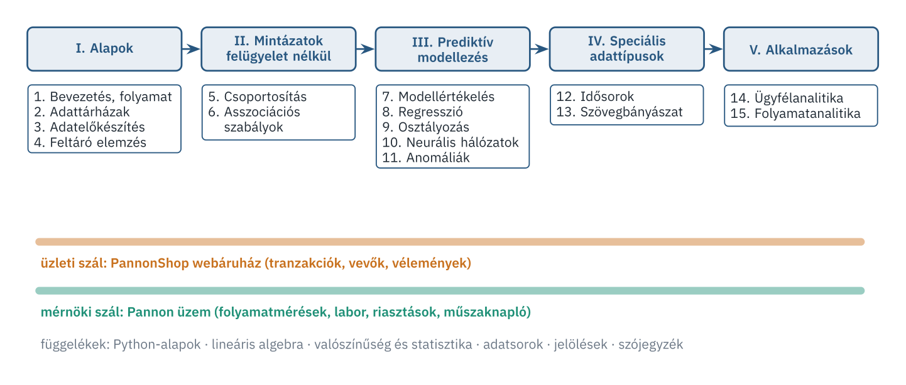

<a href="https://uni-pannon.hu"><picture>
  <source media="(prefers-color-scheme: dark)" srcset="assets/logo/pe-cimer-nevjel-fekvo-feher.svg">
  
</picture></a>

# Adatbányászat – a hatékonyság eszköze

**Elmélet és gyakorlat Pythonban** · 2., teljesen átdolgozott kiadás<br>
Abonyi János · Pannon Egyetem, Veszprém, 2026

Nyílt hozzáférésű egyetemi tankönyv az adatbányászat és a gépi tanulás módszereiről. A
könyv minden módszert a matematikai háttérrel, futtatható Python-kóddal és két, fejezetről
fejezetre továbbvitt esettanulmányon mutat be; az elméletet böngészőben futó gyakorló
alkalmazások és Google Colab-jegyzetfüzetek egészítik ki.

| Olvasás és gyakorlás | |
|---|---|
| Webkönyv (kereshető, interaktív) | <https://complexsystemsintelligence.github.io/adatbanyaszat/> |
| PDF (nyomtatható, B5) | [adatbanyaszat.pdf](https://complexsystemsintelligence.github.io/adatbanyaszat/adatbanyaszat.pdf) |
| EPUB (e-könyv-olvasóra) | [adatbanyaszat.epub](https://complexsystemsintelligence.github.io/adatbanyaszat/adatbanyaszat.epub) |
| Gyakorló alkalmazások (14) | [apps/](apps/README.md) – böngészőben, telepítés nélkül |
| Colab-jegyzetfüzetek (15) | [notebooks/](notebooks/README.md) – fejezetenként egy, egy kattintással futtatható |

## Kinek szól a könyv?

Elsősorban mérnök-, informatikus- és gazdálkodási BSc-hallgatóknak, valamint azoknak a
gyakorló szakembereknek, akik adatokból szeretnének megalapozott döntéseket hozni. Az
előismereteket a függelékek pótolják: az A. függelék a szükséges Python-alapokat, a B. a
lineáris algebrát (vektorok, mátrixok, sajátérték- és szingulárisérték-felbontás), a C. a
valószínűségszámítás és a statisztika elemeit foglalja össze.

## Két végigvitt eset

A fejezetek ugyanazon a két adatsoron dolgoznak, így a módszerek eredményei egymásra
épülnek és összevethetők.

- **PannonShop** (üzleti szál): egy webáruház ügyfelei, rendelései, termékei és szöveges
  értékelései – adattárház, kosárelemzés, lemorzsolódás-előrejelzés, csalásszűrés,
  ügyfélérték és ajánlórendszer.
- **Pannon üzem** (mérnöki szál): egy folyamatos keverős tartályreaktor (CSTR) mérései,
  hibái, riasztásai, laboreredményei és műszaknaplója – folyamatfelügyelet, hibadiagnosztika,
  lágy szenzor és prediktív karbantartás.

Mindkét adatsort a könyv Python-csomagja (`src/adatbanyaszat`) állítja elő rögzített
véletlenmaggal. Az adatokba beépített, ismert mintázatok (szegmensek, szabályok, hibák,
csalások) miatt minden módszer eredménye a „valódi” válasszal összevethető, és minden szám
reprodukálható.

## A könyv felépítése



| Fejezet | Gyakorló alkalmazás | Jegyzetfüzet |
|---|---|---|
| **I. Alapok** | | |
| 1. [Adatból tudás: az adatbányászat folyamata](https://complexsystemsintelligence.github.io/adatbanyaszat/chapters/01-bevezetes.html) | | [Colab](https://colab.research.google.com/github/ComplexSystemsIntelligence/adatbanyaszat/blob/main/notebooks/01-bevezetes.ipynb) |
| 2. [Adattárházak és analitikus adatkezelés](https://complexsystemsintelligence.github.io/adatbanyaszat/chapters/02-adattarhazak.html) | [OLAP-kocka](https://complexsystemsintelligence.github.io/adatbanyaszat/apps/olap-kocka.html) | [Colab](https://colab.research.google.com/github/ComplexSystemsIntelligence/adatbanyaszat/blob/main/notebooks/02-adattarhazak.ipynb) |
| 3. [Adatok előkészítése](https://complexsystemsintelligence.github.io/adatbanyaszat/chapters/03-adatelokeszites.html) | [Adattisztítás](https://complexsystemsintelligence.github.io/adatbanyaszat/apps/adattisztitas.html) | [Colab](https://colab.research.google.com/github/ComplexSystemsIntelligence/adatbanyaszat/blob/main/notebooks/03-adatelokeszites.ipynb) |
| 4. [Feltáró adatelemzés és dimenziócsökkentés](https://complexsystemsintelligence.github.io/adatbanyaszat/chapters/04-feltaro-elemzes.html) | [Főkomponens-elemzés](https://complexsystemsintelligence.github.io/adatbanyaszat/apps/pca-forgatas.html) | [Colab](https://colab.research.google.com/github/ComplexSystemsIntelligence/adatbanyaszat/blob/main/notebooks/04-feltaro-elemzes.ipynb) |
| **II. Mintázatok felügyelet nélkül** | | |
| 5. [Csoportosítás](https://complexsystemsintelligence.github.io/adatbanyaszat/chapters/05-csoportositas.html) | [k-átlag](https://complexsystemsintelligence.github.io/adatbanyaszat/apps/kmeans.html) | [Colab](https://colab.research.google.com/github/ComplexSystemsIntelligence/adatbanyaszat/blob/main/notebooks/05-csoportositas.ipynb) |
| 6. [Gyakori mintázatok és asszociációs szabályok](https://complexsystemsintelligence.github.io/adatbanyaszat/chapters/06-asszociacios-szabalyok.html) | [Apriori](https://complexsystemsintelligence.github.io/adatbanyaszat/apps/apriori.html) | [Colab](https://colab.research.google.com/github/ComplexSystemsIntelligence/adatbanyaszat/blob/main/notebooks/06-asszociacios-szabalyok.ipynb) |
| **III. Prediktív modellezés** | | |
| 7. [A felügyelt tanulás alapjai és a modellek értékelése](https://complexsystemsintelligence.github.io/adatbanyaszat/chapters/07-modellertekeles.html) | [ROC- és PR-görbe](https://complexsystemsintelligence.github.io/adatbanyaszat/apps/roc-kuszob.html) | [Colab](https://colab.research.google.com/github/ComplexSystemsIntelligence/adatbanyaszat/blob/main/notebooks/07-modellertekeles.ipynb) |
| 8. [Regresszió](https://complexsystemsintelligence.github.io/adatbanyaszat/chapters/08-regresszio.html) | [Regularizáció](https://complexsystemsintelligence.github.io/adatbanyaszat/apps/regresszio.html) | [Colab](https://colab.research.google.com/github/ComplexSystemsIntelligence/adatbanyaszat/blob/main/notebooks/08-regresszio.ipynb) |
| 9. [Osztályozás](https://complexsystemsintelligence.github.io/adatbanyaszat/chapters/09-osztalyozas.html) | [Döntési fa](https://complexsystemsintelligence.github.io/adatbanyaszat/apps/dontesi-fa.html) | [Colab](https://colab.research.google.com/github/ComplexSystemsIntelligence/adatbanyaszat/blob/main/notebooks/09-osztalyozas.ipynb) |
| 10. [Neurális hálózatok és mélytanulás](https://complexsystemsintelligence.github.io/adatbanyaszat/chapters/10-melytanulas.html) | [Neurális háló](https://complexsystemsintelligence.github.io/adatbanyaszat/apps/neuralis-halo.html) | [Colab](https://colab.research.google.com/github/ComplexSystemsIntelligence/adatbanyaszat/blob/main/notebooks/10-melytanulas.ipynb) |
| 11. [Anomáliák és eltérések észlelése](https://complexsystemsintelligence.github.io/adatbanyaszat/chapters/11-anomaliak.html) | [Anomália-észlelők](https://complexsystemsintelligence.github.io/adatbanyaszat/apps/anomalia.html) | [Colab](https://colab.research.google.com/github/ComplexSystemsIntelligence/adatbanyaszat/blob/main/notebooks/11-anomaliak.ipynb) |
| **IV. Speciális adattípusok** | | |
| 12. [Idősorok elemzése](https://complexsystemsintelligence.github.io/adatbanyaszat/chapters/12-idosorok.html) | [DTW](https://complexsystemsintelligence.github.io/adatbanyaszat/apps/dtw.html) | [Colab](https://colab.research.google.com/github/ComplexSystemsIntelligence/adatbanyaszat/blob/main/notebooks/12-idosorok.ipynb) |
| 13. [Szövegbányászat](https://complexsystemsintelligence.github.io/adatbanyaszat/chapters/13-szovegbanyaszat.html) | [TF-IDF](https://complexsystemsintelligence.github.io/adatbanyaszat/apps/tfidf.html) | [Colab](https://colab.research.google.com/github/ComplexSystemsIntelligence/adatbanyaszat/blob/main/notebooks/13-szovegbanyaszat.ipynb) |
| **V. Alkalmazások** | | |
| 14. [Ügyfélkapcsolat-menedzsment és ügyfélanalitika](https://complexsystemsintelligence.github.io/adatbanyaszat/chapters/14-ugyfelanalitika.html) | [Ügyfélérték](https://complexsystemsintelligence.github.io/adatbanyaszat/apps/clv.html) | [Colab](https://colab.research.google.com/github/ComplexSystemsIntelligence/adatbanyaszat/blob/main/notebooks/14-ugyfelanalitika.ipynb) |
| 15. [Ipari folyamatanalitika](https://complexsystemsintelligence.github.io/adatbanyaszat/chapters/15-folyamatanalitika.html) | [Lágy szenzor](https://complexsystemsintelligence.github.io/adatbanyaszat/apps/lagy-szenzor.html) | [Colab](https://colab.research.google.com/github/ComplexSystemsIntelligence/adatbanyaszat/blob/main/notebooks/15-folyamatanalitika.ipynb) |

**Függelékek:**
[A. Python-alapok](https://complexsystemsintelligence.github.io/adatbanyaszat/appendices/a-python.html) ·
[B. Lineáris algebra](https://complexsystemsintelligence.github.io/adatbanyaszat/appendices/b-linearis-algebra.html) ·
[C. Valószínűségszámítás és statisztika](https://complexsystemsintelligence.github.io/adatbanyaszat/appendices/c-valoszinuseg.html) ·
[D. Az adatsorok leírása](https://complexsystemsintelligence.github.io/adatbanyaszat/appendices/d-adatsorok.html) ·
[E. Jelölések](https://complexsystemsintelligence.github.io/adatbanyaszat/appendices/e-jelolesek.html) ·
[F. Magyar–angol szójegyzék](https://complexsystemsintelligence.github.io/adatbanyaszat/appendices/f-szojegyzek.html)

## A példák futtatása

**Colabban** (telepítés nélkül): a fenti táblázat „Colab” hivatkozása megnyitja a fejezet
jegyzetfüzetét; az első cella telepíti a könyv segédcsomagját, utána a cellák sorban
futtathatók. A 10. fejezet PyTorch-példái is itt futnak, mert a Colab tartalmazza a PyTorch-ot.

**Saját gépen** (Python ≥ 3.10):

```bash
git clone https://github.com/ComplexSystemsIntelligence/adatbanyaszat.git
cd adatbanyaszat
python -m venv .venv && source .venv/bin/activate   # Windows: .venv\Scripts\activate
pip install -r requirements.txt                     # a könyv csomagja és függőségei
```

Ezután a `notebooks/` jegyzetfüzetei Jupyterben futtathatók, a futó esetek adatai pedig
egy sorral betölthetők:

```python
from adatbanyaszat import load_shop, load_plant
shop = load_shop()     # PannonShop: ügyfelek, termékek, rendelések, értékelések
plant = load_plant()   # Pannon üzem: mérések, hibák, riasztások, laboreredmények
```

A futó esetek CSV-exportja a [`data/`](data/) mappában is megtalálható, a táblák és
oszlopok leírásával együtt a [D. függelékben](https://complexsystemsintelligence.github.io/adatbanyaszat/appendices/d-adatsorok.html).

## A tároló szerkezete

```
_quarto.yml               a könyv konfigurációja (Quarto book: HTML, PDF, EPUB)
index.qmd                 előszó
chapters/                 a 15 fejezet forrása (Quarto Markdown + Python)
appendices/               az A–F függelék forrása
references.bib            irodalomjegyzék (BibTeX)
figures/tikz/             a TikZ-ábrák forrása; figures/data/: az adatvezérelt ábrák adatai
figures/build/            a lefordított ábrák (PDF a nyomtatott, SVG a webes változathoz)
apps/                     böngészőben futó gyakorló alkalmazások (HTML + JavaScript)
notebooks/                Colab-jegyzetfüzetek (a fejezetekből generálva)
src/adatbanyaszat/        a könyv Python-csomagja: adatgenerátorok, betöltők, ábrastílus
data/                     a futó esetek adatai CSV-ben
scripts/                  ábrafordítás, jegyzetfüzet-generálás és -teszt, adatexport
_extensions/pannon/       a tankönyvsorozat arculata (SCSS, LaTeX-fejléc, TikZ-stílus, Lua-szűrők)
_freeze/                  a fejezetek lefuttatott kódjának eredményei (gyorsítótár)
kiadas/                   a kiadások PDF- és EPUB-változata (a Zenodo-archívum része)
.github/workflows/        a könyv automatikus fordítása és a jegyzetfüzetek tesztje
```

## A könyv fordítása

Követelmények: Python ≥ 3.10, [Quarto](https://quarto.org) ≥ 1.6, XeLaTeX (TeX Live) és
`pdftocairo` (poppler-utils). A betűkészletek (IBM Plex, Raleway) a tárolóban vannak.

```bash
python scripts/build_figures.py          # TikZ-ábrák (csak a megváltozottakat fordítja)
python scripts/make_notebooks.py         # Colab-jegyzetfüzetek a fejezetekből
quarto render                            # HTML + PDF + EPUB a _book/ mappába
quarto preview                           # helyi előnézet szerkesztés közben
python scripts/test_notebooks.py         # a jegyzetfüzetek végrehajthatóságának tesztje
```

A fejezetek kódja a fordításkor lefut; az eredményeket a `_freeze/` mappa tárolja, így a
kód csak a megváltozott fejezetekben fut újra.

## Közzététel és archiválás

- A `main` ágra feltöltött minden változás után a [`publish.yml`](.github/workflows/publish.yml)
  munkafolyamat lefordítja a könyvet (HTML, PDF, EPUB), és a `gh-pages` ágon közzéteszi a
  GitHub Pages-en.
- A [`notebooks.yml`](.github/workflows/notebooks.yml) hetente és minden pull requestnél
  lefuttatja a jegyzetfüzeteket.
- A kiadásokat (GitHub Release) a Zenodo–GitHub integráció archiválja és DOI-val látja el;
  a metaadatokat a [`.zenodo.json`](.zenodo.json) adja (a [`CITATION.cff`](CITATION.cff) a
  GitHub „Cite this repository” hivatkozásához tartozik).

**Új kiadás menete**

1. A változatszám és a dátum frissítése a `CITATION.cff`-ben, a `.zenodo.json`-ban és a
   `_extensions/pannon/pannon-header.tex` `\peverzio` sorában, majd feltöltés a `main` ágra.
2. Ha a fordítás sikeres, a `scripts/kiadas.sh` a közzétett PDF-et és EPUB-ot a
   [`kiadas/`](kiadas/) mappába másolja; ezek feltöltése után a kiadás forráscsomagja az
   olvasható könyvet is tartalmazza.
3. GitHub → Releases → új címke (`vX.Y.Z`) → Publish. A Zenodo archiválja a forráscsomagot és
   DOI-t ad, a munkafolyamat pedig a PDF-et és az EPUB-ot a kiadáshoz is csatolja.

## Licenc

Copyright © 2026 Abonyi János.

- A könyv szövege, ábrái és táblázatai a [Creative Commons Nevezd meg! – Ne add el! 4.0
  Nemzetközi (CC BY-NC 4.0)](https://creativecommons.org/licenses/by-nc/4.0/deed.hu) licenc
  alatt állnak ([teljes szöveg](LICENSE)): nem kereskedelmi célra – oktatásban, tanulásra,
  kutatásban – szabadon másolhatók, terjeszthetők és átdolgozhatók a szerző és a licenc
  feltüntetésével, valamint a változtatások jelzésével. Kereskedelmi célú felhasználáshoz a
  szerző előzetes engedélye szükséges.
- A programkód (a `src/`, `scripts/`, `apps/` és `notebooks/` tartalma, valamint a fejezetek
  kódrészletei) az [MIT licenc](LICENSE-CODE) alatt áll.
- A Pannon Egyetem neve, címere és logója a Pannon Egyetem arculati elemei; ezekre a fenti
  licencek nem terjednek ki.

## Hivatkozás

Abonyi János (2026): *Adatbányászat – a hatékonyság eszköze. Elmélet és gyakorlat
Pythonban.* 2., teljesen átdolgozott kiadás. Pannon Egyetem, Veszprém.
<https://complexsystemsintelligence.github.io/adatbanyaszat/>

```bibtex
@book{abonyi2026adatbanyaszat,
  author    = {Abonyi, János},
  title     = {Adatbányászat -- a hatékonyság eszköze. Elmélet és gyakorlat Pythonban},
  edition   = {2., teljesen átdolgozott},
  publisher = {Pannon Egyetem},
  address   = {Veszprém},
  year      = {2026},
  url       = {https://complexsystemsintelligence.github.io/adatbanyaszat/}
}
```

Hibát, pontatlanságot vagy javaslatot a tároló [Issues](https://github.com/ComplexSystemsIntelligence/adatbanyaszat/issues)
oldalán lehet jelezni.

## Köszönetnyilvánítás

A második kiadás kutatási hátterét a Nemzeti Kutatási, Fejlesztési és Innovációs Hivatal
OTKA 143482 számú projektje támogatta.
