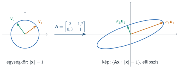

# Lineáris algebra az adatbányászathoz {#sec-app-linalg}

```{python}
#| include: false
import numpy as np
np.set_printoptions(precision=3, suppress=True)
```

::: {.roadmap}
Az adatbányászat módszereinek nagy része lineáris algebrai műveletekre épül: az
adathalmaz egy mátrix, a regresszió egy vetítés, a főkomponens-elemzés egy
sajátérték-feladat, a neurális hálózat mátrixszorzások és nemlineáris függvények
sorozata. Ez a függelék a könyvben használt fogalmakat foglalja össze az alapoktól a
szinguláris érték szerinti felbontásig és a mátrixos deriválásig, minden fogalomnál
megmutatva, hol használjuk és hogyan számolható NumPy-jal. Részletesebb tárgyalás
@strang2016, @strang2019 és – kifejezetten a gépi tanulás szemszögéből – @deisenroth2020
könyvében található.
:::

## Vektorok {#sec-app-vektorok}

Egy $n$-dimenziós **vektor** $n$ valós szám rendezett listája, amelyet oszlopvektorként
írunk: $\mathbf{x} = (x_1, \dots, x_n)^\top \in\mathbb{R}^n$. Az adatbányászatban egy
objektum (vevő, mérési időpont) jellemzőinek vektora a **jellemzőtér** egy pontja. A
vektorok összeadása és számmal való szorzása elemenként történik; geometriailag az
összeadás a paralelogramma-szabály, a skalárral szorzás nyújtás vagy zsugorítás.

A két vektor **skaláris szorzata**

$$
\mathbf{x}^\top\mathbf{y} = \sum_{i=1}^{n}x_iy_i = \lVert\mathbf{x}\rVert\,\lVert\mathbf{y}\rVert\cos\theta ,
$$ {#eq-app-skalaris}

ahol $\theta$ a két vektor által bezárt szög. Ha a skaláris szorzat nulla, a vektorok
**merőlegesek** (ortogonálisak). A ([-@eq-app-skalaris]) összefüggés adja a
koszinusz-hasonlóságot ([-@sec-szoveg]. fejezet), és a skaláris szorzat a lineáris modellek
($\mathbf{w}^\top\mathbf{x} + b$) alapművelete.

A vektor hosszát a **norma** méri. A leggyakoribbak az $\ell_p$-normák:

$$
\lVert\mathbf{x}\rVert_1 = \sum_i|x_i|,\qquad
\lVert\mathbf{x}\rVert_2 = \sqrt{\sum_ix_i^2} = \sqrt{\mathbf{x}^\top\mathbf{x}},\qquad
\lVert\mathbf{x}\rVert_\infty = \max_i|x_i| .
$$ {#eq-app-normak}

Két pont távolsága a különbségvektor normája: az $\ell_2$ az euklideszi, az $\ell_1$ a
Manhattan-, az $\ell_\infty$ a Csebisev-távolság ([-@sec-csoportositas]. fejezet). A
regularizációban az $\ell_2$-norma négyzete a ridge-, az $\ell_1$-norma a lasszó-büntetés
([-@sec-regresszio]. fejezet).

```{python}
x, y = np.array([3.0, 4.0]), np.array([4.0, 3.0])
print(x @ y, np.linalg.norm(x), np.linalg.norm(x, 1), np.linalg.norm(x, np.inf))
print("koszinusz:", x @ y / (np.linalg.norm(x) * np.linalg.norm(y)))
```

Az $\mathbf{x}$ vektor $\mathbf{u}$ irányú (egységvektorra) **vetülete**
$(\mathbf{u}^\top\mathbf{x})\,\mathbf{u}$: ez az $\mathbf{u}$ egyenesének az $\mathbf{x}$-hez
legközelebbi pontja, és a maradék, $\mathbf{x} - (\mathbf{u}^\top\mathbf{x})\mathbf{u}$,
merőleges $\mathbf{u}$-ra. A főkomponens-elemzés ilyen vetítésekkel dolgozik.

## Mátrixok és műveleteik {#sec-app-matrixok}

Egy $m\times n$-es **mátrix** $m$ sorba és $n$ oszlopba rendezett szám. Az adatmátrix
$\mathbf{X}\in\mathbb{R}^{N\times n}$ sorai az objektumok, oszlopai a jellemzők. A
**transzponált** $\mathbf{X}^\top$ a sorokat és oszlopokat felcseréli.

A **mátrix–vektor szorzat** kétféleképpen értelmezhető: $\mathbf{A}\mathbf{x}$ $i$-edik eleme
az $\mathbf{A}$ $i$-edik sorának és $\mathbf{x}$-nek a skaláris szorzata, ugyanakkor
$\mathbf{A}\mathbf{x}$ az $\mathbf{A}$ oszlopainak $\mathbf{x}$ elemeivel súlyozott lineáris
kombinációja is:

$$
\mathbf{A}\mathbf{x} = x_1\mathbf{a}_1 + x_2\mathbf{a}_2 + \dots + x_n\mathbf{a}_n .
$$ {#eq-app-linkomb}

A második értelmezés a kulcs a regresszióhoz: a $\mathbf{X}\mathbf{w}$ előrejelzés mindig az
$\mathbf{X}$ oszlopai által kifeszített altérben van. A **mátrixszorzat**
$\mathbf{C} = \mathbf{A}\mathbf{B}$ elemei $c_{ij} = \sum_k a_{ik}b_{kj}$; a szorzás
asszociatív, de általában nem kommutatív ($\mathbf{A}\mathbf{B}\neq\mathbf{B}\mathbf{A}$), és
$(\mathbf{A}\mathbf{B})^\top = \mathbf{B}^\top\mathbf{A}^\top$. Egy mátrix lineáris
leképezésként is felfogható: a $\mathbf{x}\mapsto\mathbf{A}\mathbf{x}$ leképezés a teret
forgatja, nyújtja, vetíti; két leképezés egymás utáni alkalmazása a mátrixok szorzata. A
neurális hálózatok rétegei ilyen leképezések nemlineáris függvényekkel váltakozva
([-@sec-neuralis]. fejezet).

A **kovarianciamátrix** a centrált adatmátrixból számolható:
$\mathbf{S} = \frac{1}{N-1}\tilde{\mathbf{X}}^\top\tilde{\mathbf{X}}$, ahol
$\tilde{\mathbf{X}}$ oszlopai nulla átlagúak. Szimmetrikus, és átlójában a
varianciák állnak.

```{python}
rng = np.random.default_rng(0)
X = rng.normal(size=(200, 3)) @ np.array([[1.0, 0.8, 0.0], [0.0, 0.6, 0.0], [0.0, 0.0, 0.5]])
Xc = X - X.mean(axis=0)
S = Xc.T @ Xc / (len(X) - 1)
print(S); print(np.allclose(S, np.cov(X, rowvar=False)))
```

## Lineáris függetlenség, rang, inverz {#sec-app-rang}

A $\mathbf{v}_1, \dots, \mathbf{v}_k$ vektorok **lineárisan függetlenek**, ha egyikük sem
állítható elő a többiek lineáris kombinációjaként. Egy mátrix **rangja** a lineárisan
független oszlopainak (egyben sorainak) maximális száma. Ha egy adatmátrix oszlopai
lineárisan összefüggők – például egy jellemző két másik összege, vagy a kategóriaarányok
összege 1 –, a mátrix nem teljes rangú, és ez a regresszióban multikollinearitáshoz vezet
([-@sec-regresszio]. fejezet).

Egy $n\times n$-es négyzetes mátrix **invertálható**, ha van olyan $\mathbf{A}^{-1}$, amelyre
$\mathbf{A}\mathbf{A}^{-1} = \mathbf{A}^{-1}\mathbf{A} = \mathbf{I}$; ez pontosan akkor teljesül,
ha a mátrix teljes rangú, vagyis a **determinánsa** nem nulla. A determináns abszolút
értéke azt mutatja meg, hányszorosára változtatja a leképezés a térfogatot; a nulla
determináns azt jelenti, hogy a leképezés egy alacsonyabb dimenziós altérbe „lapítja” a
teret, és így nem fordítható vissza. Numerikusan az inverz kiszámítását kerüljük: a
$\mathbf{A}\mathbf{x} = \mathbf{b}$ egyenletrendszert közvetlenül oldjuk meg
(`np.linalg.solve`), mert ez gyorsabb és pontosabb. A közel szinguláris mátrixok
érzékenységét a **kondíciószám** (a legnagyobb és a legkisebb szinguláris érték hányadosa)
méri.

## Legkisebb négyzetek és vetítés {#sec-app-legkisebb-negyzetek}

Ha az $\mathbf{X}\mathbf{w} = \mathbf{y}$ egyenletrendszernek nincs pontos megoldása (több
egyenlet, mint ismeretlen), a **legkisebb négyzetes** megoldást keressük, amely a
$\lVert\mathbf{y} - \mathbf{X}\mathbf{w}\rVert_2^2$ eltérést minimalizálja. Geometriailag ez
$\mathbf{y}$ merőleges vetítése az $\mathbf{X}$ oszlopai által kifeszített altérre: a maradék
merőleges minden oszlopra, $\mathbf{X}^\top(\mathbf{y} - \mathbf{X}\hat{\mathbf{w}}) = \mathbf{0}$,
amiből a **normálegyenletek**:

$$
\mathbf{X}^\top\mathbf{X}\,\hat{\mathbf{w}} = \mathbf{X}^\top\mathbf{y},\qquad
\hat{\mathbf{w}} = (\mathbf{X}^\top\mathbf{X})^{-1}\mathbf{X}^\top\mathbf{y},\qquad
\hat{\mathbf{y}} = \underbrace{\mathbf{X}(\mathbf{X}^\top\mathbf{X})^{-1}\mathbf{X}^\top}_{\mathbf{H}}\mathbf{y} .
$$ {#eq-app-normalegyenlet}

A $\mathbf{H}$ **vetítőmátrix** szimmetrikus és idempotens ($\mathbf{H}^2 = \mathbf{H}$). A
gyakorlatban a megoldást QR- vagy SVD-felbontással számoljuk (`np.linalg.lstsq`), mert a
$\mathbf{X}^\top\mathbf{X}$ kondíciószáma az $\mathbf{X}$-énak a négyzete.

```{python}
Xd = np.column_stack([np.ones(6), [1, 2, 3, 4, 5, 6]])
yd = np.array([2.1, 3.9, 6.2, 7.8, 10.1, 12.2])
w_normal = np.linalg.solve(Xd.T @ Xd, Xd.T @ yd)
w_lstsq, *_ = np.linalg.lstsq(Xd, yd, rcond=None)
H = Xd @ np.linalg.solve(Xd.T @ Xd, Xd.T)
print(w_normal, w_lstsq, np.allclose(H @ H, H), np.round(Xd.T @ (yd - H @ yd), 10))
```

## Sajátértékek és sajátvektorok {#sec-app-sajatertek}

Egy négyzetes $\mathbf{A}$ mátrix **sajátvektora** olyan nem nulla $\mathbf{v}$ vektor,
amelynek irányát a leképezés nem változtatja meg, csak a hosszát:

$$
\mathbf{A}\mathbf{v} = \lambda\mathbf{v} ,
$$ {#eq-app-sajatertek}

ahol $\lambda$ a hozzá tartozó **sajátérték**. A sajátértékek a
$\det(\mathbf{A} - \lambda\mathbf{I}) = 0$ karakterisztikus egyenlet gyökei.

A **szimmetrikus** mátrixok – mint a kovarianciamátrix – különösen fontosak. A
**spektráltétel** szerint sajátértékeik valósak, sajátvektoraik páronként merőlegesek, és
a mátrix felbontható

$$
\mathbf{A} = \mathbf{V}\boldsymbol\Lambda\mathbf{V}^\top = \sum_{i=1}^{n}\lambda_i\mathbf{v}_i\mathbf{v}_i^\top
$$ {#eq-app-spektral}

alakban, ahol $\mathbf{V}$ oszlopai az ortonormált sajátvektorok, $\boldsymbol\Lambda$ a
sajátértékek diagonális mátrixa. A kovarianciamátrix sajátvektorai a **főkomponensek**,
sajátértékei a főkomponensek mentén mért varianciák ([-@sec-feltaro]. fejezet). Egy
szimmetrikus mátrix **pozitív szemidefinit**, ha minden $\mathbf{x}$-re
$\mathbf{x}^\top\mathbf{A}\mathbf{x}\ge 0$ – ez pontosan akkor teljesül, ha minden sajátértéke
nemnegatív; minden kovarianciamátrix ilyen. Ha minden sajátérték pozitív, a mátrix
**pozitív definit** és invertálható.

Az $\mathbf{x}^\top\mathbf{A}\mathbf{x}$ **kvadratikus forma** szintvonalai pozitív definit
$\mathbf{A}$ esetén ellipszisek (ellipszoidok), amelyek tengelyei a sajátvektorok irányába
mutatnak, és hossza $1/\sqrt{\lambda_i}$-vel arányos. A Mahalanobis-távolság
([-@sec-anomalia]. fejezet) a $\boldsymbol\Sigma^{-1}$ mátrixú kvadratikus forma: a
$\boldsymbol\Sigma$ sajátvektorai mentén az ottani szórással skálázott távolság.

```{python}
lam, V = np.linalg.eigh(S)                     # szimmetrikus mátrixra: eigh (növekvő sorrend)
print("sajátértékek:", lam)
print("rekonstrukció:", np.allclose(V @ np.diag(lam) @ V.T, S), "| ortonormált:", np.allclose(V.T @ V, np.eye(3)))
```

## Szinguláris érték szerinti felbontás {#sec-app-svd}

Bármely $m\times n$-es mátrix – nem csak a négyzetes és szimmetrikus – felbontható

$$
\mathbf{A} = \mathbf{U}\boldsymbol\Sigma\mathbf{V}^\top = \sum_{i=1}^{r}\sigma_i\mathbf{u}_i\mathbf{v}_i^\top
$$ {#eq-app-svd}

alakban (**szinguláris érték szerinti felbontás**, SVD), ahol $\mathbf{U}$ ($m\times m$) és
$\mathbf{V}$ ($n\times n$) ortogonális mátrixok, $\boldsymbol\Sigma$ pedig diagonális, a
nemnegatív, csökkenő sorrendű $\sigma_1\ge\sigma_2\ge\dots\ge 0$ **szinguláris értékekkel**;
$r$ a mátrix rangja. Geometriailag minden lineáris leképezés egy forgatás ($\mathbf{V}^\top$),
egy tengelyek menti nyújtás ($\boldsymbol\Sigma$) és egy újabb forgatás ($\mathbf{U}$)
egymásutánja: az egységkört ellipszisbe viszi, amelynek féltengelyei a szinguláris értékek
([-@fig-app-svd]. ábra). A szinguláris értékek négyzetei az $\mathbf{A}^\top\mathbf{A}$
sajátértékei, $\mathbf{V}$ oszlopai pedig a sajátvektorai.

{#fig-app-svd width=85%}

Az SVD legfontosabb tulajdonsága az **optimális alacsony rangú közelítés**: az
Eckart–Young-tétel [@eckart1936] szerint az első $k$ tag összege,
$\mathbf{A}_k = \sum_{i=1}^{k}\sigma_i\mathbf{u}_i\mathbf{v}_i^\top$, a legjobb $k$ rangú
közelítés Frobenius- és spektrálnormában is, és a közelítés hibája
$\lVert\mathbf{A} - \mathbf{A}_k\rVert_F^2 = \sum_{i>k}\sigma_i^2$. Erre épül a
főkomponens-elemzés (a centrált adatmátrix SVD-je: a jobb oldali szinguláris vektorok a
főkomponensek, $\sigma_i^2/(N-1)$ a varianciájuk), a látens szemantikus elemzés
([-@sec-szoveg]. fejezet), a mátrixfaktorizációs ajánlórendszerek ([-@sec-ugyfel]. fejezet)
és a numerikusan stabil legkisebb négyzetes megoldás. A **pszeudoinverz**
$\mathbf{A}^{+} = \mathbf{V}\boldsymbol\Sigma^{+}\mathbf{U}^\top$ (ahol $\boldsymbol\Sigma^{+}$ a
nem nulla szinguláris értékek reciprokait tartalmazza) nem teljes rangú mátrixokra is
megadja a legkisebb normájú legkisebb négyzetes megoldást.

```{python}
U, s, Vt = np.linalg.svd(Xc, full_matrices=False)
print("szinguláris értékek:", s)
print("σ²/(N−1) = kovariancia-sajátértékek:", s ** 2 / (len(Xc) - 1))
X1 = s[0] * np.outer(U[:, 0], Vt[0])             # a legjobb 1 rangú közelítés
print("relatív hiba (1 rang):", np.linalg.norm(Xc - X1) / np.linalg.norm(Xc),
      "| elméleti:", np.sqrt((s[1:] ** 2).sum() / (s ** 2).sum()))
```

## Mátrixos deriválás {#sec-app-derivalas}

A gépi tanulás modelljeinek paramétereit egy célfüggvény minimalizálásával határozzuk meg,
amihez a célfüggvény paraméterek szerinti **gradiensére** van szükség: egy
$f:\mathbb{R}^n\to\mathbb{R}$ függvény gradiense a parciális deriváltak vektora,
$\nabla f(\mathbf{x}) = (\partial f/\partial x_1, \dots, \partial f/\partial x_n)^\top$, amely
a függvény leggyorsabb növekedésének irányába mutat. A könyvben használt azonosságok
($\mathbf{a}$, $\mathbf{A}$ állandók):

$$
\nabla_{\mathbf{x}}(\mathbf{a}^\top\mathbf{x}) = \mathbf{a},\qquad
\nabla_{\mathbf{x}}(\mathbf{x}^\top\mathbf{A}\mathbf{x}) = (\mathbf{A} + \mathbf{A}^\top)\mathbf{x},\qquad
\nabla_{\mathbf{w}}\lVert\mathbf{y} - \mathbf{X}\mathbf{w}\rVert_2^2 = -2\mathbf{X}^\top(\mathbf{y} - \mathbf{X}\mathbf{w}) .
$$ {#eq-app-gradiensek}

Az utolsó kifejezést nullával egyenlővé téve kapjuk a ([-@eq-app-normalegyenlet])
normálegyenleteket. Vektorértékű függvények deriváltja a **Jacobi-mátrix**
($J_{ij} = \partial f_i/\partial x_j$); a **láncszabály** összetett függvényekre a
Jacobi-mátrixok szorzata, $\partial(\mathbf{f}\circ\mathbf{g})/\partial\mathbf{x} =
\mathbf{J}_{\mathbf{f}}\,\mathbf{J}_{\mathbf{g}}$. A neurális hálózatok hibavisszaterjesztése
([-@sec-neuralis]. fejezet) ennek a szabálynak a hatékony, a kimenettől a bemenet felé
haladó alkalmazása. A másodrendű deriváltak mátrixa, a **Hesse-mátrix**, a konvexitást
jellemzi: ha minden pontban pozitív szemidefinit, a függvény konvex, és minden lokális
minimuma globális (ilyen a lineáris és a logisztikus regresszió célfüggvénye).

Egy analitikusan levezetett gradiens helyessége **numerikusan ellenőrizhető**:

```{python}
def f(w):
    return np.sum((yd - Xd @ w) ** 2)
w0, h = np.array([0.5, 1.5]), 1e-6
analitikus = -2 * Xd.T @ (yd - Xd @ w0)
numerikus = np.array([(f(w0 + h * e) - f(w0 - h * e)) / (2 * h) for e in np.eye(2)])
print(analitikus, numerikus)
```

## Összefoglaló táblázat {#sec-app-linalg-tabla}

| Fogalom | NumPy | Hol használjuk |
|---|---|---|
| skaláris szorzat, norma | `x @ y`, `np.linalg.norm` | távolságok, koszinusz-hasonlóság, regularizáció |
| mátrixszorzat | `A @ B` | lineáris modellek, neurális hálók |
| egyenletrendszer, legkisebb négyzetek | `np.linalg.solve`, `np.linalg.lstsq` | lineáris regresszió |
| szimmetrikus sajátérték-felbontás | `np.linalg.eigh` | főkomponens-elemzés, Mahalanobis-távolság |
| szinguláris érték szerinti felbontás | `np.linalg.svd` | PCA, LSA, ajánlórendszerek, pszeudoinverz |
| determináns, rang, kondíciószám | `np.linalg.det`, `matrix_rank`, `cond` | multikollinearitás, numerikus stabilitás |

: A könyvben használt lineáris algebrai eszközök. {#tbl-app-linalg}
