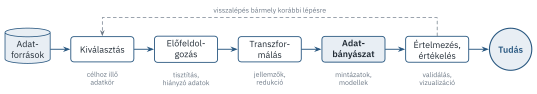
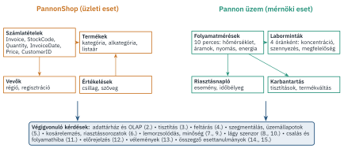

# Adatból tudás: az adatbányászat folyamata {#sec-bevezetes}

```{python}
#| include: false
import numpy as np
import pandas as pd
import matplotlib.pyplot as plt
import adatbanyaszat as ab
ab.set_style()
pd.set_option("display.max_columns", 10)
pd.set_option("display.width", 100)
```

::: {.roadmap}
Ez a fejezet kijelöli a könyv kereteit. Tisztázzuk, mit értünk adatbányászaton, milyen
típusú kérdésekre ad választ, és milyen lépésekből áll egy adatbányászati projekt a
célok megfogalmazásától a bevezetett modell karbantartásáig. Áttekintjük az adatok
felhasználásának jogi és etikai kereteit, végül bemutatjuk a két futó esettanulmányt
– a PannonShop webáruházat és a Pannon üzemet –, amelyekre a további fejezetek
példái épülnek.

**A fejezet végére az olvasó** képes lesz megkülönböztetni a felügyelt és a felügyelet
nélküli tanulási feladatokat; egy gyakorlati problémát adatbányászati feladattípushoz
rendelni; a CRISP-DM és a CRISP-ML(Q) fázisai mentén megtervezni egy elemzési projektet;
és felismerni azokat a helyzeteket, amelyekben az adatkezelés adatvédelmi vagy
MI-szabályozási kérdéseket vet fel.
:::

## Miért van szükség adatbányászatra? {#sec-miert}

A vállalatok, üzemek és intézmények működésük során folyamatosan adatokat
rögzítenek: minden eladásról számla készül, minden szenzor percenként több mérést
küld, minden ügyfélkapcsolat nyomot hagy egy informatikai rendszerben. Az adatok
gyűjtése ma már olcsó és automatikus; a szűk keresztmetszet az, hogy a
felhalmozott adatokból kinyerjük-e a döntésekhez szükséges *tudást*. Egy webáruház
vezetője nem a számlatételek millióira kíváncsi, hanem arra, hogy mely vevői fognak
valószínűleg elpártolni, és kiket érdemes megkeresni egy ajánlattal. Egy üzem
technológusa nem a hőmérséklet-idősorokat akarja nézegetni, hanem időben szeretne
értesülni arról, ha a folyamat a megszokottól eltérően kezd viselkedni.

Az adatbányászat azoknak a módszereknek és eljárásoknak a gyűjtőneve, amelyek
ezt a lépést – az adatoktól a döntést segítő tudásig – rendszerezetten és
ellenőrizhetően teszik meg. A terület a statisztika, a gépi tanulás, az
adatbázis-kezelés és a vizualizáció határán fejlődött ki, és mindegyiktől örökölt
valamit: a statisztikától a bizonytalanság kezelését és a következtetés szigorát, a
gépi tanulástól az automatikus modellépítést, az adatbázis-kezeléstől a nagy
adatmennyiségek hatékony elérését, a vizualizációtól pedig azt a felismerést, hogy
az eredményt végső soron embereknek kell megérteniük és elfogadniuk.

A könyv első kiadása [@abonyi2006] óta a terület eszköztára jelentősen kibővült.
Általánossá váltak az együttes (ensemble) modellek és a mély neurális hálózatok, az
elemzések túlnyomó része nyílt forráskódú Python-könyvtárakkal készül, és a modellek
egyre gyakrabban kerülnek éles üzembe, ahol folyamatos felügyeletet igényelnek. Az
alapkérdések azonban nem változtak: *milyen adatból, milyen módszerrel, milyen
megbízhatósággal* juthatunk használható tudáshoz? Ez a könyv ezekre a kérdésekre
keresi a választ.

## Alapfogalmak {#sec-alapfogalmak}

### Adat, információ, tudás

A hétköznapi szóhasználatban az *adat*, az *információ* és a *tudás* gyakran
összemosódik, az adatbányászatban azonban érdemes különbséget tenni közöttük.

- **Adat** a rögzített tény: „a 240679-es számlán 2 db kávébab szerepel 7990 Ft-os
  egységáron”. Önmagában kevés jelentést hordoz.
- **Információ** az adat feldolgozott, összefüggésbe helyezett formája: „decemberben
  a kávébab forgalma az éves átlag többszöröse”.
- **Tudás** olyan általánosítható összefüggés, amely cselekvést tesz lehetővé: „aki
  kávéfőző gépet vesz, nagy valószínűséggel kávébabot és vízkőoldót is vásárol – ezért
  érdemes a gép mellé ajánlani őket”.

Az adatbányászat ebben a láncban a középső és a felső szint közötti átmenetet
támogatja: az adatokban rejlő, előre nem ismert, de érvényes és hasznos
összefüggéseket tárja fel.

### Mi az adatbányászat?

A tudásfeltárás (Knowledge Discovery in Databases, KDD) folyamatának máig
legtöbbet idézett meghatározását @fayyad1996 adta. Eszerint a tudásfeltárás az a
nem triviális folyamat, amelynek során adatokban **érvényes**, **újszerű**,
**potenciálisan hasznos** és **végső soron érthető** mintázatokat azonosítunk.
A definíció mind a négy jelzője fontos:

- *érvényes*: a mintázat új adatokra is – bizonyos megbízhatósággal – teljesül, nem
  csupán a véletlen műve;
- *újszerű*: nem olyan összefüggés, amelyet a szakértők már ismernek (az, hogy a
  karácsonyi díszek decemberben fogynak, nem felfedezés);
- *hasznos*: valamilyen döntést vagy cselekvést támogat;
- *érthető*: a döntéshozó számára értelmezhető, ellenőrizhető formában jelenik meg.

A szakirodalom az *adatbányászat* kifejezést kétféle értelemben használja. Tágabb
értelemben a teljes tudásfeltárási folyamat szinonimája, szűkebb értelemben e
folyamat egyetlen lépése: a mintázatkereső algoritmusok alkalmazása
(lásd a [-@fig-kdd]. ábrát). E könyv címében a tágabb, a fejezetekben – ahol a különbség számít – a
szűkebb értelmet használjuk.

{#fig-kdd width=100%}

### Tanulás adatokból

Szinte minden adatbányászati módszer *induktív* tanuláson alapul: konkrét példákból
általános összefüggésre következtet. Ennek formalizálásához bevezetjük a könyv
alapjelöléseit (a teljes jelöléslistát az [-@sec-app-jelolesek]. függelék tartalmazza).

Az elemzés tárgyai az **objektumok** (rekordok, megfigyelések, esetek), például
vevők, számlák vagy 10 perces mérési időpontok. Minden objektumot $n$ darab
**jellemző** (attribútum, változó) ír le. Az $N$ objektum adatai az
**adatmátrixot** alkotják:

$$
\mathbf{X} =
\begin{bmatrix}
x_{11} & x_{12} & \cdots & x_{1n}\\
x_{21} & x_{22} & \cdots & x_{2n}\\
\vdots & \vdots & \ddots & \vdots\\
x_{N1} & x_{N2} & \cdots & x_{Nn}
\end{bmatrix}
\in \mathbb{R}^{N\times n},
\qquad
\mathbf{x}_k = [x_{k1},\,x_{k2},\,\dots,\,x_{kn}]^\top .
$$ {#eq-adatmatrix}

Az adatmátrix $k$-adik **sora** a $k$-adik objektum, $j$-edik **oszlopa** a $j$-edik
jellemző összes mért értéke. Ez a konvenció egyezik a `pandas` adattáblák és a
`scikit-learn` könyvtár szokásával, így a képletek és a kódok közvetlenül
megfeleltethetők egymásnak. (A szakirodalom egy része – köztük e könyv első kiadása
is – helyenként a transzponált, $n\times N$-es elrendezést használja; ilyenkor a
képletekben a szorzások sorrendje megfordul.)

**Felügyelt tanulásról** beszélünk, ha minden objektumhoz ismert egy **célváltozó**
(kimenet, címke) $y_k$ értéke is, és olyan $f$ függvényt keresünk, amely a
jellemzőkből előrejelzi azt:

$$
\hat{y} = f(\mathbf{x};\boldsymbol{\theta}),
$$ {#eq-modell}

ahol $\boldsymbol{\theta}$ a modell **paramétereinek** vektora. Ha a célváltozó
kategorikus (például „lemorzsolódik / marad”), **osztályozásról**, ha folytonos
(például termékkoncentráció mol/L-ben), **regresszióról** beszélünk. A paramétereket
úgy választjuk meg, hogy a modell a rendelkezésre álló tanítóadatokon a lehető
legkisebb hibát kövesse el. Ha a hibát egy $L(y,\hat y)$ **veszteségfüggvény**
méri, a tanulás az *empirikus kockázat* minimalizálása:

$$
\hat{\boldsymbol{\theta}} = \arg\min_{\boldsymbol{\theta}}\;
\frac{1}{N}\sum_{k=1}^{N} L\bigl(y_k,\, f(\mathbf{x}_k;\boldsymbol{\theta})\bigr).
$$ {#eq-erm}

A ([-@eq-erm]) képlet a könyv egyik legfontosabb egyenlete: a regressziós modellek, a
logisztikus regresszió, a támaszvektor-gépek és a neurális hálózatok mind ennek
speciális esetei, csak az $f$ modellcsalád és az $L$ veszteségfüggvény más. Látni
fogjuk azt is, hogy a tanítóadatokon elért kis hiba még nem garancia a jó
működésre: a valódi cél az **általánosítás**, vagyis hogy a modell *új*, a tanítás
során nem látott adatokon is jól teljesítsen ([-@sec-ertekeles]. fejezet).

**Felügyelet nélküli tanulásban** nincs célváltozó; az adatok belső szerkezetét
keressük. Ilyen feladat a hasonló objektumok csoportokba rendezése (csoportosítás),
a gyakran együtt előforduló elemek feltárása (asszociációs szabályok), az adatok
tömörítése kevesebb dimenzióba (dimenziócsökkentés) vagy a többségtől eltérő
objektumok felderítése (anomália-észlelés). A felügyelet nélküli eredmények
értékelése nehezebb, hiszen nincs „helyes válasz”, amellyel összevethetnénk őket;
ezért itt különösen fontos a szakterületi értelmezés.

## Adatbányászati feladattípusok {#sec-feladattipusok}

A gyakorlati kérdések sokfélék, de néhány jól körülhatárolható feladattípusra
vezethetők vissza ([-@fig-feladatok]. ábra). A feladattípus felismerése az elemzés első
és talán legfontosabb lépése, mert ez határozza meg, milyen módszerek jöhetnek szóba,
és hogyan kell az eredményt értékelni.

{#fig-feladatok width=100%}

| Feladattípus | Jellemző kérdés | Kimenet | Fejezet |
|:--|:--|:--|:--:|
| Osztályozás | Melyik osztályba tartozik az objektum? | kategória, valószínűség | 9. |
| Regresszió | Mekkora lesz egy mennyiség értéke? | szám | 8. |
| Csoportosítás | Milyen természetes csoportok vannak? | csoportcímkék | 5. |
| Asszociációs szabályok | Mi jár együtt mivel? | „ha A, akkor B” szabályok | 6. |
| Anomália-észlelés | Mi tér el a megszokottól? | eltérési pontszám | 11. |
| Dimenziócsökkentés | Hogyan tömöríthető az adat? | kevesebb új jellemző | 4. |
| Idősor-előrejelzés | Hogyan alakul a jövőben? | jövőbeli értékek | 12. |
| Szövegelemzés | Miről, milyen hangulatban szól a szöveg? | témák, címkék | 13. |

: Az adatbányászati feladattípusok áttekintése. {#tbl-feladatok}

A [-@tbl-feladatok]. táblázat feladattípusai a gyakorlatban ritkán jelennek meg
tisztán. Egy lemorzsolódás-előrejelző rendszer például csoportosítással kezdődhet
(milyen vevőtípusok vannak?), osztályozással folytatódhat (ki fog elpártolni?), és
asszociációs szabályokkal zárulhat (mit ajánljunk a megtartásukhoz?). A könyv utolsó két
fejezete ([-@sec-ugyfel]. és [-@sec-folyamat]. fejezet) éppen ilyen összetett,
több módszert összekapcsoló esettanulmányokat mutat be.

## Az adatbányászati projekt folyamata {#sec-folyamat-modellek}

Az adatbányászat nem egyetlen algoritmus lefuttatása, hanem több lépésből álló,
iteratív folyamat. A tapasztalat azt mutatja, hogy a projektek sikere sokkal inkább
múlik a cél pontos megfogalmazásán, az adatok megismerésén és előkészítésén, valamint
az eredmények üzleti értelmezésén, mint a modellezési algoritmus kiválasztásán.

### A CRISP-DM folyamatmodell

Az ágazatfüggetlen CRISP-DM (Cross-Industry Standard Process for Data Mining)
folyamatmodellt egy ipari konzorcium dolgozta ki [@chapman2000; @wirth2000]. Az
adatbányászati folyamatmodellek összehasonlító áttekintése szerint a CRISP-DM vált a
terület *de facto* szabványává [@mariscal2010]. A modell hat fázist különböztet meg
([-@fig-crisp]. ábra):

1. **Az üzleti cél megértése.** Mi a döntéshozó valódi problémája? Mi számít
   sikernek, és hogyan mérjük? Milyen erőforrások, korlátok és kockázatok vannak?
   A fázis végterméke az üzleti cél *adatbányászati* célként való megfogalmazása
   (például: „a következő negyedévben lemorzsolódó vevők azonosítása legalább 70%-os
   megbízhatósággal”).
2. **Az adatok megismerése.** Milyen adatok állnak rendelkezésre, honnan származnak,
   mennyire teljesek és megbízhatók? Az első feltáró elemzések
   ([-@sec-feltaro]. fejezet) gyakran már ebben a szakaszban módosítják a célokat.
3. **Adatelőkészítés.** Az elemzéshez szükséges adattábla előállítása: kiválasztás,
   tisztítás, összekapcsolás, transzformálás, új jellemzők képzése
   ([-@sec-elokeszites]. fejezet). Ez a fázis rendszerint a projekt idejének jelentős
   részét felemészti.
4. **Modellezés.** A feladattípusnak megfelelő módszerek kiválasztása, a modellek
   felépítése és paramétereik hangolása ([-@sec-csoportositas]–[-@sec-szoveg]. fejezet).
5. **Kiértékelés.** Megfelel-e a modell az *üzleti* céloknak? A statisztikai
   pontosság szükséges, de nem elégséges feltétel; azt is vizsgálni kell, hogy a modell
   használata megéri-e, és nincsenek-e nem kívánt mellékhatásai ([-@sec-ertekeles].
   fejezet).
6. **Bevezetés.** Az eredmények beépítése a mindennapi működésbe: egy jelentés, egy
   döntéstámogató felület vagy egy automatikusan futó, más rendszereket kiszolgáló
   modell formájában.

![A CRISP-DM folyamatmodell hat fázisa [@chapman2000] a könyv megfelelő fejezeteivel, kiegészítve a CRISP-ML(Q) monitorozási és karbantartási fázisával [@studer2021]. A szaggatott nyilak a gyakori visszalépéseket jelölik.](../figures/build/01-crisp.svg){#fig-crisp width=100%}

A fázisok sorrendje nem merev: a nyilak a leggyakoribb visszalépéseket jelzik. Az
adatok megismerése során kiderülhet, hogy a cél az adott adatokból nem érhető el;
a modellezés rámutathat az előkészítés hiányosságaira; a kiértékelés pedig gyakran új
iterációt indít.

### Kiterjesztés: a gépi tanulási modellek életciklusa

A CRISP-DM eredetileg egyszeri elemzési projektekre készült. Ma azonban a modellek
gyakran hónapokig vagy évekig üzemelnek, miközben a környezetük változik: új termékek
jelennek meg, a vevők szokásai módosulnak, egy üzemben kicserélnek egy szenzort. A
@studer2021 által javasolt **CRISP-ML(Q)** folyamatmodell ezért két lényeges ponton
egészíti ki a CRISP-DM-et. Egyrészt minden fázishoz minőségbiztosítási lépéseket
rendel (milyen kockázatok merülnek fel, és hogyan csökkenthetők), másrészt külön
fázisként kezeli a bevezetett modell **monitorozását és karbantartását**.

Ennek oka, hogy egy éles üzemben futó modell teljesítménye idővel romolhat. A
bemeneti adatok eloszlásának megváltozását **adatsodródásnak** (data drift), a
bemenet és a célváltozó közötti kapcsolat megváltozását **koncepciósodródásnak**
(concept drift) nevezzük [@gama2014]. Mindkettő ellen csak folyamatos méréssel és
szükség esetén a modell újratanításával lehet védekezni. Az éles gépi tanulási
rendszerekben a modell kódja általában csak kis része a teljes rendszernek: a
körülötte lévő adatgyűjtő, ellenőrző és kiszolgáló infrastruktúra fenntartása legalább
akkora feladat, mint maga a modellezés [@sculley2015].

::: {.callout-important title="Kulcsgondolat"}
Egy adatbányászati projekt eredménye nem egy algoritmus, hanem egy *folyamat*, amely
a döntéshozó kérdésétől a bevezetett és felügyelt megoldásig tart. A módszerek
ismerete szükséges, de a siker leggyakrabban a cél pontos megfogalmazásán, az adatok
minőségén és az eredmények értelmezésén múlik.
:::

## Felelős adatbányászat: adatvédelem, szabályozás, etika {#sec-felelos}

Az adatbányászati eredmények emberek életére is hatással lehetnek: egy hitelbírálati
modell döntést hoz arról, ki kap kölcsönt, egy toborzási modell előszűri a
jelentkezőket. Ezért a módszertani kérdések mellett már a projekt elején tisztázni kell
az adatkezelés jogi kereteit és az alkalmazás etikai kockázatait.

### Személyes adatok és a GDPR

Az Európai Unióban a személyes adatok kezelését az általános adatvédelmi rendelet
(GDPR) szabályozza [@gdpr2016]. Személyes adat minden olyan információ, amely
azonosított vagy azonosítható természetes személyre vonatkozik – egy vevőazonosító
is az, ha más adatokkal összekapcsolva visszavezethető egy konkrét személyre. A
rendelet 5. cikke rögzíti az adatkezelés alapelveit, amelyek közül az
adatbányászatban különösen fontos:

- a **célhoz kötöttség**: az adatokat csak meghatározott, egyértelmű és jogszerű
  célból lehet gyűjteni, és ezzel össze nem egyeztethető módon nem szabad tovább
  kezelni;
- az **adattakarékosság**: csak a cél eléréséhez szükséges adatok kezelhetők;
- a **pontosság** és a **korlátozott tárolhatóság**;
- az **elszámoltathatóság**: az adatkezelőnek igazolnia kell a megfelelést.

A rendelet 22. cikke külön szabályozza a kizárólag automatizált adatkezelésen –
köztük a profilalkotáson – alapuló, az érintettre joghatással járó vagy őt hasonlóan
jelentős mértékben érintő döntéseket.

Az adatbányászati gyakorlatban két technikai fogalmat kell élesen megkülönböztetni.
Az **álnevesítés** (pszeudonimizálás) során a közvetlen azonosítókat (név, e-mail-cím)
helyettesítő kódra cseréljük, de a kapcsolat egy külön tárolt kulccsal
visszaállítható; az ilyen adat a GDPR szerint továbbra is személyes adat. Az
**anonimizálás** után a személy már semmilyen észszerűen valószínűsíthető eszközzel
nem azonosítható. Ez nehezebb, mint elsőre látszik: a nem közvetlen azonosítók (például
irányítószám, születési dátum, nem) kombinációja is egyedivé tehet egy rekordot. A
*$k$-anonimitás* követelménye szerint minden rekordnak legalább $k-1$ másik rekorddal
meg kell egyeznie ezekben a kvázi-azonosítókban [@sweeney2002].

### A mesterséges intelligenciáról szóló uniós rendelet

Az Európai Unió 2024-ben elfogadta a mesterséges intelligenciáról szóló rendeletet
(AI Act) [@aiact2024]. A rendelet kockázatalapú megközelítést követ: tiltja az
elfogadhatatlan kockázatú gyakorlatokat, szigorú követelményeket támaszt a *magas
kockázatú* rendszerekkel szemben (ilyenek például bizonyos foglalkoztatási, oktatási,
illetve a természetes személyek hitelképességét értékelő alkalmazások), egyes
rendszerekre átláthatósági kötelezettségeket ír elő, a többi alkalmazást pedig
lényegében szabadon hagyja. A rendelet 2024. augusztus 1-jén lépett hatályba, a
rendelkezései fokozatosan válnak alkalmazandóvá; a konkrét határidőket és az esetleges
módosításokat mindig a hatályos joganyagban kell ellenőrizni.

A könyv módszerei önmagukban nem „magas kockázatúak” – a besorolás az
*alkalmazási* területtől függ. Ugyanaz az osztályozó algoritmus lehet ártalmatlan,
ha termékajánlást ad, és lehet magas kockázatú, ha munkavállalók kiválasztásában
használják. Ezért a CRISP-DM első fázisában érdemes rögzíteni a tervezett alkalmazás
jogi besorolását is.

### Méltányosság és átláthatóság

A jogi megfelelésen túl az adatbányász felelőssége, hogy a modellje ne
hátrányosítson meg csoportokat indokolatlanul. A torzítás forrása gyakran maga az
adat: ha a múltbeli döntések igazságtalanok voltak, a belőlük tanult modell ezt
újratermeli. A méltányosság mérésének és biztosításának módszereivel külön
szakirodalom foglalkozik [@barocas2023]; a könyvben a modellek értelmezhetőségének
eszközeit ([-@sec-osztalyozas]. fejezet) és a kiértékelés csoportonkénti
bontását ([-@sec-ertekeles]. fejezet) mutatjuk be, amelyek az ilyen problémák
felismerésének első lépései.

::: {.callout-note title="Megjegyzés a könyv adatairól"}
A könyv mindkét futó esete *szintetikus*: az adatokat egy szimulátor állítja elő,
ezért nem tartalmaznak valódi személyes adatot. A szimulátorok úgy készültek, hogy a
valós adatok jellegzetes nehézségeit (hiányzó értékek, hibás rögzítés, szezonalitás,
zaj) visszaadják, ugyanakkor a háttérben működő „igazság” ismert, így a módszerek
eredménye pontosan ellenőrizhető.
:::

## Eszközök: a Python adatelemzési ökoszisztémája {#sec-eszkozok}

Az első kiadás példái Excelre, a WEKA programcsomagra és MATLAB-programokra
épültek. Ma az adatbányászati gyakorlatban – a kutatásban és az iparban egyaránt – a
Python nyelv és a köré épült nyílt forráskódú könyvtárak dominálnak. A könyv
következetesen a „klasszikus”, széles körben használt, jól dokumentált csomagokra
támaszkodik:

| Csomag | Feladat a könyvben | Hivatkozás |
|:--|:--|:--|
| NumPy | tömb- és mátrixműveletek, az algoritmusok saját implementációja | @harris2020 |
| SciPy | optimalizálás, statisztika, interpoláció, távolságok | @virtanen2020 |
| pandas | adattáblák, csoportosítás, idősorok | @mckinney2010 |
| Matplotlib, seaborn | ábrák | @hunter2007; @waskom2021 |
| scikit-learn | gépi tanulási modellek, előfeldolgozás, kiértékelés | @pedregosa2011 |
| statsmodels | statisztikai modellek, idősor-modellek | @seabold2010 |
| mlxtend | gyakori elemhalmazok, asszociációs szabályok | @raschka2018 |
| PyWavelets | wavelet-transzformáció | @lee2019 |
| PyTorch | mély neurális hálózatok | @paszke2019 |

: A könyvben használt fő Python-csomagok. {#tbl-csomagok}

A Python alapjait és a fenti csomagok használatát az [-@sec-app-python]. függelék
foglalja össze, a módszerek mögötti lineáris algebrai és valószínűségszámítási
fogalmakat pedig a [-@sec-app-linalg]. és a [-@sec-app-valszam]. függelék.

A könyvhöz egy kis segédcsomag is tartozik (`adatbanyaszat`), amely a futó esetek
adatait állítja elő, és beállítja az ábrák egységes stílusát. Minden fejezet kódja
így kezdődik:

```{python}
#| eval: false
import adatbanyaszat as ab
ab.set_style()           # a könyv ábrastílusa
shop = ab.load_shop()    # PannonShop – üzleti futó eset
plant = ab.load_plant()  # Pannon üzem – mérnöki futó eset
```

A kódok a könyv honlapjáról letölthető Colab-notebookokban telepítés nélkül, a
böngészőben is futtathatók (lásd az Előszót).

## A két futó esettanulmány {#sec-futoesetek}

A módszereket a könyv két, végig ugyanazon adatokon dolgozó esettanulmányon mutatja
be ([-@fig-futoesetek]. ábra). Így az olvasó azt is látja, hogyan épülnek egymásra
a fejezetek: amit a [-@sec-elokeszites]. fejezetben megtisztítunk, azt a
[-@sec-csoportositas]. fejezetben csoportosítjuk, a [-@sec-osztalyozas]. fejezetben
pedig előrejelzésre használjuk.

{#fig-futoesetek width=100%}

### PannonShop: egy webáruház két éve

::: {.eset-uzleti}
A PannonShop kitalált magyar webáruház, amely kávét, teát, konyhai eszközöket,
háztartási gépeket, dekorációs és ajándéktárgyakat, valamint írószereket árul. Az
adatok 2024. január 1. és 2025. december 31. közötti számlatételeket tartalmaznak. A
tábla szerkezete a nemzetközi gyakorlatban széles körben használt Online Retail II
adatsorét követi [@chen2012]: minden sor egy számla egy tétele, a számlaszám
(`Invoice`), a cikkszám (`StockCode`), a megnevezés (`Description`), a mennyiség
(`Quantity`), az időpont (`InvoiceDate`), az egységár (`Price`), a vevőazonosító
(`CustomerID`) és a régió (`Regio`) adataival.
:::

```{python}
shop = ab.load_shop()
tx = shop.transactions
print(tx.shape)
tx.head()
```

```{python}
#| echo: false
n_inv = tx.Invoice.nunique()
n_cust = tx.CustomerID.nunique()
n_prod = shop.products.shape[0]
```

Az adatsor `{python} f"{len(tx):,}".replace(",", " ")` számlatételt tartalmaz
`{python} f"{n_inv:,}".replace(",", " ")` számláról, `{python} f"{n_cust:,}".replace(",", " ")`
azonosított vevőtől, `{python} n_prod` termékre. Már az első sorok is mutatnak
valamit abból, ami a valós adatokra jellemző: a postaköltség („POST”) nem termék,
de számlatételként szerepel; a megnevezések között előfordulnak csupa nagybetűs,
szóközzel lezárt változatok; a vendégvásárlásoknál hiányzik a vevőazonosító; a „C”
betűvel kezdődő számlák pedig sztornók, negatív mennyiséggel. Ezekkel a
[-@sec-elokeszites]. fejezetben foglalkozunk.

A szimulátor a háttérben öt vevőszegmenssel dolgozik (törzsvásárló, alkalmi vásárló,
akcióvadász, viszonteladó, lemorzsolódó), amelyek eltérő gyakorisággal, eltérő
termékkörből és eltérő mennyiségben vásárolnak, és eltérő ütemben pártolnak el. A
szegmensek a modellek számára rejtettek – a [-@sec-csoportositas]. fejezetben azt
vizsgáljuk, mennyire lehet őket a vásárlási szokásokból visszafejteni. A kosarakba a
szimulátor néhány valószerű vásárlási szabályt is „beültetett” (például a kávéfőző
géphez gyakran kávébab társul), amelyeket a [-@sec-asszociacio]. fejezet
algoritmusainak kell megtalálniuk.

### Pannon üzem: egy reaktor egy éve

::: {.eset-mernoki}
A Pannon üzem egy folyamatos üzemű, kevert tankreaktor, amelyben exoterm reakcióval
három termékminőséget (A, B, C) gyártanak néhány napos kampányokban. A reaktor
hőmérsékletét hűtőköpeny tartja az alapjelen; a hőcserélő felületén azonban lerakódás
képződik, ezért a hűtési teljesítmény két tisztítás között fokozatosan romlik. A
10 perces mérések 2025 teljes évét lefedik; a termékkoncentrációt és a
szennyezőtartalmat 4 óránként laboratóriumi minta méri.
:::

```{python}
plant = ab.load_plant()
m = plant.measurements
print(m.shape)
m.iloc[:, :8].head()
```

A szimulátor egyszerűsített, de fizikailag konzisztens modellen alapul: a konverzió
a hőmérséklettől és a tartózkodási időtől függ (Arrhenius-kinetika), a szükséges
hűtővízáram a hőmérlegből adódik, nyáron pedig a melegebb hűtővíz miatt a lerakódott
hőcserélő a teljesítőképessége határára kerülhet. Az év során ismert időpontokban
különböző hibák lépnek fel: hőmérséklet-érzékelő elcsúszása (szenzor-drift), a
betáplált nyersanyag koncentrációjának visszaesése, a hűtővízszelep akadozása és a
hűtővíz átmeneti felmelegedése. Ezek felismerése a [-@sec-anomalia]. és a
[-@sec-folyamat]. fejezet feladata.

```{python}
#| label: fig-uzem-attekintes
#| fig-cap: "A Pannon üzem egy évének áttekintése napi átlagokkal: a hűtővízáram a lerakódás miatt két tisztítás között fokozatosan nő, nyáron a melegebb hűtővíz miatt a szelep a határára kerül (szürke vonal: a szelep maximuma)."
#| fig-width: 7
#| fig-height: 3.6
napi = m.set_index("ido")[["F_hutoviz", "T_hutoviz"]].resample("D").mean()
fig, ax = plt.subplots(2, 1, sharex=True)
ax[0].plot(napi.index, napi.F_hutoviz, color=ab.PALETTE[0])
ax[0].axhline(9.0, color="0.6", lw=1, ls="--")
ax[0].set_ylabel("hűtővíz\n[m³/h]")
for d in plant.truth["cleanings"]:
    ax[0].axvline(d, color=ab.PALETTE[3], lw=0.8, alpha=0.6)
ax[1].plot(napi.index, napi.T_hutoviz, color=ab.PALETTE[1])
ax[1].set_ylabel("hűtővíz-hőm.\n[°C]")
fig.tight_layout()
```

A [-@fig-uzem-attekintes]. ábrán a függőleges zöld vonalak a tisztításokat jelölik.
Már ez az egyszerű ábra is megmutatja az adatbányászat egyik alapvető tanulságát: a
mért jelek mögött több, egymásra rakódó jelenség (évszakos változás, lerakódás,
karbantartás, hibák) áll, amelyeket az elemzés során szét kell választanunk.

## Összefoglalás {#sec-bev-osszefoglalas}

- Az adatbányászat az adatokból a döntést segítő tudásig vezető folyamat; a feltárt
  mintázatoknak érvényesnek, újszerűnek, hasznosnak és érthetőnek kell lenniük.
- A felügyelt tanulás ismert célváltozó előrejelzésére épít (osztályozás, regresszió),
  a felügyelet nélküli tanulás az adatok belső szerkezetét keresi (csoportosítás,
  asszociáció, anomáliák, dimenziócsökkentés).
- A felügyelt tanulás a veszteségfüggvény átlagának minimalizálásaként formalizálható
  ([-@eq-erm]), de a cél az új adatokra való általánosítás.
- A CRISP-DM hat fázisa (üzleti megértés, adatmegismerés, előkészítés, modellezés,
  kiértékelés, bevezetés) ma is az adatbányászati projektek vezérfonala; a CRISP-ML(Q)
  minőségbiztosítással és a bevezetett modellek monitorozásával egészíti ki.
- A személyes adatok kezelése a GDPR, az MI-alkalmazásoké az uniós MI-rendelet
  hatálya alá eshet; a besorolás az alkalmazási területtől függ.

## Ellenőrző kérdések {.unnumbered}

1. Miben különbözik az adat, az információ és a tudás? Mondjon mindháromra egy-egy
   példát a Pannon üzem világából!
2. Melyik feladattípusba sorolná az alábbi kérdéseket? (a) Melyik vevőnk nyitja meg
   valószínűleg a hírlevelet? (b) Mennyi villamos energiát fogyaszt az üzem jövő héten?
   (c) Vannak-e olyan termékek, amelyeket rendszerint együtt vásárolnak? (d) Szokatlan-e
   a reaktor mostani viselkedése?
3. Miért nem elegendő, ha egy modell a tanítóadatokon kis hibát ér el?
4. Melyik CRISP-DM-fázisban dől el, hogy egy projekt sikeresnek tekinthető-e? Miért lehet
   szükség egy már bevezetett modell újratanítására?
5. Mi a különbség az álnevesítés és az anonimizálás között? Melyik esetben marad az adat
   személyes adat?

## Feladatok {.unnumbered}

1. **Probléma megfogalmazása.** Válasszon egy Önhöz közel álló szervezetet (egyetem,
   munkahely, sportegyesület)! Fogalmazzon meg egy üzleti kérdést, majd alakítsa át
   adatbányászati céllá a CRISP-DM első fázisának megfelelően: határozza meg a
   célváltozót, a sikerkritériumot és a szükséges adatokat.
2. **Az adatok első megtekintése.** Töltse be a PannonShop adatait, és határozza meg:
   (a) hány különböző számla és vevő szerepel; (b) mekkora a sztornózott
   számlák aránya; (c) melyik hónapban volt a legtöbb rendelés!
3. **Az üzem egy hete.** Ábrázolja a Pannon üzem reaktorhőmérsékletét és hűtővízáramát
   egy tetszőleges hétre! Mit tapasztal a termékváltások idején?
4. **Kockázatelemzés.** A PannonShop vezetése automatikus hitelkeret-megállapítást
   tervez a viszonteladói számára a vásárlási előzmények alapján. Milyen adatvédelmi és
   méltányossági kérdéseket kell tisztázni a projekt indítása előtt?

## További olvasmányok {.unnumbered}

A tudásfeltárás fogalmi kereteit @fayyad1996 klasszikus cikke foglalja össze. A
terület legátfogóbb tankönyvei @han2022 és @tan2019; a statisztikai tanulás elméleti
alapjait @hastie2009, bevezető szinten és Python-példákkal @james2023 tárgyalja. A
CRISP-DM leírása @chapman2000, a gépi tanulási modellek életciklusára kiterjesztett
változata @studer2021 munkájában olvasható.
