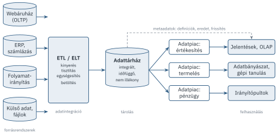
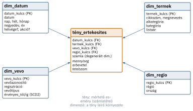
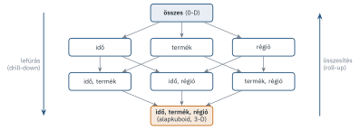

# Adattárházak és analitikus adatkezelés {#sec-adattarhaz}

```{python}
#| include: false
import sqlite3
import numpy as np
import pandas as pd
import matplotlib.pyplot as plt
import adatbanyaszat as ab
ab.set_style()
pd.set_option("display.max_columns", 12)
pd.set_option("display.width", 110)
pd.set_option("display.float_format", lambda v: f"{v:,.1f}".replace(",", " "))
```

::: {.roadmap}
Az adatbányászathoz megbízható, egységes és könnyen elérhető adatok kellenek. A
vállalati adatok azonban sokféle, a napi működést kiszolgáló rendszerben szétszórva
keletkeznek. Ez a fejezet azt mutatja be, hogyan szervezhetők ezek az adatok
elemzésre alkalmas formába: mi az adattárház, hogyan épül fel a dimenzionális
adatmodell (csillag-, hópehely- és galaxisséma), milyen műveletek végezhetők a
többdimenziós adatkockán, és hogyan alakította át a területet az oszlopos tárolás,
az adattó és a lakehouse-architektúra. A gyakorlati részben mindkét futó eset
adataiból csillagsémát építünk, és OLAP-jellegű lekérdezéseket futtatunk.

**A fejezet végére az olvasó** képes lesz megkülönböztetni az operatív és az analitikus
adatkezelést; egy üzleti folyamathoz tény- és dimenziótáblákat tervezni; az OLAP-műveleteket
SQL-ben és pandasban végrehajtani; és indokolni egy analitikus adatarchitektúra
megválasztását.
:::

## Operatív és analitikus adatkezelés {#sec-oltp-olap}

Egy webáruház adatbázisa másodpercenként sok kis tranzakciót szolgál ki: rendelést
rögzít, készletet csökkent, szállítási címet módosít. Az ilyen **operatív**, más néven
OLTP- (On-Line Transaction Processing) rendszerek tervezésének célja, hogy sok
párhuzamos felhasználó gyorsan és ellentmondásmentesen tudjon kevés rekordot olvasni
és írni. Ehhez a relációs adatmodell normalizált sémái illenek [@codd1970]: minden
tény egyetlen helyen szerepel, így a módosítás nem okoz ellentmondást.

Az elemző kérdései egészen mások. „Hogyan alakult az elmúlt két évben a kávékategória
negyedéves árbevétele régiónként?” – egy ilyen lekérdezés sok százezer rekordot olvas,
de egyetlen rekordot sem módosít, és sok tábla összekapcsolását igényli. Ha az elemző
közvetlenül az operatív adatbázison dolgozna, lassítaná az ügyfélkiszolgálást, ráadásul
az adatai hiányosak lennének: az operatív rendszerek gyakran csak az aktuális állapotot
tárolják, a múltat felülírják. Az **analitikus**, más néven OLAP- (On-Line Analytical
Processing) rendszerek ezért külön adattárolóban, elemzésre optimalizált szerkezetben
tárolják az adatokat [@codd1993].

| Szempont | Operatív (OLTP) | Analitikus (OLAP) |
|:--|:--|:--|
| Felhasználó | ügyintéző, alkalmazás | elemző, döntéshozó |
| Művelet | sok rövid olvasás és írás | kevés, sok rekordot olvasó lekérdezés |
| Adatok | aktuális, részletes | történeti, összesített is |
| Séma | normalizált | dimenzionális (csillag) |
| Optimalizálási cél | tranzakciós sebesség, konzisztencia | lekérdezési sebesség, áttekinthetőség |
| Tipikus kérdés | „Mi van a 240679-es rendelésben?” | „Hogyan alakul a forgalom régiónként?” |

: Az operatív és az analitikus adatkezelés összehasonlítása. {#tbl-oltp-olap}

## Az adattárház {#sec-adattarhaz-fogalma}

### Definíció és architektúra

Az adattárház fogalmát @inmon2005 négy tulajdonsággal írja le. Az adattárház

- **tárgyorientált**: a szervezet fő témái (vevő, termék, értékesítés, termelés) köré
  szerveződik, nem az alkalmazások köré;
- **integrált**: a különböző forrásrendszerek eltérő kódolásait, mértékegységeit és
  elnevezéseit egységesíti;
- **időfüggő**: minden adat egy időponthoz vagy időszakhoz kötődik, a múlt nem íródik
  felül;
- **nem illékony**: a betöltött adatokat nem módosítjuk, csak újabbakkal bővítjük.

Az adattárház tipikus felépítését a [-@fig-dw-architektura]. ábra mutatja. A
forrásrendszerekből az adatokat egy integrációs folyamat (ETL) gyűjti össze,
tisztítja és tölti be az adattárházba. Az adattárházból témaspecifikus **adatpiacok**
(data mart) szolgálják ki az egyes felhasználói köröket, amelyek jelentéseket,
OLAP-elemzéseket, irányítópultokat és adatbányászati modelleket építenek rájuk. Az
egészet **metaadatok** kísérik: mit jelent egy mező, honnan származik, mikor
frissült.

{#fig-dw-architektura width=100%}

Az adattárház-építésnek két klasszikus iskolája van. @inmon2005 felülről lefelé
haladó (*top-down*) megközelítésében először egy normalizált, vállalati szintű
adattárház készül, és az adatpiacok ebből származnak. @kimball2013 alulról felfelé
építkező (*bottom-up*) megközelítésében az adatpiacok dimenzionális modellként
egymás után készülnek el, és az egységességet a közös, úgynevezett **megfeleltetett
dimenziók** (conformed dimensions) biztosítják. A gyakorlatban gyakran a kettő
keveréke valósul meg; az elemző szempontjából a lényeg mindkét esetben a
dimenzionális modell, amelyet a következő alfejezetben tárgyalunk.

### Adatintegráció: ETL és ELT

Az **ETL** (Extract–Transform–Load) a forrásadatok kinyerését, átalakítását és
betöltését jelenti [@kimball2004]. Az átalakítás magában foglalja a tisztítást
(hibás és hiányzó értékek kezelése, [-@sec-elokeszites]. fejezet), az egységesítést
(azonos kódolás, mértékegység, dátumformátum), a duplikátumok kiszűrését, a
helyettesítő kulcsok kiosztását és az összesítéseket. A modern, felhőalapú
rendszerekben gyakori az **ELT** változat: a nyers adat először változatlanul bekerül
a központi tárolóba, és az átalakítás ott, SQL-lekérdezésekkel történik. Így a nyers
adat megmarad, és az átalakítási szabályok később is módosíthatók.

### A változó dimenziók kezelése

A dimenziók tartalma idővel változik: egy vevő elköltözik, egy terméket átsorolnak
másik kategóriába. A kérdés az, hogy a múltbeli tények a régi vagy az új
dimenzióértékhez tartozzanak-e. Az ilyen **lassan változó dimenziók** (slowly changing
dimensions, SCD) kezelésére @kimball2013 több típust ír le, közülük a három
leggyakoribb:

- **1. típus – felülírás**: a régi értéket felülírjuk, a múlt „átíródik”. Egyszerű,
  de a korábbi állapot elvész.
- **2. típus – új sor**: a változáskor új dimenziósor keletkezik új helyettesítő
  kulccsal, és az *érvényes-tól* / *érvényes-ig* mezők jelzik az érvényességi időszakot.
  A régi tények a régi sorra, az újak az újra mutatnak; a múlt hűen megmarad.
- **3. típus – új oszlop**: a korábbi értéket egy külön oszlopban őrizzük meg; csak
  egy korábbi állapotot tud követni.

Adatbányászati szempontból a 2. típus a legfontosabb: csak így biztosítható, hogy egy
modell tanításakor minden tény azokkal a jellemzőkkel szerepeljen, amelyek *akkor*
érvényesek voltak. Ennek elmulasztása a jövőbeli információ „beszivárgásához” vezethet
([-@sec-elokeszites]. fejezet).

## A dimenzionális adatmodell {#sec-dimenzionalis}

### Tények és dimenziók

A dimenzionális modell [@kimball2013] két táblatípusra épül. A **ténytábla** egy üzleti
folyamat mérhető eseményeit tárolja (például egy számlatételt vagy egy órás
termelési adatot), és két oszloptípust tartalmaz: a dimenziókra mutató **idegen
kulcsokat** és a **mértékeket** (mennyiség, árbevétel, energiafogyasztás). A
**dimenziótáblák** a tények leíró környezetét adják: *mikor* (dátum), *mit* (termék),
*ki* (vevő), *hol* (régió) történt.

A tervezés első és legfontosabb döntése a **szemcsézettség** (granularitás)
meghatározása: mit képvisel a ténytábla egy sora? A PannonShop esetében a
legfinomabb szemcsézettség a számlatétel; a Pannon üzem esetében az órás átlag. A
finomabb szemcsézettség rugalmasabb (bármilyen összesítés előállítható belőle), de
nagyobb tárolási igénnyel jár. Az ökölszabály: a lehető legfinomabb, még értelmes
szemcsézettséget tároljuk, mert összesíteni mindig lehet, részletezni utólag nem.

A mértékek összesíthetőségük szerint háromfélék:

- **additív** mértékek minden dimenzió mentén összeadhatók (árbevétel, mennyiség);
- **félig additív** mértékek csak egyes dimenziók mentén adhatók össze (egy
  készletszint régiók mentén összegezhető, de időben nem – időben átlagolni kell);
- **nem additív** mértékek egyáltalán nem adhatók össze (arányok, átlagárak,
  hőmérsékletek); ezeket az additív összetevőikből kell újraszámolni.

::: {.callout-warning title="Buktató: arányok összesítése"}
Az átlagár nem additív. Ha az egyik régióban 100 tétel átlagára 2000 Ft, a másikban
10 tételé 8000 Ft, a két régió együttes átlagára nem $(2000+8000)/2 = 5000$ Ft, hanem
$(100\cdot 2000 + 10\cdot 8000)/110 \approx 2545$ Ft. Arányokat és átlagokat mindig
a számlálójuk és nevezőjük külön összesítésével kell újraszámolni.
:::

### Csillagséma, hópehelyséma, galaxisséma

A **csillagsémában** a ténytábla a középen áll, és minden dimenziótáblához közvetlenül
kapcsolódik ([-@fig-csillagsema]. ábra). A dimenziótáblák szándékosan *nem
normalizáltak*: a termékdimenzió például egyetlen táblában tartalmazza a terméket, az
alkategóriát és a kategóriát, ezért egy lekérdezéshez kevés összekapcsolás kell. Az
ismétlődő kategórianevek miatti redundancia a dimenziótáblák kis mérete miatt nem
jelentős.

{#fig-csillagsema width=95%}

A **hópehelysémában** a dimenziókat normalizáljuk: a termékdimenzióból például külön
kategóriatábla válik le. Ez csökkenti a redundanciát, de több összekapcsolást
igényel, ezért az elemzési célú rendszerekben ritkábban választják. A
**galaxisséma** (tényegyüttes, fact constellation) több ténytáblát tartalmaz, amelyek
közös dimenziókon osztoznak; a PannonShop esetében például az értékesítési és a
vevőértékelési ténytábla közösen használhatja a dátum-, termék- és vevődimenziót.

### A dátumdimenzió

Szinte minden ténytábla kapcsolódik a dátumdimenzióhoz, amely az időbeli összesítések
alapja. Ahelyett, hogy a lekérdezésekben minden alkalommal kiszámolnánk, melyik héthez
vagy negyedévhez tartozik egy dátum, a dátumdimenzió soronként tárolja ezeket az
attribútumokat – a munkanapokat, ünnepnapokat, akciós heteket is. Ez az egyszerű tábla
az adatbányászatban is hasznos: a [-@sec-idosor]. fejezet idősor-modelljei éppen ilyen
naptári jellemzőkből építkeznek.

## Az adatkocka és az OLAP-műveletek {#sec-olap}

### Az adatkocka

A dimenzionális modell természetes szemléltetése az **adatkocka**: $d$ dimenzió
esetén egy $d$ dimenziós tömb, amelynek celláiban a mértékek összesített értékei
állnak ([-@fig-kocka]. ábra). A „kocka” elnevezés három dimenzióra utal, de az elv
tetszőleges számú dimenzióra érvényes.

{#fig-kocka width=100%}

Az alapvető OLAP-műveletek a következők:

- **Szeletelés** (slice): egy dimenzió értékét rögzítjük (például csak a „Kávé és tea”
  kategória), az eredmény eggyel kevesebb dimenziós.
- **Kockázás** (dice): több dimenzió mentén egyszerre választunk részhalmazt (például
  két régió, két negyedév, két kategória).
- **Összesítés** (roll-up): egy dimenzió hierarchiájában feljebb lépünk (nap → hónap →
  negyedév → év), vagy egy dimenziót teljesen összegzünk.
- **Lefúrás** (drill-down): az összesítés fordítottja, a részletesebb szint felé.
- **Forgatás** (pivot): a dimenziók megjelenítési sorrendjének cseréje (sorok és
  oszlopok felcserélése a kimutatásban).

### A kuboidok hálója

Egy $d$ dimenziós kocka minden dimenzióhalmazára képezhető egy összesítés, amelyet
**kuboidnak** nevezünk [@gray1997]. A kuboidok hálót alkotnak
([-@fig-kuboid-halo]. ábra): a legalsó, $d$ dimenziós **alapkuboid** a legrészletesebb, a
legfelső, 0 dimenziós **csúcskuboid** egyetlen számot (a végösszeget) tartalmaz. Hierarchiák
nélkül a kuboidok száma $2^d$. Ha az $i$-edik dimenzióhoz $L_i$ hierarchiaszint tartozik
(a dátumnál például nap, hónap, negyedév, év: $L_i = 4$), akkor a kuboidok száma

$$
T = \prod_{i=1}^{d} (L_i + 1),
$$ {#eq-kuboidok}

ahol a „$+1$” a dimenzió teljes összegzésének („összes”) felel meg. Már néhány
dimenzió és hierarchia esetén is nagyon sok kuboid adódik: négy dimenzió, egyenként
négy szinttel $5^4 = 625$ kuboidot jelent. Ezért a rendszerek nem számolják ki előre
az összeset, hanem csak a leggyakrabban használt vagy a legtöbb másikat kiszolgáló
kuboidokat tárolják (**részleges materializáció**); ennek klasszikus mohó algoritmusát
@harinarayan1996 dolgozta ki.

{#fig-kuboid-halo width=85%}

Az SQL szabvány `GROUP BY ROLLUP` és `GROUP BY CUBE` kiegészítései
[@gray1997] egyetlen lekérdezéssel állítják elő egy hierarchia összes
összesítési szintjét, illetve az összes kuboidot.

## Korszerű analitikus adatarchitektúrák {#sec-modern-dw}

### Oszlopos tárolás

A hagyományos adatbázisok soronként tárolják az adatokat: egy rekord összes mezője
egymás mellett van a lemezen. Ez az OLTP-műveleteknek kedvez, ahol egy teljes rekordot
olvasunk vagy írunk. Az analitikus lekérdezések viszont tipikusan sok sor néhány
oszlopát olvassák. Az **oszlopos tárolás** oszloponként helyezi el az adatokat,
így egy lekérdezésnek csak a szükséges oszlopokat kell beolvasnia; ráadásul az azonos
típusú, gyakran ismétlődő értékek nagyon jól tömöríthetők [@stonebraker2005]. Az
oszlopos és soros tárolás közötti teljesítménykülönbség nem csupán a tárolási
formátumból, hanem a végrehajtómotor ehhez illeszkedő kialakításából is fakad
[@abadi2008]. Ma az analitikus adatbázisok és a nagy adatállományok fájlformátumai
(például az Apache Parquet) túlnyomórészt oszlopos szerveződésűek.

### Adattó és lakehouse

A nem strukturált és félig strukturált adatok (naplófájlok, szenzoradatok, képek,
szövegek) megjelenésével elterjedt az **adattó** (data lake): olcsó objektumtárban,
nyers formában, előzetes séma nélkül tárolt adatok gyűjteménye. Az adattó rugalmas,
de könnyen „adatmocsárrá” válik, ha hiányzik a minőségbiztosítás és a metaadat-kezelés.
A **lakehouse**-architektúra a két világ előnyeit próbálja egyesíteni: nyílt,
oszlopos fájlformátumokban tárolt adatokra az adattárházakból ismert
szolgáltatásokat (tranzakciókezelés, séma-érvényesítés, verziókövetés, gyors
SQL-lekérdezés) épít, így ugyanazon az adaton futhatnak a jelentések és a gépi
tanulási feladatok [@armbrust2021].

A technológiák változnak, a dimenzionális gondolkodás azonban mindegyikben
megmarad: a lakehouse „arany” rétegében is tény- és dimenziótáblák szolgálják ki az
elemzőket. Ezért a következő gyakorlatban a klasszikus csillagsémát építjük fel.

## Gyakorlat: csillagséma és OLAP Pythonban {#sec-dw-gyakorlat}

### A PannonShop csillagsémája SQLite-ban

A Python beépített `sqlite3` modulja egy teljes értékű, fájl- vagy memóriaalapú
relációs adatbázist biztosít, így telepítés nélkül kipróbálható vele a csillagséma.
Először a dimenziótáblákat állítjuk elő. A dátumdimenzió a vizsgált időszak minden
napjára egy sort tartalmaz:

```{python}
shop = ab.load_shop()
tx = shop.transactions.copy()

# --- dátumdimenzió ---
napok = pd.date_range("2024-01-01", "2025-12-31", freq="D")
dim_datum = pd.DataFrame({
    "datum_kulcs": napok.strftime("%Y%m%d").astype(int),
    "datum": napok.date.astype(str),
    "ev": napok.year,
    "negyedev": napok.year.astype(str) + "-N" + napok.quarter.astype(str),
    "honap": napok.strftime("%Y-%m"),
    "het_napja": napok.dayofweek + 1,          # 1 = hétfő
    "hetvege": (napok.dayofweek >= 5).astype(int),
})
dim_datum.head(3)
```

A termék- és régiódimenzió a törzsadatokból készül; a ténytábla a számlatételekből,
amelyekben a természetes kulcsokat (cikkszám, régiónév) helyettesítő kulcsokra
cseréljük. A postaköltség-sorokat kihagyjuk, mert nem termékértékesítést jelentenek;
a sztornókat negatív mennyiségű tényként megtartjuk, így az összegzés automatikusan
a nettó forgalmat adja.

```{python}
dim_termek = shop.products.reset_index().rename(columns={"index": "termek_kulcs"})
dim_regio = (pd.DataFrame({"regio": sorted(tx.Regio.unique())})
             .reset_index().rename(columns={"index": "regio_kulcs"}))
dim_regio["orszag"] = np.where(dim_regio.regio.isin(["Ausztria", "Szlovákia", "Németország"]),
                               dim_regio.regio, "Magyarország")

f = tx[tx.StockCode != "POST"].copy()
f["Description"] = f.Description.str.strip()
f = (f.merge(dim_termek[["termek_kulcs", "StockCode"]], on="StockCode")
      .merge(dim_regio[["regio_kulcs", "regio"]], left_on="Regio", right_on="regio"))
teny = pd.DataFrame({
    "datum_kulcs": f.InvoiceDate.dt.strftime("%Y%m%d").astype(int),
    "termek_kulcs": f.termek_kulcs,
    "regio_kulcs": f.regio_kulcs,
    "vevo": f.CustomerID,                      # egyszerűség kedvéért természetes kulcs
    "szamla": f.Invoice,                       # degenerált dimenzió
    "mennyiseg": f.Quantity,
    "arbevetel": f.Quantity * f.Price,
})

con = sqlite3.connect(":memory:")
for nev, tabla in [("dim_datum", dim_datum), ("dim_termek", dim_termek),
                   ("dim_regio", dim_regio), ("teny_ertekesites", teny)]:
    tabla.to_sql(nev, con, index=False)
print(f"ténytábla: {len(teny):,} sor".replace(",", " "))
```

Most már egy tipikus elemzői kérdés – *negyedéves nettó árbevétel kategóriánként* –
egyetlen, a csillagséma szerkezetét követő lekérdezés:

```{python}
q = """
SELECT d.negyedev, t.Kategoria AS kategoria,
       SUM(f.arbevetel) / 1e6 AS arbevetel_mFt
FROM teny_ertekesites f
JOIN dim_datum  d ON f.datum_kulcs  = d.datum_kulcs
JOIN dim_termek t ON f.termek_kulcs = t.termek_kulcs
GROUP BY d.negyedev, t.Kategoria
ORDER BY d.negyedev, arbevetel_mFt DESC
"""
negyedeves = pd.read_sql(q, con)
negyedeves.head(6)
```

### OLAP-műveletek a pandas kimutatástáblájával

A `pandas` `pivot_table` függvénye az adatkocka egy kétdimenziós nézetét állítja
elő; a `margins=True` beállítás az összesítő sorokat és oszlopokat is hozzáadja,
vagyis egyszerre két kuboidszintet mutat. A kocka három dimenziója itt az idő
(negyedév), a termékkategória és a régió.

```{python}
kocka = pd.read_sql("""
SELECT d.ev, d.negyedev, t.Kategoria AS kategoria, r.regio, r.orszag, f.arbevetel
FROM teny_ertekesites f
JOIN dim_datum d  ON f.datum_kulcs  = d.datum_kulcs
JOIN dim_termek t ON f.termek_kulcs = t.termek_kulcs
JOIN dim_regio r  ON f.regio_kulcs  = r.regio_kulcs
""", con)

# összesítés (roll-up): negyedév -> év, régió -> összes
kocka.pivot_table(index="kategoria", columns="ev", values="arbevetel",
                  aggfunc="sum", margins=True, margins_name="Összesen") / 1e6
```

A szeletelés egy dimenzió rögzítése, a kockázás több dimenzió mentén egyszerre
történő szűrés:

```{python}
# szelet: csak a "Kávé és tea" kategória, negyedév × ország
szelet = kocka[kocka.kategoria == "Kávé és tea"]
szelet.pivot_table(index="negyedev", columns="orszag", values="arbevetel",
                   aggfunc="sum").div(1e6).round(2).tail(4)
```

```{python}
# kocka-részlet (dice): két kategória, két régió, 2025 negyedévei
resz = kocka[kocka.kategoria.isin(["Háztartási gépek", "Ajándék"])
             & kocka.regio.isin(["Közép-Magyarország", "Nyugat-Dunántúl"])
             & (kocka.ev == 2025)]
resz.pivot_table(index=["kategoria", "regio"], columns="negyedev",
                 values="arbevetel", aggfunc="sum").div(1e6).round(2)
```

Az SQLite nem ismeri a `GROUP BY ROLLUP` szerkezetet, de egy hierarchia összes
összesítési szintje `UNION ALL`-lal könnyen előállítható. Az alábbi lekérdezés az
év → negyedév hierarchia három szintjét adja vissza egyetlen táblában:

```{python}
rollup = pd.read_sql("""
SELECT d.ev, d.negyedev, SUM(f.arbevetel)/1e6 AS mFt FROM teny_ertekesites f
  JOIN dim_datum d ON f.datum_kulcs = d.datum_kulcs GROUP BY d.ev, d.negyedev
UNION ALL
SELECT d.ev, 'összes', SUM(f.arbevetel)/1e6 FROM teny_ertekesites f
  JOIN dim_datum d ON f.datum_kulcs = d.datum_kulcs GROUP BY d.ev
UNION ALL
SELECT 'összes', 'összes', SUM(f.arbevetel)/1e6 FROM teny_ertekesites f
""", con)
rollup
```

::: {.eset-uzleti}
A kimutatásokból már most látszik a PannonShop forgalmának két jellegzetessége: a
negyedik negyedév kiugró forgalma (karácsonyi szezon) és a háztartási gépek magas
részesedése az árbevételből, amely a magas egységárakból fakad. Az első a
[-@sec-idosor]. fejezet szezonális modelljeinek, a második a [-@sec-ugyfel].
fejezet vevőérték-számításának lesz fontos bemenete.
:::

::: {.callout-warning title="Tisztítatlan adatokon számoltunk"}
A fenti kimutatások a nyers számlatételekből készültek. A [-@sec-elokeszites]. fejezetben
látni fogjuk, hogy néhány hibásan rögzített egységár és néhány szokatlanul nagy
rendelés érezhetően torzítja az egyes cellák értékét. Egy valódi adattárházban az ETL
folyamat feladata, hogy az ilyen hibákat a betöltés előtt kiszűrje vagy megjelölje.
:::

```{python}
#| label: fig-negyedeves
#| fig-cap: "A PannonShop negyedéves nettó árbevétele termékkategóriánként (millió Ft). A negyedik negyedévek kiemelkedése a karácsonyi szezont tükrözi."
#| fig-width: 7
#| fig-height: 3.4
pv = negyedeves.pivot(index="negyedev", columns="kategoria", values="arbevetel_mFt")
pv = pv[pv.sum().sort_values(ascending=False).index]
ax = pv.plot(kind="bar", stacked=True, width=0.8, color=ab.PALETTE + ["#9AA5B1"], edgecolor="white", linewidth=0.6)
ax.set_xlabel("")
ax.set_ylabel("nettó árbevétel [millió Ft]")
ax.legend(ncol=3, fontsize=8, loc="upper left")
plt.xticks(rotation=0, fontsize=8)
plt.tight_layout()
```

### A Pannon üzem termelési adatpiaca

A mérnöki esetben a ténytábla egy sora egy üzemóra. A mértékek közül a betáplált
mennyiség és az energiafogyasztás additív, a hőmérsékletek és nyomások nem additívak.
Egy fontos teljesítménymutató a **fajlagos energiafogyasztás**: az egységnyi
betáplált nyersanyagra jutó villamos energia (kWh/m³). Mivel arányszám, az
összesítéskor a számlálót és a nevezőt külön kell összegezni.

```{python}
plant = ab.load_plant()
h = plant.hourly.dropna(subset=["F_betap", "E_fogyasztas"]).copy()
h = h[h.F_betap > 1.0]                               # a tisztítási leállásokat kihagyjuk
h["honap"] = h.ido.dt.to_period("M").astype(str)
h["energia_kWh"] = h.E_fogyasztas * 1.0              # órás átlagteljesítmény × 1 óra
h["betap_m3"] = h.F_betap * 1.0

def fajlagos(df):
    """Fajlagos energia: összes energia / összes betáplálás (nem az órás arányok átlaga!)."""
    return df.energia_kWh.sum() / df.betap_m3.sum()

tabla = (h.groupby(["termek", "muszak"], observed=True)
           .apply(fajlagos, include_groups=False).unstack().round(3))
tabla
```

```{python}
#| label: fig-fajlagos
#| fig-cap: "A Pannon üzem havi fajlagos energiafogyasztása termékenként. A nyári hónapokban a nagyobb hűtővízáram (szivattyúzás) növeli az energiaigényt."
#| fig-width: 7
#| fig-height: 3.2
havi = (h.groupby(["honap", "termek"]).apply(fajlagos, include_groups=False)
          .unstack())
ax = havi.plot(marker="o", color=ab.PALETTE[:3])
ax.set_xlabel("")
ax.set_ylabel("fajlagos energia [kWh/m³]")
ax.legend(title="termék", ncol=3)
plt.xticks(range(len(havi.index)), [m[5:] for m in havi.index])
plt.tight_layout()
```

::: {.eset-mernoki}
A [-@fig-fajlagos]. ábra szerint a fajlagos energiafogyasztás nyáron megnő. Ennek
oka a hűtés: melegebb hűtővíz és lerakódott hőcserélő mellett ugyanakkora hőmennyiség
elvonásához több hűtővizet kell szivattyúzni. A fajlagos mutató a termékek között is
különbözik, ezért egy havi összehasonlításnál a termékösszetétel változását is
figyelembe kell venni – ez tipikus példája annak, amikor egy összesített mutató
változása mögött az összetétel változása áll.
:::

### Kitérő: soros és oszlopos fájlformátum

A következő kis kísérlet a tárolási formátum hatását szemlélteti. A számlatételeket
CSV-ként (soros, szöveges) és Parquet-formátumban (oszlopos, tömörített) is kiírjuk,
majd összevetjük a méretüket és egyetlen oszlop beolvasásának idejét.

```{python}
import os, time, tempfile
d = tempfile.mkdtemp()
csv_f, pq_f = os.path.join(d, "tx.csv"), os.path.join(d, "tx.parquet")
tx.to_csv(csv_f, index=False)
tx.to_parquet(pq_f, index=False)

t0 = time.perf_counter(); pd.read_csv(csv_f, usecols=["Price"]); t_csv = time.perf_counter() - t0
t0 = time.perf_counter(); pd.read_parquet(pq_f, columns=["Price"]); t_pq = time.perf_counter() - t0
print(f"CSV:     {os.path.getsize(csv_f)/1e6:5.1f} MB, egy oszlop beolvasása {t_csv*1000:6.1f} ms")
print(f"Parquet: {os.path.getsize(pq_f)/1e6:5.1f} MB, egy oszlop beolvasása {t_pq*1000:6.1f} ms")
```

A pontos értékek a géptől függnek, de a nagyságrendi különbség jellemző: az
oszlopos formátum kisebb, és csak a kért oszlopot kell beolvasni belőle.





## Összefoglalás {#sec-dw-osszefoglalas}

- Az operatív (OLTP) rendszerek a tranzakciók gyors és konzisztens kezelésére, az
  analitikus (OLAP) rendszerek a sok rekordot érintő lekérdezésekre optimalizáltak.
- Az adattárház tárgyorientált, integrált, időfüggő és nem illékony adatgyűjtemény;
  az adatintegrációt az ETL/ELT folyamat végzi.
- A dimenzionális modell ténytáblákból (mértékek) és dimenziótáblákból (leíró
  környezet) áll; a legfontosabb tervezési döntés a szemcsézettség.
- A mértékek additívak, félig additívak vagy nem additívak; arányokat a számlálójuk és
  nevezőjük külön összesítésével kell képezni.
- Az OLAP-műveletek (szeletelés, kockázás, összesítés, lefúrás, forgatás) az
  adatkocka kuboidjai között navigálnak; a kuboidok száma ([-@eq-kuboidok]) szerint
  gyorsan nő.
- Az oszlopos tárolás, az adattó és a lakehouse a technológiát változtatta meg, a
  dimenzionális modellezés elveit nem.

## Ellenőrző kérdések {.unnumbered}

1. Miért nem célszerű az elemzéseket közvetlenül az operatív adatbázison futtatni?
2. Mit jelent az adattárház négy Inmon-féle tulajdonsága? Mondjon mindegyikre példát a
   PannonShop világából!
3. Mi a szemcsézettség, és miért ajánlott a lehető legfinomabbat választani?
4. Mi a különbség az 1. és a 2. típusú lassan változó dimenzió között? Miért fontos ez
   egy lemorzsolódás-előrejelző modell tanításakor?
5. Hány kuboidja van egy négydimenziós kockának, ha a dimenziók hierarchiaszintjeinek
   száma 4, 3, 2 és 1?
6. Melyik mérték additív, félig additív, illetve nem additív: árbevétel, raktárkészlet,
   reaktorhőmérséklet, visszaküldési arány?

## Feladatok {.unnumbered}

1. **Tervezés.** Tervezzen csillagsémát a PannonShop vásárlói értékeléseihez! Mi a
   szemcsézettség, melyek a mértékek és a dimenziók? Mely dimenziók közösek az
   értékesítési ténytáblával (galaxisséma)?
2. **Lekérdezés.** Az SQLite-adatbázisban kérdezze le, hogy hétvégén vagy hétköznap
   nagyobb-e az átlagos kosárérték! (Vigyázat: a kosárérték számlaszintű mérték, előbb
   számlánként kell összegezni.)
3. **Lefúrás.** A [-@fig-negyedeves]. ábrán a 2024. negyedik negyedév kiemelkedik.
   Fúrjon le havi, majd heti szintre, és állapítsa meg, mely hetekben koncentrálódik a
   forgalom!
4. **Összetételhatás.** Számítsa ki a Pannon üzem havi fajlagos energiafogyasztását
   termékbontás nélkül is! Mutassa meg egy példán, hogy az összesített mutató akkor is
   változhat, ha a termékenkénti értékek változatlanok!
5. **SCD.** Tegyük fel, hogy 2025. július 1-jén a „Teáskanna” termék a „Konyhai
   eszközök” kategóriából átkerül a „Kávé és tea” kategóriába. Valósítsa meg a változást
   2. típusú SCD-ként a termékdimenzióban, és mutassa meg, hogyan változik a kategóriánkénti
   2025-ös árbevétel!

## További olvasmányok {.unnumbered}

A dimenzionális modellezés alapműve @kimball2013, az ETL-folyamatoké @kimball2004.
Az Inmon-féle vállalati adattárház koncepcióját @inmon2005 írja le. Az adatkocka
és a kuboidháló elméletét @gray1997, a részleges materializációt @harinarayan1996
tárgyalja. Az oszlopos adatbázisokról @abadi2008, a lakehouse-architektúráról
@armbrust2021 ad áttekintést.
