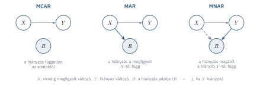
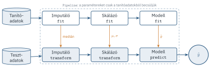

# Adatok előkészítése {#sec-elokeszites}

```{python}
#| include: false
import numpy as np
import pandas as pd
import matplotlib.pyplot as plt
import adatbanyaszat as ab
ab.set_style()
pd.set_option("display.max_columns", 12)
pd.set_option("display.width", 110)
```

::: {.roadmap}
A valós adatok hiányosak, zajosak és ellentmondásosak. Mielőtt bármilyen modellt
építenénk, meg kell ismernünk az adatok hibáit, és el kell döntenünk, hogyan kezeljük
őket. Ez a fejezet sorra veszi az adatelőkészítés fő feladatait: az adattípusok és
mérési skálák azonosítását, az adatminőség felmérését, a hiányzó értékek, a zaj és a
kiugró értékek kezelését, a transzformációkat és kódolásokat, valamint a jellemzők
kiválasztását. Külön alfejezet foglalkozik az adatszivárgással, a gyakorlati
adatbányászat egyik leggyakoribb és legalattomosabb hibájával. A fejezet végére mindkét
futó eset adatai megtisztított, elemzésre kész formába kerülnek.

**A fejezet végére az olvasó** képes lesz egy adattábla minőségi problémáit
szisztematikusan feltárni; a hiányzás mechanizmusának megfelelő kezelési módot
választani; robusztus módszerekkel kiugró értékeket keresni; a jellemzőket a modellhez
illő skálára transzformálni és kódolni; és az előfeldolgozást szivárgásmentes
`scikit-learn` folyamatba szervezni.
:::

## Adattípusok és mérési skálák {#sec-skalak}

Egy változóval végezhető műveletek attól függnek, milyen **mérési skálán** mértük.
@stevens1946 klasszikus felosztása négy skálát különböztet meg:

| Skála | Megengedett összevetés | Példa | Értelmes középérték |
|:--|:--|:--|:--|
| névleges (nominális) | egyenlő / nem egyenlő | régió, termékkategória | módusz |
| sorrendi (ordinális) | kisebb / nagyobb | csillagos értékelés, minőségi osztály | medián |
| intervallum | különbség | hőmérséklet °C-ban, dátum | átlag |
| arány | különbség és hányados | mennyiség, ár, áramlási sebesség | átlag, mértani közép |

: Mérési skálák és a rajtuk értelmezett műveletek. {#tbl-skalak}

A névleges és a sorrendi skálájú változókat együtt **kategorikus**, az intervallum- és
arányskálájúakat **numerikus** (folytonos vagy diszkrét) változóknak nevezzük. A
különbség nem formális szőrszálhasogatás: egy irányítószám számjegyekből áll, de
névleges változó, átlagolása értelmetlen; a 20 °C nem „kétszer olyan meleg”, mint a
10 °C, mert a Celsius-skála nullpontja önkényes. Az adatbányászati algoritmusok
többsége numerikus bemenetet vár, ezért a kategorikus változókat kódolni kell
([-@sec-kodolas]. alfejezet) – de úgy, hogy ne vigyünk be a kódolással nem létező
sorrendet vagy távolságot.

A `pandas` adattípusai ezt a felosztást csak részben követik: a számok `int64` vagy
`float64`, a szövegek `object` vagy `string`, a dátumok `datetime64`, és létezik egy
külön `category` típus is a kategorikus változókra.

```{python}
shop = ab.load_shop()
tx = shop.transactions
tx.dtypes
```

## Az adatminőség felmérése {#sec-adatminoseg}

Az adatminőség nem egyetlen tulajdonság. A felhasználói szemléletű adatminőség-kutatás
klasszikus eredménye szerint az adatok használói a pontosság mellett a teljességet, a
konzisztenciát, az időszerűséget, az értelmezhetőséget és a hozzáférhetőséget is
minőségi dimenziónak tekintik [@wang1996]. Az elemzés szempontjából hasznos továbbá a
**rendezett adat** (tidy data) elve: minden változó egy oszlop, minden megfigyelés
egy sor, minden megfigyelési egység egy tábla [@wickham2014]. A számlatétel-tábla
ennek megfelel – a vevőszintű elemzéshez azonban majd egy új, vevőnként egy sort
tartalmazó táblát kell belőle képeznünk.

Az adatminőség felmérése a gyakorlatban egy ellenőrzőlista végigvitelét jelenti.
Mennyi a hiányzó érték oszloponként? Vannak-e duplikált sorok? Értelmes
tartományban vannak-e az értékek? Egységes-e a kódolás? Összeegyeztethetők-e a
mezők egymással?

::: {.eset-uzleti}
Végezzük el ezt a felmérést a PannonShop számlatételein! Az egyes problématípusokat
egyszerű logikai feltételekkel jelöljük meg, majd összesítjük.
:::

```{python}
p = shop.products.set_index("StockCode")
lista_ar = tx.StockCode.map(p.ListaAr)
problemak = pd.Series({
    "hiányzó vevőazonosító":          tx.CustomerID.isna().sum(),
    "sztornó (C-számla) tétel":        tx.Invoice.str.startswith("C").sum(),
    "postaköltség (nem termék)":       (tx.StockCode == "POST").sum(),
    "teljesen duplikált sor":          tx.duplicated().sum(),
    "nulla egységár":                  (tx.Price == 0).sum(),
    "listaár 20-szorosa feletti ár":   (tx.Price > 20 * lista_ar).sum(),
    "nem egységes megnevezés":         (tx.Description != tx.Description.str.strip().str.capitalize()).sum(),
}, name="sorok száma")
problemak.to_frame().assign(arany=lambda d: (d["sorok száma"] / len(tx) * 100).round(2))
```

A lista jól mutatja, hogy az adatminőségi problémák különböző természetűek, ezért
különböző kezelést igényelnek:

- A **hiányzó vevőazonosító** a vendégvásárlásokból fakad. Nem pótolható (nem
  „tudhatjuk”, ki vásárolt), de nem is hiba: a forgalmi elemzésekben a sor megtartható,
  a vevőszintű elemzésekben viszont nem használható.
- A **sztornók** valós üzleti események. Egy forgalmi kimutatásban nettósítani kell őket,
  egy kosárelemzésben viszont a sztornózott számlát is el kell hagyni, mert az a kosár
  végül nem valósult meg.
- A **postaköltség** nem termék; a termékszintű elemzésekből ki kell zárni.
- A **duplikált sorok** rögzítési hibák (egy tétel kétszer került be), törölni kell őket.
  Óvatosan: két azonos sor lehet két valódi, azonos vásárlás is – itt az azonos számlaszám
  és időbélyeg teszi egyértelművé a hibát.
- A **nulla árú** tételek ajándékok; az árbevételhez nem járulnak hozzá, a kosárelemzésben
  viszont szerepelhetnek.
- A **listaár sokszorosán rögzített ár** tipikus elírás (két nullával több). Mivel a
  helyes érték kikövetkeztethető, javítható.
- A **nem egységes írásmód** (csupa nagybetű, szóköz a végén) egyszerű szövegnormalizálással
  orvosolható.

```{python}
#| echo: false
torz = (tx.Quantity * tx.Price)[tx.Price > 20 * lista_ar].sum() / (tx.Quantity * tx.Price).sum() * 100
```

Az elírt egységárak csak a sorok töredékét érintik, mégis a teljes bruttó forgalom
`{python} f"{torz:.1f}".replace(".", ",")` százalékát adják – vagyis a
[-@sec-adattarhaz]. fejezet kimutatásait érezhetően torzították. Ez az adatminőség egyik
alaptörvénye: kevés, de nagy értékű hiba is jelentősen eltorzíthatja az összesítéseket.

## Hiányzó adatok {#sec-hianyzo}

### A hiányzás mechanizmusai

A hiányzó adatok kezelésének első kérdése nem az, hogy *mivel* pótoljuk őket, hanem
az, hogy *miért* hiányoznak. @rubin1976 nyomán három mechanizmust különböztetünk meg
([-@fig-hianyzo]. ábra). Jelölje $Y$ a hiányos változót, $X$ a mindig megfigyelt
változókat, $R$ pedig a hiányzás jelzőjét ($R=1$, ha $Y$ értéke hiányzik).

- **Teljesen véletlenszerű hiányzás** (missing completely at random, MCAR): a hiányzás
  valószínűsége sem a megfigyelt, sem a hiányzó értékektől nem függ,
  $P(R=1\mid X, Y) = P(R=1)$. Például egy szenzor véletlenszerű, rövid adatátviteli
  kiesései.
- **Véletlenszerű hiányzás** (missing at random, MAR): a hiányzás csak a *megfigyelt*
  változóktól függ, $P(R=1\mid X, Y) = P(R=1\mid X)$. Például ha a laboráns hétvégén
  ritkábban vesz mintát – a hiányzás a (megfigyelt) naptól függ, nem a koncentrációtól.
- **Nem véletlenszerű hiányzás** (missing not at random, MNAR): a hiányzás magától a
  hiányzó értéktől függ. Például egy érzékelő a méréshatára felett nem ad értéket, vagy
  a nagy jövedelműek gyakrabban tagadják meg a jövedelmük közlését.

{#fig-hianyzo width=95%}

A mechanizmus azért kulcsfontosságú, mert meghatározza, hogy egy egyszerű kezelés
torzít-e. MCAR esetén a hiányos sorok elhagyása csak a mintanagyságot csökkenti, az
eredményt nem torzítja. MAR esetén az elhagyás torzíthat, de a megfigyelt változók
felhasználásával a torzítás korrigálható. MNAR esetén az adatokból magukból ez nem
lehetséges; szakterületi ismeret vagy a hiányzás külön modellezése kell hozzá
[@little2019].

A következő kísérlet ezt szemlélteti. A Pannon üzem órás hűtővíz-hőmérsékletéből
mesterségesen törlünk nagyjából 30–40%-nyi adatot a három mechanizmus szerint, és
megnézzük, mennyire torzul a megmaradt adatok átlaga.

```{python}
plant = ab.load_plant()
h = plant.hourly.dropna(subset=["T_hutoviz", "T_kornyezet"]).reset_index(drop=True)
y, x = h.T_hutoviz.to_numpy(), h.T_kornyezet.to_numpy()
rng = np.random.default_rng(1)

def logit_p(z, arany=0.3):
    """A z pontszámhoz tartozó hiányzási valószínűség, átlagosan 'arany' hiányzással."""
    z = (z - z.mean()) / z.std()
    b = np.log(arany / (1 - arany))
    return 1 / (1 + np.exp(-(b + 2.0 * z)))

hianyzik = {
    "MCAR": rng.random(len(y)) < 0.3,
    "MAR (környezeti hőm. függvénye)": rng.random(len(y)) < logit_p(x),
    "MNAR (saját értékének függvénye)": rng.random(len(y)) < logit_p(y),
}
pd.DataFrame({k: {"hiányzó arány": m.mean(), "megmaradt átlag": y[~m].mean(),
                  "torzítás [°C]": y[~m].mean() - y.mean()} for k, m in hianyzik.items()}).T.round(3)
```

A valódi átlag `{python} f"{y.mean():.2f}".replace(".", ",")` °C. MCAR esetben a
megmaradt adatok átlaga lényegében torzítatlan, a másik két esetben jelentősen eltér.
MAR esetben azonban a torzítás javítható, mert a hiányzást okozó környezeti hőmérséklet
ismert, és a hűtővíz hőmérséklete jól becsülhető belőle (lásd az alábbi feladatot). MNAR
esetben ez a lehetőség nincs meg.

### Kezelési stratégiák

A hiányzó adatok kezelésének fő lehetőségei:

1. **Esetek elhagyása** (listwise deletion): minden hiányos sort törlünk. Egyszerű, MCAR
   esetén torzítatlan, de sok változó esetén a sorok nagy része elveszhet.
2. **Egyszerű pótlás**: az átlaggal, mediánnal (numerikus) vagy módusszal (kategorikus)
   helyettesítünk. Gyors, de a változó szórását alábecsüli, és a változók közötti
   kapcsolatokat gyengíti.
3. **Hiányjelző változó**: a pótlás mellé egy 0/1 jelzőt is felveszünk, így a modell
   „megtanulhatja”, ha a hiányzásnak magának is információtartalma van.
4. **Modellalapú pótlás**: a hiányzó értéket a többi változóból becsüljük. A
   $k$-legközelebbi szomszéd módszer a hasonló sorok értékeinek átlagát használja
   [@troyanskaya2001]; az iteratív (láncolt egyenletes) pótlás minden hiányos változóra
   regressziós modellt illeszt a többi változóból, és ezt felváltva ismétli
   [@vanbuuren2011].
5. **Idősorokban** a szomszédos időpontok értékéből: lineáris interpolációval vagy az
   utolsó ismert érték továbbvitelével – de csak rövid hiányok esetén.

Hasonlítsuk össze ezeket a módszereket a Pannon üzem 10 perces adatain. Ehhez az
eredetileg teljes adatokból véletlenszerűen törlünk értékeket, így a valódi érték
ismert, és a pótlás hibája mérhető.

```{python}
from sklearn.experimental import enable_iterative_imputer  # noqa: F401
from sklearn.impute import SimpleImputer, KNNImputer, IterativeImputer

oszlopok = ["T_kornyezet", "F_betap", "c_betap", "T_reaktor", "F_hutoviz", "T_hutoviz", "E_fogyasztas"]
teljes = ab.plant_clean().set_index("ido")[oszlopok].dropna().iloc[::6]   # óránkénti ritkítás
mask = rng.random(teljes.shape) < 0.10
mask[:, 0] = False                                                        # a környezeti hőm. mindig ismert
hianyos = teljes.mask(mask)

def rmse(potolt):
    return np.sqrt(((potolt - teljes)[mask].stack() ** 2).mean())

eredmeny = {
    "átlag": SimpleImputer(strategy="mean").fit_transform(hianyos),
    "medián": SimpleImputer(strategy="median").fit_transform(hianyos),
    "lineáris interpoláció (idő)": hianyos.interpolate(limit_direction="both").to_numpy(),
    "k-NN (k=5)": KNNImputer(n_neighbors=5).fit_transform((hianyos - hianyos.mean()) / hianyos.std())
                  * hianyos.std().to_numpy() + hianyos.mean().to_numpy(),
    "iteratív (láncolt regresszió)": IterativeImputer(random_state=0, max_iter=10).fit_transform(hianyos),
}
pd.Series({k: rmse(pd.DataFrame(v, index=teljes.index, columns=oszlopok))
           for k, v in eredmeny.items()}, name="RMSE").round(3).to_frame()
```

::: {.eset-mernoki}
Az eredmény a folyamatadatok természetét tükrözi. Az átlaggal vagy mediánnal történő
pótlás a legrosszabb, mert figyelmen kívül hagyja, hogy a változók erősen összefüggnek
egymással és önmaguk korábbi értékeivel. A változók közötti kapcsolatokat kihasználó
modellalapú pótlás és az időbeli szomszédokat felhasználó interpoláció sokkal
pontosabb. A gyakorlatban a kettő kombinálható: rövid kiesésekre interpoláció, hosszabb
hiányokra modellalapú becslés – ez utóbbi már a [-@sec-regresszio]. fejezet lágy
szenzoraihoz vezet.
:::

::: {.callout-warning title="Buktató: a pótolt érték nem mért érték"}
A pótolt értékekkel a további elemzésben úgy dolgozunk, mintha mérések lennének, pedig
becslések. Ezért (a) mindig jelöljük meg őket (hiányjelző változó), (b) a modell
kiértékelésénél vegyük figyelembe, hogy a pótlás bizonytalansága nem jelenik meg az
eredményben, és (c) a pótló modell paramétereit csak a tanítóadatokból becsüljük
([-@sec-szivargas]. alfejezet).
:::

## Zaj és kiugró értékek {#sec-kiugro}

### Zaj és simítás

A **zaj** a mért érték véletlen ingadozása a valódi érték körül. A zaj nem hiba, hanem
a mérés természetes velejárója; csökkentése simítással lehetséges. Az $m$ hosszú,
középre igazított **mozgóátlag** az

$$
\tilde{x}_t = \frac{1}{m}\sum_{i=-(m-1)/2}^{(m-1)/2} x_{t+i}
$$ {#eq-mozgoatlag}

képlettel számolható (páratlan $m$ esetén). A mozgóátlag a zajt csökkenti, de a hirtelen
változásokat elkeni, és a kiugró értékekre érzékeny: egyetlen hibás érték $m$ szomszédos
simított értéket ront el. A **mozgómedián** ugyanebben az ablakban a mediánt veszi, így
egy-egy kiugró értéket teljesen figyelmen kívül hagy, a lépcsőszerű változásokat pedig
élesen megőrzi.

### Kiugró értékek felismerése

A **kiugró érték** (outlier) olyan megfigyelés, amely a többitől annyira eltér, hogy
felmerül a gyanú: más mechanizmus hozta létre – mérési hiba, rögzítési hiba, vagy éppen
egy érdekes, ritka esemény. Az utóbbi esetben a kiugró érték nem eltávolítandó, hanem
az elemzés célpontja ([-@sec-anomalia]. fejezet).

A legegyszerűbb módszer a **standardizált érték** (z-pontszám):

$$
z_k = \frac{x_k - \bar{x}}{s},
$$ {#eq-zpontszam}

ahol $\bar{x}$ a mintaátlag, $s$ a tapasztalati szórás; a $|z_k| > 3$ értékeket
tekintjük kiugrónak. A módszer gyengéje, hogy az átlag és a szórás maga is érzékeny a
kiugró értékekre: egy nagy hiba annyira megnövelheti a szórást, hogy önmaga már nem is
tűnik kiugrónak (ez az *elfedés* jelensége). Ezért ajánlott a **robusztus
z-pontszám**, amely az átlag helyett a mediánt, a szórás helyett a mediántól vett
abszolút eltérések mediánját (MAD) használja [@leys2013]:

$$
z_k^{\mathrm{rob}} = \frac{x_k - \operatorname{med}(x)}{1{,}4826\cdot \operatorname{MAD}},
\qquad
\operatorname{MAD} = \operatorname{med}_k\bigl|x_k - \operatorname{med}(x)\bigr|.
$$ {#eq-robusztusz}

Az 1,4826-os szorzó azt biztosítja, hogy normális eloszlás esetén a nevező a szórás
torzítatlan becslése legyen. Egy harmadik, a dobozdiagramokból ismert szabály
[@tukey1977] az alsó és felső kvartilis ($Q_1$, $Q_3$) és az interkvartilis
terjedelem ($\mathrm{IQR} = Q_3 - Q_1$) alapján a $[Q_1 - 1{,}5\,\mathrm{IQR},\;
Q_3 + 1{,}5\,\mathrm{IQR}]$ intervallumon kívüli pontokat jelöli.

Idősorokban a kiugró értékeket a *helyi* környezetükhöz kell viszonyítani, hiszen a
folyamat szintje változik. A **Hampel-szűrő** a ([-@eq-robusztusz]) képletet egy
mozgó ablakban alkalmazza: a mozgó mediántól $k$-szoros MAD-nál jobban eltérő pontokat
jelöli ([-@fig-hampel]. ábra).

{#fig-hampel width=100%}

```{python}
m = plant.measurements.set_index("ido")
x = m.P_reaktor[m.F_betap > 1].dropna()
valodi = (x < 0.5) | (x > 3.4)          # a szimulátor ismert tüskéi: 0 és másfélszeres értékek
z = (x - x.mean()) / x.std()
zr = (x - x.median()) / (1.4826 * (x - x.median()).abs().median())
q1, q3 = x.quantile([0.25, 0.75])
jelolesek = {
    "z-pontszám (|z|>3)": z.abs() > 3,
    "robusztus z (|z|>3,5)": zr.abs() > 3.5,
    "Tukey-szabály (1,5 IQR)": (x < q1 - 1.5 * (q3 - q1)) | (x > q3 + 1.5 * (q3 - q1)),
    "Hampel-szűrő, k=4": ab.prep.hampel(x, window=7, k=4),
    "Hampel-szűrő, k=5": ab.prep.hampel(x, window=7, k=5),
}
pd.DataFrame({k: {"jelölt pont": v.sum(), "ebből valódi tüske": (v & valodi).sum()}
              for k, v in jelolesek.items()}).T.assign(**{"valódi tüskék száma": valodi.sum()})
```

A reaktornyomás mérései között a szimulátor ismert helyeken nulla és másfélszeres
értékű tüskéket helyezett el, így a módszerek pontossága ellenőrizhető. Ezek a
*durva* hibák olyan messze esnek a többi értéktől, hogy mindhárom globális szabály
hibátlanul megtalálja őket. A Hampel-szűrő is mindet megjelöli, de mellettük – kisebb
$k$ esetén – sok olyan pontot is, ahol a nyomás egy termékváltás vagy egy lassú
ingadozás miatt gyorsan változik. A tanulság kettős. Egyrészt a módszert a keresett
hibatípushoz kell választani: a durva hibákra a globális robusztus szabályok elegendők,
a lokális módszer ott hasznos, ahol a kiugrás a folyamat *helyi* szintjéhez képest
jelentős, de a teljes adat szórásához képest kicsi. Másrészt a küszöböt az ismert
hibákkal kell kalibrálni – ezért használja a könyv segédcsomagja a tisztításhoz a
konzervatívabb $k=5$ értéket.

## Transzformációk {#sec-transzformaciok}

### Skálázás

Sok módszer – a távolságalapú csoportosítás, a $k$-legközelebbi szomszéd, a
regularizált regresszió, a neurális hálózatok – érzékeny a változók mértékegységére.
Ha egy vevő vásárlási értékét forintban, a vásárlások számát darabban mérjük, egy
euklideszi távolságban a forint dominál, pusztán a nagyságrendje miatt. A leggyakoribb
skálázások:

$$
x'_{kj} = \frac{x_{kj} - \min_k x_{kj}}{\max_k x_{kj} - \min_k x_{kj}} \quad\text{(min–max)},
\qquad
x'_{kj} = \frac{x_{kj} - \bar{x}_j}{s_j} \quad\text{(standardizálás)},
$$ {#eq-skalazas}

valamint a robusztus skálázás, amely a medián és az interkvartilis terjedelem
segítségével az ([-@eq-skalazas]) második képletének kiugró értékekre érzéketlen
változata. A min–max skálázás a $[0, 1]$ intervallumba képez, de egyetlen kiugró érték
az összes többit egy szűk sávba szoríthatja.

### Eloszlás-transzformációk

A pénzügyi és mennyiségi változók (vásárlási érték, rendelésszám) eloszlása gyakran erősen
**jobbra ferde**: a többség kis értékű, néhány vevő nagyon nagy értékű. Az ilyen
változókat a **logaritmus** – vagy nullát is tartalmazó adatokra a $\log(1+x)$ –
transzformáció közelíti a szimmetrikushoz. Általánosabb a pozitív adatokra értelmezett
**Box–Cox-transzformáció** [@boxcox1964],

$$
x^{(\lambda)} =
\begin{cases}
\dfrac{x^{\lambda} - 1}{\lambda}, & \lambda \neq 0,\\[2mm]
\ln x, & \lambda = 0,
\end{cases}
$$ {#eq-boxcox}

amelynek $\lambda$ paraméterét maximum-likelihood módszerrel úgy választjuk meg, hogy a
transzformált adat a normális eloszláshoz a lehető legközelebb kerüljön. A
**Yeo–Johnson-transzformáció** [@yeo2000] ugyanezt az elvet nulla és negatív
értékekre is kiterjeszti.

```{python}
#| label: fig-transzformacio
#| fig-cap: "A PannonShop vevőinek teljes vásárlási értéke (M) eredeti skálán, logaritmus után és Yeo–Johnson-transzformáció után. Az eredeti eloszlás erősen jobbra ferde; a transzformációk után közel szimmetrikus."
#| fig-width: 7
#| fig-height: 2.6
from sklearn.preprocessing import PowerTransformer
vevok = ab.customer_table()
M = vevok.M_ertek.to_numpy()
yj = PowerTransformer(method="yeo-johnson").fit_transform(M.reshape(-1, 1)).ravel()
fig, ax = plt.subplots(1, 3)
ax[0].hist(M / 1e6, bins=40, color=ab.PALETTE[0]); ax[0].set_title("eredeti [millió Ft]")
ax[1].hist(np.log10(M), bins=40, color=ab.PALETTE[1]); ax[1].set_title("$\\log_{10}$")
ax[2].hist(yj, bins=40, color=ab.PALETTE[3]); ax[2].set_title("Yeo–Johnson")
for a in ax: a.set_yticks([])
fig.tight_layout()
```

### Kategorikus változók kódolása {#sec-kodolas}

A névleges változókat a legtöbb modell számára **egy-forró** (one-hot) kódolással
alakítjuk numerikussá: egy $C$ értéket felvevő változó helyett $C$ darab 0/1 értékű
jelzőváltozót képzünk. Lineáris modelleknél az egyik jelzőt el kell hagyni, különben a
jelzők összege konstans, és a modell paraméterei nem azonosíthatók egyértelműen
(*dummy-csapda*). A sorrendi változók kódolhatók egész számokkal, ha a sorrend
értelmes, a távolságok egyenlőségét azonban ezzel feltételezzük.

```{python}
from sklearn.preprocessing import OneHotEncoder
enc = OneHotEncoder(sparse_output=False, drop="first")
regio = shop.customers[["Regio"]].head(5)
pd.DataFrame(enc.fit_transform(shop.customers[["Regio"]])[:5],
             columns=enc.get_feature_names_out(), index=regio.Regio).iloc[:, :5]
```

Sok értéket felvevő változóknál (például cikkszám, irányítószám) az egy-forró kódolás
túl sok oszlopot eredményez. Ilyenkor szóba jön a **célváltozó szerinti kódolás**
(target encoding), amely minden kategóriát a célváltozó adott kategórián belüli átlagával
helyettesít – ez azonban a szivárgás egyik tipikus forrása, ha nem kizárólag a
tanítóadatokból számoljuk ([-@sec-szivargas]. alfejezet).

### Diszkretizálás

A **diszkretizálás** egy folytonos változót intervallumokra bont. Az *egyenlő
szélességű* felosztás a tartományt azonos hosszú szakaszokra osztja, az *egyenlő
gyakoriságú* (kvantilis alapú) felosztás úgy, hogy minden szakaszba nagyjából azonos
számú megfigyelés essen. Ferde eloszlásoknál a két módszer nagyon eltérő eredményt
ad: egyenlő szélesség esetén szinte minden megfigyelés az első intervallumba kerül. A
diszkretizálás információvesztéssel jár, de értelmezhetőbbé tehet egy modellt, és
egyes módszerek (például a [-@sec-asszociacio]. fejezet asszociációs szabályai)
kategorikus bemenetet igényelnek.

```{python}
from sklearn.preprocessing import KBinsDiscretizer
r = vevok[["R_nap"]]
eq_w = KBinsDiscretizer(n_bins=4, encode="ordinal", strategy="uniform").fit(r)
eq_f = KBinsDiscretizer(n_bins=4, encode="ordinal", strategy="quantile").fit(r)
pd.DataFrame({
    "egyenlő szélesség – határok": [np.round(eq_w.bin_edges_[0], 0)],
    "egyenlő gyakoriság – határok": [np.round(eq_f.bin_edges_[0], 0)],
}).T.rename(columns={0: "intervallumhatárok (nap)"})
```

### Új jellemzők képzése

Az adatelőkészítés talán legtöbb szakértelmet igénylő része az új, a feladat
szempontjából informatív jellemzők képzése. A számlatételekből a vevő viselkedését
leíró vevőszintű táblát állítunk elő; ennek klasszikus magja az **RFM-modell**
[@hughes1994]: a legutóbbi vásárlás óta eltelt idő (*recency*), a vásárlások száma
(*frequency*) és a vásárlások összértéke (*monetary*). Ezt kiegészítjük az átlagos
kosárértékkel, a kosármérettel, a vásárlások közötti átlagos idővel, az akciós
időszakban történt vásárlások arányával és a kategóriánkénti költési arányokkal.

```{python}
vevok = ab.customer_table(ref_date="2026-01-01")
vevok.head().round(2)
```

A folyamatadatokból hasonlóan képezhetők új jellemzők: időbeli eltolt értékek
(*lag*), mozgóátlagok és mozgó szórások, naptári jellemzők (óra, a hét napja), vagy a
fizikai ismeretekből adódó származtatott mennyiségek (például a hűtési teljesítmény a
hűtővízáram és a hőmérséklet-különbség szorzataként). Az ilyen, szakterületi tudásra
épülő jellemzők gyakran többet javítanak egy modellen, mint a modellcsalád cseréje.

## Jellemzők kiválasztása {#sec-jellemzovalasztas}

A sok jellemző nem feltétlenül jobb: a lényegtelen jellemzők zajt visznek a modellbe,
növelik a számítási igényt és a túltanulás veszélyét, a modell értelmezését pedig
megnehezítik. A jellemzőkiválasztás módszerei három csoportba sorolhatók
[@guyon2003; @kohavi1997]:

- **Szűrő** (filter) módszerek a modelltől függetlenül, egy statisztikai mérőszám alapján
  rangsorolják a jellemzőket: varianciaküszöb, a célváltozóval vett korreláció vagy
  kölcsönös információ.
- **Burkoló** (wrapper) módszerek a modell teljesítménye alapján keresnek jó
  jellemzőhalmazt: például előre- vagy hátralépéses kiválasztással, vagy rekurzív
  jellemzőelhagyással. Pontosabbak, de számításigényesek, és könnyen túltanulnak.
- **Beágyazott** (embedded) módszerekben a kiválasztás a tanítás része: a
  [-@sec-regresszio]. fejezet lasszó-regressziója nulla együtthatót ad a lényegtelen
  változóknak, a [-@sec-osztalyozas]. fejezet döntési fái pedig csak a hasznos
  változókat használják vágásra.

A **Pearson-féle korrelációs együttható** két numerikus változó lineáris kapcsolatának
erősségét méri:

$$
r_{xy} = \frac{\sum_{k=1}^{N}(x_k-\bar{x})(y_k-\bar{y})}
{\sqrt{\sum_{k=1}^{N}(x_k-\bar{x})^2}\,\sqrt{\sum_{k=1}^{N}(y_k-\bar{y})^2}}
\in [-1, 1].
$$ {#eq-pearson}

A korreláció csak lineáris kapcsolatot mér; a nemlineáris függések kimutatására a
**kölcsönös információ** alkalmasabb, amely akkor és csak akkor nulla, ha a két változó
független.

::: {.eset-mernoki}
Mely mért folyamatváltozók hordoznak információt a laborban mért termékkoncentrációról?
A szűrő módszerekkel ez gyorsan felmérhető. (A célváltozó csak 4 óránként ismert, ezért
csak a laborminták időpontjaiban dolgozunk.)
:::

```{python}
from sklearn.feature_selection import mutual_info_regression
d = ab.plant_clean().dropna(subset=["c_termek_labor"])
d = d[~d.leallas]
X = d[["T_kornyezet", "F_betap", "c_betap", "T_betap", "T_reaktor", "F_hutoviz",
       "T_hutoviz", "P_reaktor", "P_kevero", "E_fogyasztas"]].dropna()
y = d.loc[X.index, "c_termek_labor"]
szuro = pd.DataFrame({
    "|Pearson r|": X.corrwith(y).abs(),
    "kölcsönös információ": mutual_info_regression(X, y, random_state=0),
}).sort_values("kölcsönös információ", ascending=False)
szuro.round(3)
```

A kölcsönös információ szerint a betáplált koncentráció és a reaktorhőmérséklet áll
az élen – a szimulátor konverziós modellje alapján ez várható is, hiszen a
termékkoncentráció a betáplált koncentráció és a hőmérséklettől függő konverzió
szorzata. Figyelemre méltó, hogy a reaktorhőmérséklet Pearson-korrelációja közel nulla:
a kapcsolat nem egyszerűen lineáris, mert a hőmérséklet-alapjel és a betáplált
koncentráció termékenként együtt változik. A keverőteljesítmény és a betáplálási
áram erős korrelációja pedig abból fakad, hogy mindkettő a gyártott terméktől függ –
közvetítő változók, nem okok. Az eredmény egyúttal
figyelmeztet a szűrő módszerek korlátjára: egyenként rangsorolják a változókat, így
nem veszik észre sem a redundanciát (több változó ugyanazt az információt hordozza),
sem a kölcsönhatásokat (két változó csak együtt informatív).

## Adatszivárgás és a szivárgásmentes folyamat {#sec-szivargas}

**Adatszivárgásról** (data leakage) akkor beszélünk, ha a modell tanítása során
olyan információ jut a modellbe, amely az alkalmazás idején nem állna rendelkezésre
[@kaufman2012]. A szivárgás következménye mindig ugyanaz: a modell a kiértékeléskor
kiválóan teljesít, élesben pedig csalódást okoz. Leggyakoribb formái:

- **Jövőbeli információ** a jellemzők között: például egy lemorzsolódás-előrejelző
  modellben a „lemondta a hírlevelet” változó, amelyet a vevő éppen az elpártoláskor
  állít be.
- **Előfeldolgozás a teljes adaton**: ha a skálázás, a pótlás vagy a jellemzőkiválasztás
  paramétereit a teszthalmazzal együtt becsüljük, a teszthalmaz információja beszivárog
  a tanításba.
- **Duplikátumok és csoportok átfedése**: ha ugyanannak a vevőnek a rekordjai a tanító- és
  a teszthalmazba is kerülnek, a modell „felismeri” a vevőt.
- **Időbeli keveredés**: idősorokon véletlen felosztással a modell a jövőből tanul a
  múlt előrejelzéséhez ([-@sec-idosor]. fejezet).

A második típus különösen alattomos, mert jóhiszemű, „szokásos” lépésekből adódik. A
következő kísérlet ezt mutatja be. Tisztán véletlen adatokat generálunk – a jellemzők
semmilyen kapcsolatban nincsenek a célváltozóval, így egyetlen modell sem lehet jobb a
véletlen találgatásnál (50%) –, majd a 20 „legjobb” jellemzőt *a teljes adatbázison*
választjuk ki, és csak ezután értékeljük a modellt keresztvalidációval.

```{python}
from sklearn.feature_selection import SelectKBest, f_classif
from sklearn.linear_model import LogisticRegression
from sklearn.model_selection import cross_val_score
from sklearn.pipeline import make_pipeline

rng = np.random.default_rng(0)
Xz = rng.normal(size=(100, 5000))           # 100 megfigyelés, 5000 zajváltozó
yz = rng.integers(0, 2, size=100)            # véletlen címkék

# HIBÁS: a kiválasztás a teljes adaton történik, csak utána validálunk
X_sel = SelectKBest(f_classif, k=20).fit_transform(Xz, yz)
hibas = cross_val_score(LogisticRegression(max_iter=1000), X_sel, yz, cv=5).mean()

# HELYES: a kiválasztás a folyamat része, minden validációs körben csak a tanítórészen fut
pipe = make_pipeline(SelectKBest(f_classif, k=20), LogisticRegression(max_iter=1000))
helyes = cross_val_score(pipe, Xz, yz, cv=5).mean()
print(f"szivárgással:    {hibas:.2f}\nszivárgás nélkül: {helyes:.2f}")
```

A szivárgásos változat lényegesen jobb eredményt mutat a véletlennél – teljesen zajos
adaton! A magyarázat: a teljes adaton kiválasztott 20 jellemző éppen azért került
kiválasztásra, mert *ezen a mintán* véletlenül együtt mozog a címkékkel, és ez a
véletlen együttmozgás a validációs részhalmazokban is megvan. Ezt a hibát az
orvosbiológiai irodalom is dokumentálta [@ambroise2002].

A megoldás a `scikit-learn` **Pipeline** (folyamat) objektuma ([-@fig-pipeline]. ábra):
az előfeldolgozási lépéseket és a modellt egyetlen egységbe fűzi, amelynek `fit`
hívása minden lépés paramétereit csak a kapott (tanító)adatokból becsli, a `predict`
hívás pedig ugyanezekkel a paraméterekkel alakítja át az új adatokat. A különböző
típusú oszlopok eltérő kezelését a `ColumnTransformer` teszi lehetővé.

{#fig-pipeline width=100%}

```{python}
from sklearn.compose import ColumnTransformer
from sklearn.preprocessing import StandardScaler
from sklearn.impute import SimpleImputer

numerikus = ["R_nap", "F_szamla", "M_ertek", "atl_kosarertek", "atl_koztes_nap"]
kategorikus = ["Regio"]
elokeszito = ColumnTransformer([
    ("num", make_pipeline(SimpleImputer(strategy="median", add_indicator=True),
                          PowerTransformer()), numerikus),
    ("kat", OneHotEncoder(handle_unknown="ignore"), kategorikus),
])
tabla = vevok.join(shop.customers.set_index("CustomerID")[["Regio"]])
Xp = elokeszito.fit_transform(tabla)
print(Xp.shape)
print(elokeszito.get_feature_names_out()[:8])
```

## Gyakorlat: a futó esetek megtisztítása {#sec-elokeszites-gyakorlat}

A fejezetben kidolgozott lépéseket a könyv segédcsomagja egy-egy függvényben foglalja
össze, hogy a további fejezetek ugyanabból a megtisztított adatból indulhassanak:

- `ab.prep.clean_transactions(tx, products)`: szövegnormalizálás, duplikátumok törlése,
  postaköltség és nulla árú sorok elhagyása, elírt egységárak javítása, sztornózott
  számlák eltávolítása; a `ab.shop_clean()` rövidítés ezt az alapértelmezett adatokra
  hívja;
- `ab.prep.customer_features(...)`: a vevőszintű RFM- és vásárlásiszerkezet-tábla
  (`ab.customer_table()`);
- `ab.prep.clean_plant(m)`: a fizikailag lehetetlen értékek és a Hampel-szűrő által jelölt
  tüskék eltávolítása, rövid hiányok interpolációja, a leállások jelölése
  (`ab.plant_clean()`).

```{python}
tiszta = ab.shop_clean()
print(f"nyers: {len(tx):,} sor  ->  tisztított: {len(tiszta):,} sor".replace(",", " "))
print(f"nettó árbevétel (tisztított): {tiszta.Ertek.sum()/1e6:,.1f} millió Ft".replace(",", " "))
```





## Összefoglalás {#sec-elokeszites-osszefoglalas}

- A változó mérési skálája (névleges, sorrendi, intervallum, arány) meghatározza a rajta
  értelmes műveleteket és a megfelelő kódolást.
- Az adatminőség-felmérés szisztematikus ellenőrzőlista; a feltárt problémák különböző
  természetűek, és különböző kezelést igényelnek.
- A hiányzó adatok kezelésének első kérdése a mechanizmus (MCAR, MAR, MNAR); az egyszerű
  pótlás a szórást alábecsüli, a modellalapú pótlás a változók közötti kapcsolatokat is
  felhasználja.
- A kiugró értékek keresésére robusztus módszereket (medián, MAD, Hampel-szűrő) érdemes
  használni; a kiugró érték lehet hiba és lehet értékes ritka esemény is.
- A skálázás, az eloszlás-transzformációk, a kódolás és a diszkretizálás a modell
  igényeihez igazítják az adatokat; a jó új jellemzők szakterületi tudást hordoznak.
- Az adatszivárgás elkerülésének legfontosabb eszköze, hogy minden adatfüggő
  előfeldolgozási lépést csak a tanítóadatokon illesztünk (Pipeline).

## Ellenőrző kérdések {.unnumbered}

1. Miért értelmetlen az irányítószámok átlaga? Milyen skálán mérjük a csillagos értékelést?
2. Mi a különbség az MCAR, a MAR és az MNAR mechanizmus között? Melyikbe sorolná a
   PannonShop hiányzó vevőazonosítóit?
3. Miért alábecsüli az átlaggal való pótlás a változó szórását?
4. Mi az elfedés jelensége, és miért védi ki a robusztus z-pontszám?
5. Miért kell a skálázás paramétereit csak a tanítóadatokból becsülni?
6. Mi a dummy-csapda, és hogyan kerülhető el?

## Feladatok {.unnumbered}

1. **MAR korrekciója.** A hiányzó adatos kísérletben a MAR esetben pótolja a hiányzó
   hűtővíz-hőmérsékleteket a környezeti hőmérsékletre illesztett lineáris regresszióval!
   Mennyire csökken az átlag torzítása?
2. **Kiugró árak.** Termékenként számítsa ki az egységárak robusztus z-pontszámát! Mely
   tételek ára gyanús, és melyek magyarázhatók akciós árazással?
3. **Diszkretizálás.** Bontsa a vevők összes vásárlási értékét (M) öt egyenlő szélességű és öt
   egyenlő gyakoriságú intervallumra! Hány vevő esik az egyes intervallumokba? Melyik
   felosztás alkalmasabb egy szegmentációhoz, és miért?
4. **Szivárgás.** Ismételje meg a zajváltozós kísérletet 50, 500 és 5000 zajváltozóval!
   Hogyan függ a szivárgásos becslés optimizmusa a változók számától?
5. **Új jellemzők.** Képezzen a Pannon üzem adataiból egy „hűtési teljesítmény” jellemzőt
   (hűtővízáram × [reaktorhőmérséklet − hűtővíz-hőmérséklet])! Erősebb-e a kapcsolata a
   termékkoncentrációval, mint az eredeti változóké?

## További olvasmányok {.unnumbered}

A hiányzó adatok elméletének alapműve @little2019; a többszörös pótlás gyakorlatát
@vanbuuren2011 írja le. A jellemzőkiválasztásról @guyon2003 ad áttekintést. Az
adatszivárgás formalizálását és felismerésének módszereit @kaufman2012 tárgyalja. A
rendezett adat elvéről @wickham2014, az adatminőség dimenzióiról @wang1996 olvasható.
