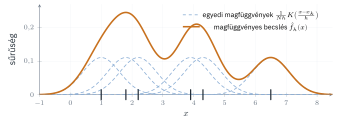
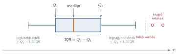

# Feltáró adatelemzés és dimenziócsökkentés {#sec-feltaro}

```{python}
#| include: false
import numpy as np
import pandas as pd
import matplotlib.pyplot as plt
from scipy import stats
import adatbanyaszat as ab
ab.set_style()
pd.set_option("display.max_columns", 12)
pd.set_option("display.width", 110)
```

::: {.roadmap}
Mielőtt modellt építenénk, meg kell ismernünk az adatainkat: hogyan oszlanak el az
egyes változók, hogyan függnek össze egymással, vannak-e csoportok, trendek, szokatlan
pontok. Ez a fejezet a feltáró adatelemzés (exploratory data analysis) eszköztárát
mutatja be: a leíró statisztikákat, az egyváltozós eloszlások ábrázolását
(hisztogram, magfüggvényes sűrűségbecslés, dobozdiagram, kvantilis ábrák), a
többváltozós kapcsolatok vizsgálatát (korreláció, pontdiagram-mátrix, párhuzamos
koordináták), végül a sokdimenziós adatok áttekintését lehetővé tevő
dimenziócsökkentési módszereket – a főkomponens-elemzést, a többdimenziós skálázást és
a t-SNE-t.

**A fejezet végére az olvasó** képes lesz egy adathalmazt leíró statisztikákkal és ábrákkal
jellemezni; a megfelelő ábratípust kiválasztani; a főkomponens-elemzést levezetni,
végrehajtani és értelmezni (megmagyarázott variancia, főkomponens-értékek, súlyok); és
megítélni a nemlineáris vetítések erősségeit és csapdáit.
:::

## A feltáró adatelemzés szemlélete {#sec-eda-szemlelet}

A feltáró adatelemzés fogalmát @tukey1977 vezette be, szembeállítva a hipotézisvizsgáló
(megerősítő) statisztikával. A megerősítő elemzés egy előre megfogalmazott kérdésre
keres választ; a feltáró elemzés célja éppen a kérdések *megtalálása*: mit mutatnak
az adatok, mi meglepő bennük, milyen feltevéseket érdemes később ellenőrizni. Ennek
fő eszköze a vizualizáció – nem azért, mert a számok rosszak, hanem mert egyetlen szám
sok, nagyon különböző adatsort írhat le.

Ezt a legvilágosabban @anscombe1973 négy adatsora mutatja ([-@tbl-anscombe]. táblázat
és [-@fig-anscombe]. ábra). A négy adatsorban az $x$ és $y$ változók átlaga, szórása,
korrelációja és a rájuk illesztett regressziós egyenes két tizedesjegy pontossággal
megegyezik – az ábrák viszont négy teljesen különböző helyzetet mutatnak: egy közel
lineáris kapcsolatot, egy görbe vonalút, egy egyetlen kiugró érték által eltorzított
lineárisat, és egy olyat, ahol a korrelációt egyetlen pont hozza létre.

```{python}
#| label: tbl-anscombe
#| tbl-cap: "Anscombe négy adatsorának leíró statisztikái."
anscombe = {
    "I":   ([10, 8, 13, 9, 11, 14, 6, 4, 12, 7, 5],
            [8.04, 6.95, 7.58, 8.81, 8.33, 9.96, 7.24, 4.26, 10.84, 4.82, 5.68]),
    "II":  ([10, 8, 13, 9, 11, 14, 6, 4, 12, 7, 5],
            [9.14, 8.14, 8.74, 8.77, 9.26, 8.10, 6.13, 3.10, 9.13, 7.26, 4.74]),
    "III": ([10, 8, 13, 9, 11, 14, 6, 4, 12, 7, 5],
            [7.46, 6.77, 12.74, 7.11, 7.81, 8.84, 6.08, 5.39, 8.15, 6.42, 5.73]),
    "IV":  ([8, 8, 8, 8, 8, 8, 8, 19, 8, 8, 8],
            [6.58, 5.76, 7.71, 8.84, 8.47, 7.04, 5.25, 12.50, 5.56, 7.91, 6.89]),
}
def jellemzok(x, y):
    x, y = np.array(x, float), np.array(y, float)
    b1, b0 = np.polyfit(x, y, 1)
    return {"átlag x": x.mean(), "átlag y": y.mean(), "szórás x": x.std(ddof=1),
            "szórás y": y.std(ddof=1), "korreláció": np.corrcoef(x, y)[0, 1],
            "meredekség": b1, "tengelymetszet": b0}
pd.DataFrame({k: jellemzok(*v) for k, v in anscombe.items()}).round(2)
```

```{python}
#| label: fig-anscombe
#| fig-cap: "Anscombe négy adatsora: azonos leíró statisztikák, teljesen eltérő szerkezet [@anscombe1973]."
#| fig-width: 7
#| fig-height: 2.4
fig, ax = plt.subplots(1, 4, sharex=True, sharey=True)
xx = np.array([3, 20])
for a, (k, (x, y)) in zip(ax, anscombe.items()):
    b1, b0 = np.polyfit(x, y, 1)
    a.scatter(x, y, s=18, color=ab.PALETTE[0], zorder=3)
    a.plot(xx, b0 + b1 * xx, color=ab.PALETTE[1], lw=1.2)
    a.set_title(k)
fig.tight_layout()
```

A tanulság egyszerű, de alapvető: **mielőtt egy összefüggést számszerűsítenénk, nézzük
meg.** A vizualizáció tervezésének elveiről a további olvasmányok között ajánlott
irodalom szól; itt csak egy, kísérletekkel alátámasztott szempontot emelünk ki:
az emberi szem a közös skálán elhelyezkedő pozíciókat sokkal pontosabban hasonlítja
össze, mint a szögeket, területeket vagy színárnyalatokat [@cleveland1984]. Ezért
mennyiségek összehasonlítására az oszlop- és pontdiagram jobb választás, mint a
kördiagram.

## Egy változó eloszlásának jellemzése {#sec-egyvaltozos}

### Leíró statisztikák

Egy numerikus változó $x_1, \dots, x_N$ mintáját három szempontból jellemezzük: hol
helyezkedik el (közép), mennyire szóródik, és milyen az alakja.

**Középértékek.** A számtani átlag $\bar{x} = \frac1N\sum_k x_k$ minden megfigyelést
figyelembe vesz, de érzékeny a kiugró értékekre. A medián (a rendezett minta középső
eleme) robusztus. A módusz a leggyakoribb érték; kategorikus változóknál ez az
egyetlen értelmes középérték.

**Szóródás.** A tapasztalati szórásnégyzet és a szórás

$$
s^2 = \frac{1}{N-1}\sum_{k=1}^{N}(x_k-\bar{x})^2, \qquad s = \sqrt{s^2}.
$$ {#eq-szorasnegyzet}

Az $N-1$-es nevező (Bessel-korrekció) teszi a becslést torzítatlanná; a részleteket a
[-@sec-app-valszam]. függelék tárgyalja. Robusztus szóródási mérőszám az
interkvartilis terjedelem ($\mathrm{IQR} = Q_3 - Q_1$) és a MAD
([-@sec-kiugro]. alfejezet).

**Alak.** A ferdeség és a csúcsosság a harmadik, illetve negyedik centrált momentumon
alapul:

$$
g_1 = \frac{\frac1N\sum_k (x_k-\bar{x})^3}{\left(\frac1N\sum_k (x_k-\bar{x})^2\right)^{3/2}},
\qquad
g_2 = \frac{\frac1N\sum_k (x_k-\bar{x})^4}{\left(\frac1N\sum_k (x_k-\bar{x})^2\right)^{2}} - 3.
$$ {#eq-ferdeseg}

A normális eloszlás ferdesége és (a $-3$-mal korrigált) csúcsossága nulla. Pozitív
ferdeség jobbra elnyúló, hosszú jobb oldali „farkú” eloszlást jelez – ilyen a vásárlási
érték és a legtöbb mennyiségi változó.

```{python}
vevok = ab.customer_table()
oszl = ["R_nap", "F_szamla", "M_ertek", "atl_kosarertek", "atl_koztes_nap"]
leiro = vevok[oszl].describe().T
leiro["ferdeség"] = vevok[oszl].skew()
leiro["csúcsosság"] = vevok[oszl].kurt()
leiro.round(1)
```

::: {.eset-uzleti}
A vevőszintű táblában az átlag és a medián (50%) között nagy a különbség a
vásárlási érték és az átlagos kosárérték esetén: az átlag többszöröse a mediánnak. Ez
erős jobbra ferdeséget jelez – kevés, nagyon sokat vásárló vevő (a viszonteladók)
húzza fel az átlagot. Az ilyen változókra a medián jobb „tipikus érték”, és a
modellezés előtt logaritmikus vagy más eloszlás-transzformáció indokolt
([-@sec-transzformaciok]. alfejezet).
:::

### Hisztogram és magfüggvényes sűrűségbecslés

A **hisztogram** a változó tartományát egyenlő szélességű intervallumokra bontja, és
mindegyik fölé az oda eső megfigyelések számával (vagy relatív gyakoriságával) arányos
magasságú oszlopot rajzol. A kép erősen függ az intervallumszélességtől: túl keskeny
intervallumoknál zajos, túl szélesnél elmossa a szerkezetet. A Freedman–Diaconis-szabály
az intervallumszélességet a $h = 2\,\mathrm{IQR}\,N^{-1/3}$ képlettel választja
[@freedman1981]; ez a kiugró értékekre kevéssé érzékeny.

A **magfüggvényes sűrűségbecslés** (kernel density estimation, KDE) a hisztogram sima
változata ([-@fig-kde]. ábra). Minden megfigyelés köré egy kis, egységnyi területű
„dombot” (magfüggvényt, $K$) helyezünk, és ezeket összegezzük:

$$
\hat f_h(x) = \frac{1}{N h}\sum_{k=1}^{N} K\!\left(\frac{x - x_k}{h}\right),
\qquad K(u) = \frac{1}{\sqrt{2\pi}}e^{-u^2/2}.
$$ {#eq-kde}

A $h$ sávszélesség a hisztogram intervallumszélességének szerepét tölti be. Egy
gyakran használt választás Silverman ökölszabálya, $h = 0{,}9\,\min\!\left(s,
\mathrm{IQR}/1{,}34\right) N^{-1/5}$ [@silverman1986], amely közel normális eloszlásra
optimális, többcsúcsú eloszlásokra viszont túlsimíthat.

{#fig-kde width=100%}

### Dobozdiagram, kvantilis ábrák

A **dobozdiagram** [@tukey1977] öt számmal foglalja össze az eloszlást
([-@fig-doboz-anatomia]. ábra): a doboz a két kvartilis között húzódik, benne a medián, a
„bajuszok” a kerítéseken belüli legszélső értékekig nyúlnak, a kerítéseken kívüli
pontokat egyenként jelöljük. Előnye, hogy sok csoport eloszlása tömören egymás mellé
rajzolható.

{#fig-doboz-anatomia width=95%}

```{python}
#| label: fig-doboz-honap
#| fig-cap: "A hűtővíz-hőmérséklet havi eloszlása dobozdiagramokon. Jól látszik az évszakos változás és az, hogy nyáron a szóródás is nagyobb; a kiugró pontok egy része a hűtővíz-kiesésekhez tartozik."
#| fig-width: 7
#| fig-height: 3
plant = ab.load_plant()
h = plant.hourly.dropna(subset=["T_hutoviz"])
csoport = [g.T_hutoviz.values for _, g in h.groupby(h.ido.dt.month)]
fig, ax = plt.subplots()
ax.boxplot(csoport, widths=0.6, flierprops=dict(marker="o", markersize=2, alpha=0.4),
           medianprops=dict(color=ab.PALETTE[1], lw=1.6),
           boxprops=dict(color=ab.PE_BLUE), whiskerprops=dict(color=ab.PE_BLUE))
ax.set_xticks(range(1, 13), ["jan", "feb", "márc", "ápr", "máj", "jún", "júl", "aug", "szept", "okt", "nov", "dec"])
ax.set_ylabel("hűtővíz-hőmérséklet [°C]")
fig.tight_layout()
```

A **kvantilis–kvantilis (Q–Q) ábra** két eloszlás alakját hasonlítja össze: a minta
rendezett értékeit egy elméleti eloszlás (leggyakrabban a normális) megfelelő
kvantiliseinek függvényében ábrázolja. Ha a minta az elméleti eloszlásból származik, a
pontok egy egyenesre esnek; a görbülés ferdeséget, az „S” alak a normálisnál nehezebb
vagy könnyebb farkakat jelez.

```{python}
#| label: fig-qq
#| fig-cap: "Normális Q–Q ábra a vevők teljes vásárlási értékére (balra) és annak logaritmusára (jobbra). Az eredeti változó erősen jobbra ferde; a logaritmus jóval közelebb van a normálishoz, bár a két szélen még eltér tőle."
#| fig-width: 7
#| fig-height: 2.8
fig, ax = plt.subplots(1, 2)
for a, adat, cim in [(ax[0], vevok.M_ertek, "vásárlási érték"), (ax[1], np.log10(vevok.M_ertek), "log$_{10}$(vásárlási érték)")]:
    (osm, osr), (b, a0, r) = stats.probplot(adat, dist="norm")
    a.scatter(osm, osr, s=5, color=ab.PALETTE[0], alpha=0.6)
    a.plot(osm, a0 + b * osm, color=ab.PALETTE[1], lw=1.2)
    a.set_title(cim); a.set_xlabel("elméleti normális kvantilis")
ax[0].set_ylabel("mintakvantilis")
fig.tight_layout()
```

## Több változó együttes vizsgálata {#sec-tobbvaltozos}

### Korreláció

Két numerikus változó lineáris kapcsolatát a Pearson-féle korrelációs együttható
méri ([-@eq-pearson]). A **Spearman-féle rangkorreláció** [@spearman1904] ugyanezt a
képletet a megfigyelések rangszámaira alkalmazza; így bármilyen monoton (nem csak
lineáris) kapcsolatot kimutat, és kevéssé érzékeny a kiugró értékekre. Sok változó
esetén a páronkénti korrelációkat **korrelációs mátrixba** rendezzük, és hőtérképen
ábrázoljuk.

```{python}
#| label: fig-korr
#| fig-cap: "A Pannon üzem órás folyamatváltozóinak Pearson-féle (bal felső háromszög) és Spearman-féle (jobb alsó háromszög) korrelációs mátrixa."
#| fig-width: 6.5
#| fig-height: 5.2
valt = ["T_kornyezet", "F_betap", "c_betap", "T_betap", "T_reaktor", "F_hutoviz",
        "T_hutoviz", "P_reaktor", "P_kevero", "E_fogyasztas"]
hh = plant.hourly[plant.hourly.F_betap > 1][valt].dropna()
P, S = hh.corr(method="pearson").to_numpy(), hh.corr(method="spearman").to_numpy()
M = np.where(np.triu(np.ones_like(P, bool), 1), P, S)
np.fill_diagonal(M, 1)
fig, ax = plt.subplots()
im = ax.imshow(M, cmap="RdBu_r", vmin=-1, vmax=1)
ax.set_xticks(range(len(valt)), valt, rotation=60, ha="right", fontsize=8)
ax.set_yticks(range(len(valt)), valt, fontsize=8)
for i in range(len(valt)):
    for j in range(len(valt)):
        ax.text(j, i, f"{M[i, j]:.1f}", ha="center", va="center", fontsize=6.5,
                color="white" if abs(M[i, j]) > 0.6 else "#1F2933")
ax.grid(False)
fig.colorbar(im, ax=ax, shrink=0.8)
fig.tight_layout()
```

::: {.callout-warning title="A korreláció nem okozati kapcsolat"}
A [-@fig-korr]. ábrán a betáplálási áram és a keverőteljesítmény erősen korrelál, holott
egyik sem okozza a másikat: mindkettő a gyártott termékminőségtől függ. Az ilyen
közös okot **zavaró változónak** (confounder) nevezzük. A korreláció mindig csak
együttmozgást jelez; okozati következtetéshez kísérlet vagy a zavaró változók
kontrollálása szükséges.
:::

### Pontdiagram-mátrix és párhuzamos koordináták

A **pontdiagram-mátrix** minden változópárra egy pontdiagramot rajzol, az átlóban az
egyes változók eloszlásával. Sok változónál áttekinthetetlenné válik, de 4–6 változóra
kiváló első áttekintést ad, különösen ha a pontokat egy kategorikus változó szerint
színezzük.

```{python}
#| label: fig-pairplot
#| fig-cap: "Pontdiagram-mátrix a Pannon üzem négy változójára, termékenként színezve (1000 véletlen órás minta). A termékek jól elkülönülő felhőket alkotnak a reaktorhőmérséklet és a keverőteljesítmény síkjában."
#| fig-width: 6.5
#| fig-height: 6
import seaborn as sns
minta = (plant.hourly[plant.hourly.F_betap > 1]
         .dropna(subset=["T_reaktor"]).sample(1000, random_state=0))
g = sns.pairplot(minta[["T_reaktor", "F_hutoviz", "P_kevero", "E_fogyasztas", "termek"]],
                 hue="termek", hue_order=["A", "B", "C"], palette=ab.PALETTE[:3],
                 plot_kws=dict(s=8, alpha=0.6, linewidth=0), diag_kind="kde", height=1.5)
```

A **párhuzamos koordináták** [@inselberg1985] a változókat egymással párhuzamos
függőleges tengelyekre helyezik, és minden megfigyelést a tengelyeken felvett
értékeit összekötő töröttvonalként ábrázolnak. Így tetszőleges számú változó egy
ábrán jeleníthető meg; a csoportok egymástól elkülönülő vonalkötegekként, a
negatív korreláció a tengelyek között kereszteződő vonalakként ismerhető fel. Az
értelmezhetőséghez a változókat azonos skálára (például $[0,1]$) kell hozni.

```{python}
#| label: fig-parhuzamos
#| fig-cap: "Párhuzamos koordináták a Pannon üzem órás adataira (min–max skálázás után, termékenként 60 véletlen óra)."
#| fig-width: 7
#| fig-height: 3
from pandas.plotting import parallel_coordinates
pk = plant.hourly[plant.hourly.F_betap > 1].dropna(subset=valt)
pk = pk.groupby("termek", group_keys=False).sample(60, random_state=1)
norm = (pk[valt] - pk[valt].min()) / (pk[valt].max() - pk[valt].min())
norm["termek"] = pk.termek.values
fig, ax = plt.subplots()
parallel_coordinates(norm, "termek", color=ab.PALETTE[:3], alpha=0.35, lw=0.8, ax=ax)
ax.tick_params(axis="x", rotation=40, labelsize=8)
ax.legend(title="termék", loc="upper right")
fig.tight_layout()
```

## Dimenziócsökkentés: főkomponens-elemzés {#sec-pca}

Ha egy objektumot sok változó ír le, a változók közötti összefüggések miatt az adatok
gyakran egy alacsonyabb dimenziós altér közelében helyezkednek el. A Pannon üzem tíz
folyamatváltozója például nem tíz független információt hordoz: a hőmérsékletek, áramok
és teljesítmények együtt mozognak, mert ugyanazok a fizikai törvények kötik össze őket.
A **dimenziócsökkentés** célja, hogy az adatokat kevesebb új változóval írjuk le úgy,
hogy a lényeges információ megmaradjon. Ez megkönnyíti a megjelenítést (2–3 dimenzió
ábrázolható), csökkenti a zajt és a számítási igényt, és a korrelált változók
problémáját is kezeli.

### Levezetés: a legnagyobb variancia iránya

A **főkomponens-elemzés** (principal component analysis, PCA) @pearson1901 és
@hotelling1933 munkáira megy vissza; korszerű áttekintését @jolliffe2016 adja. Az ötlet:
keressük azt az irányt, amely mentén az adatok szórása a legnagyobb, majd erre
merőlegesen a következő legnagyobb szórású irányt, és így tovább
([-@fig-pca-geom]. ábra). A szükséges lineáris algebrai fogalmakat (skaláris szorzat,
vetítés, sajátérték, sajátvektor, szinguláris felbontás) a [-@sec-app-linalg]. függelék
részletesen tárgyalja.

Legyen $\mathbf{X}_c$ az oszloponként centrált adatmátrix (minden oszlopból kivontuk az
oszlop átlagát), és

$$
\mathbf{C} = \frac{1}{N-1}\,\mathbf{X}_c^\top \mathbf{X}_c \in \mathbb{R}^{n\times n}
$$ {#eq-kovariancia}

a tapasztalati kovarianciamátrix. Egy $\mathbf{v}$ egységvektor irányába vetítve az
adatokat, a $k$-adik objektum vetülete $t_k = \mathbf{x}_{c,k}^\top\mathbf{v}$, a
vetületek szórásnégyzete pedig

$$
\frac{1}{N-1}\sum_{k=1}^{N} t_k^2 = \frac{1}{N-1}\,\mathbf{v}^\top\mathbf{X}_c^\top\mathbf{X}_c\mathbf{v}
= \mathbf{v}^\top\mathbf{C}\,\mathbf{v}.
$$

A legnagyobb szórású irány tehát a

$$
\max_{\mathbf{v}}\; \mathbf{v}^\top\mathbf{C}\,\mathbf{v}
\quad\text{feltéve, hogy}\quad \mathbf{v}^\top\mathbf{v} = 1
$$ {#eq-pca-opt}

feltételes szélsőérték-feladat megoldása. A Lagrange-függvény
$\mathcal{L}(\mathbf{v},\lambda) = \mathbf{v}^\top\mathbf{C}\mathbf{v} -
\lambda(\mathbf{v}^\top\mathbf{v} - 1)$; a $\mathbf{v}$ szerinti gradienst nullává téve

$$
\nabla_{\mathbf{v}}\mathcal{L} = 2\mathbf{C}\mathbf{v} - 2\lambda\mathbf{v} = \mathbf{0}
\quad\Longrightarrow\quad
\mathbf{C}\mathbf{v} = \lambda\mathbf{v}.
$$ {#eq-pca-sajat}

Az optimális irány tehát $\mathbf{C}$ egy sajátvektora, és mivel ilyenkor
$\mathbf{v}^\top\mathbf{C}\mathbf{v} = \lambda\mathbf{v}^\top\mathbf{v} = \lambda$, a
vetületek szórásnégyzete éppen a megfelelő sajátérték. A legnagyobb szórást a
**legnagyobb sajátértékhez** tartozó sajátvektor adja: ez az **első főkomponens**
iránya. Mivel $\mathbf{C}$ szimmetrikus és pozitív szemidefinit, sajátértékei nemnegatív
valós számok, $\lambda_1 \ge \lambda_2 \ge \dots \ge \lambda_n \ge 0$, a sajátvektorok
pedig ortonormált bázist alkotnak. A második főkomponens az elsőre merőleges irányok
közül a legnagyobb szórású – ez a második sajátvektor –, és így tovább.

{#fig-pca-geom width=70%}

### Főkomponens-értékek, súlyok és a megmaradt variancia

Gyűjtsük az első $q$ sajátvektort a $\mathbf{V}_q = [\mathbf{v}_1, \dots,
\mathbf{v}_q] \in \mathbb{R}^{n\times q}$ mátrixba. Az objektumok új, $q$ dimenziós
koordinátái – a **főkomponens-értékek** (scores) – és az eredeti adatok ezekből
visszaállított közelítése:

$$
\mathbf{T} = \mathbf{X}_c\mathbf{V}_q \in \mathbb{R}^{N\times q},
\qquad
\hat{\mathbf{X}}_c = \mathbf{T}\mathbf{V}_q^\top .
$$ {#eq-pca-score}

A $\mathbf{V}_q$ oszlopainak elemei a **súlyok** (loadings): megmutatják, hogy az egyes
eredeti változók milyen mértékben járulnak hozzá egy főkomponenshez, és ezen keresztül
a főkomponensek értelmezését teszik lehetővé.

Az összes változó együttes szórásnégyzete (a kovarianciamátrix nyoma) a sajátértékek
összege: $\operatorname{tr}\mathbf{C} = \sum_{j=1}^{n}\lambda_j$. Az első $q$
főkomponens által **megmagyarázott varianciahányad** és a visszaállítás átlagos
négyzetes hibája:

$$
\eta_q = \frac{\sum_{j=1}^{q}\lambda_j}{\sum_{j=1}^{n}\lambda_j},
\qquad
\frac{1}{N-1}\bigl\|\mathbf{X}_c - \hat{\mathbf{X}}_c\bigr\|_F^2 = \sum_{j=q+1}^{n}\lambda_j .
$$ {#eq-pca-hiba}

A közelítés hibája tehát az **elhagyott** sajátértékek összege. (Az első kiadás e
képletet tévesen a megtartott sajátértékek összegeként közölte; a megtartott
sajátértékek összege a megmagyarázott variancia.) Ez az összefüggés egyben azt is
mutatja, hogy a PCA a $q$ dimenziós lineáris alterek közül a legkisebb négyzetes
visszaállítási hibát adja – ez az Eckart–Young-tétel következménye [@eckart1936].

A gyakorlatban a sajátérték-felbontás helyett numerikusan stabilabb a centrált
adatmátrix **szinguláris felbontása** (SVD):

$$
\mathbf{X}_c = \mathbf{U}\boldsymbol{\Sigma}\mathbf{V}^\top,
\qquad
\lambda_j = \frac{\sigma_j^2}{N-1},
\qquad
\mathbf{T} = \mathbf{U}_q\boldsymbol{\Sigma}_q .
$$ {#eq-pca-svd}

A $\mathbf{V}$ jobb oldali szinguláris vektorai a főkomponens-irányok, a $\sigma_j$
szinguláris értékek négyzetei a sajátértékekkel arányosak. A `scikit-learn` `PCA`
osztálya ezt az utat követi.

::: {.callout-important title="Az algoritmus összefoglalása: főkomponens-elemzés"}
1. Centráljuk az adatmátrixot (oszloponként kivonjuk az átlagot); eltérő mértékegységű
   változók esetén standardizáljuk is (ez a korrelációs mátrixon végzett PCA).
2. Számítsuk ki a centrált mátrix szinguláris felbontását, vagy a kovarianciamátrix
   sajátérték-felbontását ([-@eq-kovariancia]–[-@eq-pca-sajat]).
3. Rendezzük a sajátértékeket csökkenő sorrendbe; válasszuk meg a megtartott
   főkomponensek $q$ számát (például $\eta_q \ge 0{,}9$, vagy a sajátérték-diagram
   „könyöke” alapján).
4. Számítsuk ki a főkomponens-értékeket ($\mathbf{T} = \mathbf{X}_c\mathbf{V}_q$), és
   értelmezzük a főkomponenseket a súlyok alapján.
:::

::: {.callout-warning title="Skálázás nélkül a nagy számok nyernek"}
A PCA a varianciát maximalizálja, ezért a nagy mértékegységű (nagy szórású) változók
uralják. Ha a változók eltérő mértékegységűek – °C, m³/h, kW –, a PCA előtt
standardizálni kell őket. Ilyenkor a kovarianciamátrix helyett lényegében a
korrelációs mátrix sajátértékeit és sajátvektorait számoljuk.
:::

### Kézi megvalósítás és ellenőrzés

Valósítsuk meg a PCA-t NumPy-jal a Pannon üzem tíz folyamatváltozóján, és ellenőrizzük
a ([-@eq-pca-hiba]) összefüggést!

```{python}
Xh = plant.hourly[plant.hourly.F_betap > 1].dropna(subset=valt)
X = Xh[valt].to_numpy()
Z = (X - X.mean(0)) / X.std(0, ddof=1)          # standardizálás
N = Z.shape[0]

C = Z.T @ Z / (N - 1)                            # = korrelációs mátrix
lam, V = np.linalg.eigh(C)                       # szimmetrikus mátrix sajátfelbontása
order = np.argsort(lam)[::-1]
lam, V = lam[order], V[:, order]

q = 3
T = Z @ V[:, :q]                                 # főkomponens-értékek
Z_hat = T @ V[:, :q].T                           # visszaállítás
hiba = np.sum((Z - Z_hat) ** 2) / (N - 1)
print("sajátértékek:", np.round(lam, 3))
print(f"megmagyarázott varianciahányad (q={q}): {lam[:q].sum() / lam.sum():.3f}")
print(f"visszaállítási hiba: {hiba:.4f}   elhagyott sajátértékek összege: {lam[q:].sum():.4f}")
```

A két utolsó szám egyezik, ahogy a ([-@eq-pca-hiba]) képlet állítja. A `scikit-learn`
SVD-alapú megvalósítása ugyanezt adja (a sajátvektorok előjele tetszőleges, ezért csak
abszolút értékben hasonlítunk):

```{python}
from sklearn.decomposition import PCA
pca = PCA().fit(Z)
print(np.allclose(pca.explained_variance_, lam),
      np.allclose(np.abs(pca.components_[:q]), np.abs(V[:, :q].T)))
```

### Értelmezés: a Pannon üzem főkomponensei

```{python}
#| label: fig-scree
#| fig-cap: "A Pannon üzem folyamatváltozóinak sajátérték-diagramja (oszlopok) és a kumulált megmagyarázott varianciahányad (vonal)."
#| fig-width: 6
#| fig-height: 2.8
fig, ax = plt.subplots()
ax.bar(range(1, len(lam) + 1), lam, color=ab.PALETTE[0], width=0.6)
ax2 = ax.twinx()
ax2.plot(range(1, len(lam) + 1), np.cumsum(lam) / lam.sum(), color=ab.PALETTE[1], marker="o")
ax2.set_ylim(0, 1.05); ax2.grid(False); ax2.set_ylabel("kumulált hányad")
ax.set_xlabel("főkomponens"); ax.set_ylabel("sajátérték")
ax.set_xticks(range(1, len(lam) + 1))
fig.tight_layout()
```

```{python}
suly = pd.DataFrame(V[:, :3], index=valt, columns=["PC1", "PC2", "PC3"])
suly.round(2)
```

```{python}
#| label: fig-pca-uzem
#| fig-cap: "A Pannon üzem órás adatainak első két főkomponense. Balra termékenként színezve: a három termék elkülönülő felhőket alkot. Jobbra a hónap szerint színezve: a termékeken belül az évszakos változás is kirajzolódik."
#| fig-width: 7
#| fig-height: 3.2
fig, ax = plt.subplots(1, 2, sharex=True, sharey=True)
for g, c in zip(["A", "B", "C"], ab.PALETTE):
    sel = (Xh.termek == g).to_numpy()
    ax[0].scatter(T[sel, 0], T[sel, 1], s=3, alpha=0.4, color=c, label=g)
ax[0].legend(title="termék", markerscale=4)
sc = ax[1].scatter(T[:, 0], T[:, 1], s=3, alpha=0.5, c=Xh.ido.dt.month, cmap="twilight")
fig.colorbar(sc, ax=ax[1], label="hónap")
for a in ax: a.set_xlabel("PC1")
ax[0].set_ylabel("PC2")
fig.tight_layout()
```

::: {.eset-mernoki}
A súlyok alapján a főkomponensek fizikailag értelmezhetők. Az egyik fő irányt a
termékfüggő változók (betáplálás, betáplált koncentráció, keverőteljesítmény,
reaktorhőmérséklet és -nyomás) határozzák meg – ez a *termékminőség-tengely*; egy másikat a környezeti és a
hűtővíz-hőmérséklet, valamint a hűtővízáram – ez az *évszak- és hűtéstengely*. Tíz mért
változó helyett így két-három, jól értelmezhető „rejtett” változóval írható le az üzem
állapota. A [-@sec-anomalia]. fejezetben erre építve fogjuk a hibákat felismerni:
egy hibás állapot vagy szokatlan helyre kerül a főkomponensek terében, vagy a
főkomponensekkel nem magyarázható maradékot hoz létre.
:::

## Nemlineáris vetítések {#sec-nemlinearis}

A PCA lineáris: az adatokat egy síkra (altérre) vetíti. Ha az adatok egy görbült
felület mentén helyezkednek el, vagy a csoportok nem választhatók el lineárisan,
nemlineáris módszerek adhatnak hűbb képet.

A **többdimenziós skálázás** (multidimensional scaling, MDS) az objektumok közötti
távolságokból indul ki, és olyan alacsony dimenziós elhelyezést keres, amelyben a
távolságok a lehető legjobban egyeznek az eredetiekkel. A klasszikus (metrikus) MDS
[@torgerson1952] euklideszi távolságok esetén a PCA-val egyenértékű eredményt ad; a
nemmetrikus változat csak a távolságok sorrendjét igyekszik megőrizni [@kruskal1964].
A **Sammon-leképezés** [@sammon1969] a kis távolságok megőrzésére helyez nagyobb
hangsúlyt; az eredeti ($d_{ij}^{*}$) és a leképezett ($d_{ij}$) távolságok eltérését az

$$
E = \frac{1}{\sum_{i<j} d_{ij}^{*}}\sum_{i<j}\frac{\bigl(d_{ij}^{*} - d_{ij}\bigr)^2}{d_{ij}^{*}}
$$ {#eq-sammon}

hibafüggvénnyel méri, amelyben a $1/d_{ij}^{*}$ súly a közeli pontpárokat hangsúlyozza.

A **t-SNE** (t-distributed stochastic neighbor embedding) [@vandermaaten2008] a ma
legelterjedtebb vizualizációs célú nemlineáris vetítés. Az eredeti térben minden
pontpárhoz egy valószínűséget rendel, amely annál nagyobb, minél közelebbi szomszédok;
az alacsony dimenziós térben hasonló, de nehéz farkú (Student-$t$) eloszlással számol,
és a kettő közötti Kullback–Leibler-eltérést minimalizálja. A helyi szomszédsági
szerkezetet kiválóan megőrzi, ezért a csoportok jól elkülönülnek. Használatakor
azonban óvatosnak kell lenni [@wattenberg2016]:

- az eredmény erősen függ a *perplexitás* paramétertől (az effektív szomszédszámtól);
- a csoportok mérete és a csoportok közötti távolságok a t-SNE-ábrán **nem
  értelmezhetők**;
- az algoritmus véletlen kezdőpontból indul, így különböző futtatások eltérő képet adhatnak;
- tisztán véletlen adatokban is „csoportokat” mutathat.

A t-SNE tehát feltáró vizualizációra való, nem a távolságokon alapuló további
elemzésre. Hasonló célú, újabb módszer az UMAP [@mcinnes2018].

::: {.eset-uzleti}
Vetítsük két dimenzióba a PannonShop vevőinek standardizált vásárlási jellemzőit
PCA-val, metrikus MDS-sel és t-SNE-vel! Az ábrán a pontokat a szimulátor rejtett
szegmensei szerint színezzük – ezt a valós elemzésben nem ismernénk, itt viszont
megmutatja, melyik vetítés őrzi meg legjobban a csoportszerkezetet.
:::

```{python}
#| label: fig-vetitesek
#| fig-cap: "A PannonShop vevőinek kétdimenziós vetületei (600 véletlenszerűen kiválasztott vevő), a szimulátor rejtett szegmensei szerint színezve."
#| fig-width: 7.2
#| fig-height: 2.8
from sklearn.manifold import MDS, TSNE
from sklearn.preprocessing import StandardScaler
shop = ab.load_shop()
jell = ["R_nap", "F_szamla", "M_ertek", "atl_kosarertek", "atl_kosarmeret", "atl_mennyiseg",
        "akcios_arany", "arany_kave", "arany_gep", "arany_konyha", "arany_dekor", "arany_ajandek", "arany_iroszer"]
vt = vevok[jell].copy()
for c in ["F_szamla", "M_ertek", "atl_kosarertek", "atl_mennyiseg"]:
    vt[c] = np.log1p(vt[c])
vt = vt.sample(600, random_state=0)
Zv = StandardScaler().fit_transform(vt)
szegmens = shop.truth["segment"].reindex(vt.index).to_numpy()
vetuletek = {
    "PCA": PCA(n_components=2).fit_transform(Zv),
    "metrikus MDS": MDS(n_components=2, random_state=0, n_init=1, max_iter=300).fit_transform(Zv),
    "t-SNE (perplexitás 30)": TSNE(n_components=2, perplexity=30, random_state=0).fit_transform(Zv),
}
fig, ax = plt.subplots(1, 3)
szegm_nevek = ["törzsvásárló", "alkalmi", "akcióvadász", "viszonteladó", "lemorzsolódó"]
for a, (nev, Y) in zip(ax, vetuletek.items()):
    for s, c in zip(szegm_nevek, ab.PALETTE):
        sel = szegmens == s
        a.scatter(Y[sel, 0], Y[sel, 1], s=5, color=c, alpha=0.7, label=s)
    a.set_title(nev, fontsize=10); a.set_xticks([]); a.set_yticks([])
ax[0].legend(fontsize=7, markerscale=2.5, loc="lower left")
fig.tight_layout()
```

A vetületek megmutatják, hogy a szegmensek egy része (például a viszonteladók és az
alkalmi vásárlók) jól elkülönül, mások – a törzsvásárlók és a később lemorzsolódók –
erősen átfednek. Ez nem a módszerek hibája: a lemorzsolódó vevők az elpártolásukig
hasonlóan viselkednek, mint a törzsvásárlók, a különbség a *jövőbeli* viselkedésükben
van. Ezt a kérdést a felügyelt tanulás eszközeivel, a [-@sec-osztalyozas]. fejezetben
vizsgáljuk.





## Összefoglalás {#sec-feltaro-osszefoglalas}

- A feltáró elemzés célja a kérdések megtalálása; fő eszköze a vizualizáció, mert a
  leíró statisztikák nagyon eltérő adatsorokat is azonosnak mutathatnak.
- Egy változó eloszlását középérték, szóródás és alak jellemzi; ferde eloszlásokra a
  medián és az IQR jobb mérőszám, mint az átlag és a szórás.
- A hisztogram, a magfüggvényes sűrűségbecslés, a dobozdiagram és a Q–Q ábra az
  eloszlás különböző tulajdonságait emeli ki.
- A korreláció lineáris (Pearson) vagy monoton (Spearman) együttmozgást mér, okozati
  kapcsolatot nem.
- A PCA a kovarianciamátrix sajátvektoraira vetít; a $k$-adik sajátérték a $k$-adik
  főkomponens varianciája, a visszaállítás hibája az elhagyott sajátértékek összege.
- A nemlineáris vetítések (MDS, Sammon, t-SNE) a helyi szerkezetet jobban megőrizhetik,
  de a t-SNE ábráin a távolságok és csoportméretek nem értelmezhetők.

## Ellenőrző kérdések {.unnumbered}

1. Miért tanulságos Anscombe négy adatsora? Mit mutatna meg közülük egy hisztogram?
2. Mikor jobb középérték a medián, mint az átlag?
3. Mit jelent, ha egy Q–Q ábra pontjai jobbra felfelé elhajlanak az egyenestől?
4. Miért kell a PCA előtt standardizálni a Pannon üzem változóit?
5. Mekkora a visszaállítás hibája, ha $n=5$ változó sajátértékei 2,8; 1,2; 0,6; 0,3; 0,1,
   és két főkomponenst tartunk meg? Mekkora a megmagyarázott varianciahányad?
6. Miért nem szabad egy t-SNE-ábrán a csoportok közötti távolságot értelmezni?

## Feladatok {.unnumbered}

1. **Hisztogram és sávszélesség.** Ábrázolja a vevők átlagos kosárértékének logaritmusát
   hisztogramon 10, 30 és 100 intervallummal, valamint magfüggvényes becsléssel három
   különböző sávszélességgel! Melyik kép mutat meg két csúcsot, és mi lehet ennek az oka?
2. **Spearman vagy Pearson?** Számítsa ki a vevők vásárlásszáma (F) és vásárlási értéke (M)
   közötti Pearson- és Spearman-korrelációt! Miért tér el a kettő?
3. **PCA lépésről lépésre.** Végezze el a PCA-t a Pannon üzem adatain standardizálás
   nélkül! Melyik változó uralja az első főkomponenst, és miért?
4. **Hibák a főkomponensek terében.** Színezze a [-@fig-pca-uzem]. ábra pontjait a szimulátor
   hibacímkéi szerint (`plant.truth["fault"]`, órás szintre összesítve)! Mely hibatípusok
   látszanak az első két főkomponens síkjában, és melyek nem?
5. **t-SNE érzékenysége.** Futtassa a t-SNE-t a vevőadatokon 5, 30 és 100 perplexitással,
   valamint három különböző véletlen kezdőértékkel! Mi marad állandó, és mi változik?

## További olvasmányok {.unnumbered}

A feltáró adatelemzés klasszikusa @tukey1977. A grafikus megjelenítés elveiről @tufte2001
és @wilkinson2005, az észlelési pontosságról @cleveland1984 ír. A PCA átfogó, modern
áttekintése @jolliffe2016; a mögötte álló lineáris algebrát @strang2016 és
@deisenroth2020 tárgyalja. A t-SNE helyes használatához @wattenberg2016 interaktív
cikke ajánlott.
