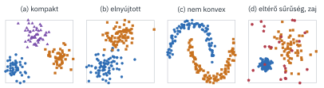
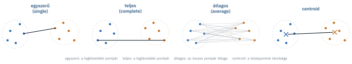
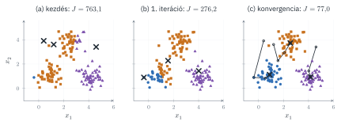
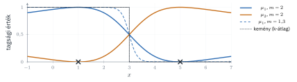
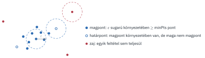
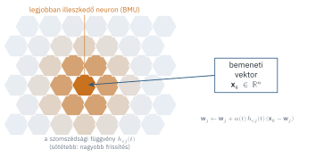

# Csoportosítás {#sec-csoportositas}

```{python}
#| include: false
import numpy as np
import pandas as pd
import matplotlib.pyplot as plt
import adatbanyaszat as ab
ab.set_style()
pd.set_option("display.max_columns", 14)
pd.set_option("display.width", 110)
```

::: {.roadmap}
A csoportosítás (klaszterezés) az egymáshoz hasonló objektumok csoportokba rendezése
előzetesen ismert csoportcímkék nélkül. A vevők szegmentálásától az üzemállapotok
azonosításáig számos gyakorlati feladat mögött ez a felügyelet nélküli tanulási
feladat áll. A fejezet a hasonlóság méréséből indul ki, majd bemutatja a módszerek fő
családjait: a hierarchikus, a partícionáló ($k$-átlag, $k$-medoid), a fuzzy
($c$-átlag), a modellalapú (Gauss-keverék, EM-algoritmus), a sűrűségalapú (DBSCAN)
és a neurális hálózatos (önszerveződő térkép) módszereket. Végül azzal foglalkozunk,
hogyan ítélhető meg egy csoportosítás jósága, és hogyan választható meg a csoportok
száma.

**A fejezet végére az olvasó** képes lesz a feladathoz és az adattípushoz illő
távolságmértéket választani; a fő csoportosítási algoritmusok célfüggvényét és lépéseit
felírni és megvalósítani; a csoportok számát belső validitási mutatókkal megválasztani;
és egy szegmentálás eredményét üzletileg értelmezni.
:::

## Mi a csoport? {#sec-csoport-fogalma}

Intuitív értelemben egy csoport (klaszter) olyan objektumok halmaza, amelyek
egymáshoz hasonlóbbak, mint a más csoportokba tartozókhoz. Ez a meghatározás
szándékosan homályos: a „hasonlóság” és a „csoport” jelentése a feladattól függ.
A [-@fig-alakok]. ábra négy jellegzetes helyzetet mutat. A kompakt, gömbszerű csoportokat
szinte minden módszer megtalálja; az elnyújtott csoportokhoz a csoportok alakját is
figyelembe vevő (például Mahalanobis-távolságot vagy kovarianciamátrixot használó)
módszerek kellenek; a nem konvex, egymásba fonódó alakzatokat a sűrűségalapú vagy
az egyszerű kapcsolódású hierarchikus módszerek ismerik fel; az eltérő sűrűségű
csoportok és a zaj pedig külön kihívást jelentenek.

{#fig-alakok width=100%}

A csoportosítás eredményének formája is többféle lehet. A **kemény** (éles)
csoportosításban minden objektum pontosan egy csoportba tartozik; a **fuzzy**
csoportosításban minden objektum minden csoporthoz egy 0 és 1 közötti tagsági
értékkel tartozik; a **valószínűségi** csoportosítás csoporttagsági valószínűségeket
ad; a **hierarchikus** csoportosítás egymásba ágyazott csoportok fáját állítja elő.

## Hasonlóság és távolság {#sec-tavolsagok}

### Folytonos változók

Az objektumok közötti különbözőséget leggyakrabban egy $d(\mathbf{x}_i,\mathbf{x}_j)$
**távolságfüggvénnyel** mérjük, amely nemnegatív, szimmetrikus, csak azonos pontokra
nulla, és teljesíti a háromszög-egyenlőtlenséget. A legismertebb a **Minkowski-távolság**
családja:

$$
d_p(\mathbf{x}_i,\mathbf{x}_j) = \left(\sum_{l=1}^{n}\lvert x_{il}-x_{jl}\rvert^{p}\right)^{1/p},
$$ {#eq-minkowski}

amelynek $p=2$ esetén az euklideszi, $p=1$ esetén a városi (Manhattan) távolság,
$p\to\infty$ esetén pedig a Csebisev-távolság, $\max_l\lvert x_{il}-x_{jl}\rvert$ a
speciális esete. A Minkowski-távolságok érzékenyek a változók skálájára, ezért
használatuk előtt általában standardizálni kell ([-@sec-transzformaciok]. alfejezet).

A **Mahalanobis-távolság** [@mahalanobis1936] a változók szórását és egymással való
korrelációját is figyelembe veszi:

$$
d_M(\mathbf{x}_i,\mathbf{x}_j) = \sqrt{(\mathbf{x}_i-\mathbf{x}_j)^\top\mathbf{C}^{-1}(\mathbf{x}_i-\mathbf{x}_j)},
$$ {#eq-mahalanobis}

ahol $\mathbf{C}$ a kovarianciamátrix. Ha $\mathbf{C}$ az egységmátrix, az euklideszi
távolságot kapjuk; ha diagonális, a standardizált euklideszit. A Mahalanobis-távolság
az elnyújtott, korrelált csoportokat „gömbbé” alakítja, és a [-@sec-anomalia]. fejezet
anomália-észlelő módszereinek is alapja.

Szövegek, vásárlási kosarak és más sok, többnyire nulla értékű változóval leírt
objektumok esetén a **koszinusz-hasonlóság** a szokásos választás, amely a két vektor
által bezárt szög koszinusza, $\cos\theta = \mathbf{x}_i^\top\mathbf{x}_j /
(\lVert\mathbf{x}_i\rVert\lVert\mathbf{x}_j\rVert)$; független a vektorok hosszától,
csak az „irányukat” hasonlítja össze.

### Kategorikus és vegyes változók

Bináris változók (például: megvásárolta-e a vevő az adott terméket) esetén két
objektum összevetése egy $2\times 2$-es gyakorisági táblázattal írható le: $a$ az
olyan változók száma, amelyek mindkét objektumban 1 értékűek, $d$ a mindkettőben 0
értékűek, $b$ és $c$ pedig az eltérők. Az **egyszerű egyezési együttható**
$(a+d)/(a+b+c+d)$ a közös nullákat is egyezésnek tekinti. Vásárlási kosaraknál ez
félrevezető – két vevő nem lesz hasonló attól, hogy egyikük sem vett adventi koszorút
–, ezért itt a **Jaccard-együttható**, $a/(a+b+c)$ a megfelelő, amely a közös hiányt
figyelmen kívül hagyja.

Vegyes típusú változók esetén a **Gower-féle hasonlóság** [@gower1971] változónként
számol egy $[0,1]$ közötti hasonlóságot – numerikus változóra
$1 - \lvert x_{il}-x_{jl}\rvert / R_l$, ahol $R_l$ a változó terjedelme, kategorikusra
egyezés esetén 1, eltérés esetén 0 –, és ezeket (súlyozottan) átlagolja.

### Csoportok közötti távolság

A hierarchikus módszerekhez két *csoport* távolságát is értelmezni kell
([-@fig-kapcsolodas]. ábra). Az **egyszerű kapcsolódás** (single linkage) a legközelebbi
pontpár, a **teljes kapcsolódás** (complete linkage) a legtávolabbi pontpár, az
**átlagos kapcsolódás** (average linkage) az összes pontpár távolságának átlaga, a
**centroid** módszer a csoportközéppontok távolsága. A **Ward-módszer** [@ward1963]
azt a két csoportot vonja össze, amelyek összevonása a legkisebb mértékben növeli a
csoporton belüli négyzetes eltérések összegét.

{#fig-kapcsolodas width=100%}

## Hierarchikus módszerek {#sec-hierarchikus}

### Az egyesítő eljárás

Az **egyesítő** (agglomeratív) hierarchikus csoportosítás minden objektumot külön
csoportként indít, majd lépésenként mindig a két legközelebbi csoportot vonja össze,
amíg egyetlen csoport nem marad. Az összevonások sorrendjét és az összevonáskori
távolságokat a **dendrogram** (fadiagram) ábrázolja; a dendrogram egy adott magasságban
történő „elvágása” adja a kívánt számú csoportot.

Az összevonás után az új csoport távolságát a többitől nem kell az eredeti pontokból
újraszámolni: a fenti kapcsolódási szabályok mindegyike felírható a
**Lance–Williams-formulával** [@lance1967]. Ha az $i$ és $j$ csoportot összevonjuk, az
új csoport távolsága egy harmadik, $k$ csoporttól:

$$
d_{(ij)k} = \alpha_i\,d_{ik} + \alpha_j\,d_{jk} + \beta\,d_{ij} + \gamma\,\lvert d_{ik}-d_{jk}\rvert .
$$ {#eq-lance-williams}

| Módszer | $\alpha_i$ | $\beta$ | $\gamma$ |
|:--|:--|:--|:--|
| egyszerű kapcsolódás | $1/2$ | 0 | $-1/2$ |
| teljes kapcsolódás | $1/2$ | 0 | $+1/2$ |
| átlagos kapcsolódás | $n_i/(n_i+n_j)$ | 0 | 0 |
| Ward (négyzetes euklideszi távolságokra) | $(n_i+n_k)/(n_i+n_j+n_k)$ | $-n_k/(n_i+n_j+n_k)$ | 0 |

: A Lance–Williams-formula együtthatói néhány kapcsolódási szabályra ($n_i$ az $i$ csoport elemszáma; $\alpha_j$ az $\alpha_i$ képletéből $i$ és $j$ cseréjével adódik). {#tbl-lance-williams}

Például egyszerű kapcsolódásra
$d_{(ij)k} = \tfrac12 d_{ik} + \tfrac12 d_{jk} - \tfrac12\lvert d_{ik}-d_{jk}\rvert = \min(d_{ik}, d_{jk})$,
ahogy az egyszerű kapcsolódás definíciójából várható.

A **felosztó** (divizív) hierarchikus módszerek fordítva haladnak: egyetlen csoportból
indulnak, és lépésenként a leginkább heterogén csoportot bontják ketté [@kaufman1990].
Számításigényesebbek, ezért ritkábban használják őket.

::: {.callout-important title="Az algoritmus összefoglalása: egyesítő hierarchikus csoportosítás"}
1. Számítsuk ki az objektumok páronkénti távolságmátrixát; kezdetben minden objektum külön csoport.
2. Keressük meg a két legközelebbi csoportot, és vonjuk össze őket; jegyezzük fel az összevonási távolságot.
3. Frissítsük az új csoport távolságait a többitől a Lance–Williams-formulával ([-@eq-lance-williams]).
4. Ismételjük a 2–3. lépést, amíg egy csoport marad; az eredményt dendrogramon ábrázoljuk, és a kívánt magasságban elvágjuk.
:::

### Kézi példa

Vegyük a segédcsomag hét pontját a síkon, és kövessük végig az egyszerű kapcsolódású
eljárást! Először a távolságmátrixot számítjuk ki:

```{python}
from scipy.spatial.distance import pdist, squareform
from scipy.cluster.hierarchy import linkage, dendrogram
P = ab.pontok_mini()
Dm = pd.DataFrame(squareform(pdist(P)), index=P.index, columns=P.index)
Dm.round(2)
```

A legkisebb távolság az $E$ és a $G$ pont között van (0,50), ezért először ezek
egyesülnek. Egyszerű kapcsolódásnál az $\{E,G\}$ csoport távolsága egy harmadik
ponttól a két távolság minimuma; így a következő lépésben a $C$ pont csatlakozik
(0,71 távolságra $G$-től), majd az $F$ pont (1,00 távolságra $E$-től). Ezután az
$A$ és $B$ pont egyesül (1,12), a $D$ pont az $F$-en keresztül kapcsolódik a négyelemű
csoporthoz (2,06), végül a két megmaradt csoport a $B$–$C$ pontpár távolságánál (2,50)
olvad össze. Az összevonások teljes sorrendjét a `linkage` függvény adja meg: minden
sor egy összevonás, az első két oszlop az összevont csoportok sorszáma (a 7-től
kezdődő sorszámok a korábban létrejött csoportokat jelölik), a harmadik az összevonási
távolság, a negyedik az új csoport elemszáma.

```{python}
Z_single = linkage(P, method="single")
pd.DataFrame(Z_single, columns=["csoport_1", "csoport_2", "távolság", "elemszám"]).round(2)
```

```{python}
#| label: fig-dendrogram
#| fig-cap: "A hét pont dendrogramja egyszerű (balra) és teljes kapcsolódással (jobbra). A szaggatott vonal két csoportot eredményező elvágást jelöl."
#| fig-width: 7
#| fig-height: 2.8
fig, ax = plt.subplots(1, 2)
for a, m in zip(ax, ["single", "complete"]):
    Z = linkage(P, method=m)
    dendrogram(Z, labels=list(P.index), ax=a, color_threshold=0, above_threshold_color=ab.PE_BLUE)
    a.axhline(Z[-1, 2] * 0.8 if m == "single" else Z[-2, 2] * 1.05, color=ab.PALETTE[1], ls="--", lw=1)
    a.set_title("egyszerű kapcsolódás" if m == "single" else "teljes kapcsolódás")
ax[0].set_ylabel("összevonási távolság")
fig.tight_layout()
```

A két dendrogram ugyanazokat a természetes csoportokat ($\{A,B\}$ és a többi pont)
mutatja, de az összevonási távolságok és a $D$ pont helyzete eltér: a teljes kapcsolódás
a távoli $D$ pontot csak nagy távolságnál olvasztja be, ami a kiugró pontok
felismerésében segíthet.

## Partícionáló módszerek {#sec-particionalo}

### A $k$-átlag algoritmus

A **$k$-átlag** ($k$-means) módszer az adatokat előre megadott számú, $c$ csoportra
osztja úgy, hogy a csoportokon belüli négyzetes eltérések összege minimális legyen:

$$
J = \sum_{i=1}^{c}\sum_{\mathbf{x}_k\in G_i}\lVert\mathbf{x}_k - \mathbf{v}_i\rVert^2,
$$ {#eq-kmeans-j}

ahol $G_i$ az $i$-edik csoport, $\mathbf{v}_i$ a középpontja (centroidja). A feladat
globális optimumának megtalálása nehéz (NP-nehéz), ezért egy egyszerű iteratív
eljárást, a Lloyd-algoritmust használjuk [@lloyd1982; @macqueen1967], amely két lépést
ismételget ([-@fig-kmeans-iter]. ábra):

1. **Hozzárendelés**: minden objektumot a legközelebbi középponthoz rendelünk.
2. **Frissítés**: minden középpontot a hozzá rendelt objektumok átlagára állítunk,
   $\mathbf{v}_i = \frac{1}{\lvert G_i\rvert}\sum_{\mathbf{x}_k\in G_i}\mathbf{x}_k$.

Mindkét lépés csökkenti (pontosabban nem növeli) $J$-t: a hozzárendelés rögzített
középpontok mellett, a frissítés rögzített hozzárendelés mellett optimális (a
négyzetes eltérések összegét az átlag minimalizálja). Mivel a lehetséges
hozzárendelések száma véges, az algoritmus véges sok lépésben megáll – de csak egy
**lokális** minimumban, amely a kezdő középpontoktól függ. Ezért az algoritmust több
kezdőpontból érdemes futtatni, a kezdőpontokat pedig a **$k$-means++** eljárással
célszerű választani, amely az első középpont után a további középpontokat a már
kiválasztottaktól vett távolság négyzetével arányos valószínűséggel sorsolja
[@arthur2007].

{#fig-kmeans-iter width=100%}

A $k$-átlag gyors (lépésenként $O(Nc\,n)$), egyszerű, és nagy adathalmazokra is jól
skálázódik. Korlátai a célfüggvényéből fakadnak: gömbszerű, hasonló méretű csoportokat
feltételez, érzékeny a kiugró értékekre (az átlag miatt), és a csoportok számát előre
meg kell adni.

```{python}
def kmeans_sajat(X, c, max_iter=100, seed=0):
    """A Lloyd-algoritmus NumPy-megvalósítása (k-means++ kezdéssel)."""
    rng = np.random.default_rng(seed)
    V = [X[rng.integers(len(X))]]
    for _ in range(1, c):                              # k-means++ kezdőpontok
        d2 = np.min(((X[:, None, :] - np.array(V)[None]) ** 2).sum(-1), axis=1)
        V.append(X[rng.choice(len(X), p=d2 / d2.sum())])
    V = np.array(V)
    for it in range(max_iter):
        D2 = ((X[:, None, :] - V[None]) ** 2).sum(-1)  # N x c négyzetes távolságok
        lab = D2.argmin(1)                             # hozzárendelés
        V_uj = np.array([X[lab == i].mean(0) for i in range(c)])  # frissítés
        if np.allclose(V_uj, V):
            break
        V = V_uj
    J = D2[np.arange(len(X)), lab].sum()
    return lab, V, J, it + 1

lab, V, J, it = kmeans_sajat(P.to_numpy(), c=2)
print("címkék:", dict(zip(P.index, lab.tolist())), f"  J = {J:.2f}, iterációk: {it}")
```

### A $k$-medoid algoritmus

A **$k$-medoid** módszer [@kaufman1990] a középpontokat a csoport egy tényleges
objektumára, a **medoidra** korlátozza – arra az objektumra, amelynek a csoport többi
tagjától vett távolságösszege minimális. Ennek két előnye van: a módszer tetszőleges
távolság- vagy különbözőségmátrixszal működik (nem kell átlagot számolni, így
kategorikus vagy vegyes adatokra is alkalmazható), és kevésbé érzékeny a kiugró
értékekre. A klasszikus PAM (Partitioning Around Medoids) algoritmus a medoidokat
cserékkel javítja, amíg a teljes távolságösszeg csökken; ára a nagyobb számításigény.

## Fuzzy csoportosítás {#sec-fcm}

A valóságban a csoportok közötti határ gyakran nem éles: egy vevő viselkedése félúton
lehet az alkalmi vásárló és a törzsvásárló között, egy üzemállapot átmeneti lehet két
működési mód között. A **fuzzy csoportosítás** ezt tagsági értékekkel fejezi ki
([-@fig-fcm-tagsag]. ábra).

### A fuzzy partíció és a $c$-átlag célfüggvény

Legyen $\mathbf{U} = [\mu_{ik}] \in [0,1]^{c\times N}$ a **fuzzy partíciós mátrix**, ahol
$\mu_{ik}$ a $k$-adik objektum tagsági értéke az $i$-edik csoportban. A fuzzy partíció
feltételei: minden tagsági érték a $[0,1]$ intervallumba esik, minden objektum
tagsági értékeinek összege 1 ($\sum_{i=1}^{c}\mu_{ik} = 1$), és egyik csoport sem
üres, de nem is tartalmaz minden objektumot teljes tagsággal
($0 < \sum_{k=1}^{N}\mu_{ik} < N$). A **fuzzy $c$-átlag** (FCM) algoritmus @dunn1973
ötletén alapul, általános alakját @bezdek1981 dolgozta ki. Célfüggvénye a $k$-átlag
([-@eq-kmeans-j]) célfüggvényének tagsági értékekkel súlyozott változata:

$$
J_m(\mathbf{U},\mathbf{V}) = \sum_{i=1}^{c}\sum_{k=1}^{N}\mu_{ik}^{m}\,D_{ik}^2,
\qquad D_{ik}^2 = (\mathbf{x}_k-\mathbf{v}_i)^\top\mathbf{A}(\mathbf{x}_k-\mathbf{v}_i),
$$ {#eq-fcm-j}

ahol $m>1$ a **fuzzy kitevő**, $\mathbf{A}$ pedig a távolságot meghatározó szimmetrikus,
pozitív definit mátrix ($\mathbf{A} = \mathbf{I}$ esetén euklideszi távolság). Minél
nagyobb $m$, annál „elmosódottabbak” a csoportok; $m\to 1$ esetén a $k$-átlag kemény
partícióját kapjuk vissza. A gyakorlatban leggyakrabban $m=2$-t használnak.

### Az optimum feltételei

A célfüggvényt a $\sum_i\mu_{ik}=1$ feltételek mellett minimalizáljuk. Rögzített
$\mathbf{V}$ mellett minden $k$ objektumra külön Lagrange-függvényt írunk fel:

$$
\mathcal{L}_k = \sum_{i=1}^{c}\mu_{ik}^{m}D_{ik}^2 - \lambda_k\Bigl(\sum_{i=1}^{c}\mu_{ik}-1\Bigr),
\qquad
\frac{\partial\mathcal{L}_k}{\partial\mu_{ik}} = m\,\mu_{ik}^{m-1}D_{ik}^2 - \lambda_k = 0 .
$$

Ebből $\mu_{ik} = \left(\lambda_k/(m D_{ik}^2)\right)^{1/(m-1)}$; a $\lambda_k$-t az
összegfeltételből kifejezve kapjuk a tagsági értékek frissítési szabályát. A
középpontokra a $\partial J_m/\partial\mathbf{v}_i = \mathbf{0}$ feltétel adja a súlyozott
átlagot:

$$
\mu_{ik} = \frac{1}{\sum_{j=1}^{c}\left(D_{ik}/D_{jk}\right)^{2/(m-1)}},
\qquad
\mathbf{v}_i = \frac{\sum_{k=1}^{N}\mu_{ik}^{m}\,\mathbf{x}_k}{\sum_{k=1}^{N}\mu_{ik}^{m}} .
$$ {#eq-fcm-update}

{#fig-fcm-tagsag width=100%}

::: {.callout-important title="Az algoritmus összefoglalása: fuzzy $c$-átlag"}
1. Válasszuk meg a csoportok számát ($c$), a fuzzy kitevőt ($m$, tipikusan 2), a
   távolságnormát ($\mathbf{A}$) és a leállási küszöböt ($\varepsilon$); inicializáljuk
   $\mathbf{U}$-t véletlenszerűen a partíciós feltételeknek megfelelően.
2. Számítsuk ki a középpontokat ([-@eq-fcm-update] jobb oldala).
3. Számítsuk ki a távolságokat ($D_{ik}$) és az új tagsági értékeket ([-@eq-fcm-update] bal oldala).
4. Ismételjük a 2–3. lépést, amíg $\max_{ik}\lvert\mu_{ik}^{(t)}-\mu_{ik}^{(t-1)}\rvert < \varepsilon$.
:::

Az FCM euklideszi normával a $k$-átlaghoz hasonlóan gömbszerű csoportokat keres. A
**Gustafson–Kessel-algoritmus** [@gustafson1979] minden csoporthoz saját,
adaptív normát (egy fuzzy kovarianciamátrixból származtatott $\mathbf{A}_i$ mátrixot)
rendel, így elnyújtott, hipersík jellegű csoportokat is felismer; ez különösen
hasznos folyamatadatok lokálisan lineáris modelljeinek azonosításában. A fuzzy
csoportosítás további változatait és rendszeridentifikációs alkalmazásait
@abonyi2007 tárgyalja részletesen.

```{python}
def fcm(X, c, m=2.0, max_iter=200, eps=1e-6, seed=0):
    """Fuzzy c-átlag (euklideszi norma). Visszaad: U (c x N), V (c x n), J."""
    rng = np.random.default_rng(seed)
    U = rng.random((c, len(X)))
    U /= U.sum(0)
    for _ in range(max_iter):
        W = U ** m
        V = W @ X / W.sum(1, keepdims=True)                     # középpontok
        D = np.sqrt(((X[None, :, :] - V[:, None, :]) ** 2).sum(-1)) + 1e-12
        U_uj = 1.0 / ((D[:, None, :] / D[None, :, :]) ** (2 / (m - 1))).sum(1)
        if np.max(np.abs(U_uj - U)) < eps:
            U = U_uj
            break
        U = U_uj
    J = ((U ** m) * D ** 2).sum()
    return U, V, J

U, V, J = fcm(P.to_numpy(), c=2)
pd.DataFrame(U.T, index=P.index, columns=["μ₁", "μ₂"]).round(3)
```

A tagsági értékek a kézi példában is informatívak: az $A$ és $B$ pont egyértelműen az
egyik, $E$, $F$ és $G$ egyértelműen a másik csoportba tartozik, a két csoport közé eső
$C$ pont tagsága viszont a legkevésbé határozott, és a távoli $D$ pont tagsága is
elmarad a csoportmag pontjaiétól. A fuzzy csoportosítás így a bizonytalan
hozzárendeléseket is jelzi.

Fuzzy partíciók jóságának mérésére a **partíciós együttható**,
$\mathrm{PC} = \frac1N\sum_{i}\sum_{k}\mu_{ik}^2$ (értéke $1/c$ és 1 közé esik, a nagyobb
élesebb partíciót jelez), valamint a csoportok kompaktságát és szeparációját együtt
mérő **Xie–Beni-index** [@xie1991] használható.

## Modellalapú csoportosítás: Gauss-keverék modellek {#sec-gmm}

A **modellalapú** csoportosítás azt feltételezi, hogy az adatok egy valószínűségi
eloszlások keverékéből származnak, és minden csoport egy keverékkomponensnek felel
meg. A leggyakoribb a **Gauss-keverék modell** (Gaussian mixture model, GMM):

$$
p(\mathbf{x}) = \sum_{i=1}^{c}\pi_i\,\mathcal{N}(\mathbf{x}\mid\boldsymbol{\mu}_i,\boldsymbol{\Sigma}_i),
\qquad \pi_i\ge 0,\;\; \sum_{i=1}^{c}\pi_i = 1,
$$ {#eq-gmm}

ahol $\pi_i$ a komponensek súlya, $\boldsymbol{\mu}_i$ a várható értéke,
$\boldsymbol{\Sigma}_i$ a kovarianciamátrixa (a többdimenziós normális eloszlást a
[-@sec-app-valszam]. függelék ismerteti). A paramétereket maximum-likelihood
módszerrel becsüljük; mivel a csoporttagság nem ismert, ezt az
**EM-algoritmus** (Expectation–Maximization) [@dempster1977] végzi, amely két lépést
ismételget:

- **E-lépés**: a jelenlegi paraméterekkel kiszámítjuk, mekkora valószínűséggel
  származik az egyes objektumok a komponensekből (ezek a *felelősségek*):
  $$
  \gamma_{ik} = \frac{\pi_i\,\mathcal{N}(\mathbf{x}_k\mid\boldsymbol{\mu}_i,\boldsymbol{\Sigma}_i)}
  {\sum_{j=1}^{c}\pi_j\,\mathcal{N}(\mathbf{x}_k\mid\boldsymbol{\mu}_j,\boldsymbol{\Sigma}_j)} .
  $$ {#eq-em-e}
- **M-lépés**: a felelősségekkel súlyozva újrabecsüljük a paramétereket:
  $$
  N_i = \sum_{k}\gamma_{ik},\quad
  \pi_i = \frac{N_i}{N},\quad
  \boldsymbol{\mu}_i = \frac{1}{N_i}\sum_{k}\gamma_{ik}\mathbf{x}_k,\quad
  \boldsymbol{\Sigma}_i = \frac{1}{N_i}\sum_{k}\gamma_{ik}(\mathbf{x}_k-\boldsymbol{\mu}_i)(\mathbf{x}_k-\boldsymbol{\mu}_i)^\top .
  $$ {#eq-em-m}

Az EM-algoritmus minden iterációban növeli (nem csökkenti) a log-likelihoodot, és egy
lokális maximumhoz konvergál. Közeli rokonságban áll a $k$-átlaggal és az FCM-mel: a
felelősségek „puha” tagsági értékek, a középpontok súlyozott átlagok. Ha minden
kovarianciamátrixot $\sigma^2\mathbf{I}$-re rögzítünk és $\sigma\to 0$, a $k$-átlagot
kapjuk vissza.

::: {.callout-note title="Javítás az első kiadáshoz képest"}
Az első kiadás az EM-algoritmust a WEKA programcsomag megvalósításának tulajdonságai
alapján jellemezte (attribútumok függetlenségének feltevése, a csoportszám automatikus
meghatározása). Ezek nem az EM-algoritmus, hanem egy konkrét implementáció
beállításai: az általános GMM tetszőleges kovarianciamátrixot megenged, a csoportok
számát pedig modellválasztási kritériummal kell megválasztani.
:::

A modellalapú megközelítés előnye, hogy a csoportok száma statisztikailag
megalapozottan választható. A **bayesi információs kritérium**,
$\mathrm{BIC} = -2\ln\hat{L} + p\ln N$ (ahol $\hat L$ a maximális likelihood, $p$ a
becsült paraméterek száma) a jobb illeszkedést a paraméterek számával bünteti; a
legkisebb BIC-értékű modellt választjuk.

## Sűrűségalapú csoportosítás: DBSCAN {#sec-dbscan}

A **DBSCAN** (Density-Based Spatial Clustering of Applications with Noise)
[@ester1996] a csoportokat a sűrű tartományok összefüggő részeiként értelmezi, amelyeket
ritka tartományok választanak el egymástól. Két paramétere a környezet sugara ($\varepsilon$)
és a „sűrűnek” tekintett környezethez szükséges legkisebb pontszám (minPts). A pontokat
három típusba sorolja ([-@fig-dbscan]. ábra):

- **magpont**: az $\varepsilon$ sugarú környezetében legalább minPts pont van (önmagát is beleértve);
- **határpont**: nem magpont, de egy magpont környezetébe esik;
- **zajpont**: egyik sem.

Két magpont ugyanabba a csoportba kerül, ha egymás környezetében lánccal elérhetők;
a határpontok a szomszédos magpont csoportjához csatlakoznak, a zajpontok egyik
csoportba sem. A DBSCAN tetszőleges alakú csoportokat felismer, a csoportok számát nem
kell előre megadni, és a zajt külön kezeli. Gyengéje, hogy eltérő sűrűségű csoportok
esetén nincs mindegyiknek megfelelő $\varepsilon$; ezt a problémát a hierarchikus
változat, a **HDBSCAN** [@campello2013] oldja meg, amely különböző sűrűségszinteken
vizsgálja a csoportszerkezetet.

{#fig-dbscan width=85%}

## Önszerveződő térképek {#sec-som}

Az **önszerveződő térkép** (self-organizing map, SOM) [@kohonen1982; @kohonen2001] egy
neurális hálózat, amely a sokdimenziós adatokat egy kétdimenziós (négyzetes vagy
hatszöges) neuronrácsra képezi le úgy, hogy a hasonló objektumok szomszédos
neuronokra kerüljenek ([-@fig-som]. ábra). Minden $j$ neuronhoz egy
$\mathbf{w}_j\in\mathbb{R}^n$ **prototípusvektor** tartozik. A tanítás során
véletlen sorrendben vesszük az objektumokat; mindegyikhez megkeressük a
**legjobban illeszkedő neuront** (best matching unit, BMU),
$c = \arg\min_j\lVert\mathbf{x}_k-\mathbf{w}_j\rVert$, majd a BMU-t és rácsbeli
szomszédait az objektum felé mozdítjuk:

$$
\mathbf{w}_j \leftarrow \mathbf{w}_j + \alpha(t)\,h_{cj}(t)\,\bigl(\mathbf{x}_k - \mathbf{w}_j\bigr),
\qquad
h_{cj}(t) = \exp\!\left(-\frac{\lVert\mathbf{r}_c-\mathbf{r}_j\rVert^2}{2\sigma^2(t)}\right),
$$ {#eq-som}

ahol $\mathbf{r}_j$ a $j$ neuron rácsbeli helye, $\alpha(t)$ a tanulási ráta, $\sigma(t)$
a szomszédsági sugár; mindkettő a tanítás során csökken. A tanítás végén a rács a
bemeneti tér „lenyomata”: a szomszédos neuronok prototípusai hasonlók. A csoportok
határait az **U-mátrix** teszi láthatóvá, amely minden neuronnál a szomszédos
prototípusoktól vett átlagos távolságot ábrázolja: a nagy értékek (gerincek) a
csoportok közötti határokat jelzik.

{#fig-som width=90%}

## A csoportosítás értékelése {#sec-validacio}

Mivel nincs „helyes válasz”, a csoportosítás értékelése különleges kihívás. Három
megközelítést különböztetünk meg.

**Belső mutatók** csak az adatokat és a csoportosítást használják. A
**sziluett-együttható** [@rousseeuw1987] minden objektumra összeveti a saját csoportján
belüli átlagos távolságot ($a_k$) a legközelebbi másik csoport pontjaitól vett átlagos
távolsággal ($b_k$):

$$
s_k = \frac{b_k - a_k}{\max(a_k, b_k)} \in [-1, 1],
\qquad
\bar{s} = \frac1N\sum_{k=1}^{N}s_k .
$$ {#eq-sziluett}

Az 1-hez közeli érték jól elhelyezett, a 0 körüli két csoport határán lévő, a negatív
érték valószínűleg rossz csoportba sorolt objektumot jelez. A **Davies–Bouldin-index**
[@davies1979] a csoportpárok átlagos „hasonlóságát” méri (a kisebb a jobb); a
**Caliński–Harabasz-index** [@calinski1974] a csoportok közötti és a csoportokon belüli
szóródás arányát (a nagyobb a jobb).

**Külső mutatók** a csoportosítást egy ismert besorolással vetik össze – ez
a valóságban ritkán áll rendelkezésre, de a módszerek összehasonlításában és a mi
szimulált adatainkon hasznos. A **korrigált Rand-index** (adjusted Rand index, ARI)
[@hubert1985] azt méri, hogy az objektumpárok mekkora hányadát kezeli a két felosztás
egyformán (mindkettő ugyanabba vagy mindkettő különböző csoportba sorolja), a
véletlenszerű egyezés várható értékével korrigálva: értéke véletlen felosztásnál 0
körüli, tökéletes egyezésnél 1.

A **stabilitás** azt vizsgálja, mennyire változik a csoportosítás, ha az adatokat
kissé megváltoztatjuk (újramintavételezés, zaj hozzáadása) – egy valódi szerkezet
stabil, a véletlen műterméke nem.

::: {.callout-warning title="A csoportok száma nem „adat”"}
A belső mutatók segítenek a csoportok számának megválasztásában, de gyakran nem adnak
egyértelmű választ, és különböző mutatók különböző számot javasolhatnak. A végső döntés
a felhasználás céljától is függ: egy marketingkampányhoz 4–6 jól megkülönböztethető
szegmens lehet ideális akkor is, ha a mutatók 3-at vagy 8-at sugallnak.
:::

## Gyakorlat: vevőszegmentálás és üzemállapotok {#sec-csoport-gyakorlat}

### A PannonShop vevőinek szegmentálása

A [-@sec-elokeszites]. fejezetben előállított vevőszintű táblából indulunk. A ferde
eloszlású változókat logaritmussal transzformáljuk, majd standardizálunk – a
távolságalapú módszerek ezt igénylik.

```{python}
from sklearn.preprocessing import StandardScaler
from sklearn.cluster import KMeans, AgglomerativeClustering, DBSCAN
from sklearn.mixture import GaussianMixture
from sklearn.metrics import silhouette_score, davies_bouldin_score, calinski_harabasz_score, adjusted_rand_score

shop = ab.load_shop()
vevok = ab.customer_table()
jell = ["R_nap", "F_szamla", "M_ertek", "atl_kosarertek", "atl_kosarmeret", "atl_mennyiseg",
        "akcios_arany", "arany_kave", "arany_gep", "arany_konyha", "arany_dekor", "arany_ajandek", "arany_iroszer"]
Xv = vevok[jell].copy()
for c in ["F_szamla", "M_ertek", "atl_kosarertek", "atl_mennyiseg"]:
    Xv[c] = np.log1p(Xv[c])
Zv = StandardScaler().fit_transform(Xv)
valodi = (shop.truth["segment"].reindex(vevok.index)            # csak értékeléshez!
          .fillna("egyéb").to_numpy())                         # (néhány új, egyszeri vevő)
```

Először a csoportok számát választjuk meg a belső mutatók alapján:

```{python}
#| label: fig-k-valasztas
#| fig-cap: "A csoportok számának megválasztása a PannonShop vevőinél: a k-átlag célfüggvénye (könyökdiagram), a sziluett-együttható és a Davies–Bouldin-index a csoportok számának függvényében."
#| fig-width: 7
#| fig-height: 2.5
ks = range(2, 10)
eredm = []
for k in ks:
    km = KMeans(n_clusters=k, n_init=10, random_state=0).fit(Zv)
    eredm.append({"k": k, "J": km.inertia_, "sziluett": silhouette_score(Zv, km.labels_),
                  "DB": davies_bouldin_score(Zv, km.labels_), "ARI": adjusted_rand_score(valodi, km.labels_)})
eredm = pd.DataFrame(eredm).set_index("k")
fig, ax = plt.subplots(1, 3)
for a, col, c in zip(ax, ["J", "sziluett", "DB"], ab.PALETTE):
    a.plot(eredm.index, eredm[col], marker="o", color=c); a.set_title(col); a.set_xlabel("csoportok száma")
fig.tight_layout()
```

```{python}
eredm.round(3)
```

```{python}
#| echo: false
k_best = int(eredm.sziluett.idxmax())
```

A görbék a gyakorlatban jellemző képet mutatják: a könyökdiagramon nincs éles törés, a
sziluett-együttható a vizsgált tartományban lassan nő (a legnagyobb érték
`{python} k_best` csoportnál adódik, de a különbségek kicsik), a Davies–Bouldin-index
pedig lassan csökken. A belső mutatók tehát nem jelölnek ki egyértelmű csoportszámot.
Az ARI oszlop (amelyet a valóságban nem ismernénk) azt mutatja, hogy a rejtett
szegmensekkel 4–6 csoport esetén a legnagyobb az egyezés. Az értelmezhetőség és a
marketingfelhasználás szempontjából is kezelhető 5 csoporttal dolgozunk tovább, és
összehasonlítjuk a módszereket:

```{python}
c = 5
modellek = {
    "k-átlag": KMeans(n_clusters=c, n_init=20, random_state=0).fit_predict(Zv),
    "hierarchikus (Ward)": AgglomerativeClustering(n_clusters=c, linkage="ward").fit_predict(Zv),
    "hierarchikus (átlagos)": AgglomerativeClustering(n_clusters=c, linkage="average").fit_predict(Zv),
    "Gauss-keverék": GaussianMixture(n_components=c, covariance_type="full", n_init=3, random_state=0).fit(Zv).predict(Zv),
    "fuzzy c-átlag (m=1,3)": fcm(Zv, c=c, m=1.3, seed=1)[0].argmax(0),
}
pd.DataFrame({nev: {"sziluett": silhouette_score(Zv, l), "Davies–Bouldin": davies_bouldin_score(Zv, l),
                    "ARI (rejtett szegmensek)": adjusted_rand_score(valodi, l),
                    "legkisebb csoport": np.bincount(l).min()} for nev, l in modellek.items()}).T.round(3)
```

::: {.eset-uzleti}
A $k$-átlag, a Ward-módszer és a Gauss-keverék hasonló minőségű felosztást ad, az átlagos
kapcsolódású hierarchikus módszer viszont egy-két nagyon kicsi csoportot választ le (a
kiugró vevőket), és a nagy tömeget egyben hagyja – ez a kapcsolódási szabály ismert
tulajdonsága. A szegmentálás értéke azonban nem a mutatókon, hanem az
értelmezhetőségen múlik. Nézzük meg a $k$-átlag csoportjainak profilját!
:::

```{python}
lab = modellek["k-átlag"]
profil = vevok.assign(csoport=lab).groupby("csoport").agg(
    vevok=("R_nap", "size"), R_median=("R_nap", "median"), F_median=("F_szamla", "median"),
    M_median_eFt=("M_ertek", lambda s: s.median() / 1e3), kosar_median_eFt=("atl_kosarertek", lambda s: s.median() / 1e3),
    mennyiseg=("atl_mennyiseg", "median"), akcios=("akcios_arany", "mean"), gep=("arany_gep", "mean"))
profil.round(2)
```

```{python}
pd.crosstab(pd.Series(lab, name="k-átlag csoport"), pd.Series(valodi, name="rejtett szegmens"))
```

A profilok jól értelmezhetők: elkülönül a kevés, de nagyon nagy mennyiségben vásárló
viszonteladói csoport; egy gyakran vásárló, közepes kosárértékű, rendszeres csoport;
egy akciós időszakokra koncentráló csoport; egy régen vásárolt, ritkán visszatérő
csoport; és egy alkalmi, kis értékű csoport. A kereszttábla szerint a rejtett
szegmensek többsége egy-egy csoportban koncentrálódik, a törzsvásárlók és a később
lemorzsolódók azonban részben keverednek – ahogy a [-@sec-feltaro]. fejezet
vetületei is mutatták. A szegmensek elnevezése és a hozzájuk rendelt marketingakciók
a [-@sec-ugyfel]. fejezet témája.

A fuzzy csoportosítás itt különösen hasznos: a vevők egy részének tagsági értékei között
nincs domináns, ezek a „határeseti” vevők, akiknél egy kemény besorolás félrevezető
lenne.

```{python}
U, V, J = fcm(Zv, c=5, m=1.3, seed=1)
max_tagsag = U.max(0)
print(f"partíciós együttható: {(U ** 2).sum() / U.shape[1]:.3f}")
print(f"vevők, akiknek legnagyobb tagsági értéke 0,5 alatt van: {(max_tagsag < 0.5).mean():.1%}")
```

::: {.callout-warning title="A fuzzy kitevő sokdimenziós adatokon"}
A szokásos $m=2$ fuzzy kitevővel az FCM ezen a 13 dimenziós adaton szinte egyenletes
tagsági értékeket ad, és a középpontok egy része összeolvad (az egyik csoport a legnagyobb
tagság szerint üres marad). Ennek oka, hogy sok dimenzióban a pontok távolságai a
középpontoktól egymáshoz nagyon hasonlóvá válnak, így a ([-@eq-fcm-update]) szabály
szerinti tagsági értékek kiegyenlítődnek [@winkler2011]. A gyakorlati megoldás a kisebb
fuzzy kitevő (itt $m=1{,}3$), a dimenziószám csökkentése (például főkomponensekre), vagy
a partíciós együttható ellenőrzése: ha az értéke $1/c$ közelében van, a partíció
használhatatlanul elmosódott.
:::

### A Pannon üzem üzemállapotai

A mérnöki esetben arra vagyunk kíváncsiak, milyen jellegzetes működési állapotai
vannak az üzemnek. A [-@sec-feltaro]. fejezet főkomponens-értékeiből indulunk, és
Gauss-keverék modellt illesztünk, a komponensek számát a BIC alapján választva.

```{python}
#| label: fig-gmm-bic
#| fig-cap: "A Gauss-keverék modell BIC-értéke a komponensek számának függvényében a Pannon üzem órás adatainak első három főkomponensén."
#| fig-width: 5
#| fig-height: 2.6
from sklearn.decomposition import PCA
plant = ab.load_plant()
valt = ["T_kornyezet", "F_betap", "c_betap", "T_betap", "T_reaktor", "F_hutoviz",
        "T_hutoviz", "P_reaktor", "P_kevero", "E_fogyasztas"]
Hh = plant.hourly[plant.hourly.F_betap > 1].dropna(subset=valt).reset_index(drop=True)
Zh = StandardScaler().fit_transform(Hh[valt])
Th = PCA(n_components=3).fit_transform(Zh)
bic = {k: GaussianMixture(n_components=k, covariance_type="full", random_state=0).fit(Th).bic(Th) for k in range(1, 9)}
fig, ax = plt.subplots()
ax.plot(list(bic), list(bic.values()), marker="o", color=ab.PALETTE[0])
ax.set_xlabel("komponensek száma"); ax.set_ylabel("BIC")
fig.tight_layout()
```

```{python}
k_bic = min(bic, key=bic.get)
gmm = GaussianMixture(n_components=k_bic, covariance_type="full", random_state=0).fit(Th)
allapot = gmm.predict(Th)
print(f"BIC szerinti komponensszám: {k_bic};  ARI a termékcímkékkel: {adjusted_rand_score(Hh.termek, allapot):.2f}")
pd.crosstab(Hh.termek, pd.Series(allapot, name="üzemállapot"))
```

```{python}
hiba_oras = plant.truth["fault"].resample("1h").agg(lambda x: x.mode().iat[0])
(Hh.assign(allapot=allapot, hiba=Hh.ido.map(hiba_oras))
   .groupby("allapot").agg(orak=("ido", "size"), termek=("termek", lambda x: x.mode().iat[0]),
                           T_kornyezet=("T_kornyezet", "mean"), F_hutoviz=("F_hutoviz", "mean"),
                           E_fogyasztas=("E_fogyasztas", "mean"), honap_median=("ido", lambda x: x.dt.month.median()),
                           hibas_orak=("hiba", lambda x: (x != "normál").mean()))
   .round(2))
```

::: {.eset-mernoki}
A BIC a termékek számánál több komponenst javasol, és az állapotok profilja megmutatja
az okát: minden termék működési tartománya egy hideg és egy meleg évszaki állapotra
bomlik, amelyek a hűtővízáramban és az energiafogyasztásban különböznek. Egy külön, kis
állapot a legnagyobb hűtési igényű órákat írja le (itt a legnagyobb a hűtővízáram), egy
másik kis elemszámú, több termékre kiterjedő állapotban pedig az órák jelentős része hibás
üzemállapothoz tartozik – a keverékmodell tehát a szokatlan működést is külön komponensbe sorolja. Az
üzemállapotok azonosítása a folyamatfelügyelet fontos előkészítő lépése: az
állapotfüggő felügyelet ([-@sec-folyamat]. fejezet) minden állapotra külön „normális”
tartományt tanulhat – hogy ez mikor éri meg, azt ott vizsgáljuk meg.
:::

### Önszerveződő térkép a vevőkre

Végül egy rövid, NumPy-ban írt SOM-megvalósítás a ([-@eq-som]) frissítési szabály
közvetlen átültetése. A $10\times 10$-es rácsot a vevők standardizált jellemzőin tanítjuk.

```{python}
def som_tanit(X, sorok=10, oszlopok=10, epochok=20, alpha0=0.5, sigma0=3.0, seed=0):
    rng = np.random.default_rng(seed)
    racs = np.array([(i, j) for i in range(sorok) for j in range(oszlopok)], float)
    W = X[rng.choice(len(X), sorok * oszlopok)]              # kezdés véletlen mintákból
    T = epochok * len(X)
    t = 0
    for ep in range(epochok):
        for k in rng.permutation(len(X)):
            frac = t / T
            alpha, sigma = alpha0 * (1 - frac), sigma0 * (1 - frac) + 0.5
            c = np.argmin(((W - X[k]) ** 2).sum(1))           # legjobban illeszkedő neuron
            h = np.exp(-((racs - racs[c]) ** 2).sum(1) / (2 * sigma ** 2))
            W += alpha * h[:, None] * (X[k] - W)
            t += 1
    return W, racs

W, racs = som_tanit(Zv, epochok=10)
umat = np.zeros(len(W))
for j in range(len(W)):
    szomsz = np.where(np.abs(racs - racs[j]).sum(1) == 1)[0]
    umat[j] = np.mean(np.linalg.norm(W[szomsz] - W[j], axis=1))
bmu = np.array([np.argmin(((W - x) ** 2).sum(1)) for x in Zv])
```

```{python}
#| label: fig-som-umatrix
#| fig-cap: "A vevők önszerveződő térképe. Balra az U-mátrix (világos: nagy távolság a szomszédos prototípusok között – csoporthatár), jobbra a neuronokra leképezett vevők leggyakoribb rejtett szegmense."
#| fig-width: 7
#| fig-height: 3.2
from matplotlib.colors import ListedColormap
szegm_nevek = ["törzsvásárló", "alkalmi", "akcióvadász", "viszonteladó", "lemorzsolódó"]
kod = {s: i for i, s in enumerate(szegm_nevek)}
domin = np.full(len(W), np.nan)
for j in range(len(W)):
    s = valodi[bmu == j]
    if len(s):
        domin[j] = kod.get(pd.Series(s).mode().iat[0], np.nan)
fig, ax = plt.subplots(1, 2)
im = ax[0].imshow(umat.reshape(10, 10), cmap="Greys_r"); ax[0].set_title("U-mátrix")
ax[1].imshow(domin.reshape(10, 10), cmap=ListedColormap(ab.PALETTE[:5]), vmin=-0.5, vmax=4.5)
ax[1].set_title("leggyakoribb rejtett szegmens")
for a in ax: a.set_xticks([]); a.set_yticks([]); a.grid(False)
from matplotlib.patches import Patch
ax[1].legend(handles=[Patch(color=ab.PALETTE[i], label=s) for i, s in enumerate(szegm_nevek)],
             fontsize=7, loc="center left", bbox_to_anchor=(1.02, 0.5))
fig.tight_layout()
```





## Összefoglalás {#sec-csoport-osszefoglalas}

- A csoportosítás eredménye a távolságmértéktől és a módszer által feltételezett
  csoportalaktól függ; nincs minden helyzetben jól működő módszer.
- A hierarchikus módszerek egymásba ágyazott csoportokat (dendrogramot) adnak; a
  kapcsolódási szabályok a Lance–Williams-formulával egységesen kezelhetők.
- A $k$-átlag a csoporton belüli négyzetes eltérésösszeget minimalizálja; gyors, de
  lokális optimumba konvergál, és gömbszerű csoportokat feltételez.
- A fuzzy $c$-átlag tagsági értékeket ad, a frissítési szabályai a célfüggvény feltételes
  szélsőértékéből vezethetők le; a Gauss-keverék modell valószínűségi tagságot ad, és a
  csoportszám a BIC-kel választható.
- A DBSCAN tetszőleges alakú csoportokat talál, és a zajt külön kezeli; az önszerveződő
  térkép a hasonló objektumokat szomszédos rácspontokra képezi le.
- A csoportosítás értékelésére belső (sziluett, Davies–Bouldin, Caliński–Harabasz), külső
  (ARI) és stabilitási mutatók szolgálnak, de a végső mérce az értelmezhetőség.

## Ellenőrző kérdések {.unnumbered}

1. Miért kell a csoportosítás előtt standardizálni a változókat? Mikor nem?
2. Miért jobb a Jaccard-együttható a vásárlási kosarak összehasonlítására, mint az egyszerű egyezési együttható?
3. Igazolja a Lance–Williams-formulából, hogy teljes kapcsolódásnál $d_{(ij)k} = \max(d_{ik}, d_{jk})$!
4. Miért nem növekedhet a $k$-átlag célfüggvénye egyik lépésben sem? Miért nem garantált mégis a globális optimum?
5. Mi történik az FCM tagsági értékeivel, ha $m\to 1$, illetve ha $m\to\infty$?
6. Milyen adatokon működik jól a DBSCAN, és miért nem működik jól eltérő sűrűségű csoportoknál?
7. Mit mér a sziluett-együttható, és mit jelent egy objektum negatív sziluettértéke?

## Feladatok {.unnumbered}

1. **Kézi számolás.** Végezze el kézzel a hét pont teljes kapcsolódású hierarchikus
   csoportosításának első három lépését, és vesse össze a `scipy` eredményével!
2. **FCM levezetés.** Vezesse le a ([-@eq-fcm-update]) középpont-frissítési képletét a
   $\partial J_m/\partial\mathbf{v}_i = \mathbf{0}$ feltételből euklideszi norma esetén!
3. **Kezdőpontok hatása.** Futtassa a saját $k$-átlag függvényt a vevőadatokon 20 különböző
   véletlen kezdőértékkel ($c=5$)! Hányféle különböző $J$ értéket kap? Mi a tanulság?
4. **DBSCAN paraméterezése.** A $k$-adik legközelebbi szomszéd távolságának rendezett
   ábrája ($k$ = minPts) segít az $\varepsilon$ megválasztásában. Készítse el az ábrát a
   [-@fig-alakok]. (c) ábra adataira, és futtassa a DBSCAN-t a kiválasztott paraméterekkel!
5. **Stabilitás.** Vegyen 20 bootstrap-mintát a vevőkből, futtassa mindegyiken a $k$-átlagot
   $c=3, 5, 8$ csoporttal, és mérje az ARI-vel a felosztások páronkénti egyezését! Melyik
   csoportszám adja a legstabilabb szegmentálást?
6. **Gustafson–Kessel.** Egészítse ki az `fcm` függvényt a csoportonkénti adaptív
   normával [@gustafson1979], és próbálja ki a [-@fig-alakok]. (b) ábra elnyújtott
   csoportjain!

## További olvasmányok {.unnumbered}

A csoportosítás klasszikus monográfiája @kaufman1990. A fuzzy csoportosítás elméletét
@bezdek1981, adatbányászati és rendszeridentifikációs alkalmazásait @abonyi2007 tárgyalja.
A Gauss-keverék modellek és az EM-algoritmus részletes leírása @bishop2006 könyvében
található. A sűrűségalapú módszerekről @ester1996 és @campello2013, az önszerveződő
térképekről @kohonen2001 ír. A belső validitási mutatók összehasonlításához @han2022
csoportosítási fejezete ad jó kiindulópontot.
