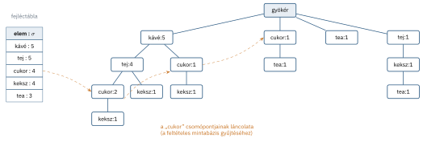
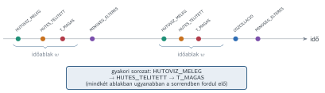

# Gyakori mintázatok és asszociációs szabályok {#sec-asszociacio}

```{python}
#| include: false
import numpy as np
import pandas as pd
import matplotlib.pyplot as plt
import adatbanyaszat as ab
ab.set_style()
pd.set_option("display.max_columns", 12)
pd.set_option("display.width", 120)
pd.set_option("display.max_colwidth", 60)
```

::: {.roadmap}
Mely termékeket vásárolják együtt? Mely riasztások követik rendszeresen egymást egy
üzemben? Az ilyen kérdésekre a gyakori elemhalmazok és az asszociációs szabályok
feltárása ad választ. A fejezet bevezeti az alapfogalmakat (támogatottság,
megbízhatóság), bemutatja a keresés hatékonyságát biztosító Apriori-elvet és a rá épülő
algoritmusokat (Apriori, Eclat, FP-growth), a gyakori elemhalmazok tömör
reprezentációit, a szabályok érdekességének mérőszámait, végül a többszintű, a
mennyiségi és a sorozatmintákra vonatkozó kiterjesztéseket.

**A fejezet végére az olvasó** képes lesz egy kis tranzakciós adatbázison kézzel
végigvinni az Apriori-algoritmust; nagy adatbázison FP-growth-szal gyakori
elemhalmazokat és szabályokat keresni; a szabályokat a lift, a leverage és a
conviction alapján kritikusan értékelni; és eseménynaplókban gyakori sorozatokat
feltárni.
:::

## Alapfogalmak {#sec-asszoc-alapfogalmak}

A feladatot @agrawal1993 fogalmazta meg a vásárlói kosarak elemzésére. Legyen
$\mathcal{I} = \{i_1, \dots, i_d\}$ az **elemek** (termékek) halmaza, és legyen az
adatbázis $N$ **tranzakció** (kosár) $\mathcal{T} = \{T_1, \dots, T_N\}$ gyűjteménye,
ahol minden $T_k \subseteq \mathcal{I}$. Elemek egy $X\subseteq\mathcal{I}$
halmazát **elemhalmaznak**, $k$ elemű elemhalmazt $k$-elemhalmaznak nevezünk.

Egy elemhalmaz **támogatottsága** (support) azoknak a tranzakcióknak az aránya,
amelyek tartalmazzák:

$$
s(X) = \frac{\sigma(X)}{N},
\qquad
\sigma(X) = \bigl|\{T_k\in\mathcal{T} : X\subseteq T_k\}\bigr| .
$$ {#eq-support}

Az $X$ elemhalmaz **gyakori**, ha támogatottsága eléri a felhasználó által megadott
$s_{\min}$ küszöböt.

Egy **asszociációs szabály** $X\Rightarrow Y$ alakú, ahol $X$ és $Y$ diszjunkt
elemhalmazok ($X$ az előzmény, $Y$ a következmény). A szabály támogatottsága
$s(X\Rightarrow Y) = s(X\cup Y)$, **megbízhatósága** (confidence) pedig annak becsült
feltételes valószínűsége, hogy egy $X$-et tartalmazó kosár $Y$-t is tartalmaz:

$$
c(X\Rightarrow Y) = \frac{s(X\cup Y)}{s(X)} \approx P(Y\mid X).
$$ {#eq-confidence}

Az asszociációs szabályok feltárásának feladata az összes olyan szabály megtalálása,
amelynek támogatottsága legalább $s_{\min}$, megbízhatósága legalább $c_{\min}$. A
feladatot két lépésre bontjuk: (1) megkeressük a gyakori elemhalmazokat, (2) mindegyikből
előállítjuk a megbízható szabályokat. A számításigényes rész az első lépés.

::: {.callout-note title="A keresési tér mérete"}
$d$ elemből $2^d - 1$ nem üres elemhalmaz és $3^d - 2^{d+1} + 1$ lehetséges szabály
képezhető (minden elem az előzménybe, a következménybe vagy egyikbe sem kerülhet, és
egyik oldal sem lehet üres). A PannonShop mindössze 60 termékére ez $2^{60}\approx
10^{18}$ elemhalmaz – a kimerítő keresés reménytelen.
:::

## Az Apriori-elv és az Apriori-algoritmus {#sec-apriori}

### Az Apriori-elv

A keresési tér hatékony bejárásának kulcsa egy egyszerű megfigyelés: ha egy elemhalmaz
gyakori, akkor minden részhalmaza is gyakori, hiszen minden olyan kosár, amely
tartalmazza az elemhalmazt, a részhalmazait is tartalmazza. Formálisan a támogatottság
**anti-monoton**:

$$
X\subseteq Y \quad\Longrightarrow\quad s(X)\ge s(Y).
$$ {#eq-antimonoton}

Ennek megfordítása a gyakorlatban hasznos alak: **ha egy elemhalmaz ritka, minden
bővítése is ritka**, így a bővítéseit meg sem kell számolni ([-@fig-halo]. ábra).

{#fig-halo width=100%}

### Az algoritmus

Az **Apriori-algoritmus** [@agrawal1994] szintenként halad: először a gyakori
1-elemhalmazokat keresi meg, majd a $k$-adik szinten a $(k-1)$-elemű gyakori halmazokból
állítja elő a $k$-elemű **jelölteket**, és ezek támogatottságát egyetlen adatbázis-bejárással
számolja meg. A jelöltképzés két lépésből áll:

1. **Összekapcsolás**: két gyakori $(k-1)$-elemhalmazt, amelyek (rendezett alakban) az
   első $k-2$ elemükben megegyeznek, egy $k$-elemű jelöltté egyesítünk.
2. **Metszés**: elhagyjuk azokat a jelölteket, amelyeknek van ritka
   $(k-1)$-elemű részhalmaza ([-@eq-antimonoton]).

::: {.callout-important title="Az algoritmus összefoglalása: Apriori"}
1. Számoljuk meg az egyes elemek támogatottságát; $F_1$ a gyakori elemek halmaza.
2. $k = 2, 3, \dots$ esetén, amíg $F_{k-1}$ nem üres:
   a. állítsuk elő a $C_k$ jelölthalmazt $F_{k-1}$ elemeinek összekapcsolásával és metszéssel;
   b. egy adatbázis-bejárással számoljuk meg a jelöltek támogatottságát;
   c. $F_k$ a $C_k$ gyakori elemei.
3. A gyakori elemhalmazok: $F_1\cup F_2\cup\dots$
:::

### Kézi példa

A segédcsomag nyolc kosarán kövessük végig az algoritmust $\sigma_{\min} = 3$
(azaz $s_{\min} = 37{,}5\%$) mellett!

```{python}
kosarak = ab.kosar_mini()
for i, k in enumerate(kosarak, 1):
    print(f"T{i}: {', '.join(k)}")
```

Az elemek támogatottsága alapján $F_1 = \{$kávé (5), tej (5), cukor (4), keksz (4),
tea (3)$\}$; a citrom (2) ritka. A $C_2$ jelöltek $F_1$ összes párja (10 db); közülük
gyakori a {kávé, tej} (4), a {kávé, cukor} (3), a {kávé, keksz} (3) és a {tej, keksz}
(3). A $C_3$ jelöltek összekapcsolással: {kávé, tej, cukor}, {kávé, tej, keksz} és {kávé,
cukor, keksz}. A metszés az elsőt elhagyja (a {tej, cukor} ritka) és a harmadikat is (a
{cukor, keksz} ritka), így csak a {kávé, tej, keksz} marad; ennek támogatottsága 2, tehát
ritka. $F_3$ üres, az algoritmus megáll.

Írjuk meg az algoritmust Pythonban – a kód szinte szó szerint követi az összefoglalást:

```{python}
from itertools import combinations

def apriori_sajat(tranzakciok, min_sigma):
    T = [frozenset(t) for t in tranzakciok]
    def szamol(jeloltek):
        return {c: sum(c <= t for t in T) for c in jeloltek}
    elemek = {frozenset([i]) for t in T for i in t}
    F = {c: s for c, s in szamol(elemek).items() if s >= min_sigma}
    osszes, k = dict(F), 2
    while F:
        elozo = sorted(tuple(sorted(c)) for c in F)
        jeloltek = set()
        for a, b in combinations(elozo, 2):                 # összekapcsolás
            if a[:k - 2] == b[:k - 2]:
                c = frozenset(a) | frozenset(b)
                if all(frozenset(r) in F for r in combinations(sorted(c), k - 1)):   # metszés
                    jeloltek.add(c)
        F = {c: s for c, s in szamol(jeloltek).items() if s >= min_sigma}
        osszes.update(F)
        k += 1
    return osszes

gyakori = apriori_sajat(kosarak, min_sigma=3)
for c, s in sorted(gyakori.items(), key=lambda x: (len(x[0]), -x[1])):
    print(f"{set(c)}: {s}")
```

### Az Apriori továbbfejlesztései

Az Apriori fő költsége a sok jelölt és az ismételt adatbázis-bejárás. A klasszikus
továbbfejlesztések ezeket csökkentik: a **DHP** [@park1995] hasítótáblával szűri a
$C_2$ jelölteket, és bejárásonként szűkíti az adatbázist; a **DIC** [@brin1997] a
bejárás közben, menet közben indít új jelölteket, így kevesebb bejárás kell. A ma
használt algoritmusok azonban más elven működnek.

## Mélységi és mintanövelő algoritmusok {#sec-fpgrowth}

### Vertikális adatábrázolás: Eclat

Az **Eclat** [@zaki2000] a tranzakciós adatbázist *függőlegesen* tárolja: minden
elemhez a tartalmazó tranzakciók azonosítóinak listáját (tid-listáját) rendeli. Egy
elemhalmaz támogatottsága így a tid-listák metszetének hossza – nem kell az
adatbázist újra bejárni. A mini-példában a kávé tid-listája $\{1,2,4,6,7\}$, a tejé
$\{1,2,4,7,8\}$, a metszet $\{1,2,4,7\}$, tehát $\sigma(\{\text{kávé, tej}\}) = 4$. Az
Eclat a hálót mélységben járja be, és a metszeteket fokozatosan szűkíti.

### FP-growth

Az **FP-growth** [@han2000] egyáltalán nem állít elő jelölteket. Két bejárással egy tömör
prefixfát, az **FP-fát** építi fel ([-@fig-fpfa]. ábra): az első bejárás megszámolja az
elemek gyakoriságát, a második minden tranzakció gyakori elemeit gyakoriság szerint
csökkenő sorrendbe rendezi, és a fába illeszti. A közös előtagú tranzakciók közös utat
használnak, így a fa gyakran sokkal kisebb, mint az adatbázis. A gyakori elemhalmazokat
ezután rekurzívan bányászuk: minden elemre összegyűjtjük a fában hozzá vezető utakat
(a **feltételes mintabázist**), ebből feltételes FP-fát építünk, és azon folytatjuk a
keresést.

{#fig-fpfa width=100%}

A „cukor” feltételes mintabázisa a fából kiolvasható: a {kávé, tej} út kétszer, a {kávé}
út egyszer vezet cukor csomóponthoz (a gyökértől közvetlenül induló cukor csomópont
előtt nincs elem). A cukorral együtt gyakori elem tehát csak a kávé (3), így a
{kávé, cukor} gyakori, a {tej, cukor} (2) nem – egyezésben a hálóból kapott eredménnyel.

## Tömör reprezentációk: zárt és maximális elemhalmazok {#sec-zart-maximalis}

Alacsony támogatottsági küszöbnél a gyakori elemhalmazok száma óriási lehet, hiszen egy
$k$ elemű gyakori halmaz minden részhalmaza is gyakori. Két tömör reprezentáció
csökkenti ezt a redundanciát:

- Egy gyakori elemhalmaz **maximális**, ha egyik valódi bővítése sem gyakori
  [@bayardo1998]. A maximális gyakori elemhalmazokból az összes gyakori elemhalmaz
  előállítható (mint részhalmazaik), de a támogatottságuk nem.
- Egy elemhalmaz **zárt**, ha egyik valódi bővítésének sem ugyanakkora a támogatottsága
  [@pasquier1999]. A zárt gyakori elemhalmazokból a gyakori elemhalmazok *és*
  támogatottságaik is visszaállíthatók: egy elemhalmaz támogatottsága a legkisebb őt
  tartalmazó zárt halmaz támogatottsága.

A kettő viszonya: minden maximális gyakori elemhalmaz zárt is, így
$\text{maximális}\subseteq\text{zárt}\subseteq\text{gyakori}$.

## Szabályok előállítása és értékelése {#sec-szabalyok}

### Szabályok a gyakori elemhalmazokból

Egy $Z$ gyakori elemhalmazból minden $X\Rightarrow Z\setminus X$ szabály
($\emptyset\ne X\subset Z$) támogatottsága ugyanaz, $s(Z)$; csak a megbízhatóságot kell
kiszámolni. A megbízhatóság általában nem anti-monoton, egy rögzített $Z$-ből képzett
szabályokra viszont igen: ha a következményt bővítjük (az előzményt szűkítjük), a
megbízhatóság nem nőhet, mert $c = s(Z)/s(X)$ és a kisebb $X$ támogatottsága nagyobb.
Ezért ha egy szabály nem megbízható, a több elemű következményű „rokonai” sem azok.

### Az érdekesség mérése

A támogatottság és a megbízhatóság önmagában félrevezető lehet. Ha egy termék nagyon
népszerű, minden szabály, amelynek következménye, nagy megbízhatóságú lesz – akkor is,
ha az előzménynek semmi köze hozzá. A **lift** a megbízhatóságot a következmény
alapgyakoriságához viszonyítja:

$$
\mathrm{lift}(X\Rightarrow Y) = \frac{c(X\Rightarrow Y)}{s(Y)} = \frac{s(X\cup Y)}{s(X)\,s(Y)} .
$$ {#eq-lift}

A lift értéke 1, ha $X$ és $Y$ előfordulása (a mintán) független; 1 fölött pozitív, alatta
negatív kapcsolatot jelez. További gyakori mérőszámok a **leverage** (más néven
Piatetsky-Shapiro-mérték) [@piatetsky1991], amely a különbséget méri a független esethez
képest, és a **conviction** [@brin1997], amely azt méri, hányszor gyakrabban fordulna elő
a szabály „megsértése” ($X$ előfordul, de $Y$ nem), ha $X$ és $Y$ független lenne:

$$
\mathrm{leverage}(X\Rightarrow Y) = s(X\cup Y) - s(X)\,s(Y),
\qquad
\mathrm{conviction}(X\Rightarrow Y) = \frac{1 - s(Y)}{1 - c(X\Rightarrow Y)} .
$$ {#eq-leverage}

A mérőszámok eltérő tulajdonságúak (szimmetrikusak-e, hogyan viselkednek ritka elemekre,
hogyan függnek a kosarak számától); választásukhoz @tan2004 ad szempontokat.

::: {.callout-warning title="Buktató: a megbízható, de érdektelen szabály"}
Ha a vásárlók 80%-a vesz kávét, és a teát vásárlók 75%-a is vesz kávét, a
„tea ⇒ kávé” szabály megbízhatósága 75% – mégis *negatív* kapcsolatot jelez, hiszen a
teát vásárlók kevésbé valószínűen vesznek kávét, mint egy átlagos vásárló
(lift = 0,75/0,80 ≈ 0,94). A megbízhatóságot mindig a következmény alapgyakoriságához
kell viszonyítani.
:::

Az asszociációs szabályok együttes előfordulást írnak le, **nem okozati kapcsolatot**. Egy
erős szabály oka lehet egy közös harmadik tényező (például egy akció, amelyben a két
termék együtt szerepelt), és a sok tesztelt szabály között a véletlen is produkál
„erős” szabályokat; a nagyon kis támogatottságú szabályokat ezért óvatosan kell kezelni.

## Kiterjesztések {#sec-asszoc-kiterjesztesek}

**Többszintű szabályok.** A termékek gyakran hierarchiába szerveződnek (termék →
alkategória → kategória). Termékszinten egy kapcsolat túl ritka lehet ahhoz, hogy
kimutassuk, kategóriaszinten viszont már erős. Az általánosított asszociációs szabályok
[@srikant1995] egyszerre több szinten keresnek, és kiszűrik azokat az alacsonyabb szintű
szabályokat, amelyek csak a magasabb szintű szabályt ismétlik.

**Mennyiségi szabályok.** Numerikus attribútumok (életkor, vásárlási érték, hőmérséklet)
esetén az értékeket intervallumokra bontjuk, és az „attribútum ∈ intervallum” állításokat
tekintjük elemeknek [@srikant1996q]. Az eredmény erősen függ a diszkretizálástól: a túl
keskeny intervallumok ritkák, a túl szélesek elmossák a kapcsolatot.

**Sorozatminták.** Ha a tranzakciók időrendje is számít (egy vevő egymást követő
vásárlásai, egy üzem riasztásainak sorrendje), **gyakori sorozatokat** keresünk: olyan
eseménysorozatokat, amelyek sok sorozatban ugyanabban a sorrendben fordulnak elő. A
klasszikus algoritmusok a GSP [@srikant1996s], amely az Apriori-elvet viszi át sorozatokra,
és a PrefixSpan [@pei2001], amely az FP-growth-hoz hasonlóan vetített adatbázisokon dolgozik.
Ipari riasztásnaplókban a gyakori riasztássorozatok feltárása a riasztási „árvizek”
csökkentésének egyik eszköze [@dorgo2018; @wang2016] ([-@fig-riasztas]. ábra).

{#fig-riasztas width=100%}

## Gyakorlat: kosárelemzés és riasztássorozatok {#sec-asszoc-gyakorlat}

### A PannonShop kosarai

A `mlxtend` csomag [@raschka2018] a gyakori elemhalmazok keresését `pandas`
adattáblákon végzi, amelyekben minden sor egy kosár, minden oszlop egy termék logikai
jelzője. A sztornózott számlák nélküli, megtisztított számlatételekből indulunk
([-@sec-elokeszites]. fejezet).

```{python}
from mlxtend.preprocessing import TransactionEncoder
from mlxtend.frequent_patterns import fpgrowth, apriori, association_rules

tiszta = ab.shop_clean()
kosar = tiszta.groupby("Invoice").Description.apply(lambda s: sorted(set(s)))
print(f"kosarak: {len(kosar):,}, átlagos kosárméret: {kosar.str.len().mean():.2f}".replace(",", " "))
te = TransactionEncoder()
B = pd.DataFrame(te.fit_transform(kosar), columns=te.columns_)
B.iloc[:3, :6]
```

```{python}
import time
for alg, f in [("Apriori", apriori), ("FP-growth", fpgrowth)]:
    t0 = time.perf_counter()
    gy = f(B, min_support=0.005, use_colnames=True)
    print(f"{alg:10s}: {len(gy):5d} gyakori elemhalmaz, {time.perf_counter() - t0:6.2f} s")
```

Mindkét algoritmus ugyanazokat a gyakori elemhalmazokat adja; az FP-growth jellemzően
gyorsabb, különösen alacsony küszöbnél. A szabályokat a lift szerint rendezzük:

```{python}
gy = fpgrowth(B, min_support=0.005, use_colnames=True)
sz = association_rules(gy, metric="confidence", min_threshold=0.3)
sz["szabaly"] = sz.antecedents.apply(lambda s: ", ".join(sorted(s))) + "  ⇒  " + sz.consequents.apply(lambda s: ", ".join(sorted(s)))
sz[["szabaly", "support", "confidence", "lift", "leverage", "conviction"]] \
  .sort_values("lift", ascending=False).head(12).round(3)
```

::: {.eset-uzleti}
A legnagyobb liftű szabályok között szerepelnek a szimulátor által „beültetett”
kapcsolatok (kávéfőző gép ⇒ kávébab, vízkőoldó; teáskanna ⇒ zöld és fekete tea; pontozott
füzet ⇒ tollkészlet; illatgyertya ⇒ gyertyatartó). Ellenőrizzük szisztematikusan, hogy
az algoritmus mindegyiket megtalálta-e, és mekkora lifttel!
:::

```{python}
beultetett = ab.load_shop().truth["planted_rules"]
sorok = []
for ante, cons, p in beultetett:
    m = sz[(sz.antecedents == frozenset(ante)) & (sz.consequents == frozenset([cons]))]
    sorok.append({"szabály": f"{ante[0]} ⇒ {cons}", "beültetett valószínűség": p,
                  "megtalálva": len(m) > 0,
                  "megbízhatóság": m.confidence.iat[0] if len(m) else np.nan,
                  "lift": m.lift.iat[0] if len(m) else np.nan})
pd.DataFrame(sorok).round(3)
```

A megtalált szabályok megbízhatósága nem pontosan egyezik a beültetett
valószínűséggel. Ennek két oka van: a következmény néha a szabálytól függetlenül, a
vevő saját preferenciái miatt is a kosárba kerül (ez növeli a megbízhatóságot), és ha a
kosárban több előzmény is van, a szabályok egymást erősítik.

```{python}
#| label: fig-szabalyok
#| fig-cap: "A PannonShop asszociációs szabályai a támogatottság–megbízhatóság síkon, a lift szerint színezve. A kis támogatottságú, de nagy liftű szabályok (jobb felső színek a bal oldalon) a legérdekesebbek."
#| fig-width: 6
#| fig-height: 3.4
fig, ax = plt.subplots()
sc = ax.scatter(sz.support, sz.confidence, c=sz.lift, cmap="viridis", s=12 + 4 * sz.lift, alpha=0.8)
fig.colorbar(sc, ax=ax, label="lift")
ax.set_xscale("log"); ax.set_xlabel("támogatottság (log)"); ax.set_ylabel("megbízhatóság")
fig.tight_layout()
```

### Kategóriaszintű szabályok

A termékeket kategóriájukkal helyettesítve kategóriaszintű kosarakat kapunk; a
kategóriák között gyakoribb, de gyengébb kapcsolatok mutathatók ki:

```{python}
termek_kat = ab.load_shop().products.set_index("Description").Kategoria
kat_kosar = tiszta.assign(kat=tiszta.Description.map(termek_kat)).groupby("Invoice").kat.apply(lambda s: sorted(set(s)))
te2 = TransactionEncoder()
BK = pd.DataFrame(te2.fit_transform(kat_kosar), columns=te2.columns_)
szk = association_rules(fpgrowth(BK, min_support=0.03, use_colnames=True), metric="lift", min_threshold=1.05)
szk["szabaly"] = szk.antecedents.apply(lambda s: ", ".join(sorted(s))) + "  ⇒  " + szk.consequents.apply(lambda s: ", ".join(sorted(s)))
szk[["szabaly", "support", "confidence", "lift"]].sort_values("lift", ascending=False).head(8).round(3)
```

### Zárt és maximális elemhalmazok

```{python}
def zart_maximalis(gy):
    halmazok = dict(zip(gy.itemsets, gy.support))
    zart = maxi = 0
    for X, s in halmazok.items():
        bovitesek = [Y for Y in halmazok if len(Y) == len(X) + 1 and X < Y]
        zart += all(abs(halmazok[Y] - s) > 1e-12 for Y in bovitesek)
        maxi += len(bovitesek) == 0
    return zart, maxi

for s_min in [0.02, 0.01, 0.005, 0.002]:
    g = fpgrowth(B, min_support=s_min, use_colnames=True)
    z, m = zart_maximalis(g)
    print(f"s_min = {s_min:<6}: gyakori {len(g):5d}   zárt {z:5d}   maximális {m:5d}")
```

(Elég az eggyel nagyobb gyakori bővítéseket vizsgálni: ha egy elemhalmaznak van azonos
támogatottságú bővítése, akkor eggyel nagyobb is van, és egy nem gyakori bővítés nem
lehet azonos támogatottságú.) Ezen az adaton minden gyakori elemhalmaz zárt is – a
viszonylag kis, változatos kosaraknál ritka, hogy egy bővítés pontosan ugyanannyi
kosárban forduljon elő –, a maximális elemhalmazok viszont lényegesen kevesebben vannak.
Erősen korrelált elemeket tartalmazó adatokon (például összetartozó termékcsomagoknál)
a zárt halmazok is jelentős tömörítést adnak.

### Riasztássorozatok a Pannon üzemben

::: {.eset-mernoki}
A Pannon üzem riasztásnaplója időbélyeggel ellátott eseményekből áll. Arra vagyunk
kíváncsiak, mely riasztások követik rendszeresen egymást rövid időn belül, mert az ilyen
láncok egy közös kiváltó okra utalhatnak, és a kezelő a lánc első elemére reagálva
megelőzheti a többit.
:::

Egyszerű, de hatékony módszer a **rendezett párok** és hármasok számlálása egy
időablakon belül. Minden $A$ riasztásnál megnézzük, milyen riasztások követték a
következő $w = 3$ órán belül; így megkapjuk az „$A$ után $w$-n belül $B$”
sorozatszabály megbízhatóságát, és ezt összevetjük $B$ alapgyakoriságával (liftjével).

```{python}
plant = ab.load_plant()
R = plant.alarms.copy()
w = pd.Timedelta(hours=3)
ido, nev = R.ido.to_numpy(), R.riasztas.to_numpy()
parok = []
for i in range(len(R)):
    kovetok = set(nev[(ido > ido[i]) & (ido <= ido[i] + w)]) - {nev[i]}
    parok += [(nev[i], b) for b in kovetok]
parok = pd.DataFrame(parok, columns=["A", "B"])
nA = R.riasztas.value_counts()
# B alapgyakorisága: a 3 órás ablakok mekkora hányadában fordul elő B
ablakok = pd.date_range(R.ido.min().floor("3h"), R.ido.max(), freq="3h")
alap = {b: np.isin(ablakok, R.loc[R.riasztas == b, "ido"].dt.floor("3h").unique()).mean() for b in nA.index}
sorozat = (parok.value_counts().rename("db").reset_index()
           .assign(megbizhatosag=lambda d: d.db / d.A.map(nA),
                   lift=lambda d: d.megbizhatosag / d.B.map(alap)))
sorozat[sorozat.db >= 8].sort_values("db", ascending=False).head(10).round(2)
```

```{python}
harmasok = []
for i in range(len(R)):
    utana = R[(R.ido > R.ido.iat[i]) & (R.ido <= R.ido.iat[i] + w)].riasztas.tolist()
    for j, b in enumerate(utana):
        for c in utana[j + 1:]:
            if len({nev[i], b, c}) == 3:
                harmasok.append((nev[i], b, c))
pd.Series([" → ".join(h) for h in harmasok]).value_counts().head(6).to_frame("előfordulás")
```

A hármas sorozatok ritkák – egy év alatt csak néhány teljes lánc fordul elő –, a párok
azonban egyértelmű képet adnak, és fizikailag értelmezhetők: a meleg hűtővizet a hűtés
telítődése és a reaktorhőmérséklet emelkedése követi, a magas hőmérsékletet pedig
minőségi eltérés. Más párok mögött mérési vagy szabályozási jelenség áll: a
hűtővízszelep akadozásakor az oszcilláló szelepállás időnként eléri a határt, ezért a
„hűtés telített” és a „hűtővíz-oszcilláció” riasztás együtt jár, holott a hűtés valójában
nem telített. A sorozatminták így nemcsak a riasztási „árvizek” csökkentésére (a
következményként fellépő riasztások elnyomására), hanem a kiváltó ok gyors
azonosítására és a félrevezető riasztások felderítésére is használhatók. A
[-@sec-folyamat]. fejezetben ezt a gondolatot a hibadiagnosztikával kapcsoljuk össze.





## Összefoglalás {#sec-asszoc-osszefoglalas}

- Az asszociációs szabályok keresése két lépés: a gyakori elemhalmazok feltárása és a
  megbízható szabályok előállítása; a számításigényes rész az első.
- A támogatottság anti-monoton: egy ritka elemhalmaz minden bővítése ritka. Ez teszi
  lehetővé az Apriori-algoritmus metszését.
- Az Eclat vertikális tid-listákkal, az FP-growth egy tömör prefixfával, jelöltképzés
  nélkül dolgozik; nagy adatbázisokon ezek a hatékonyabbak.
- A zárt gyakori elemhalmazok a támogatottságokat is megőrző, a maximálisak még tömörebb,
  de veszteséges reprezentációt adnak.
- A megbízhatóság a következmény alapgyakoriságát nem veszi figyelembe; a lift, a
  leverage és a conviction ezt korrigálja. A szabályok együttes előfordulást, nem okozatot írnak le.
- A módszer kiterjeszthető fogalmi hierarchiákra, numerikus attribútumokra és
  időrendezett eseménysorozatokra.

## Ellenőrző kérdések {.unnumbered}

1. Mit jelent, hogy a támogatottság anti-monoton? Miért nem az a megbízhatóság általában?
2. Hány jelöltet állít elő az Apriori a második szinten, ha $|F_1| = 40$?
3. Mi a különbség a zárt és a maximális gyakori elemhalmaz között? Melyikből állíthatók
   vissza a támogatottságok?
4. Mikor lehet egy 90%-os megbízhatóságú szabály érdektelen?
5. Miért nem következik egy erős asszociációs szabályból, hogy az egyik termék ajánlása
   növelni fogja a másik eladását?

## Feladatok {.unnumbered}

1. **Kézi Apriori.** Végezze el a mini-példát $\sigma_{\min} = 2$ küszöbbel! Állítsa elő a
   {kávé, tej, cukor} gyakori elemhalmazból képezhető összes szabályt, és számítsa ki a
   megbízhatóságukat és a liftjüket!
2. **FP-fa.** Rajzolja meg a mini-példa FP-fáját $\sigma_{\min} = 2$ esetén! Mi a „keksz”
   feltételes mintabázisa?
3. **Küszöbök hatása.** Ábrázolja a PannonShop gyakori elemhalmazainak és szabályainak
   számát a támogatottsági küszöb függvényében! Hol jelennek meg a beültetett szabályok?
4. **Szezonális szabályok.** Keressen szabályokat külön a decemberi és a többi hónap
   kosaraiban! Mely szabályok jellemzőek csak a karácsonyi időszakra?
5. **Időablak.** Vizsgálja meg, hogyan változnak a riasztássorozatok megbízhatóságai és
   liftjei 30 perces, 2 órás és 6 órás időablak esetén! Melyik ablak adja a fizikailag
   legjobban értelmezhető láncokat?

## További olvasmányok {.unnumbered}

Az asszociációs szabályok és az Apriori eredeti leírása @agrawal1993 és @agrawal1994. A
mintanövelő módszerekről @han2000, a vertikális algoritmusokról @zaki2000 ír. Az
érdekességi mértékek összehasonlítását @tan2004 végezte el. A terület átfogó tárgyalása
@han2022 két mintabányászati fejezetében olvasható. A riasztásnaplók sorozatbányászatáról
@dorgo2018, az ipari riasztáskezelés problémáiról @wang2016 ad áttekintést.
