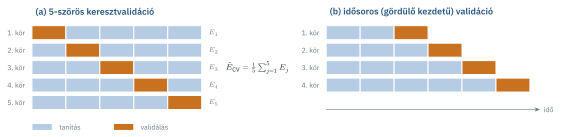
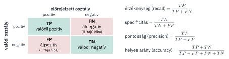

# A felügyelt tanulás alapjai és a modellek értékelése {#sec-ertekeles}

```{python}
#| include: false
import numpy as np
import pandas as pd
import matplotlib.pyplot as plt
import adatbanyaszat as ab
ab.set_style()
pd.set_option("display.max_columns", 12)
pd.set_option("display.width", 110)
```

::: {.roadmap}
Mielőtt a regressziós és osztályozó modellek családjait sorra vennénk, tisztázzuk, mit
jelent, hogy egy modell „jó”, és hogyan mérhető ez megbízhatóan. A fejezet a felügyelt
tanulás általános keretéből indul: az általánosítási hiba, a túltanulás és a
torzítás–variancia felbontás fogalmaiból. Ezután a modellek kiértékelésének gyakorlati
eszközeit tárgyalja: a tanító-, validációs és teszthalmazokra bontást, a
keresztvalidációt (az idősoros és a csoportos változatokkal együtt), a regressziós és az
osztályozási mérőszámokat, a ROC- és PR-görbéket, a döntési küszöb költségalapú
megválasztását, a valószínűségek kalibrációját és a kiegyensúlyozatlan osztályok
kezelését.

**A fejezet végére az olvasó** képes lesz egy modell várható teljesítményét torzítatlanul
becsülni; az adatok szerkezetének megfelelő validációs sémát választani; a feladathoz
illő mérőszámot kiválasztani és értelmezni; és a döntési küszöböt az üzleti költségek
alapján megállapítani.
:::

## Az általánosítás problémája {#sec-altalanositas}

A [-@sec-bevezetes]. fejezetben a felügyelt tanulást a tanítóadatokon számolt átlagos
veszteség minimalizálásaként írtuk fel ([-@eq-erm]). A valódi cél azonban nem a
tanítóadatok minél pontosabb visszaadása, hanem az, hogy a modell az ugyanabból a
folyamatból származó *új* adatokon is jól teljesítsen. Ha az adatok egy $p(\mathbf{x}, y)$
együttes eloszlásból származnak, a modell **általánosítási hibája** (várható kockázata)

$$
R(f) = \mathbb{E}_{(\mathbf{x},y)\sim p}\bigl[L\bigl(y, f(\mathbf{x})\bigr)\bigr],
$$ {#eq-kockazat}

amelyet nem ismerünk, csak becsülhetünk. A tanítóhiba ennek *optimista* becslése, hiszen
a modell paramétereit éppen ezekre az adatokra hangoltuk. Minél rugalmasabb a
modellcsalád, annál nagyobb lehet a különbség.

A [-@fig-komplexitas]. ábra ezt egy egyszerű kísérlettel szemlélteti. 25 zajos mérési
pontra egyre magasabb fokszámú polinomot illesztünk. A tanítóhiba a fokszámmal
monoton csökken – egy elég magas fokú polinom minden ponton áthaladhat –, a független
teszthalmazon mért hiba viszont egy darabig csökken, majd növekedni kezd. Az
alacsony fokszámú modell **alultanul** (nem képes leírni a valódi összefüggést), a magas
fokszámú **túltanul** (a zajt is megtanulja).

{#fig-komplexitas width=100%}

### A torzítás–variancia felbontás

A jelenség négyzetes veszteség esetén pontosan elemezhető [@geman1992; @hastie2009].
Tegyük fel, hogy $y = g(\mathbf{x}) + \varepsilon$, ahol $\varepsilon$ nulla várható
értékű, $\sigma^2$ szórásnégyzetű zaj, és a $\hat f$ modellt egy véletlen tanítóhalmazon
becsüljük. Egy rögzített $\mathbf{x}_0$ pontban a várható négyzetes hiba – a zaj és a
tanítóhalmaz véletlenségére vett várható érték – három részre bomlik:

$$
\mathbb{E}\bigl[(y_0 - \hat f(\mathbf{x}_0))^2\bigr]
= \underbrace{\sigma^2}_{\text{csökkenthetetlen zaj}}
+ \underbrace{\bigl(\mathbb{E}[\hat f(\mathbf{x}_0)] - g(\mathbf{x}_0)\bigr)^2}_{\text{torzítás}^2}
+ \underbrace{\mathbb{E}\bigl[(\hat f(\mathbf{x}_0) - \mathbb{E}[\hat f(\mathbf{x}_0)])^2\bigr]}_{\text{variancia}} .
$$ {#eq-torzitas-variancia}

A **torzítás** azt méri, mennyire tér el a modell *átlagos* előrejelzése (sok
lehetséges tanítóhalmazon) a valódi függvénytől; a **variancia** azt, hogy mennyire
ingadozik az előrejelzés tanítóhalmazról tanítóhalmazra. Az egyszerű modellek torzítása
nagy, varianciája kicsi; a rugalmas modelleké fordítva. A jó modell a kettő közötti
egyensúlyt találja meg. A ([-@eq-torzitas-variancia]) felbontás levezetéséhez az
$y_0 - \hat f = (y_0 - g) + (g - \mathbb{E}\hat f) + (\mathbb{E}\hat f - \hat f)$
összeget kell négyzetre emelni; a vegyes szorzatok várható értéke nulla, mert a zaj
független a tanítóhalmaztól, és $\mathbb{E}[\mathbb{E}\hat f - \hat f] = 0$.

A felbontás a gyakorlatban két irányt jelöl ki. A torzítást rugalmasabb modellcsaláddal,
jobb jellemzőkkel csökkenthetjük; a varianciát több adattal, egyszerűbb modellel,
**regularizációval** ([-@sec-regresszio]. fejezet) vagy sok modell átlagolásával
([-@sec-osztalyozas]. fejezet, együttes modellek).

## Adatfelosztás és validáció {#sec-validacio-semak}

### Tanító-, validációs és teszthalmaz

Az általánosítási hiba becsléséhez olyan adatok kellenek, amelyeket a modell a tanítás
során nem látott. A legegyszerűbb a **visszatartásos** (hold-out) módszer: az adatokat
véletlenszerűen tanító- és teszthalmazra bontjuk (például 80–20%-os arányban). Ha a
modellnek hangolandó **hiperparaméterei** is vannak (például a polinom fokszáma, egy fa
mélysége), a teszthalmaz nem használható a hangolásra, különben az is optimistává válik.
Ilyenkor háromfelé bontunk: a **tanítóhalmazon** illesztjük a paramétereket, a
**validációs halmazon** választjuk ki a hiperparamétereket, és a **teszthalmazt** csak
egyszer, a végső modell értékelésére használjuk.

### Keresztvalidáció

Kis adathalmazon a visszatartás pazarló, és a becslés erősen függ a véletlen
felosztástól. A **$K$-szoros keresztvalidáció** [@stone1974] az adatokat $K$ közel
egyenlő részre (foldra) osztja, és $K$-szor tanít: mindig egy rész a validációs, a többi a
tanítóhalmaz ([-@fig-cv]. ábra). Az általánosítási hiba becslése a $K$ validációs hiba
átlaga:

$$
\hat{E}_{\mathrm{CV}} = \frac{1}{K}\sum_{j=1}^{K}\frac{1}{|\mathcal{V}_j|}
\sum_{k\in\mathcal{V}_j}L\bigl(y_k, \hat f^{(-j)}(\mathbf{x}_k)\bigr),
$$ {#eq-cv}

ahol $\mathcal{V}_j$ a $j$-edik validációs rész, $\hat f^{(-j)}$ pedig a nélküle tanított
modell. A gyakorlatban a $K = 5$ vagy $K = 10$ jó kompromisszum a becslés torzítása és
varianciája között [@kohavi1995]. Osztályozásnál a **rétegzett** keresztvalidáció minden
részben megőrzi az osztályarányokat; ez kiegyensúlyozatlan osztályoknál különösen fontos.

{#fig-cv width=100%}

::: {.callout-warning title="A véletlen felosztás feltételezi a függetlenséget"}
A keresztvalidáció azt feltételezi, hogy a megfigyelések függetlenek. Ha nem azok, a
véletlen felosztás optimista becslést ad:

- **Idősorokban** a szomszédos időpontok erősen hasonlók; véletlen felosztásnál a modell
  „interpolál” a tanítóhalmaz közeli pontjai között, élesben viszont *előre* kell jeleznie.
  Ilyenkor a gördülő kezdetű (expanding window) validációt kell használni, ahol a modell
  mindig csak a múltból tanul ([-@fig-cv]. (b) ábra) [@bergmeir2012].
- **Csoportos adatokban** (egy vevő több rekordja, egy gép több mérése) ugyanazon
  csoport rekordjai nem kerülhetnek a tanító- és a validációs halmazba is; ezt a
  csoportos keresztvalidáció biztosítja.
:::

### Hiperparaméter-hangolás és beágyazott keresztvalidáció

A hiperparamétereket rendszerint rácskereséssel (az összes kombináció kipróbálásával)
vagy véletlen kereséssel választjuk; utóbbi sok hiperparaméter esetén gyakran
hatékonyabb, mert a fontos hiperparaméterek több különböző értékét próbálja ki
[@bergstra2012]. A kiválasztott modell keresztvalidációs hibája azonban már optimista,
hiszen a legjobbat választottuk ki sok közül. Torzítatlan becsléshez **beágyazott**
keresztvalidáció kell: egy külső ciklus becsli a teljesítményt, és minden külső körben egy
belső keresztvalidáció hangolja a hiperparamétereket, kizárólag a külső kör tanítórészén.

## Regressziós mérőszámok {#sec-regresszio-metrikak}

Ha $y_k$ a valódi, $\hat y_k$ az előrejelzett érték, a leggyakoribb mérőszámok:

$$
\mathrm{MAE} = \frac1N\sum_{k}\lvert y_k - \hat y_k\rvert,\qquad
\mathrm{RMSE} = \sqrt{\frac1N\sum_{k}(y_k - \hat y_k)^2},\qquad
R^2 = 1 - \frac{\sum_k (y_k - \hat y_k)^2}{\sum_k (y_k - \bar y)^2} .
$$ {#eq-regresszio-metrikak}

Az MAE és az RMSE a célváltozó mértékegységében fejezi ki a hibát; az RMSE a nagy hibákat
jobban bünteti. Az $R^2$ (determinációs együttható) azt méri, hogy a modell a célváltozó
szórásnégyzetének mekkora hányadát magyarázza meg; az átlaggal való előrejelzés $R^2 =
0$-t ad, és új adatokon az $R^2$ negatív is lehet. A százalékos hibák (MAPE) könnyen
értelmezhetők, de nulla közeli valódi értékeknél használhatatlanok.

## Osztályozási mérőszámok {#sec-osztalyozas-metrikak}

### A tévesztési mátrix és a belőle származó mérőszámok

Kétosztályos feladatban az egyik osztályt – rendszerint a ritkábbat, a „keresettet”
(lemorzsolódó vevő, hibás termék) – **pozitívnak**, a másikat negatívnak nevezzük. A
**tévesztési mátrix** (keveredési mátrix, confusion matrix) a valódi és az előrejelzett
osztályok szerint négy cellába sorolja az eseteket ([-@fig-tevesztes]. ábra): valódi
pozitív (TP), álnegatív (FN), álpozitív (FP), valódi negatív (TN).

{#fig-tevesztes width=95%}

A **helyes arány** (accuracy) a helyesen osztályozott esetek hányada. Kiegyensúlyozatlan
osztályoknál félrevezető: ha a termékek 9%-a hibás, a „minden termék jó” triviális
osztályozó is 91%-os helyes arányt ér el, miközben egyetlen hibát sem talál meg. Ezért az
osztályonkénti mérőszámokat kell néznünk:

- **érzékenység** (recall, sensitivity, valódi pozitív arány): a pozitívak hányadát
  találja meg a modell;
- **specificitás** (valódi negatív arány): a negatívak hányadát sorolja helyesen;
- **pontosság** (precision): a pozitívnak jelzett esetek hányada valóban pozitív;
- az **F1-mérték** a pontosság és az érzékenység harmonikus közepe,
  $F_1 = 2PR/(P+R)$;
- a **kiegyensúlyozott helyes arány** az érzékenység és a specificitás átlaga.

A magyar szakirodalomban a *precision* fordítása nem egységes (pontosság,
megbízhatóság, precizitás); e könyvben a *pontosság* a precision, a *helyes arány* az
accuracy megfelelője. Többosztályos feladatban a mérőszámokat osztályonként számoljuk, és
átlagoljuk: a *makroátlag* minden osztályt egyenlő súllyal, a *súlyozott átlag* az
osztályok gyakoriságával vesz figyelembe.

### A ROC-görbe és az AUC

A legtöbb osztályozó nem csak osztálycímkét, hanem egy **pontszámot** (például a pozitív
osztály becsült valószínűségét) ad, és a címkét egy küszöbérték határozza meg. A küszöb
csökkentésével több esetet jelzünk pozitívnak: nő az érzékenység, de nő az álpozitívak
aránya is. A **ROC-görbe** (receiver operating characteristic) az összes lehetséges
küszöbre ábrázolja a valódi pozitív arányt az álpozitív arány ($1 -$ specificitás)
függvényében [@fawcett2006]. A véletlen találgatás az átlót adja, a tökéletes osztályozó a
bal felső sarkon halad át.

A görbe alatti terület (**AUC**) egyetlen számban foglalja össze az osztályozó
rangsorolási képességét. Fontos értelmezése: az AUC annak a valószínűsége, hogy egy
véletlenszerűen választott pozitív eset pontszáma nagyobb, mint egy véletlenszerűen
választott negatívé:

$$
\mathrm{AUC} = P\bigl(\hat s(\mathbf{x}^{+}) > \hat s(\mathbf{x}^{-})\bigr).
$$ {#eq-auc}

Az AUC független a küszöbtől és az osztályaránytól. Erősen kiegyensúlyozatlan
feladatokban azonban túl kedvező képet adhat, mert a sok negatív eset miatt az álpozitív
arány akkor is kicsi marad, ha az álpozitívak száma nagy. Ilyenkor informatívabb a
**pontosság–érzékenység (PR) görbe** és az alatta lévő terület (átlagos pontosság)
[@saito2015]. A PR-görbén a véletlen osztályozó szintje a pozitív osztály aránya.

### A döntési küszöb megválasztása

Az alapértelmezett 0,5-ös küszöb ritkán optimális. A küszöbválasztás üzleti döntés: a
két hibatípus költsége általában nagyon különböző. Ha egy lemorzsolódó vevő elvesztése
$C_{FN}$, egy fölösleges megtartási ajánlat $C_{FP}$ költséggel jár, és a modell
valószínűségei jól kalibráltak, akkor az a döntés minimalizálja a várható költséget,
amely pozitívnak jelöl minden esetet, ahol

$$
\hat p(\mathbf{x})\,C_{FN} > \bigl(1-\hat p(\mathbf{x})\bigr)\,C_{FP}
\quad\Longleftrightarrow\quad
\hat p(\mathbf{x}) > \frac{C_{FP}}{C_{FP}+C_{FN}} .
$$ {#eq-kuszob}

Ha a kimaradt eset tízszer drágább a téves riasztásnál, az optimális küszöb $1/11 \approx
0{,}09$ – messze a 0,5 alatt. A ([-@eq-kuszob]) képlet csak jól kalibrált valószínűségekre
érvényes; egyébként a küszöböt egy validációs halmazon, a várható költség közvetlen
minimalizálásával kell meghatározni.

### Kalibráció

Egy osztályozó **kalibrált**, ha a becsült valószínűségei a valódi relatív gyakoriságokat
tükrözik: azok közül az esetek közül, amelyekre 0,3-et becsül, nagyjából 30% legyen
pozitív. A kalibrációt **megbízhatósági diagrammal** ellenőrizzük (a becsült
valószínűségek intervallumaiban ábrázoljuk a tényleges pozitív arányt), a
valószínűségek összesített minőségét pedig a **Brier-pontszámmal**,
$\frac1N\sum_k(\hat p_k - y_k)^2$ [@brier1950]. Sok népszerű modell (például a
döntési fák, a támaszvektor-gépek, a naiv Bayes) rosszul kalibrált valószínűségeket ad;
ezek utólag kalibrálhatók (Platt-skálázás, izotonikus regresszió)
[@niculescu2005].

### Kiegyensúlyozatlan osztályok

Ha a pozitív osztály ritka, a tanulóalgoritmus a többségi osztályt „preferálja”. A fő
kezelési lehetőségek [@he2009]: (1) a költségek beépítése a tanításba
(osztálysúlyozás, a `scikit-learn` `class_weight` paramétere); (2) újramintavételezés: a
ritka osztály felülmintavételezése vagy a gyakori alulmintavételezése, illetve szintetikus
pozitív esetek előállítása (SMOTE) [@chawla2002]; (3) a döntési küszöb eltolása. Az
újramintavételezést csak a tanítóhalmazon szabad végezni, a validációs és a teszthalmaz
eredeti eloszlását meg kell őrizni. A gyakorlatban a küszöb megfelelő megválasztása és
a súlyozás gyakran ugyanannyit ér, mint az újramintavételezés.

## A modellek összehasonlítása {#sec-osszehasonlitas}

Két modell keresztvalidációs eredményeinek különbsége lehet véletlen is. Ugyanazokon a
foldokon kiértékelt modellek eredményei páronként összehasonlíthatók, de a foldok
eredményei nem függetlenek (a tanítóhalmazok átfednek), ezért a szokásos $t$-próba
túl gyakran mutat ki „szignifikáns” különbséget. Több adathalmazon végzett
összehasonlításra nemparaméteres próbák ajánlottak [@demsar2006]. A legfontosabb
gyakorlati szabály azonban egyszerűbb: **mindig hasonlítsunk egy egyszerű
viszonyítási modellhez** (többségi osztály, átlag, előző érték), mert csak így derül ki,
mennyit ér a bonyolult modell.

## Gyakorlat: lemorzsolódás és termékminőség {#sec-ertekeles-gyakorlat}

### A PannonShop lemorzsolódási feladata

::: {.eset-uzleti}
A lemorzsolódás-előrejelzés első és legfontosabb lépése a célváltozó pontos
definiálása. A 2025. július 1-jei határnapot választjuk: a jellemzőket kizárólag az ezt
megelőző vásárlásokból számoljuk, és azokat a vevőket tekintjük lemorzsolódónak, akik a
megelőző évben vásároltak, de a határnapot követő fél évben nem. Így a tanítás során a
modell pontosan azt az információt kapja, amely egy valós, július 1-jén meghozott
döntéskor rendelkezésre állna.
:::

```{python}
churn = ab.churn_table(cutoff="2025-07-01", horizon_days=183)
jell = ["R_nap", "F_szamla", "M_ertek", "atl_kosarertek", "atl_kosarmeret", "atl_mennyiseg",
        "elso_vasarlas_nap", "akcios_arany", "arany_kave", "arany_gep", "arany_konyha",
        "arany_dekor", "arany_ajandek", "arany_iroszer"]
X, y = churn[jell], churn.lemorzsolodik
print(f"aktív vevők: {len(y)}, lemorzsolódási arány: {y.mean():.1%}")
```

Egy logisztikus regressziós modellt ([-@sec-osztalyozas]. fejezet) hasonlítunk össze a
többségi osztályt előrejelző viszonyítási modellel, rétegzett 5-szörös
keresztvalidációval. Az előfeldolgozás a folyamat része, így szivárgásmentes
([-@sec-szivargas]. alfejezet).

```{python}
from sklearn.pipeline import make_pipeline
from sklearn.preprocessing import FunctionTransformer, StandardScaler
from sklearn.impute import SimpleImputer
from sklearn.linear_model import LogisticRegression
from sklearn.dummy import DummyClassifier
from sklearn.model_selection import StratifiedKFold, cross_validate, cross_val_predict

elo = make_pipeline(SimpleImputer(strategy="median"), FunctionTransformer(np.log1p), StandardScaler())
modellek = {
    "többségi osztály": DummyClassifier(strategy="most_frequent"),
    "logisztikus regresszió": make_pipeline(elo, LogisticRegression(max_iter=2000)),
}
cv = StratifiedKFold(n_splits=5, shuffle=True, random_state=0)
metrikak = ["accuracy", "balanced_accuracy", "precision", "recall", "f1", "roc_auc", "average_precision"]
pd.DataFrame({nev: {m: cross_validate(mod, X, y, cv=cv, scoring=metrikak)[f"test_{m}"].mean()
                    for m in metrikak} for nev, mod in modellek.items()}).round(3)
```

A többségi osztályt előrejelző modell helyes aránya is jelentős, mert a vevők többsége
nem morzsolódik le; az érzékenysége és a pontossága viszont nulla. A logisztikus
regresszió minden mérőszámon jobb, az AUC alapján rangsorolási képessége jó.

```{python}
#| label: fig-roc-pr
#| fig-cap: "A lemorzsolódás-előrejelző logisztikus regresszió ROC-görbéje (balra) és pontosság–érzékenység görbéje (jobbra), keresztvalidált előrejelzésekből. A szaggatott vonal a véletlen osztályozó szintje."
#| fig-width: 7
#| fig-height: 3.1
from sklearn.metrics import roc_curve, precision_recall_curve, roc_auc_score, average_precision_score
p_cv = cross_val_predict(modellek["logisztikus regresszió"], X, y, cv=cv, method="predict_proba")[:, 1]
fpr, tpr, _ = roc_curve(y, p_cv)
prec, rec, _ = precision_recall_curve(y, p_cv)
fig, ax = plt.subplots(1, 2)
ax[0].plot(fpr, tpr, color=ab.PALETTE[0], label=f"AUC = {roc_auc_score(y, p_cv):.3f}")
ax[0].plot([0, 1], [0, 1], ls="--", color="0.6")
ax[0].set_xlabel("álpozitív arány (1 − specificitás)"); ax[0].set_ylabel("érzékenység"); ax[0].legend(loc="lower right")
ax[1].plot(rec, prec, color=ab.PALETTE[1], label=f"átlagos pontosság = {average_precision_score(y, p_cv):.3f}")
ax[1].axhline(y.mean(), ls="--", color="0.6")
ax[1].set_xlabel("érzékenység"); ax[1].set_ylabel("pontosság"); ax[1].legend(loc="lower left")
fig.tight_layout()
```

Tegyük fel, hogy egy megtartási ajánlat (kupon) költsége 2 000 Ft, egy lemorzsolódó vevő
elvesztése pedig átlagosan 20 000 Ft kiesett fedezetet jelent, és az ajánlat a megkeresett
lemorzsolódók felét tartja meg. Ekkor egy álpozitív 2 000 Ft, egy álnegatív 20 000 Ft
veszteség, egy valódi pozitív pedig $2\,000 + 0{,}5\cdot 20\,000 = 12\,000$ Ft. A várható
költséget a küszöb függvényében a keresztvalidált valószínűségekből számoljuk:

```{python}
#| label: fig-kuszob-koltseg
#| fig-cap: "A lemorzsolódás-kezelés várható költsége vevőnként a döntési küszöb függvényében. A minimum messze a 0,5-ös alapértelmezés alatt van, mert a kimaradt lemorzsolódó vevő sokkal drágább a fölösleges ajánlatnál."
#| fig-width: 5.5
#| fig-height: 2.8
C_FP, C_FN, C_TP = 2_000, 20_000, 2_000 + 0.5 * 20_000
kuszobok = np.linspace(0.01, 0.99, 99)
koltseg = []
for t in kuszobok:
    jelolt = p_cv >= t
    tp, fp = np.sum(jelolt & (y == 1)), np.sum(jelolt & (y == 0))
    fn = np.sum(~jelolt & (y == 1))
    koltseg.append((tp * C_TP + fp * C_FP + fn * C_FN) / len(y))
koltseg = np.array(koltseg)
t_opt = kuszobok[koltseg.argmin()]
fig, ax = plt.subplots()
ax.plot(kuszobok, koltseg / 1000, color=ab.PALETTE[0])
ax.axvline(t_opt, color=ab.PALETTE[1], ls="--"); ax.axvline(0.5, color="0.6", ls=":")
ax.set_xlabel("döntési küszöb"); ax.set_ylabel("várható költség [ezer Ft/vevő]")
fig.tight_layout()
ft = lambda v: f"{v:,.0f}".replace(",", " ")
print(f"optimális küszöb: {t_opt:.2f};  költség: {ft(koltseg.min())} Ft/vevő "
      f"(a 0,5-ös küszöbnél {ft(koltseg[49])} Ft/vevő)")
```

A költségoptimális küszöb jóval kisebb a 0,5-nél, és a megtakarítás vevőnként érezhető.
Ugyanaz a modell tehát a küszöbtől függően nagyon különböző üzleti eredményt adhat –
a modell kiértékelését mindig a felhasználási döntéssel együtt kell végezni.

```{python}
#| label: fig-kalibracio
#| fig-cap: "A lemorzsolódási valószínűségek megbízhatósági diagramja: a becsült valószínűségek tizedeiben a tényleges lemorzsolódási arány. A logisztikus regresszió jól kalibrált, a pontok közel vannak az átlóhoz."
#| fig-width: 4.2
#| fig-height: 3.4
from sklearn.calibration import calibration_curve
from sklearn.metrics import brier_score_loss
frac, mean_p = calibration_curve(y, p_cv, n_bins=10, strategy="quantile")
fig, ax = plt.subplots()
ax.plot([0, 1], [0, 1], ls="--", color="0.6")
ax.plot(mean_p, frac, marker="o", color=ab.PALETTE[0], label=f"Brier = {brier_score_loss(y, p_cv):.3f}")
ax.set_xlabel("becsült valószínűség"); ax.set_ylabel("tényleges arány"); ax.legend(loc="upper left")
fig.tight_layout()
```

### A Pannon üzem termékminőségi feladata

::: {.eset-mernoki}
A laborminták mintegy 9%-a nem felel meg a specifikációnak. Szeretnénk a laboreredmény
megérkezése előtt, a folyamatváltozókból előre jelezni a nem megfelelő tételeket. Ez egy
kiegyensúlyozatlan osztályozási feladat, amelyben ráadásul az adatok időbeli sorrendje is
számít.
:::

```{python}
q = ab.quality_table()
vlt = ["T_kornyezet", "F_betap", "c_betap", "T_reaktor", "F_hutoviz", "T_hutoviz",
       "P_reaktor", "P_kevero", "E_fogyasztas", "dT"]
Xq, yq = q[vlt], (~q.megfelelo).astype(int)              # pozitív osztály: nem megfelelő
print(f"minták: {len(yq)}, nem megfelelő arány: {yq.mean():.1%}")
osztalyozo = make_pipeline(StandardScaler(), LogisticRegression(max_iter=2000))
sulyozott = make_pipeline(StandardScaler(), LogisticRegression(max_iter=2000, class_weight="balanced"))
```

Először azt vizsgáljuk meg, mennyire számít a validációs séma. A véletlen
keresztvalidációt összevetjük az idősoros (gördülő kezdetű) validációval:

```{python}
from sklearn.model_selection import KFold, TimeSeriesSplit
from sklearn.ensemble import RandomForestClassifier
erdo = RandomForestClassifier(n_estimators=300, min_samples_leaf=3, random_state=0, n_jobs=-1)
semak = {"véletlen 5-szörös": KFold(5, shuffle=True, random_state=0), "idősoros 5-szörös": TimeSeriesSplit(5)}
sor = {}
for nev_m, mod in {"logisztikus regresszió": osztalyozo, "véletlen erdő": erdo}.items():
    for nev_s, s in semak.items():
        r = cross_validate(mod, Xq, yq, cv=s, scoring=["roc_auc", "average_precision"])
        sor[(nev_m, nev_s)] = {"AUC": r["test_roc_auc"].mean(), "átlagos pontosság": r["test_average_precision"].mean()}
pd.DataFrame(sor).T.round(3)
```

Két tanulság is kiolvasható a táblázatból. Egyrészt a véletlen erdő
([-@sec-osztalyozas]. fejezet) a véletlen felosztásnál lényegesen jobbnak tűnik, mint
idősoros validációnál. Ennek oka az időbeli függőség: a véletlen felosztásnál egy
validációs minta szomszédos, szinte azonos körülmények között vett mintái a
tanítóhalmazban vannak, és a rugalmas modell „megjegyzi” ezeket a körülményeket. Az
idősoros validáció a valós alkalmazást tükrözi: a modellnek a jövőbeli, esetleg korábban
nem látott helyzetekre kell előre jeleznie. Másrészt a logisztikus regresszió itt gyenge:
a minőségi eltérés a célértéktől mindkét irányban bekövetkezhet (túl kicsi és túl nagy
konverzió, illetve túlmelegedés), amit egyetlen lineáris döntési határ nem tud leírni –
erre a [-@sec-osztalyozas]. fejezet nemlineáris modelljei adnak megoldást.

Végül a kiegyensúlyozatlanság kezelését vizsgáljuk a véletlen erdővel. Az utolsó
negyedév adatai alkotják a teszthalmazt, a modellt az azt megelőző időszakon tanítjuk:

```{python}
from sklearn.metrics import confusion_matrix
vagas = q.ido >= "2025-10-01"
Xtr, Xte, ytr, yte = Xq[~vagas], Xq[vagas], yq[~vagas], yq[vagas]
erdo_s = RandomForestClassifier(n_estimators=300, min_samples_leaf=3, random_state=0, n_jobs=-1,
                                class_weight="balanced_subsample")
p_erdo = erdo.fit(Xtr, ytr).predict_proba(Xte)[:, 1]
p_suly = erdo_s.fit(Xtr, ytr).predict_proba(Xte)[:, 1]
for nev, p, t in [("küszöb 0,5", p_erdo, 0.5), ("küszöb 0,3", p_erdo, 0.3), ("küszöb 0,15", p_erdo, 0.15),
                  ("osztálysúlyozás, küszöb 0,5", p_suly, 0.5)]:
    tn, fp, fn, tp = confusion_matrix(yte, p >= t).ravel()
    print(f"{nev:28s} TP={tp:3d} FN={fn:3d} FP={fp:3d} TN={tn:4d}  "
          f"érzékenység={tp / (tp + fn):.2f}  pontosság={tp / max(tp + fp, 1):.2f}")
```

Az alapértelmezett 0,5-ös küszöbbel a modell a nem megfelelő tételeknek csak kis részét
találja meg, igaz, nagy pontossággal. A küszöb csökkentése – és kisebb mértékben az
osztálysúlyozás is – az érzékenységet növeli a pontosság rovására. Hogy melyik működési
pont a jobb, az ismét a hibák költségétől függ: egy kimaradt selejtes tétel kiszállítása
többnyire sokkal drágább, mint egy fölösleges soron kívüli laborvizsgálat.





## Összefoglalás {#sec-ertekeles-osszefoglalas}

- A cél az általánosítás: a tanítóhiba az általánosítási hiba optimista becslése; a
  túl rugalmas modell túltanul, a túl merev alultanul.
- Négyzetes veszteségre a várható hiba a zaj, a torzítás négyzete és a variancia összege
  ([-@eq-torzitas-variancia]).
- A hiperparaméterek hangolására validációs halmazt vagy keresztvalidációt, a végső
  értékelésre érintetlen teszthalmazt vagy beágyazott keresztvalidációt kell használni.
- Idősorokban és csoportos adatokban a véletlen felosztás optimista; ilyenkor idősoros,
  illetve csoportos validáció kell.
- Kiegyensúlyozatlan osztályoknál a helyes arány félrevezető; az érzékenység, a
  pontosság, az F1, a PR-görbe és a költségalapú értékelés informatívabb.
- A döntési küszöb üzleti döntés; kalibrált valószínűségek esetén a hibák költségéből
  közvetlenül számolható ([-@eq-kuszob]).

## Ellenőrző kérdések {.unnumbered}

1. Miért optimista becslés a tanítóhiba? Mikor nagyobb az optimizmus?
2. Mit jelent a torzítás és a variancia? Hogyan változnak a modell rugalmasságának növelésével?
3. Miért nem szabad a teszthalmazon hangolni a hiperparamétereket?
4. Miért ad optimista becslést a véletlen keresztvalidáció idősorokon?
5. Egy osztályozó érzékenysége 0,9, specificitása 0,9, a pozitív osztály aránya 1%. Mekkora a pontossága?
6. Mi az AUC valószínűségi jelentése? Mikor informatívabb a PR-görbe?
7. Ha egy kimaradt hiba ötször drágább egy téves riasztásnál, mekkora a ([-@eq-kuszob]) szerinti optimális küszöb?

## Feladatok {.unnumbered}

1. **Torzítás és variancia kísérletileg.** Ismételje meg a polinomillesztést 200 különböző
   véletlen tanítóhalmazon, és egy rögzített $x_0$ pontban becsülje meg a torzítást és a
   varianciát a fokszám függvényében! Ellenőrizze a ([-@eq-torzitas-variancia]) felbontást!
2. **Keresztvalidációs becslés szórása.** Futtassa a lemorzsolódási modell 5-szörös
   keresztvalidációját 20 különböző véletlen felosztással! Mekkora az AUC-becslés szórása?
   Hogyan változik 10-szeres keresztvalidációval?
3. **Csoportos validáció.** Készítsen olyan lemorzsolódási táblát, amelyben ugyanaz a vevő
   több határnaphoz (2025. január 1., április 1., július 1.) is szerepel! Hasonlítsa össze a
   véletlen és a vevőnkénti csoportos (`GroupKFold`) keresztvalidáció eredményét!
4. **Kalibráció.** Vizsgálja meg a véletlen erdő valószínűségeinek kalibrációját a minőségi
   feladaton, és kalibrálja őket izotonikus regresszióval (`CalibratedClassifierCV`)!
5. **Költségérzékenység.** Hogyan változik az optimális küszöb és a várható költség, ha a
   kupon csak a megkeresett lemorzsolódók 20%-át tartja meg?

## További olvasmányok {.unnumbered}

A torzítás–variancia felbontás és a modellválasztás elméletét @hastie2009 és @james2023
tárgyalja. A keresztvalidációról @kohavi1995, az idősoros validációról @bergmeir2012 ad
áttekintést. A ROC-analízis bevezetése @fawcett2006, a PR-görbék előnyeiről @saito2015
ír. A kalibrációról @niculescu2005, a kiegyensúlyozatlan tanulásról @he2009 olvasható.
Az osztályozók statisztikai összehasonlításának módszertanát @demsar2006 foglalja össze.
