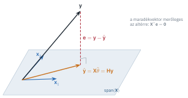
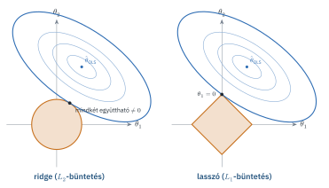
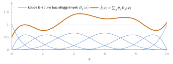

# Regresszió {#sec-regresszio}

```{python}
#| include: false
import numpy as np
import pandas as pd
import matplotlib.pyplot as plt
import adatbanyaszat as ab
ab.set_style()
pd.set_option("display.max_columns", 12)
pd.set_option("display.width", 110)
```

::: {.roadmap}
A regresszió egy folytonos célváltozó előrejelzése a magyarázó változókból. A fejezet a
legkisebb négyzetes lineáris regresszió levezetésével és geometriai értelmezésével
kezdődik, majd a becslés statisztikai tulajdonságait és a modelldiagnosztikát
tárgyalja. Ezután a sok, egymással korrelált változó problémájára a regularizált
regressziót (ridge, lasszó, elasztikus háló) mutatjuk be, végül a nemlineáris
összefüggések leírására a bázisfüggvényes (polinomiális, spline-) regressziót és a
paramétereiben nemlineáris, fizikai ismereteket is beépítő („szürkedoboz”) modelleket. A
gyakorlati részben a Pannon üzem termékkoncentrációjára lágy szenzort építünk, és a
PannonShop vevőinek jövőbeli költését jelezzük előre.

**A fejezet végére az olvasó** képes lesz a normálegyenleteket levezetni és megoldani; a
regressziós együtthatókat és a diagnosztikai ábrákat értelmezni; a regularizációs
paramétert keresztvalidációval megválasztani; és nemlineáris, akár fizikai alapú
regressziós modellt illeszteni.
:::

## Lineáris regresszió {#sec-linearis}

### A modell és a legkisebb négyzetek elve

A **lineáris regressziós modell** a célváltozót a magyarázó változók lineáris
kombinációjaként írja le:

$$
y_k = \theta_0 + \theta_1 x_{k1} + \dots + \theta_n x_{kn} + \varepsilon_k,
\qquad k = 1,\dots,N,
$$ {#eq-linreg}

ahol $\varepsilon_k$ a modell által nem magyarázott hiba. Mátrixos alakban – az
adatmátrixot egy csupa egyes oszloppal kiegészítve, hogy a tengelymetszet is a
paramétervektor része legyen – $\mathbf{y} = \mathbf{X}\boldsymbol{\theta} +
\boldsymbol{\varepsilon}$, ahol $\mathbf{X}\in\mathbb{R}^{N\times(n+1)}$. A paramétereket a
**legkisebb négyzetek** módszerével becsüljük: azt a $\boldsymbol\theta$-t keressük,
amely a hibák négyzetösszegét minimalizálja,

$$
J(\boldsymbol\theta) = \sum_{k=1}^{N}\bigl(y_k - \mathbf{x}_k^\top\boldsymbol\theta\bigr)^2
= (\mathbf{y} - \mathbf{X}\boldsymbol\theta)^\top(\mathbf{y} - \mathbf{X}\boldsymbol\theta).
$$ {#eq-ols-j}

Ez a ([-@eq-erm]) empirikuskockázat-minimalizálás négyzetes veszteséggel. A $J$ a
$\boldsymbol\theta$ konvex másodfokú függvénye; gradiensét nullává téve (a
mátrixderiválás szabályait a [-@sec-app-linalg]. függelék foglalja össze)

$$
\nabla_{\boldsymbol\theta} J = -2\mathbf{X}^\top(\mathbf{y} - \mathbf{X}\boldsymbol\theta) = \mathbf{0}
\quad\Longrightarrow\quad
\mathbf{X}^\top\mathbf{X}\,\hat{\boldsymbol\theta} = \mathbf{X}^\top\mathbf{y}.
$$ {#eq-normalegyenlet}

Ezek a **normálegyenletek**. Ha $\mathbf{X}^\top\mathbf{X}$ invertálható (az oszlopok
lineárisan függetlenek), a megoldás egyértelmű:

$$
\hat{\boldsymbol\theta} = (\mathbf{X}^\top\mathbf{X})^{-1}\mathbf{X}^\top\mathbf{y}.
$$ {#eq-ols}

::: {.callout-note title="Numerikus megjegyzés"}
A ([-@eq-ols]) képlet a levezetés eredménye, nem számítási recept. Az
$\mathbf{X}^\top\mathbf{X}$ mátrix kondíciószáma az $\mathbf{X}$ kondíciószámának
négyzete, ezért közel kollineáris változóknál az invertálás numerikusan instabil. A
szoftverek a feladatot az $\mathbf{X}$ QR- vagy szinguláris felbontásával oldják meg
[@golub2013]; NumPy-ban a `np.linalg.lstsq` függvény ezt teszi.
:::

### Geometriai értelmezés

A ([-@eq-normalegyenlet]) egyenlet átrendezve $\mathbf{X}^\top(\mathbf{y} -
\mathbf{X}\hat{\boldsymbol\theta}) = \mathbf{0}$: a **maradékvektor**
$\mathbf{e} = \mathbf{y} - \hat{\mathbf{y}}$ merőleges $\mathbf{X}$ minden oszlopára. Az
illesztett értékek vektora, $\hat{\mathbf{y}} = \mathbf{X}\hat{\boldsymbol\theta}$, tehát az
$\mathbf{y}$ merőleges vetülete az $\mathbf{X}$ oszlopai által kifeszített altérre
([-@fig-vetites]. ábra). A vetítést a

$$
\mathbf{H} = \mathbf{X}(\mathbf{X}^\top\mathbf{X})^{-1}\mathbf{X}^\top
$$ {#eq-kalapmatrix}

**kalapmátrix** végzi ($\hat{\mathbf{y}} = \mathbf{H}\mathbf{y}$). A legkisebb négyzetes
illesztés tehát az altér azon pontját választja, amely $\mathbf{y}$-hoz a legközelebb van.

{#fig-vetites width=80%}

### Kézi példa

Egyetlen magyarázó változó esetén a normálegyenletek zárt alakban megoldhatók: a
meredekség $\hat\theta_1 = S_{xy}/S_{xx}$, ahol $S_{xy} = \sum_k (x_k-\bar x)(y_k-\bar y)$
és $S_{xx} = \sum_k (x_k-\bar x)^2$, a tengelymetszet $\hat\theta_0 = \bar y -
\hat\theta_1\bar x$. A segédcsomag hat mérése a Pannon üzem hűtővízáramát és
villamosenergia-fogyasztását tartalmazza:

```{python}
d = ab.regresszio_mini()
x, y = d.F_hutoviz.to_numpy(), d.E_fogyasztas.to_numpy()
Sxx = np.sum((x - x.mean()) ** 2)
Sxy = np.sum((x - x.mean()) * (y - y.mean()))
t1 = Sxy / Sxx
t0 = y.mean() - t1 * x.mean()
print(f"x átlaga = {x.mean():.2f},  y átlaga = {y.mean():.3f}")
print(f"S_xx = {Sxx:.2f},  S_xy = {Sxy:.3f}")
print(f"meredekség = {t1:.4f} kW/(m³/h),  tengelymetszet = {t0:.3f} kW")
X1 = np.column_stack([np.ones_like(x), x])
print("lstsq:", np.round(np.linalg.lstsq(X1, y, rcond=None)[0], 4))
```

A modell szerint egységnyi (1 m³/h) hűtővízáram-növekedés mintegy 2,2 kW többlet
villamos teljesítményt jelent – ez a hűtővízszivattyú fajlagos energiaigénye.

## A becslés tulajdonságai és a modelldiagnosztika {#sec-diagnosztika}

### Statisztikai tulajdonságok

Ha a hibák nulla várható értékűek, egymással korrelálatlanok és azonos $\sigma^2$
szórásnégyzetűek, a legkisebb négyzetes becslés torzítatlan, és a lineáris torzítatlan
becslések között a legkisebb varianciájú (Gauss–Markov-tétel). A paraméterbecslés
kovarianciamátrixa és a hibaszórásnégyzet torzítatlan becslése:

$$
\operatorname{Cov}(\hat{\boldsymbol\theta}) = \sigma^2(\mathbf{X}^\top\mathbf{X})^{-1},
\qquad
\hat\sigma^2 = \frac{1}{N-n-1}\sum_{k=1}^{N}e_k^2 .
$$ {#eq-ols-cov}

Ha a hibák ráadásul normális eloszlásúak, a $\hat\theta_j/\mathrm{SE}(\hat\theta_j)$
hányados $t$-eloszlású, ami lehetővé teszi az együtthatókra vonatkozó
konfidenciaintervallumok és hipotézisvizsgálatok (például $H_0: \theta_j = 0$)
végrehajtását [@montgomery2021]. A **korrigált determinációs együttható**,
$\bar R^2 = 1 - (1-R^2)\frac{N-1}{N-n-1}$, a változók számával bünteti az $R^2$-et, így
változószámban eltérő modellek összehasonlítására alkalmasabb.

### Diagnosztika

A becslés tulajdonságai a feltevéseken múlnak, ezért ezeket ellenőrizni kell. A
legfontosabb eszközök a **maradékok ábrái**: a maradékok az illesztett értékek
függvényében (görbült mintázat a nemlinearitás, tölcsér alak a nem állandó szórás jele),
a maradékok normális Q–Q ábrája, idősorokban pedig a maradékok időbeli lefutása
(autokorreláció). A **multikollinearitás** – a magyarázó változók közötti erős lineáris
kapcsolat – az együtthatók becslését instabillá teszi (nagy standard hibák, előjelváltó
együtthatók), az előrejelzést viszont nem feltétlenül rontja. Mérőszáma a
**varianciainflációs tényező**, $\mathrm{VIF}_j = 1/(1-R_j^2)$, ahol $R_j^2$ a $j$-edik
változónak a többire illesztett regressziójából adódik; a 10 feletti érték erős
kollinearitást jelez. A **nagy befolyású pontok** azonosítására a kalapmátrix átlójában
lévő $h_{kk}$ értékek (a pont „emelőereje”) és a Cook-féle távolság szolgál.

::: {.eset-mernoki}
Építsünk lineáris lágy szenzort a Pannon üzem termékkoncentrációjára! A célváltozó a
4 óránként mért laboreredmény, a magyarázó változók a mintavétel előtti óra átlagolt
folyamatváltozói ([-@sec-ertekeles]. fejezet). A `statsmodels` csomag a becslés teljes
statisztikai összefoglalóját megadja.
:::

```{python}
import statsmodels.api as sm
from statsmodels.stats.outliers_influence import variance_inflation_factor

q = ab.quality_table()
valt = ["T_reaktor", "F_betap", "c_betap", "F_hutoviz", "T_hutoviz", "P_kevero", "E_fogyasztas"]
Xs = sm.add_constant(q[valt])
ols = sm.OLS(q.c_termek, Xs).fit()
tabla = pd.DataFrame({"együttható": ols.params, "std. hiba": ols.bse, "t": ols.tvalues,
                      "p": ols.pvalues, "VIF": [np.nan] + [variance_inflation_factor(Xs.values, i)
                                                          for i in range(1, Xs.shape[1])]})
print(f"R² = {ols.rsquared:.3f},  korrigált R² = {ols.rsquared_adj:.3f},  σ̂ = {np.sqrt(ols.scale):.4f} mol/L")
tabla.round(4)
```

```{python}
#| label: fig-maradek
#| fig-cap: "A lineáris lágy szenzor maradékai az illesztett értékek függvényében (balra) és normális Q–Q ábrán (jobbra). A maradékok szerkezete (sávok, görbület) és a nehéz farkak arra utalnak, hogy a lineáris modell nem írja le teljesen az összefüggést."
#| fig-width: 7
#| fig-height: 2.8
from scipy import stats
fig, ax = plt.subplots(1, 2)
ax[0].scatter(ols.fittedvalues, ols.resid, s=4, alpha=0.4, color=ab.PALETTE[0])
ax[0].axhline(0, color="0.5", lw=0.8); ax[0].set_xlabel("illesztett érték [mol/L]"); ax[0].set_ylabel("maradék")
(osm, osr), (b, a0, _) = stats.probplot(ols.resid, dist="norm")
ax[1].scatter(osm, osr, s=4, alpha=0.4, color=ab.PALETTE[0]); ax[1].plot(osm, a0 + b * osm, color=ab.PALETTE[1])
ax[1].set_xlabel("elméleti kvantilis"); ax[1].set_ylabel("maradék kvantilise")
fig.tight_layout()
```

Az $R^2$ magas, de a diagnosztika több problémát is mutat. A VIF-értékek szerint a
hűtővízáram és az energiafogyasztás (a szivattyú energiaigénye miatt), valamint a
termékfüggő változók (betáplálás, betáplált koncentráció, keverőteljesítmény) erősen
kollineárisak, ezért az egyes együtthatók értelmezése bizonytalan – a keverőteljesítmény
együtthatója például nem különbözik szignifikánsan nullától, holott a változó erősen
korrelál a célváltozóval. A maradékok sávos szerkezete és nehéz farkai pedig
arra utalnak, hogy az összefüggés nem lineáris, és a hibák egy része (a szenzor-drift
időszakai) más mechanizmusból származik. A következő alfejezetek ezeket a problémákat
kezelik.

## Regularizált regresszió {#sec-regularizacio}

Sok, egymással korrelált magyarázó változó esetén a legkisebb négyzetes becslés
varianciája nagy ([-@eq-ols-cov]): az $\mathbf{X}^\top\mathbf{X}$ közel szinguláris, kis
sajátértékeinek inverze naggyá teszi az együtthatók szórását. A **regularizáció** a
célfüggvényhez egy, a paraméterek nagyságát büntető tagot ad, és ezzel kis torzítás árán
jelentősen csökkenti a varianciát ([-@sec-altalanositas]. alfejezet).

### Ridge-regresszió

A **ridge-regresszió** [@hoerl1970] a paraméterek négyzetösszegét bünteti:

$$
\hat{\boldsymbol\theta}_{\mathrm{ridge}} = \arg\min_{\boldsymbol\theta}\;
\lVert\mathbf{y}-\mathbf{X}\boldsymbol\theta\rVert_2^2 + \lambda\lVert\boldsymbol\theta\rVert_2^2
= (\mathbf{X}^\top\mathbf{X} + \lambda\mathbf{I})^{-1}\mathbf{X}^\top\mathbf{y},
$$ {#eq-ridge}

ahol $\lambda\ge 0$ a regularizációs paraméter (a tengelymetszetet nem büntetjük, és a
változókat előtte standardizáljuk). A $\lambda\mathbf{I}$ hozzáadása $\mathbf{X}^\top\mathbf{X}$
minden sajátértékét $\lambda$-val növeli, így a mátrix mindig invertálható. A szinguláris
felbontás nyelvén ($\mathbf{X} = \mathbf{U}\boldsymbol\Sigma\mathbf{V}^\top$) a ridge-becslés a
$j$-edik főirány menti komponenst a $\sigma_j^2/(\sigma_j^2+\lambda)$ tényezővel zsugorítja:
a kis szóródású, zajérzékeny irányokat erősen, a nagy szóródásúakat alig.

### Lasszó és elasztikus háló

A **lasszó** (least absolute shrinkage and selection operator) [@tibshirani1996] az
abszolút értékek összegét bünteti:

$$
\hat{\boldsymbol\theta}_{\mathrm{lasszó}} = \arg\min_{\boldsymbol\theta}\;
\frac{1}{2N}\lVert\mathbf{y}-\mathbf{X}\boldsymbol\theta\rVert_2^2 + \lambda\lVert\boldsymbol\theta\rVert_1 .
$$ {#eq-lasso}

Az $L_1$-büntetés nevezetes tulajdonsága, hogy elég nagy $\lambda$ esetén egyes
együtthatókat *pontosan nullává* tesz, vagyis változókiválasztást is végez. Ennek
geometriai oka a [-@fig-regularizacio]. ábrán látható: a büntetett feladat egyenértékű
a négyzetes hiba minimalizálásával egy korlátozó tartományon belül, és a hibafüggvény
szintvonalai a gyémánt alakú $L_1$-tartományt nagy valószínűséggel egy csúcsában –
ahol valamelyik koordináta nulla – érintik, míg a kör alakú $L_2$-tartományt általános
helyzetű pontban. A lasszónak nincs zárt alakú megoldása; koordinátánkénti
optimalizálással számolják. Erősen korrelált változók közül a lasszó önkényesen
egyet választ; az **elasztikus háló** [@zou2005] a két büntetés kombinációjával
($\lambda[\alpha\lVert\boldsymbol\theta\rVert_1 + (1-\alpha)\lVert\boldsymbol\theta\rVert_2^2/2]$)
a korrelált változókat csoportosan tartja meg vagy hagyja el.

{#fig-regularizacio width=95%}

A $\lambda$ értékét keresztvalidációval választjuk ([-@sec-validacio-semak]. alfejezet).
Ehhez érdemes a **regularizációs utat** is megnézni: az együtthatókat $\lambda$
függvényében ábrázolva látszik, melyik változó marad meg legtovább a modellben.

```{python}
#| label: fig-lasszo-ut
#| fig-cap: "A lasszó regularizációs útja a lágy szenzor standardizált változóin: az együtthatók a büntetés erősségének függvényében. A függőleges vonal a keresztvalidációval (idősoros felosztással) választott λ."
#| fig-width: 6.5
#| fig-height: 3.2
from sklearn.linear_model import LassoCV, lasso_path, RidgeCV, LinearRegression
from sklearn.preprocessing import StandardScaler
from sklearn.model_selection import TimeSeriesSplit
valt_b = ["T_kornyezet", "F_betap", "c_betap", "T_betap", "T_reaktor", "F_hutoviz",
          "T_hutoviz", "P_reaktor", "P_kevero", "E_fogyasztas", "dT"]
Zq = StandardScaler().fit_transform(q[valt_b])
yq = q.c_termek.to_numpy()
racs = np.logspace(-5, -0.5, 80)
alphas, coefs, _ = lasso_path(Zq, yq - yq.mean(), alphas=racs)
lcv = LassoCV(cv=TimeSeriesSplit(5), alphas=racs, max_iter=20000).fit(Zq, yq)
szinek = ab.PALETTE + ["#9AA5B1", "#3D4852", "#E0A458", "#5DA9E9", "#8E6C8A"]
fig, ax = plt.subplots()
for j, nev in enumerate(valt_b):
    ax.plot(alphas, coefs[j], lw=1.3, label=nev, color=szinek[j])
ax.set_xscale("log"); ax.axvline(lcv.alpha_, color="0.4", ls="--")
ax.set_xlabel("λ (log)"); ax.set_ylabel("együttható"); ax.legend(fontsize=7, ncol=2, loc="upper right")
fig.tight_layout()
```

## Nemlineáris regresszió {#sec-nemlinearis-regresszio}

### Paramétereiben lineáris modellek: bázisfüggvények

Sok nemlineáris összefüggés leírható olyan modellel, amely a *paramétereiben* lineáris:

$$
\hat y = \sum_{j=1}^{M}\theta_j\,\phi_j(\mathbf{x}),
$$ {#eq-bazis}

ahol a $\phi_j$ rögzített **bázisfüggvények**. A paraméterek ugyanúgy a legkisebb
négyzetek módszerével becsülhetők, mint a lineáris esetben, csak az $\mathbf{X}$ helyére a
$\Phi_{kj} = \phi_j(\mathbf{x}_k)$ mátrix kerül. Jellemző bázisok:

- **polinomok** ($1, x, x^2, \dots$): egyszerűek, de magas fokszámnál a tartomány szélein
  erősen oszcillálnak ([-@fig-komplexitas]. ábra);
- **spline-ok**: szakaszonként polinomiális függvények, amelyek a szakaszhatárokon (a
  **csomópontokban**) folytonosan és simán (köbös spline-nál kétszer folytonosan
  deriválhatóan) csatlakoznak [@deboor2001]. A **B-spline-bázis** elemei kis
  tartójúak (csak néhány szomszédos szakaszon nem nullák), ezért az illesztés
  numerikusan stabil, és egy paraméter csak helyileg hat ([-@fig-bspline]. ábra);
- **radiális bázisfüggvények**: $\phi_j(\mathbf{x}) = \exp(-\lVert\mathbf{x}-\mathbf{c}_j\rVert^2/(2s^2))$
  alakú „dombok” a $\mathbf{c}_j$ középpontok körül [@broomhead1988]; a középpontokat
  gyakran csoportosítással ($k$-átlag) választják.

{#fig-bspline width=100%}

Több változó esetén a bázisok száma a változószámmal gyorsan nő. Egy gyakori
kompromisszum az **additív modell**, amely minden változóra külön spline-t illeszt,
és ezeket összegzi; így a változók hatása egyenként, nemlineárisan is leírható és
ábrázolható. Az ilyen sok paraméteres modelleket regularizációval kell kordában tartani.

### Paramétereiben nemlineáris modellek

Ha a modellstruktúra fizikai, kémiai vagy közgazdasági ismeretekből adódik, a modell
gyakran a paramétereiben is nemlineáris. A Pannon üzem esetében a reakciókinetika szerint
egy elsőrendű reakció stacionárius konverziója kevert tankreaktorban

$$
X = \frac{k(T)\,\tau}{1 + k(T)\,\tau},\qquad
k(T) = k_{\mathrm{ref}}\exp\!\left[-\frac{E_a}{R}\left(\frac{1}{T}-\frac{1}{T_{\mathrm{ref}}}\right)\right],\qquad
\tau = \frac{V}{F},
$$ {#eq-cstr}

és a termékkoncentráció $c = c_{\mathrm{be}}\,X$. Itt $T$ az abszolút hőmérséklet, $F$ a
betáplálási áram, $V$ a reaktortérfogat, $R$ az egyetemes gázállandó, a becsülendő
paraméterek pedig a $k_{\mathrm{ref}}$ referencia-sebességi állandó és az $E_a$ aktiválási
energia. (Az Arrhenius-egyenletet egy $T_{\mathrm{ref}}$ referencia-hőmérsékletre vonatkoztatva
írtuk fel; ez a két paraméter közötti erős korrelációt csökkenti, és numerikusan
stabilabbá teszi a becslést.) Az ilyen **szürkedoboz-modellek** előnye, hogy kevés,
fizikai jelentésű paraméterük van, és a mért tartományon kívül is megbízhatóbban
extrapolálnak.

A paramétereket a nemlineáris legkisebb négyzetek módszerével becsüljük, iteratívan.
A **Gauss–Newton-módszer** minden lépésben linearizálja a modellt az aktuális
paraméterbecslés körül, és a linearizált feladat legkisebb négyzetes megoldásával lép:
$\Delta\boldsymbol\theta = (\mathbf{J}^\top\mathbf{J})^{-1}\mathbf{J}^\top\mathbf{e}$, ahol
$\mathbf{J}$ a modell paraméterek szerinti Jacobi-mátrixa, $\mathbf{e}$ a maradékvektor. A
**Levenberg–Marquardt-módszer** [@levenberg1944; @marquardt1963] a
$(\mathbf{J}^\top\mathbf{J} + \mu\mathbf{I})$ mátrixot használja – a ridge-regresszióhoz
hasonlóan –, és a $\mu$ csillapítást adaptívan változtatja: kis $\mu$ esetén Gauss–Newton-,
nagynál gradienslépést tesz. Ez a `scipy.optimize.curve_fit` alapértelmezett eljárása.

## Gyakorlat: lágy szenzor és vevőérték-előrejelzés {#sec-regresszio-gyakorlat}

### Lágy szenzor a termékkoncentrációra

::: {.eset-mernoki}
A laboreredmény 4 óránként, órás késéssel érkezik; egy **lágy szenzor** (soft sensor) a
folyamatosan mért változókból valós időben becsüli a termékkoncentrációt
[@kadlec2009; @fortuna2007]. Az alábbiakban öt modellt hasonlítunk össze: a lineáris, a
ridge- és a lasszó-regressziót, egy additív spline-modellt, valamint a ([-@eq-cstr])
szürkedoboz-modellt. A modelleket az első kilenc hónap adatain tanítjuk, és az utolsó
negyedéven értékeljük, ahogy egy valódi bevezetésnél történne.
:::

```{python}
from scipy.optimize import curve_fit
from sklearn.pipeline import make_pipeline
from sklearn.preprocessing import SplineTransformer
from sklearn.linear_model import Ridge, Lasso
from sklearn.metrics import mean_absolute_error, mean_squared_error, r2_score

vagas = q.ido >= "2025-10-01"
tr, te = q[~vagas], q[vagas]
Xtr, Xte = tr[valt_b], te[valt_b]

modellek = {
    "lineáris (OLS)": make_pipeline(StandardScaler(), LinearRegression()),
    "ridge (λ: CV)": make_pipeline(StandardScaler(), RidgeCV(alphas=np.logspace(-3, 3, 30))),
    "lasszó (λ: CV)": make_pipeline(StandardScaler(), LassoCV(cv=TimeSeriesSplit(5), alphas=racs, max_iter=20000)),
    "additív spline + ridge": make_pipeline(StandardScaler(), SplineTransformer(n_knots=6, degree=3),
                                           RidgeCV(alphas=np.logspace(-3, 3, 30))),
}
eredmeny = {}
for nev, mod in modellek.items():
    mod.fit(Xtr, tr.c_termek)
    p = mod.predict(Xte)
    eredmeny[nev] = p

# szürkedoboz-modell: c = c_be * k tau / (1 + k tau), k = k_ref exp(-Ea/R (1/T - 1/Tref))
R_GAS, V, T_REF = 8.314, 10.0, 358.15
def cstr(Xv, k_ref, Ea):
    T, F, c_be = Xv
    k = k_ref * np.exp(-Ea / R_GAS * (1 / (T + 273.15) - 1 / T_REF))
    tau = V / F
    return c_be * k * tau / (1 + k * tau)
par, cov = curve_fit(cstr, (tr.T_reaktor, tr.F_betap, tr.c_betap), tr.c_termek, p0=[2.0, 40_000])
eredmeny["szürkedoboz (CSTR)"] = cstr((te.T_reaktor, te.F_betap, te.c_betap), *par)

pd.DataFrame({nev: {"MAE": mean_absolute_error(te.c_termek, p),
                    "RMSE": np.sqrt(mean_squared_error(te.c_termek, p)),
                    "R²": r2_score(te.c_termek, p)} for nev, p in eredmeny.items()}).T.round(4)
```

```{python}
se = np.sqrt(np.diag(cov))
k0_becsult = par[0] * np.exp(par[1] / (R_GAS * T_REF))
print(f"k_ref = {par[0]:.3f} ± {se[0]:.3f} 1/h,   Ea = {par[1]/1000:.1f} ± {se[1]/1000:.1f} kJ/mol")
print(f"a megfelelő preexponenciális tényező: k0 = {k0_becsult:.2e} 1/h")
```

Az eredmény első ránézésre meglepő: a mért működési tartományon belül mind az öt modell
hasonlóan pontos, mert ebben a szűk tartományban az összefüggés közel lineáris. A
szürkedoboz-modell mindössze két paraméterrel szinte ugyanezt a pontosságot éri el,
és – ez a fontosabb – a becsült aktiválási energia és preexponenciális tényező közel esik
a szimulátorban használt értékekhez (60 kJ/mol, illetve $1{,}7\cdot 10^{9}$ 1/h). Kis
lemaradását a szenzor-drift időszakai okozzák, amikor a mért hőmérséklet a valódinál
nagyobb, és a fizikai modell „rossz” bemenetet kap.

A modellek közötti valódi különbség akkor jön elő, amikor a tanítóadatokban nem
szereplő tartományban kell előre jelezni. Tanítsuk a modelleket csak az A és B termék
adatain, és értékeljük a C terméken, amelyet magasabb hőmérsékleten és nagyobb
betáplálással gyártanak:

```{python}
tr2, te2 = q[q.termek != "C"], q[q.termek == "C"]
extra = {}
for nev in ["lineáris (OLS)", "additív spline + ridge"]:
    mod = modellek[nev].fit(tr2[valt_b], tr2.c_termek)
    extra[nev] = mod.predict(te2[valt_b])
par2, _ = curve_fit(cstr, (tr2.T_reaktor, tr2.F_betap, tr2.c_betap), tr2.c_termek, p0=[2.0, 40_000])
extra["szürkedoboz (CSTR)"] = cstr((te2.T_reaktor, te2.F_betap, te2.c_betap), *par2)
pd.DataFrame({nev: {"RMSE": np.sqrt(mean_squared_error(te2.c_termek, p)), "R²": r2_score(te2.c_termek, p)}
              for nev, p in extra.items()}).T.round(3)
```

Az ismeretlen termékre a fizikai modell extrapolál a legjobban, a rugalmas spline-modell
viszont teljesen használhatatlanná válik: a tanítási tartományon kívül a spline-ok
viselkedését semmi sem köti meg. Ez a szürkedoboz-modellezés fő érve: a fizikai
struktúra olyan tudást visz a modellbe, amely az adatokban nincs benne.

```{python}
#| label: fig-lagy-szenzor
#| fig-cap: "A lágy szenzorok becslése a teszt-negyedév egy hetén a laboreredményekhez (pontok) képest."
#| fig-width: 7
#| fig-height: 3
het = (te.ido >= "2025-11-03") & (te.ido < "2025-11-10")
fig, ax = plt.subplots()
ax.plot(te.ido[het], te.c_termek[het], "o", color="#1F2933", ms=4, label="labor")
for (nev, p), c in zip([(k, eredmeny[k]) for k in ["lineáris (OLS)", "additív spline + ridge", "szürkedoboz (CSTR)"]], ab.PALETTE):
    ax.plot(te.ido[het], p[het.to_numpy()], color=c, lw=1.4, label=nev)
ax.set_ylabel("c_termék [mol/L]"); ax.legend(fontsize=8, ncol=2)
fig.autofmt_xdate(); fig.tight_layout()
```

### A vevők jövőbeli költése

::: {.eset-uzleti}
A PannonShop számára fontos kérdés, hogy egy vevő a következő fél évben várhatóan
mennyit költ – ez a vevőérték (customer lifetime value) egyszerűsített, rövid távú
változata ([-@sec-ugyfel]. fejezet). A jellemzőket a 2025. július 1-je előtti
vásárlásokból számoljuk, a célváltozó a következő 183 nap nettó vásárlási értéke.
:::

```{python}
from sklearn.model_selection import KFold, cross_val_predict
from sklearn.impute import SimpleImputer
from sklearn.preprocessing import FunctionTransformer
churn = ab.churn_table(cutoff="2025-07-01", horizon_days=183)
tiszta = ab.shop_clean()
jovo = tiszta[(tiszta.InvoiceDate >= "2025-07-01") & (tiszta.InvoiceDate < "2026-01-01")]
koltes = jovo.groupby("CustomerID").Ertek.sum().reindex(churn.index).fillna(0)
jell = ["R_nap", "F_szamla", "M_ertek", "atl_kosarertek", "atl_kosarmeret", "atl_mennyiseg",
        "elso_vasarlas_nap", "akcios_arany", "arany_kave", "arany_gep"]
Xc, yc = churn[jell], np.log1p(koltes)                      # logaritmikus célváltozó
elo = make_pipeline(SimpleImputer(strategy="median"), FunctionTransformer(np.log1p), StandardScaler())
cv = KFold(5, shuffle=True, random_state=0)
for nev, mod in {"átlag (viszonyítás)": make_pipeline(elo, Ridge(alpha=1e9)),
                 "lineáris": make_pipeline(elo, LinearRegression()),
                 "ridge": make_pipeline(elo, RidgeCV(alphas=np.logspace(-2, 3, 30)))}.items():
    p = cross_val_predict(mod, Xc, yc, cv=cv)
    print(f"{nev:22s} R² = {r2_score(yc, p):6.3f}   RMSE(log) = {np.sqrt(mean_squared_error(yc, p)):.3f}")
```

A vásárlási értéket logaritmikus skálán modellezzük, mert erősen jobbra ferde, és sok
vevőnél nulla (nem vásárol). A lineáris modell a variancia egy részét magyarázza meg,
de a nullák nagy aránya miatt egy kétlépéses modell – először osztályozás (vásárol-e
egyáltalán), majd regresszió a vásárlók körében – jobban illik a feladathoz; ezt a
[-@sec-ugyfel]. fejezetben valósítjuk meg.





## Összefoglalás {#sec-regresszio-osszefoglalas}

- A legkisebb négyzetes becslés a normálegyenletek megoldása; geometriailag a
  célváltozó merőleges vetülete a magyarázó változók alterére.
- A becslés tulajdonságai a hibákra tett feltevéseken múlnak; ezeket maradékábrákkal,
  a multikollinearitást VIF-fel, a befolyásos pontokat a kalapmátrix átlójával ellenőrizzük.
- A ridge-regresszió a négyzetes, a lasszó az abszolút értékes büntetéssel csökkenti a
  varianciát; a lasszó változókat is kiválaszt. A büntetés erősségét keresztvalidációval
  választjuk.
- A bázisfüggvényes (polinomiális, spline-, RBF-) modellek paramétereikben lineárisak,
  így a legkisebb négyzetes eszköztár változatlanul alkalmazható rájuk.
- A fizikai ismeretekre épülő, paramétereiben nemlineáris szürkedoboz-modellek kevés,
  értelmezhető paraméterrel írják le a folyamatot; a Gauss–Newton- és a
  Levenberg–Marquardt-módszerrel illeszthetők.

## Ellenőrző kérdések {.unnumbered}

1. Vezesse le a normálegyenleteket! Mikor nem egyértelmű a megoldás?
2. Miért merőleges a maradékvektor a magyarázó változók alterére?
3. Mit mér a VIF, és miért okoz gondot az együtthatók értelmezésében a multikollinearitás?
4. Miért ad a lasszó pontosan nulla együtthatókat, a ridge pedig nem?
5. Mit jelent, hogy egy modell „paramétereiben lineáris”? Paramétereiben lineáris-e az
   $y = \theta_1 e^{-x} + \theta_2\sin x$ modell? És az $y = \theta_1 e^{-\theta_2 x}$?
6. Miért előnyös az Arrhenius-egyenletet referencia-hőmérsékletre vonatkoztatva felírni?

## Feladatok {.unnumbered}

1. **Kézi számolás.** Számítsa ki a kézi példa $R^2$-ét és a meredekség standard hibáját
   ([-@eq-ols-cov])! Adja meg a meredekség 95%-os konfidenciaintervallumát!
2. **Ridge zárt alakban.** Valósítsa meg a ([-@eq-ridge]) képletet NumPy-ban, és ellenőrizze
   a `scikit-learn` `Ridge` osztályával (vigyázzon a tengelymetszet kezelésére)!
3. **Termékenkénti modellek.** Illesszen külön lineáris lágy szenzort mindhárom termékre!
   Jobb-e az eredmény a közös modellnél? Mi a magyarázat?
4. **Robusztus illesztés.** Ismételje meg a szürkedoboz-modell illesztését a szenzor-drift
   időszakok nélkül (`plant.truth["fault"]`)! Mennyire változnak a becsült paraméterek?
   Próbálja ki a `scipy.optimize.least_squares` robusztus veszteségfüggvényét (`loss="soft_l1"`)
   is, amely a hibák ismerete nélkül csökkenti a kiugró pontok hatását!
5. **Kétlépéses vevőérték-modell.** Építsen logisztikus regressziót arra, hogy a vevő vásárol-e
   a következő fél évben, és lineáris regressziót a vásárlók költésére! A kettő szorzata a
   várható költés. Jobb-e így az előrejelzés?

## További olvasmányok {.unnumbered}

A lineáris regresszió statisztikai elméletét és diagnosztikáját @montgomery2021 tárgyalja
részletesen. A regularizált és a bázisfüggvényes regresszió egységes tárgyalása @hastie2009
és @james2023 könyvében található. A spline-okról @deboor2001 a klasszikus referencia. Az
adatvezérelt lágy szenzorok ipari alkalmazásairól @kadlec2009 és @fortuna2007 ad áttekintést.
