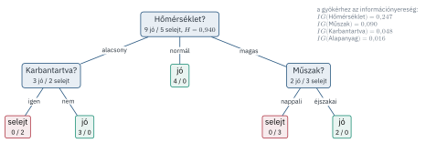
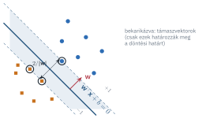
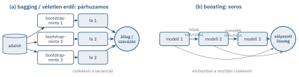

# Osztályozás {#sec-osztalyozas}

```{python}
#| include: false
import numpy as np
import pandas as pd
import matplotlib.pyplot as plt
import adatbanyaszat as ab
ab.set_style()
pd.set_option("display.max_columns", 12)
pd.set_option("display.width", 110)
```

::: {.roadmap}
Az osztályozás egy kategorikus célváltozó előrejelzése: lemorzsolódik-e a vevő,
megfelel-e a termék, milyen hiba lépett fel a folyamatban. A fejezet a legfontosabb
modellcsaládokat tárgyalja – a logisztikus regressziót, a döntési fákat, a Bayes-féle
osztályozókat, a legközelebbi szomszéd módszert, a támaszvektor-gépeket és az együttes
(ensemble) modelleket: a zsákolást, a véletlen erdőt és a gradiens-boostingot. Mindegyiknél
a működési elvet, a tanítás célfüggvényét és a jellemző erősségeket és gyengeségeket
mutatjuk be. Végül a modellek értelmezésének eszközeivel foglalkozunk, és a futó
eseteken összehasonlítjuk a módszereket.

**A fejezet végére az olvasó** képes lesz egy döntési fát kézzel felépíteni az
információnyereség alapján; a naiv Bayes-osztályozót kézzel alkalmazni; a logisztikus
regresszió együtthatóit esélyhányadosként értelmezni; a fő modellcsaládokat egy feladaton
összehasonlítani; és egy modell döntéseit permutációs fontossággal és parciális függéssel
értelmezni.
:::

## Az osztályozási feladat {#sec-osztalyozas-feladat}

Az osztályozó egy $f: \mathbb{R}^n \to \{1,\dots,C\}$ leképezés, amely a jellemzőtér
minden pontjához egy osztályt rendel. Az osztályokat elválasztó felületeket **döntési
határoknak** nevezzük. A modellek abban különböznek, milyen alakú döntési határokat
képesek leírni (lineáris, szakaszonként tengelyekkel párhuzamos, tetszőleges sima), és
hogyan találják meg őket az adatokból.

A valószínűségi osztályozók a $P(y = c\mid\mathbf{x})$ feltételes valószínűségeket
becsülik, és – egyenlő hibaköltségek esetén – a legnagyobb valószínűségű osztályt
választják. Két megközelítést szokás megkülönböztetni. A **diszkriminatív** modellek
(logisztikus regresszió, döntési fák, neurális hálózatok) közvetlenül a
$P(y\mid\mathbf{x})$-et modellezik. A **generatív** modellek (naiv Bayes, Gauss-féle
diszkriminanciaanalízis) az osztályonkénti $p(\mathbf{x}\mid y)$ eloszlást és az osztályok
$P(y)$ a priori valószínűségét modellezik, és a Bayes-tétellel számolják a
$P(y\mid\mathbf{x})$-et.

## Logisztikus regresszió {#sec-logreg}

A **logisztikus regresszió** [@cox1958] a pozitív osztály valószínűségét egy lineáris
kifejezés szigmoid transzformáltjaként modellezi:

$$
P(y = 1\mid\mathbf{x}) = \sigma(\mathbf{w}^\top\mathbf{x} + b),
\qquad
\sigma(z) = \frac{1}{1 + e^{-z}} .
$$ {#eq-logreg}

A szigmoid függvény a valós számokat a $(0, 1)$ intervallumba képezi. Átrendezve a
modell az **esély** (odds) logaritmusára lineáris:

$$
\ln\frac{P(y=1\mid\mathbf{x})}{1 - P(y=1\mid\mathbf{x})} = \mathbf{w}^\top\mathbf{x} + b .
$$ {#eq-logit}

Ebből adódik az együtthatók értelmezése: ha a $j$-edik változó egy egységgel nő (a többi
változatlansága mellett), az esély $e^{w_j}$-szeresére változik; ez az **esélyhányados**.
A döntési határ, ahol $P = 0{,}5$, a $\mathbf{w}^\top\mathbf{x} + b = 0$ hipersík – a
logisztikus regresszió tehát lineáris osztályozó.

A paramétereket maximum-likelihood módszerrel becsüljük. Egy megfigyelés valószínűsége
$p_k^{y_k}(1-p_k)^{1-y_k}$, ahol $p_k = \sigma(\mathbf{w}^\top\mathbf{x}_k + b)$; a negatív
log-likelihood a **kereszt-entrópia** (log-veszteség):

$$
J(\mathbf{w}, b) = -\sum_{k=1}^{N}\bigl[y_k\ln p_k + (1-y_k)\ln(1-p_k)\bigr] + \lambda\lVert\mathbf{w}\rVert_2^2 ,
$$ {#eq-keresztentropia}

amelyhez regularizációs tagot is adunk. A $J$ konvex, ezért egyetlen minimuma van, de zárt
alakú megoldása nincs; gradiense meglepően egyszerű,
$\nabla_{\mathbf{w}}J = \sum_k (p_k - y_k)\mathbf{x}_k + 2\lambda\mathbf{w}$, és
Newton-típusú vagy kvázi-Newton-módszerekkel gyorsan minimalizálható. Több osztály esetén a
szigmoid helyére a **softmax** függvény lép,
$P(y = c\mid\mathbf{x}) = e^{z_c}/\sum_{j}e^{z_j}$, ahol $z_c = \mathbf{w}_c^\top\mathbf{x} + b_c$.

## Döntési fák {#sec-dontesi-fak}

### Felépítés

A **döntési fa** a jellemzőteret tengelyekkel párhuzamos vágásokkal téglatestekre
bontja, és minden téglatesthez egy osztályt rendel. Minden belső csomópont egy
változóra vonatkozó tesztet tartalmaz (például „Hőmérséklet = magas?” vagy
„$x_j \le 3{,}5$?”), a levelek pedig az osztálycímkéket. Egy új objektum besorolásához
a gyökértől a levélig követjük a tesztek kimenetét. A fák legnagyobb előnye az
**értelmezhetőség**: minden levélhez vezető út egy „ha … és … akkor …” szabály.

A fát felülről lefelé, mohó rekurzív felosztással építjük [@quinlan1986; @breiman1984]:
minden csomópontban azt a tesztet választjuk, amely a gyermek-csomópontokat a
lehető legtisztábbá teszi, majd a gyermekekben ugyanezt megismételjük, amíg egy leállási
feltétel nem teljesül (tiszta csomópont, túl kevés objektum, maximális mélység).

### Szennyezettségi mértékek

Egy csomópont **szennyezettségét** az osztályok $p_1,\dots,p_C$ relatív gyakoriságai
alapján mérjük ([-@fig-entropia]. ábra). A három leggyakoribb mérték:

$$
H = -\sum_{c=1}^{C}p_c\log_2 p_c \;\text{(entrópia)},\qquad
G = 1 - \sum_{c=1}^{C}p_c^2 \;\text{(Gini-index)},\qquad
E = 1 - \max_c p_c \;\text{(téves besorolási arány)} .
$$ {#eq-szennyezettseg}

Mindhárom nulla, ha a csomópont tiszta, és maximális, ha az osztályok egyenlő arányban
fordulnak elő. Az entrópia az információelméletből [@shannon1948] származik: azt méri,
átlagosan hány bit kell egy véletlenszerűen választott objektum osztályának kódolásához.

{#fig-entropia width=75%}

Egy $A$ teszt jóságát az **információnyereséggel** mérjük – a szennyezettség csökkenésével
a gyermek-csomópontok méretével súlyozott átlagához képest:

$$
IG(S, A) = H(S) - \sum_{v\in\mathrm{értékek}(A)}\frac{|S_v|}{|S|}\,H(S_v),
$$ {#eq-infonyereseg}

ahol $S_v$ az $S$ azon részhalmaza, amelyben $A = v$. A sok értéket felvevő
változókat az információnyereség előnyben részesíti (egy azonosító-szerű változó
tökéletesen „tiszta”, de értelmetlen felosztást ad); ezt a C4.5 algoritmus [@quinlan1993]
a **nyereségaránnyal** korrigálja, amely az információnyereséget a felosztás saját
entrópiájával ($-\sum_v \frac{|S_v|}{|S|}\log_2\frac{|S_v|}{|S|}$) osztja. A CART algoritmus
[@breiman1984] csak bináris vágásokat végez, és a Gini-indexet használja; numerikus
változóknál minden lehetséges küszöböt (a rendezett értékek közötti felezőpontokat)
kipróbál.

### Kézi példa

A segédcsomag 14 gyártási tételének minősítését négy kategorikus változó írja le
([-@tbl-minoseg]. táblázat). Építsük fel a döntési fát az információnyereség alapján!

```{python}
#| label: tbl-minoseg
#| tbl-cap: "Tizennégy gyártási tétel minősítése."
d = ab.minoseg_tabla()
d
```

A gyökérben 9 jó és 5 selejtes tétel van, az entrópia

$$
H(S) = -\tfrac{9}{14}\log_2\tfrac{9}{14} - \tfrac{5}{14}\log_2\tfrac{5}{14} \approx 0{,}940 .
$$

A Hőmérséklet szerinti felosztás három részhalmazt ad: alacsony (3 jó, 2 selejt,
$H \approx 0{,}971$), normál (4 jó, $H = 0$), magas (2 jó, 3 selejt, $H \approx 0{,}971$).
Az információnyereség tehát

$$
IG(S, \text{Hőmérséklet}) = 0{,}940 - \tfrac{5}{14}\cdot 0{,}971 - \tfrac{4}{14}\cdot 0 - \tfrac{5}{14}\cdot 0{,}971 \approx 0{,}247 .
$$

A többi változóra ugyanígy számolva:

```{python}
def H(y):
    p = y.value_counts(normalize=True)
    return float(-(p * np.log2(p)).sum())

def info_nyereseg(df, attr, cel="Minoseg"):
    sulyozott = sum(len(s) / len(df) * H(s[cel]) for _, s in df.groupby(attr))
    return H(df[cel]) - sulyozott

pd.Series({a: info_nyereseg(d, a) for a in ["Homerseklet", "Alapanyag", "Muszak", "Karbantartva"]},
          name="információnyereség").round(3).to_frame()
```

A gyökérbe a Hőmérséklet kerül. A normál ág tiszta (levél: jó). Az alacsony ágban a
Karbantartva, a magas ágban a Műszak adja a legnagyobb (tökéletes) nyereséget, így a fa
két további szintben tiszta levelekhez jut ([-@fig-fa]. ábra). A fa szabályai
könnyen olvashatók: magas hőmérsékleten a nappali műszakban gyártott tételek, alacsony
hőmérsékleten pedig a karbantartás után gyártott tételek selejtesek. Tizennégy
megfigyelésből természetesen nem vonhatunk le általános következtetést – a példa az
algoritmus lépéseit szemlélteti; a fa tökéletes illeszkedése a tanítóadatokra éppen a
következő pontban tárgyalt túltanulás veszélyére figyelmeztet.

{#fig-fa width=100%}

### A túltanulás elkerülése: metszés

A fát addig növesztve, amíg minden levél tiszta, a tanítóadatokon nulla hibát érünk el –
és szinte biztosan túltanulunk. A fák mérete kétféleképpen korlátozható. Az
**előmetszés** a növesztést állítja le idejekorán (maximális mélység, egy levélben
legalább adott számú objektum, minimális nyereség). Az **utómetszés** előbb teljes fát
növeszt, majd visszanyesi. A CART **költség–komplexitás metszése** [@breiman1984] az

$$
R_\alpha(T) = R(T) + \alpha\,|T|
$$ {#eq-metszes}

kifejezést minimalizálja, ahol $R(T)$ a fa hibája (vagy szennyezettsége), $|T|$ a levelek
száma, $\alpha \ge 0$ pedig a komplexitás ára; az $\alpha$-t keresztvalidációval
választjuk. A döntési fák hátránya a nagy variancia: az adatok kis változása egészen más
fát eredményezhet. Ezt a hátrányt az együttes modellek használják ki és küszöbölik ki
([-@sec-egyuttes]. alfejezet).

## Bayes-féle osztályozók {#sec-bayes}

### A Bayes-tétel és a naiv Bayes-osztályozó

A Bayes-tétel szerint

$$
P(y = c\mid\mathbf{x}) = \frac{p(\mathbf{x}\mid y = c)\,P(y = c)}{p(\mathbf{x})} ,
$$ {#eq-bayes}

ahol a nevező nem függ az osztálytól, ezért a döntéshez elegendő a számlálót
maximalizálni. A $p(\mathbf{x}\mid y)$ sokdimenziós eloszlás becsléséhez rengeteg adat
kellene. A **naiv Bayes-osztályozó** azzal az erős egyszerűsítéssel él, hogy az osztályon
belül a jellemzők feltételesen függetlenek:

$$
\hat y = \arg\max_{c}\; P(y = c)\prod_{j=1}^{n}P(x_j\mid y = c) .
$$ {#eq-naiv-bayes}

Kategorikus jellemzőknél a $P(x_j = v\mid y = c)$ valószínűségeket relatív gyakoriságokkal
becsüljük. Ha egy érték egy osztályban nem fordult elő, a becslés nulla, és ez az egész
szorzatot nullává teszi; ezt a **Laplace-simítás** kerüli el:
$P(x_j = v\mid y = c) = (N_{c,v} + 1)/(N_c + V_j)$, ahol $V_j$ a változó lehetséges értékeinek
száma. Folytonos jellemzőkre osztályonként normális eloszlást szokás feltételezni (Gauss-féle
naiv Bayes). A függetlenségi feltevés a valóságban szinte sosem teljesül, a naiv Bayes
osztályozási pontossága mégis gyakran meglepően jó; ennek okát @domingos1997 elemezte: a
helyes döntéshez nem kell pontos valószínűség, elég, ha a legnagyobb valószínűségű
osztály helyes. A becsült valószínűségek viszont rendszerint rosszul kalibráltak.

### Kézi példa

Soroljuk be a naiv Bayes-osztályozóval azt az új tételt, amelyet magas hőmérsékleten, B
alapanyagból, éjszakai műszakban, karbantartás után gyártottak! A gyakoriságok a
[-@tbl-minoseg]. táblázatból (Laplace-simítással) számolhatók:

```{python}
uj = {"Homerseklet": "magas", "Alapanyag": "B", "Muszak": "éjszakai", "Karbantartva": "igen"}
pontszam = {}
for c, dc in d.groupby("Minoseg"):
    p = len(dc) / len(d)                                   # a priori valószínűség
    tenyezok = [f"P({c})={p:.3f}"]
    for attr, v in uj.items():
        V = d[attr].nunique()
        pv = ((dc[attr] == v).sum() + 1) / (len(dc) + V)   # Laplace-simítás
        p *= pv
        tenyezok.append(f"P({v}|{c})={pv:.3f}")
    pontszam[c] = p
    print(" · ".join(tenyezok), f" = {p:.5f}")
osszeg = sum(pontszam.values())
print({c: round(v / osszeg, 3) for c, v in pontszam.items()})
```

A tétel a naiv Bayes szerint inkább jó, mint selejtes – összhangban a döntési fával,
amely a magas hőmérsékletű, éjszakai műszakos tételeket jónak sorolja.

### Bayes-hálók

A **Bayes-hálók** [@pearl1988] a teljes függetlenség helyett a változók közötti
feltételes függetlenségeket egy irányított körmentes gráffal írják le: minden változó
csak a gráfbeli szüleitől függ, és az együttes eloszlás a
$p(x_1,\dots,x_n) = \prod_j p(x_j\mid\mathrm{szülők}(x_j))$ szorzatra bomlik. A naiv Bayes
olyan speciális Bayes-háló, amelyben az osztályváltozó minden jellemző egyetlen szülője.
A Bayes-hálók szakértői tudással is felépíthetők, ezért a diagnosztikai és
kockázatelemzési alkalmazásokban (orvosi diagnózis, hibafa-elemzés) népszerűek.

## A $k$-legközelebbi szomszéd módszer {#sec-knn}

A **$k$-legközelebbi szomszéd** ($k$-NN) módszer [@cover1967] nem épít explicit modellt:
egy új objektumot a tanítóhalmaz $k$ hozzá legközelebbi elemének többségi osztályába sorol
(regressziónál az értékeiket átlagolja). Az ilyen „lusta” módszerek tanítása csak az adatok
eltárolása, az előrejelzés viszont minden új objektumnál a teljes tanítóhalmaz
átvizsgálását igényli (amit megfelelő adatszerkezetek gyorsíthatnak). Kis $k$ esetén a
döntési határ nagyon szabálytalan (nagy variancia), nagy $k$ esetén elsimul (nagy
torzítás); a $k$ értékét keresztvalidációval választjuk. Egy klasszikus eredmény szerint
végtelen sok tanítóadat esetén az 1-NN hibája legfeljebb kétszerese a lehető legkisebb
(Bayes-) hibának.

A módszer a távolságmértéken áll vagy bukik: a változókat standardizálni kell, és sok
dimenzióban – különösen sok lényegtelen változó esetén – a távolságok egyre kevésbé
különböztetik meg a közeli és a távoli pontokat (a **dimenzió átka**). Ugyanez a jelenség
okozta az FCM elmosódását a [-@sec-csoportositas]. fejezetben.

## Támaszvektor-gépek {#sec-svm}

### A maximális margó

Ha két osztály lineárisan elválasztható, végtelen sok elválasztó hipersík létezik. A
**támaszvektor-gép** (support vector machine, SVM) [@cortes1995] azt választja, amelyik a
két osztálytól a lehető legtávolabb halad, vagyis a **margó** – a hipersík és a legközelebbi
pontok távolsága – maximális ([-@fig-svm]. ábra). A címkéket $y_k\in\{-1, +1\}$ alakban
kódolva, és a hipersíkot úgy normálva, hogy a legközelebbi pontokra
$|\mathbf{w}^\top\mathbf{x}_k + b| = 1$ legyen, a margó szélessége $2/\lVert\mathbf{w}\rVert$.
A maximális margójú hipersík tehát a

$$
\min_{\mathbf{w}, b}\;\frac12\lVert\mathbf{w}\rVert^2
\quad\text{feltéve, hogy}\quad
y_k(\mathbf{w}^\top\mathbf{x}_k + b) \ge 1,\quad k = 1,\dots,N
$$ {#eq-svm-primal}

kvadratikus programozási feladat megoldása. A megoldásban csak a margón fekvő pontok – a
**támaszvektorok** – játszanak szerepet; a többi pont elhagyható anélkül, hogy a
döntési határ változna.

{#fig-svm width=80%}

### Puha margó és kernelek

A valós adatok ritkán választhatók el tökéletesen. A **puha margójú** SVM minden
megfigyelésnek megenged egy $\xi_k\ge 0$ megsértést, és ezek összegét $C$ súllyal bünteti:
$\min \frac12\lVert\mathbf{w}\rVert^2 + C\sum_k\xi_k$, feltéve, hogy
$y_k(\mathbf{w}^\top\mathbf{x}_k + b)\ge 1 - \xi_k$. Ez egyenértékű a

$$
\min_{\mathbf{w}, b}\;\sum_{k=1}^{N}\max\bigl(0,\, 1 - y_k(\mathbf{w}^\top\mathbf{x}_k + b)\bigr) + \frac{1}{2C}\lVert\mathbf{w}\rVert^2
$$ {#eq-hinge}

regularizált veszteségminimalizálással, amelyben a **csuklóveszteség** (hinge loss) szerepel
– vagyis az SVM is a ([-@eq-erm]) keretbe illeszkedik. A nagy $C$ kevés hibát enged
(keskeny margó, nagy variancia), a kicsi széles margót és nagyobb torzítást ad.

A feladat duális alakjában az adatok csak skaláris szorzatok, $\mathbf{x}_i^\top\mathbf{x}_j$
formájában szerepelnek. Ha ezeket egy $K(\mathbf{x}_i,\mathbf{x}_j)$ **kernelfüggvénnyel**
helyettesítjük, az SVM egy (akár végtelen dimenziós) jellemzőtérben keres lineáris
elválasztást, ami az eredeti térben nemlineáris döntési határnak felel meg – anélkül,
hogy a jellemzőteret ténylegesen ki kellene számolni (**kerneltrükk**). A leggyakoribb a
radiális (Gauss-) kernel, $K(\mathbf{x}_i,\mathbf{x}_j) = \exp(-\gamma\lVert\mathbf{x}_i -
\mathbf{x}_j\rVert^2)$, amelynek $\gamma$ paramétere a döntési határ „hajlékonyságát”
szabályozza. Az SVM közepes méretű, sok jellemzős feladatokon (például szövegosztályozásban,
[-@sec-szoveg]. fejezet) különösen erős; nagyon sok megfigyelésre a kernel-SVM tanítása lassú.

## Együttes modellek {#sec-egyuttes}

Az **együttes** (ensemble) modellek sok alapmodell előrejelzését kombinálják
([-@fig-egyuttes]. ábra). Két fő stratégiájuk a variancia, illetve a torzítás csökkentését
célozza.

{#fig-egyuttes width=100%}

### Zsákolás és véletlen erdő

A **zsákolás** (bagging, bootstrap aggregating) [@breiman1996] a tanítóhalmazból
visszatevéses mintavétellel (bootstrap) $B$ mintát vesz, mindegyiken tanít egy modellt
(tipikusan egy mély, nagy varianciájú fát), és az előrejelzéseket átlagolja, illetve
szavazással kombinálja. Ha az egyes modellek varianciája $\sigma^2$, páronkénti
korrelációjuk $\rho$, az átlag varianciája

$$
\operatorname{Var}\Bigl(\frac{1}{B}\sum_{b=1}^{B}\hat f_b(\mathbf{x})\Bigr) = \rho\,\sigma^2 + \frac{1-\rho}{B}\,\sigma^2 .
$$ {#eq-bagging}

A modellek számának növelése a második tagot nullához viszi, az elsőt azonban nem: a
korrelált modellek átlagolása csak korlátozottan csökkenti a varianciát. A **véletlen erdő**
[@breiman2001] ezért a fák közötti korrelációt is csökkenti: minden vágásnál csak a
változók egy véletlen részhalmazából (osztályozásnál tipikusan $\sqrt{n}$ változóból)
választhat. A bootstrap-mintákból kimaradt („zsákon kívüli”, out-of-bag) megfigyelések
ingyenes validációs halmazt adnak. A véletlen erdő kevés hangolással is jól működik, ezért
a táblázatos adatok egyik legmegbízhatóbb „alapértelmezett” modellje.

### Boosting

A **boosting** a modelleket egymás után tanítja, és minden új modell az addigiak
gyengeségeire összpontosít. Az **AdaBoost** [@freund1997] a hibásan osztályozott
megfigyelések súlyát növeli, és a modelleket pontosságukkal súlyozva kombinálja. A
**gradiens-boosting** [@friedman2001] általánosabb: a modell egy additív függvény,
$F_M(\mathbf{x}) = \sum_{m=1}^{M}\nu\,h_m(\mathbf{x})$, ahol minden $h_m$ egy kis fa, amelyet
a veszteségfüggvény aktuális negatív gradiensére („pszeudomaradékaira”) illesztünk, $\nu$
pedig egy kis tanulási ráta. Négyzetes veszteségnél a pszeudomaradék éppen a közönséges
maradék: minden új fa az addigi modell hibáit közelíti. A gradiens-boosting korszerű,
hisztogramos megvalósításai (XGBoost, LightGBM, a `scikit-learn`
`HistGradientBoostingClassifier` osztálya) nagy adathalmazokon is gyorsak
[@chen2016; @ke2017]. Kiterjedt összehasonlító vizsgálatok szerint közepes méretű
táblázatos adatokon a fa alapú együttes modellek ma is jellemzően legalább olyan jók, mint
a mély neurális hálózatok [@grinsztajn2022].

## A modellek értelmezése {#sec-ertelmezes}

Az együttes modellek és a neurális hálózatok pontosak, de döntéseik közvetlenül nem
követhetők. A modellfüggetlen értelmezési eszközök közül kettő különösen elterjedt
[@molnar2022]:

- A **permutációs fontosság** egy változó jelentőségét azzal méri, mennyit romlik a modell
  teljesítménye egy (lehetőleg független) teszthalmazon, ha a változó értékeit véletlenszerűen
  összekeverjük, és így a célváltozóval való kapcsolatát megszüntetjük [@breiman2001;
  @fisher2019]. Korrelált változóknál óvatosan értelmezendő: ha két változó ugyanazt az
  információt hordozza, egyenként mindkettő fontossága kicsinek tűnhet.
- A **parciális függés** ábrája [@friedman2001] azt mutatja meg, hogyan változik a modell
  átlagos előrejelzése egy változó függvényében, a többi változó tapasztalati eloszlása
  felett átlagolva.

Ezek az eszközök a *modellt* magyarázzák, nem a valóságot: egy változó nagy fontossága azt
jelenti, hogy a modell támaszkodik rá, nem azt, hogy okozati hatása van.

## Gyakorlat: lemorzsolódás, minőség és hibadiagnózis {#sec-osztalyozas-gyakorlat}

### Modellek összehasonlítása a lemorzsolódási feladaton

::: {.eset-uzleti}
A [-@sec-ertekeles]. fejezet lemorzsolódási tábláján hét modellcsaládot hasonlítunk össze
rétegzett 5-szörös keresztvalidációval. A távolság- és gradiensalapú módszereknél az
előfeldolgozás (logaritmus, standardizálás) a folyamat része.
:::

```{python}
import time
from sklearn.pipeline import make_pipeline
from sklearn.preprocessing import FunctionTransformer, StandardScaler
from sklearn.impute import SimpleImputer
from sklearn.linear_model import LogisticRegression
from sklearn.tree import DecisionTreeClassifier
from sklearn.naive_bayes import GaussianNB
from sklearn.neighbors import KNeighborsClassifier
from sklearn.svm import SVC
from sklearn.ensemble import RandomForestClassifier, HistGradientBoostingClassifier
from sklearn.model_selection import StratifiedKFold, cross_validate, GridSearchCV

churn = ab.churn_table(cutoff="2025-07-01", horizon_days=183)
jell = ["R_nap", "F_szamla", "M_ertek", "atl_kosarertek", "atl_kosarmeret", "atl_mennyiseg",
        "elso_vasarlas_nap", "akcios_arany", "arany_kave", "arany_gep", "arany_konyha",
        "arany_dekor", "arany_ajandek", "arany_iroszer"]
X, y = churn[jell].astype(float), churn.lemorzsolodik
elo = make_pipeline(SimpleImputer(strategy="median"), FunctionTransformer(np.log1p), StandardScaler())
modellek = {
    "logisztikus regresszió": make_pipeline(elo, LogisticRegression(max_iter=2000)),
    "döntési fa (mélység: CV)": GridSearchCV(make_pipeline(SimpleImputer(strategy="median"),
                                   DecisionTreeClassifier(random_state=0)),
                                   {"decisiontreeclassifier__max_depth": [2, 3, 4, 5, 6, 8]}, cv=5, scoring="roc_auc"),
    "naiv Bayes (Gauss)": make_pipeline(elo, GaussianNB()),
    "k-NN (k=25)": make_pipeline(elo, KNeighborsClassifier(n_neighbors=25)),
    "SVM (RBF-kernel)": make_pipeline(elo, SVC(C=1.0, gamma="scale", probability=True, random_state=0)),
    "véletlen erdő": make_pipeline(SimpleImputer(strategy="median"),
                                   RandomForestClassifier(n_estimators=400, min_samples_leaf=5, random_state=0, n_jobs=-1)),
    "gradiens-boosting": HistGradientBoostingClassifier(max_iter=300, learning_rate=0.05, random_state=0),
}
cv = StratifiedKFold(n_splits=5, shuffle=True, random_state=0)
sorok = {}
for nev, mod in modellek.items():
    t0 = time.perf_counter()
    r = cross_validate(mod, X, y, cv=cv, scoring=["roc_auc", "average_precision", "balanced_accuracy"])
    sorok[nev] = {"AUC": r["test_roc_auc"].mean(), "AUC szórás": r["test_roc_auc"].std(),
                  "átl. pontosság": r["test_average_precision"].mean(),
                  "kiegy. helyes arány": r["test_balanced_accuracy"].mean(), "idő [s]": time.perf_counter() - t0}
pd.DataFrame(sorok).T.sort_values("AUC", ascending=False).round(3)
```

A legjobb eredményt a véletlen erdő adja (AUC ≈ 0,82), de a különbségek kicsik: a
logisztikus regresszió csak mintegy 0,03-dal marad el tőle, az SVM és a $k$-NN a kettő
között helyezkedik el. A gradiens-boosting alapbeállításokkal nem jobb a véletlen erdőnél
– a boosting érzékenyebb a hiperparaméterekre (tanulási ráta, fák mérete, iterációk
száma), és ezen a mindössze kétezer vevőt tartalmazó táblán hajlamos a túltanulásra. Az
egyetlen döntési fa és a naiv Bayes a leggyengébb. A tanulság tipikus: egy jól
előkészített, kevés jellemzős táblán (itt a [-@sec-elokeszites]. fejezet RFM-alapú
változóival) már az egyszerű, értelmezhető modell is a lehetséges teljesítmény nagy
részét eléri, a jó jellemzők többet érnek a bonyolultabb modellnél. (Mivel minden modellt
ugyanazokon a részhalmazokon értékeltünk, a különbségek megbízhatóságát pontosabban a
részhalmazonkénti, páros különbségek mutatják – lásd a feladatokat.)

A logisztikus regresszió együtthatói esélyhányadosként értelmezhetők. Mivel a
változókat logaritmus után standardizáltuk, egy együttható azt mutatja meg, hányszorosára
változik a lemorzsolódás esélye, ha a változó (logaritmusa) egy szórásnyival nő:

```{python}
lr = modellek["logisztikus regresszió"].fit(X, y)
eh = pd.Series(np.exp(lr[-1].coef_[0]), index=jell, name="esélyhányados (1 szórás)")
eh.sort_values().round(2).to_frame()
```

A legerősebb hatású változó a vásárlási gyakoriság: egy szórásnyival (logaritmikus
skálán) gyakoribb vásárlás mellett a lemorzsolódás esélye kevesebb mint felére csökken. A
legutóbbi vásárlás óta eltelt idő növeli a kockázatot – ez az RFM-modell „recency”
komponensének klasszikus megfigyelése –, és hasonló erősségű a gépvásárlások aránya: aki
főként egyszeri, nagy értékű eszközt vett, ritkábban tér vissza. Az együtthatókat
azonban óvatosan kell értelmezni, mert *feltételes* hatásokat írnak le: a vásárlási
érték (M) esélyhányadosa például azért nagyobb 1-nél, mert a gyakoriság (F) rögzítése
mellett a nagyobb költés kevesebb, de nagyobb értékű vásárlást jelent. Erősen korrelált
jellemzőknél (az R, F, M változók és az összegükben 1-et adó kategóriaarányok) az egyes
együtthatók külön-külön nem értelmezhetők okozati hatásként.

A gradiens-boosting modellt permutációs fontossággal és parciális függéssel értelmezzük,
egy visszatartott teszthalmazon:

```{python}
#| label: fig-churn-ertelmezes
#| fig-cap: "A gradiens-boosting lemorzsolódási modell értelmezése: permutációs fontosság a teszthalmazon (balra, az AUC csökkenése) és a két legfontosabb változó parciális függése (jobbra)."
#| fig-width: 7.2
#| fig-height: 3
from sklearn.model_selection import train_test_split
from sklearn.inspection import permutation_importance, PartialDependenceDisplay
Xtr, Xte, ytr, yte = train_test_split(X, y, test_size=0.3, stratify=y, random_state=0)
gb = modellek["gradiens-boosting"].fit(Xtr, ytr)
pi = permutation_importance(gb, Xte, yte, scoring="roc_auc", n_repeats=20, random_state=0)
fontos = pd.Series(pi.importances_mean, index=jell).sort_values()
fig, ax = plt.subplots(1, 3, gridspec_kw={"width_ratios": [1.4, 1, 1]})
ax[0].barh(fontos.index[-8:], fontos.values[-8:], color=ab.PALETTE[0])
ax[0].set_xlabel("AUC csökkenése"); ax[0].tick_params(axis="y", labelsize=8)
PartialDependenceDisplay.from_estimator(gb, Xtr, [fontos.index[-1], fontos.index[-2]], ax=ax[1:],
                                        line_kw={"color": ab.PALETTE[1]})
ax[1].set_ylabel("parciális függés (log-esély)"); ax[2].set_ylabel("")
fig.tight_layout()
```

A gradiens-boosting modell döntéseiben messze a legutóbbi vásárlás óta eltelt idő a
legfontosabb: a parciális függés szerint a lemorzsolódás log-esélye nagyjából három hónap
inaktivitás után kezd meredeken nőni. Figyelemre méltó, hogy a logisztikus regresszióban
legerősebb vásárlási gyakoriság itt nincs is az első nyolc változó között. Ez nem
ellentmondás, hanem a permutációs fontosság fentebb említett korlátja: a gyakoriság erősen
korrelál a vásárlási értékkel (Spearman-féle $\rho \approx 0{,}74$) és mérsékelten a
recency változóval ($\rho \approx -0{,}47$), így a fák az információt jórészt ezeken
keresztül „veszik fel”, és a gyakoriság összekeverése alig rontja a modellt. A két modell
értelmezése tehát egymást kiegészítve, a változók közötti összefüggések ismeretében
helyes.

### A termékminőség előrejelzése

::: {.eset-mernoki}
A [-@sec-ertekeles]. fejezetben láttuk, hogy a lineáris logisztikus regresszió a
minőségi feladaton gyenge, mert a selejt a célértéktől mindkét irányban való eltérésből
adódhat. Hasonlítsuk össze a nemlineáris modelleket idősoros felosztással (az utolsó
negyedév a teszthalmaz)!
:::

```{python}
from sklearn.metrics import roc_auc_score, average_precision_score
q = ab.quality_table()
vlt = ["T_kornyezet", "F_betap", "c_betap", "T_reaktor", "F_hutoviz", "T_hutoviz",
       "P_reaktor", "P_kevero", "E_fogyasztas", "dT"]
vagas = q.ido >= "2025-10-01"
Xq_tr, Xq_te = q.loc[~vagas, vlt], q.loc[vagas, vlt]
yq_tr, yq_te = (~q.megfelelo[~vagas]).astype(int), (~q.megfelelo[vagas]).astype(int)
mq = {
    "logisztikus regresszió": make_pipeline(StandardScaler(), LogisticRegression(max_iter=2000)),
    "döntési fa (mélység 5)": DecisionTreeClassifier(max_depth=5, random_state=0),
    "döntési fa (levélméret ≥ 10)": DecisionTreeClassifier(min_samples_leaf=10, random_state=0),
    "k-NN (k=15)": make_pipeline(StandardScaler(), KNeighborsClassifier(n_neighbors=15)),
    "SVM (RBF-kernel)": make_pipeline(StandardScaler(), SVC(C=3.0, probability=True, random_state=0)),
    "véletlen erdő": RandomForestClassifier(n_estimators=400, min_samples_leaf=3, random_state=0, n_jobs=-1),
    "gradiens-boosting": HistGradientBoostingClassifier(max_iter=300, learning_rate=0.05, random_state=0),
}
pd.DataFrame({nev: {"AUC": roc_auc_score(yq_te, (p := m.fit(Xq_tr, yq_tr).predict_proba(Xq_te)[:, 1])),
                    "átl. pontosság": average_precision_score(yq_te, p)} for nev, m in mq.items()}).T \
  .sort_values("AUC", ascending=False).round(3)
```

Itt a nemlineáris modellek nagy fölényben vannak: a fa alapú együttes modellek a
termékenként eltérő célérték körüli kétirányú eltéréseket és a hőmérséklet-túllépéseket
is képesek leírni. Tanulságos a két döntési fa összevetése. Az 5 mélységű fa alig jobb a
véletlennél, mert a selejt feltétele termékenként más-más koncentráció- és
hőmérséklet-tartományt jelent, és ennek leírásához sok egymásba ágyazott vágás kell. A
mélység korlátozása helyett a levelek minimális méretét előíró fa – amely mélyre nőhet, de
apró, zajra illeszkedő leveleket nem hozhat létre – már közel jár az együttes
modellekhez. A regularizáció *módja* tehát legalább annyira fontos, mint az erőssége.

### Hibadiagnózis: többosztályos osztályozás

::: {.eset-mernoki}
Végül egy többosztályos feladat: a 10 perces folyamatadatokból azt szeretnénk felismerni,
milyen hiba áll fenn éppen (ha van). A modellt az első félév adatain tanítjuk, és a második
félévben értékeljük – a második félév hibái tehát a modell számára új eseményeket
jelentenek. A nyers mért értékek helyett a hibák fizikai „ujjlenyomatát” leíró
jellemzőket számolunk:

- a hőmérséklet eltérését az alapjeltől és a hűtővíz hőmérsékletét (hűtővíz-kiesés);
- a hűtővízáram egyórás szórását (a szelepakadás oszcillációt okoz);
- a hűtővízáram és az energiafogyasztás eltérését a heti mediántól;
- a betáplált koncentráció eltérését a termék névleges értékétől (betáplálási zavar);
- egy **analitikus redundanciát**: a nyomás a valódi hőmérséklettől és a terheléstől függ,
  ezért a $P - 0{,}025\,T_\text{mért} - 0{,}04\,F_\text{betáp}$ maradék eltolódása a
  hőmérséklet-érzékelő hibájára utal (szenzor-drift).
:::

```{python}
m = ab.plant_clean()
m = m[~m.leallas].copy()
m["hiba"] = ab.load_plant().truth["fault"].reindex(m.ido).to_numpy()
mi = m.set_index("ido")
felev_vege = "2025-06-30"

F = pd.DataFrame(index=mi.index)
F["dT"] = mi.T_reaktor - mi.T_alapjel
F["T_hutoviz"] = mi.T_hutoviz
F["T_hut_valt_1h"] = mi.T_hutoviz.diff(6)
F["F_hut_szoras_1h"] = mi.F_hutoviz.rolling("60min").std()
F["F_hut_rel"] = mi.F_hutoviz.rolling("6h").mean() / mi.F_hutoviz.rolling("7D").median() - 1
F["E_rel"] = mi.E_fogyasztas.rolling("6h").mean() / mi.E_fogyasztas.rolling("7D").median() - 1
# a betáplált koncentráció a termék névleges értékéhez képest (névleges érték: a tanítóadatok mediánja)
nevl = mi.loc[:felev_vege].groupby("termek").c_betap.median()
F["c_be_rel"] = (mi.c_betap / mi.termek.map(nevl).astype(float) - 1).rolling("60min").mean()
# analitikus redundancia: nyomásmaradék a mért hőmérséklet és a terhelés alapján
P_rez = mi.P_reaktor - 0.025 * mi.T_reaktor - 0.04 * mi.F_betap
F["P_rezid"] = P_rez.rolling("6h").mean() - P_rez.rolling("7D").median()
F = F.dropna()
yh = mi.loc[F.index, "hiba"]
tanit = F.index <= felev_vege

def diagnozis(oszlopok):
    mod = HistGradientBoostingClassifier(max_iter=300, learning_rate=0.1,
                                         class_weight="balanced", random_state=0)
    return mod.fit(F.loc[tanit, oszlopok], yh[tanit]).predict(F.loc[~tanit, oszlopok])

from sklearn.metrics import recall_score, precision_score, f1_score
oszt = ["normál", "szenzor_drift", "betap_zavar", "szelep_akadas", "hutoviz_kieses"]
nyers = ["dT", "T_hutoviz", "T_hut_valt_1h", "F_hut_szoras_1h", "F_hut_rel", "E_rel"]
valtozatok = {"ujjlenyomat nélkül a betáplálásra és a driftre": nyers,
              "+ névleges koncentráció": nyers + ["c_be_rel"],
              "+ nyomásmaradék (teljes)": nyers + ["c_be_rel", "P_rezid"]}
eredm, pred = {}, None
for nev, cols in valtozatok.items():
    pred = diagnozis(cols)
    eredm[nev] = pd.Series(recall_score(yh[~tanit], pred, labels=oszt, average=None, zero_division=0), index=oszt)
    eredm[nev]["makro-F1"] = f1_score(yh[~tanit], pred, labels=oszt, average="macro", zero_division=0)
pd.DataFrame(eredm).round(2).rename_axis("felidézés (recall)")
```

```{python}
#| label: fig-hiba-cm
#| fig-cap: "A teljes jellemzőkészlettel tanított hibadiagnosztikai modell sorra normált tévesztési mátrixa a második félév adatain (sorok: valódi állapot, oszlopok: előrejelzett állapot)."
#| fig-width: 5.5
#| fig-height: 4.2
from sklearn.metrics import confusion_matrix
cm = confusion_matrix(yh[~tanit], pred, labels=oszt, normalize="true")
fig, ax = plt.subplots()
im = ax.imshow(cm, cmap="Blues", vmin=0, vmax=1)
ax.set_xticks(range(5), oszt, rotation=35, ha="right", fontsize=8); ax.set_yticks(range(5), oszt, fontsize=8)
for i in range(5):
    for j in range(5):
        ax.text(j, i, f"{cm[i, j]:.2f}", ha="center", va="center", fontsize=8,
                color="white" if cm[i, j] > 0.6 else "#1F2933")
ax.grid(False); fig.colorbar(im, ax=ax, shrink=0.8)
fig.tight_layout()
```

::: {.eset-mernoki}
A táblázat a szakterületi tudás értékét mutatja. A hűtővíz felmelegedése és a szelep
akadozása már az általános jellemzőkből is jól felismerhető, a betáplálási zavar viszont
csak akkor, ha a koncentrációt a *termék névleges értékéhez* viszonyítjuk: a 15%-os
koncentrációcsökkenés ugyanis nagyságrendileg akkora, mint a termékek névleges értékei
közötti különbség, így a nyers koncentrációból a modell nem tudja elválasztani a
termékváltástól. A szenzor-drift a legnehezebb eset: a mérési hiba öt nap alatt nulláról
fokozatosan nő, és a szabályozó a hibás mérést „követi”, így az epizód első felében a
jelek még a zajszinten belül vannak; a nyomásmaradék csak a drift későbbi szakaszában
jelez. A felügyelt hibadiagnózis másik korlátja, hogy csak a tanítóadatokban már
előfordult hibatípusokat ismerheti fel – itt minden hibatípusból csak egy-három esemény
áll rendelkezésre a tanításhoz –, egy teljesen új hiba pedig a „normál” vagy egy rossz
osztályba kerül. Ezért a gyakorlatban a felügyelt diagnózist a [-@sec-anomalia]. fejezet
felügyelet nélküli anomália-észlelésével kombinálják.
:::





## Összefoglalás {#sec-osztalyozas-osszefoglalas}

- A logisztikus regresszió a log-esélyt modellezi lineárisan; a kereszt-entrópia konvex,
  az együtthatók esélyhányadosként értelmezhetők.
- A döntési fák mohó rekurzív felosztással, a szennyezettség (entrópia, Gini-index)
  csökkentésével épülnek; jól értelmezhetők, de nagy varianciájúak, ezért metszeni kell őket.
- A naiv Bayes a jellemzők feltételes függetlenségét feltételezi; egyszerű és gyors, a
  döntései gyakran jók, a valószínűségei kevésbé.
- A $k$-NN lusta, távolságalapú módszer; érzékeny a skálázásra és a dimenzió átkára.
- Az SVM a margót maximalizálja; a kerneltrükkel nemlineáris döntési határokat is tanul.
- Az együttes modellek közül a véletlen erdő a varianciát, a gradiens-boosting a torzítást
  csökkenti; táblázatos adatokon ezek a legerősebb általános célú modellek.
- A permutációs fontosság és a parciális függés a modellt magyarázza, nem az okozati
  viszonyokat.

## Ellenőrző kérdések {.unnumbered}

1. Mit jelent, ha egy logisztikus regressziós együttható esélyhányadosa 2?
2. Miért részesíti előnyben az információnyereség a sok értékű változókat, és hogyan
   korrigálja ezt a nyereségarány?
3. Miért hasznos a Laplace-simítás a naiv Bayes-osztályozóban?
4. Hogyan hat a $k$ értéke a $k$-NN torzítására és varianciájára?
5. Mik a támaszvektorok, és miért elegendő csak ezeket ismerni a döntéshez?
6. Miért csökkenti a véletlen erdő a változók véletlen részhalmazából történő vágással a
   fák közötti korrelációt, és miért javít ez a ([-@eq-bagging]) szerint?
7. Miben különbözik a zsákolás és a boosting stratégiája?

## Feladatok {.unnumbered}

1. **Kézi fa.** Számítsa ki a kézi példa gyökérvágásához a Gini-index szerinti nyereséget is!
   Ugyanaz a változó kerül a gyökérbe?
2. **Nyereségarány.** Egészítse ki a [-@tbl-minoseg]. táblázatot egy „Tételszám” oszloppal
   (1–14)! Mekkora az információnyeresége és a nyereségaránya? Mi a tanulság?
3. **Metszés.** Tanítson teljes mélységű döntési fát a lemorzsolódási adatokon, majd
   határozza meg a költség–komplexitás metszés $\alpha$ paraméterét keresztvalidációval
   (`cost_complexity_pruning_path`)! Hány levele van a metszett fának, és mennyire értelmezhetők
   a szabályai?
4. **SVM hangolása.** Hangolja a $C$ és $\gamma$ paramétert rácskereséssel a minőségi feladaton
   (idősoros keresztvalidációval)! Ábrázolja a validációs AUC-t hőtérképen!
5. **Új hibatípus.** Hagyja ki a tanításból az összes hűtővíz-kiesést, és vizsgálja meg, milyen
   osztályba sorolja őket a modell a teszthalmazon! Javasoljon eljárást az ismeretlen hibák
   felismerésére (segítség: a becsült osztályvalószínűségek)!

## További olvasmányok {.unnumbered}

Az osztályozási módszerek átfogó tárgyalása @hastie2009 és @james2023 könyvében, a
valószínűségi megközelítésé @bishop2006 könyvében található. A döntési fák alapművei
@quinlan1986, @quinlan1993 és @breiman1984; a támaszvektor-gépeké @cortes1995. Az együttes
modellekről @breiman1996, @breiman2001 és @friedman2001 eredeti cikkei, a modellek
értelmezéséről @molnar2022 könyve ajánlott.
