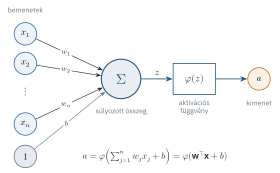
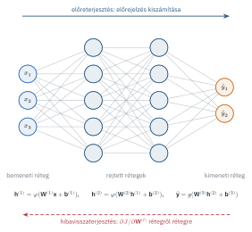
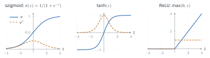
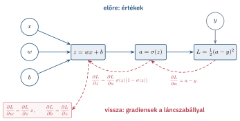
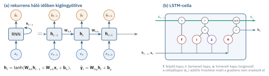
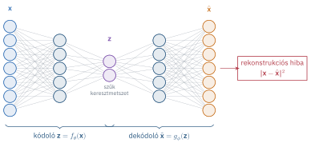

# Neurális hálózatok és mélytanulás {#sec-neuralis}

```{python}
#| include: false
import numpy as np
import pandas as pd
import matplotlib.pyplot as plt
import adatbanyaszat as ab
ab.set_style()
pd.set_option("display.max_columns", 12)
pd.set_option("display.width", 110)
```

::: {.roadmap}
A mesterséges neurális hálózatok rugalmas, sok paraméteres függvényosztályok, amelyek
paramétereit gradiensalapú optimalizálással illesztjük az adatokra. A fejezet a
legegyszerűbb építőelemtől, a mesterséges neurontól indul, majd a többrétegű hálózatokat,
a tanításukat lehetővé tevő hibavisszaterjesztést, az optimalizálás és a regularizáció
gyakorlati eszközeit tárgyalja. Ezután a mélytanulás három, az adatbányászatban fontos
architektúráját mutatjuk be: a konvolúciós, a rekurrens hálózatokat és az autoenkódereket.
A gyakorlatban egy hálózatot NumPy-ban, „nulláról” programozunk le, majd a `scikit-learn`
és a PyTorch eszközeivel egy hűtési igény modellt, egy autoenkóderes anomália-észlelőt és
egy konvolúciós hibadiagnosztikai modellt készítünk. A nagy nyelvi modellek (LLM-ek) és a
transzformer-architektúra a könyv keretein kívül esnek.

**A fejezet végére az olvasó** képes lesz egy többrétegű hálózat előre- és
hibavisszaterjesztését levezetni és vektorosan leprogramozni; a gradienst numerikusan
ellenőrizni; megválasztani a veszteségfüggvényt, az optimalizálót és a regularizációt;
felismerni, mikor érdemes – és mikor nem – mély hálózatot használni; valamint egy
konvolúciós hálózatot és egy autoenkódert idősoros folyamatadatokra alkalmazni.
:::

## A mesterséges neuron {#sec-neuron}

A mesterséges neuron [@mcculloch1943] a bemenetek súlyozott összegét egy nemlineáris
**aktivációs függvényen** vezeti át ([-@fig-neuron]. ábra):

$$
a = \varphi\Bigl(\sum_{j=1}^{n}w_jx_j + b\Bigr) = \varphi(\mathbf{w}^\top\mathbf{x} + b) .
$$ {#eq-neuron}

{#fig-neuron width=85%}

Ha $\varphi$ a szigmoid függvény, a neuron éppen a logisztikus regresszió
([-@sec-logreg]. alfejezet); ha a lépcsőfüggvény, a **perceptron** [@rosenblatt1958].
A perceptron tanítási szabálya minden hibásan osztályozott ($y_k\in\{-1,+1\}$) mintánál
a súlyokat a minta irányába mozdítja: $\mathbf{w} \leftarrow \mathbf{w} + \eta\,y_k\mathbf{x}_k$.
Lineárisan elválasztható adatokon ez véges számú lépésben elválasztó hipersíkot talál,
de egyetlen neuron csak lineáris döntési határt képes leírni: a kizáró vagy (XOR)
függvényt például nem tudja megtanulni. Ezt a korlátot @minsky1969 elemezte részletesen,
és csak a többrétegű hálózatok és a tanításukat lehetővé tevő hibavisszaterjesztés oldotta
fel.

## Többrétegű hálózatok {#sec-mlp}

### Felépítés és aktivációs függvények

A **többrétegű perceptron** (multilayer perceptron, MLP) neuronjai rétegekbe szerveződnek,
és minden réteg az előző réteg kimenetét kapja bemenetként ([-@fig-mlp]. ábra). Egy $L$
rétegű hálózat egymásba ágyazott függvények kompozíciója:

$$
\mathbf{h}^{(0)} = \mathbf{x},\qquad
\mathbf{z}^{(l)} = \mathbf{W}^{(l)}\mathbf{h}^{(l-1)} + \mathbf{b}^{(l)},\qquad
\mathbf{h}^{(l)} = \varphi\bigl(\mathbf{z}^{(l)}\bigr),\quad l = 1,\dots,L-1,
\qquad
\hat{\mathbf{y}} = g\bigl(\mathbf{z}^{(L)}\bigr),
$$ {#eq-mlp}

ahol $\mathbf{W}^{(l)}$ az $l$-edik réteg súlymátrixa, $\varphi$ a rejtett rétegek
elemenként alkalmazott aktivációs függvénye, $g$ pedig a feladathoz illő kimeneti függvény:
regressziónál az identitás, bináris osztályozásnál a szigmoid, többosztályos
osztályozásnál a softmax. A nemlinearitás lényeges: ha $\varphi$ lineáris volna, a rétegek
egyetlen lineáris leképezéssé vonhatók össze, és a mély hálózat sem tudna többet a
lineáris modellnél.

{#fig-mlp width=100%}

Az aktivációs függvények közül a szigmoid és a $\tanh$ történetileg a legfontosabb, ma
azonban a rejtett rétegekben jellemzően a **ReLU** (rectified linear unit,
$\varphi(z) = \max(0, z)$) [@nair2010] és változatai terjedtek el
([-@fig-aktivacio]. ábra). Ennek oka a deriváltakban rejlik: a szigmoid deriváltja
legfeljebb 0,25, és a függvény telítődő szakaszain közel nulla. A hibavisszaterjesztés
során a gradiens rétegenként ilyen tényezőkkel szorzódik, ezért mély hálózatokban a
bemenethez közeli rétegek gradiense exponenciálisan kicsivé válhat (**elenyésző
gradiens**). A ReLU deriváltja a pozitív tartományban 1, így ezt a problémát nagyrészt
elkerüli, ráadásul kiszámítása is olcsó.

{#fig-aktivacio width=100%}

### Univerzális approximáció

Az univerzális approximációs tétel [@cybenko1989; @hornik1991] szerint egyetlen,
elegendően sok neuront tartalmazó rejtett réteggel bármely kompakt halmazon folytonos
függvény tetszőleges pontossággal közelíthető. A tétel *létezést* mond ki: nem állítja,
hogy a szükséges neuronszám kicsi, sem azt, hogy a gradiensalapú tanítás meg is találja a
megfelelő súlyokat, és semmit sem mond az általánosításról. A gyakorlat azt mutatja, hogy
a mélyebb (több rétegű) hálózatok ugyanannyi paraméterrel sok feladatban hatékonyabban
reprezentálják a hierarchikus szerkezetű összefüggéseket, mint a széles, sekély hálózatok
[@goodfellow2016; @prince2023].

## A hálózatok tanítása {#sec-backprop}

### Veszteségfüggvények

A hálózat paramétereit – az összes $\mathbf{W}^{(l)}$ és $\mathbf{b}^{(l)}$ együttesét
$\boldsymbol\theta$-val jelölve – a ([-@eq-erm]) regularizált tapasztalati kockázat
minimalizálásával határozzuk meg. A veszteségfüggvényt a feladat valószínűségi modellje
adja: regressziónál normális eloszlású hibát feltételezve a négyzetes hiba,
$\ell = \frac12\lVert\hat{\mathbf{y}} - \mathbf{y}\rVert^2$; osztályozásnál a
kategorikus eloszlás negatív log-likelihoodja, a **kereszt-entrópia**,
$\ell = -\sum_{c}y_c\ln\hat y_c$, ahol $\mathbf{y}$ a valódi osztály egy-forró kódolása.
A kimeneti függvény és a veszteség párosítása nem véletlen: a szigmoid–kereszt-entrópia és
a softmax–kereszt-entrópia párosnál a veszteség kimeneti réteg előtti $\mathbf{z}^{(L)}$
szerinti gradiense egyszerűen $\hat{\mathbf{y}} - \mathbf{y}$, és nem telítődik.

### Hibavisszaterjesztés

A veszteség nem konvex a paraméterekben, ezért gradiensalapú iteratív módszerekkel
minimalizáljuk. A gradiens hatékony kiszámításának módszere a **hibavisszaterjesztés**
(backpropagation) [@rumelhart1986], amely a láncszabály szisztematikus alkalmazása a
hálózat számítási gráfján ([-@fig-backprop]. ábra). Vezessük be az $l$-edik réteg
**hibajelét**, $\boldsymbol\delta^{(l)} = \partial\ell/\partial\mathbf{z}^{(l)}$! A
kimeneti rétegben (a fenti párosítás mellett) $\boldsymbol\delta^{(L)} = \hat{\mathbf{y}} -
\mathbf{y}$, a rejtett rétegekben pedig a láncszabály szerint

$$
\boldsymbol\delta^{(l)} = \bigl(\mathbf{W}^{(l+1)\top}\boldsymbol\delta^{(l+1)}\bigr)\odot\varphi'\bigl(\mathbf{z}^{(l)}\bigr),
$$ {#eq-delta}

ahol $\odot$ az elemenkénti szorzás. Ebből a paraméterek szerinti gradiensek:

$$
\frac{\partial\ell}{\partial\mathbf{W}^{(l)}} = \boldsymbol\delta^{(l)}\,\mathbf{h}^{(l-1)\top},
\qquad
\frac{\partial\ell}{\partial\mathbf{b}^{(l)}} = \boldsymbol\delta^{(l)} .
$$ {#eq-backprop-grad}

Az algoritmus tehát egy előreterjesztéssel kiszámítja és eltárolja a rétegek
$\mathbf{z}^{(l)}$ és $\mathbf{h}^{(l)}$ értékeit, majd egy visszaterjesztéssel a kimenettől
a bemenet felé haladva rétegenként kiszámítja a hibajeleket és a gradienseket. A teljes
gradiens kiszámításának költsége így nagyságrendileg megegyezik egyetlen előreterjesztés
költségével – szemben a véges differenciákkal, amelyek paraméterenként egy-egy újabb
előreterjesztést igényelnének. A modern keretrendszerek (PyTorch, JAX, TensorFlow) a
számítási gráfból automatikusan állítják elő a gradienst (**automatikus differenciálás**
[@baydin2018]); a hibavisszaterjesztés ennek a fordított módú változata.

{#fig-backprop width=95%}

::: {.callout-important}
## Az algoritmus összefoglalása: egy tanítási lépés
1. Válasszunk egy $B$ elemű mini-batch-et a tanítóhalmazból.
2. **Előreterjesztés:** számítsuk ki és tároljuk a $\mathbf{z}^{(l)}$, $\mathbf{h}^{(l)}$
   értékeket és a veszteséget ([-@eq-mlp]).
3. **Visszaterjesztés:** $\boldsymbol\delta^{(L)} = \hat{\mathbf{y}} - \mathbf{y}$, majd
   $l = L-1,\dots,1$-re ([-@eq-delta]); a gradiensek ([-@eq-backprop-grad]) szerint,
   a mini-batch elemeire átlagolva.
4. **Frissítés:** módosítsuk a paramétereket az optimalizáló szabálya szerint (például
   $\boldsymbol\theta \leftarrow \boldsymbol\theta - \eta\nabla_{\boldsymbol\theta}J$).
5. Ismételjük, amíg a validációs veszteség javul (korai leállítás).
:::

### Optimalizálás

A teljes tanítóhalmazon számolt gradiens helyett a gyakorlatban kis, véletlenszerűen
választott **mini-batch**-eken számolt becslést használunk (**sztochasztikus
gradienscsökkentés**, SGD [@robbins1951]). A becslés zajos, de olcsó, és a zaj segít a
nem konvex veszteségfelület rossz stacionárius pontjainak elkerülésében. Az alapváltozat
gyorsítására két ötlet terjedt el. A **lendület** (momentum) [@polyak1964; @sutskever2013]
a gradiensek exponenciálisan súlyozott mozgóátlagával lép, ami a „völgyekben” csillapítja
az oszcillációt és gyorsítja a haladást. Az **Adam** [@kingma2015] emellett
paraméterenként adaptív lépésközt használ a gradiens második momentumának becslésével:

$$
\begin{aligned}
\mathbf{m}_t &= \beta_1\mathbf{m}_{t-1} + (1-\beta_1)\mathbf{g}_t, &
\mathbf{v}_t &= \beta_2\mathbf{v}_{t-1} + (1-\beta_2)\mathbf{g}_t^2,\\
\hat{\mathbf{m}}_t &= \frac{\mathbf{m}_t}{1-\beta_1^t},\quad \hat{\mathbf{v}}_t = \frac{\mathbf{v}_t}{1-\beta_2^t}, &
\boldsymbol\theta_t &= \boldsymbol\theta_{t-1} - \eta\,\frac{\hat{\mathbf{m}}_t}{\sqrt{\hat{\mathbf{v}}_t} + \varepsilon},
\end{aligned}
$$ {#eq-adam}

ahol $\mathbf{g}_t$ a mini-batch gradiense, a műveletek elemenként értendők, a szokásos
értékek $\beta_1 = 0{,}9$, $\beta_2 = 0{,}999$, $\varepsilon = 10^{-8}$. A
torzításkorrekció ($\hat{\mathbf{m}}_t$, $\hat{\mathbf{v}}_t$) a nulláról induló
mozgóátlagok kezdeti alulbecslését ellensúlyozza.

A legfontosabb hiperparaméter a **tanulási ráta** ($\eta$): túl nagy értéknél a tanítás
divergál, túl kicsinél lassú. A súlyok kezdeti értéke is döntő: a súlyokat véletlenszerűen,
a rétegek méretéhez skálázott szórással inicializáljuk, hogy a jelek és a gradiensek
nagysága rétegről rétegre se ne nőjön, se ne csökkenjen el. Ilyen a $\tanh$-hoz ajánlott
Glorot-inicializálás [@glorot2010], amelynél a súlyok egyenletes eloszlásúak a
$\pm\sqrt{6/(n_\text{be} + n_\text{ki})}$ intervallumon, és a ReLU-hoz ajánlott He-féle
inicializálás [@he2015], amelynél a szórás $\sqrt{2/n_\text{be}}$.

### Regularizáció

A neurális hálózatok paraméterszáma gyakran a tanítóminták számával összemérhető vagy
annál nagyobb, ezért a regularizáció elengedhetetlen [@goodfellow2016]:

- A **súlycsökkentés** (weight decay) a ([-@sec-regularizacio]. alfejezet)
  ridge-regressziójához hasonlóan $\lambda\lVert\boldsymbol\theta\rVert_2^2$ büntetőtagot
  ad a veszteséghez; Adam esetén a büntetést a gradienstől elkülönítve érdemes alkalmazni
  (AdamW, [@loshchilov2019]).
- A **korai leállítás** [@prechelt1998] a validációs veszteséget figyeli, és a tanítást
  akkor állítja le (a legjobb paramétereket visszaállítva), amikor az már nem javul.
- A **kiejtés** (dropout) [@srivastava2014] tanítás közben minden lépésben véletlenszerűen
  kinullázza a neuronok egy részét, így a hálózat nem támaszkodhat egyetlen neuronra sem;
  hatása sok, egymással súlyokat megosztó részhálózat átlagolásához hasonló.
- A **batch-normalizálás** [@ioffe2015] a rétegek bemenetét mini-batch-enként
  standardizálja; elsősorban a tanítást stabilizálja és gyorsítja, emellett enyhe
  regularizáló hatása is van.
- Az **adatbővítés** (data augmentation) a tanítóadatokat a feladat szempontjából
  lényegtelen transzformációkkal (képek tükrözése, idősorok kis eltolása, zaj hozzáadása)
  sokszorozza meg.

## Mélytanulási architektúrák {#sec-melytanulas}

A „mély” jelző a sok egymásra épülő rétegre utal, amelyek a nyers adatokból lépésről
lépésre egyre elvontabb jellemzőket tanulnak [@lecun2015]. A klasszikus adatbányászatban a
jellemzőket mi magunk terveztük meg (lásd például a [-@sec-osztalyozas]. fejezet
hibadiagnosztikai jellemzőit); a mélytanulás ígérete, hogy elegendő adat esetén a
jellemzők is a tanulás eredményei. Ennek ára a nagy adatigény és a számításigény, valamint a
nehezebb értelmezhetőség. Az architektúrák abban különböznek, milyen szerkezeti
feltevéseket (**induktív torzítást**) építenek be az adatokról.

### Konvolúciós hálózatok

A **konvolúciós hálózatok** (convolutional neural network, CNN) [@lecun1998] a rácsszerű
adatok – képek, idő- és jelsorozatok – helyi mintázatait ismerik fel. Egydimenziós
esetben egy $K$ hosszú szűrő a bemeneti sorozat minden pozíciójában ugyanazokkal a
súlyokkal számol súlyozott összeget ([-@fig-cnn1d]. ábra):

$$
y_t = \sum_{k=0}^{K-1}w_k\,x_{t+k} + b .
$$ {#eq-konvolucio}

(Szigorúan véve ez keresztkorreláció; a mélytanulási szakirodalom mégis konvolúciónak
nevezi.) Két szerkezeti feltevés teszi a CNN-eket hatékonnyá: a **helyi kapcsolódás**
(egy kimenet csak a bemenet egy kis ablakától függ) és a **súlymegosztás** (ugyanaz a
szűrő minden pozícióban), amelyből az eltolás-ekvivariancia következik – egy mintázatot
ugyanaz a szűrő ismer fel, bárhol forduljon is elő. Többcsatornás bemenetnél (például
több szenzor jelénél) a szűrő minden csatornára kiterjed, és egy réteg több szűrőt
tartalmaz, amelyek mindegyike egy-egy jellemzőtérképet állít elő. Az **összevonó**
(pooling) rétegek a jellemzőtérképeket ritkítják (például a szomszédos értékek maximumát
véve), így a mélyebb rétegek egyre hosszabb időtávot „látnak”. Az egydimenziós CNN-ek az
idősor-osztályozás és a gépállapot-figyelés erős, általános célú módszerei
[@wang2017; @ismail2019; @kiranyaz2021].

{#fig-cnn1d width=100%}

### Rekurrens hálózatok

A **rekurrens hálózatok** (recurrent neural network, RNN) sorozatokat dolgoznak fel
elemről elemre, és egy $\mathbf{h}_t$ rejtett állapotban összegzik a múltat
([-@fig-rnn]. ábra):

$$
\mathbf{h}_t = \tanh\bigl(\mathbf{W}_{hh}\mathbf{h}_{t-1} + \mathbf{W}_{xh}\mathbf{x}_t + \mathbf{b}_h\bigr) .
$$ {#eq-rnn}

Ez egy nemlineáris állapottér-modell, amelynek paraméterei minden időlépésben azonosak. A
tanítás a hálózat időben kigöngyölített változatán végzett hibavisszaterjesztéssel
(backpropagation through time) történik. A hosszú sorozatokon a gradiens a
$\mathbf{W}_{hh}$ sokszoros szorzata miatt elenyészik vagy felrobban, ezért az egyszerű RNN
nehezen tanul hosszú távú függéseket [@bengio1994]. A **hosszú rövid távú memória** (long
short-term memory, LSTM) [@hochreiter1997] ezt egy külön $\mathbf{c}_t$ cellaállapottal
és három, szigmoid aktivációjú kapuval oldja meg:

$$
\begin{aligned}
\mathbf{f}_t &= \sigma(\mathbf{W}_f[\mathbf{h}_{t-1};\mathbf{x}_t] + \mathbf{b}_f), &
\mathbf{i}_t &= \sigma(\mathbf{W}_i[\mathbf{h}_{t-1};\mathbf{x}_t] + \mathbf{b}_i), &
\mathbf{o}_t &= \sigma(\mathbf{W}_o[\mathbf{h}_{t-1};\mathbf{x}_t] + \mathbf{b}_o),\\
\tilde{\mathbf{c}}_t &= \tanh(\mathbf{W}_c[\mathbf{h}_{t-1};\mathbf{x}_t] + \mathbf{b}_c), &
\mathbf{c}_t &= \mathbf{f}_t\odot\mathbf{c}_{t-1} + \mathbf{i}_t\odot\tilde{\mathbf{c}}_t, &
\mathbf{h}_t &= \mathbf{o}_t\odot\tanh(\mathbf{c}_t) .
\end{aligned}
$$ {#eq-lstm}

A felejtő kapu ($\mathbf{f}_t$) dönti el, mennyit őrzünk meg a korábbi cellaállapotból, a
bemeneti kapu ($\mathbf{i}_t$), hogy mennyi új információ kerül bele, a kimeneti kapu
($\mathbf{o}_t$), hogy mennyi jelenik meg belőle a rejtett állapotban. A cellaállapot
additív frissítése miatt a gradiens a cellaállapot mentén sok időlépésen át is
visszaterjedhet. Az egyszerűbb **GRU** [@cho2014] két kapuval hasonló teljesítményt ér el.
A rekurrens hálózatokat idősor-előrejelzésre, sorozatok osztályozására és anomália-észlelésre
is használják [@hundman2018]. A természetes nyelvi feldolgozásban az RNN-eket mára a
figyelemmechanizmuson alapuló transzformer-architektúra [@vaswani2017] váltotta fel; ez a
nagy nyelvi modellek alapja, tárgyalása azonban meghaladja e könyv kereteit.

{#fig-rnn width=100%}

### Autoenkóderek

Az **autoenkóder** felügyelet nélküli hálózat, amely a bemenetét igyekszik reprodukálni egy
szűk keresztmetszeten át ([-@fig-autoenkoder]. ábra). A kódoló
($\mathbf{z} = f_\theta(\mathbf{x})$) a bemenetet egy alacsony dimenziós kódba képezi, a
dekódoló ($\hat{\mathbf{x}} = g_\phi(\mathbf{z})$) ebből rekonstruálja; a tanítás a
$\sum_k\lVert\mathbf{x}_k - g_\phi(f_\theta(\mathbf{x}_k))\rVert^2$ rekonstrukciós hibát
minimalizálja. Lineáris aktivációk és négyzetes hiba esetén az optimális autoenkóder
éppen a főkomponens-elemzés első $q$ főkomponense által kifeszített alteret tanulja meg
[@baldi1989]; nemlineáris aktivációkkal az autoenkóder a PCA nemlineáris általánosítása
[@kramer1991; @hinton2006]. Két fő alkalmazása a dimenziócsökkentés (a kód mint jellemző) és
az **anomália-észlelés**: a csak normál működésen tanított autoenkóder a szokatlan
mintákat rosszul rekonstruálja, így a rekonstrukciós hiba anomáliapontszámként
használható [@pang2021].

{#fig-autoenkoder width=100%}

### Mikor érdemes mély hálózatot használni?

A mélytanulás áttörést hozott a strukturálatlan adatok – képek, hang, szöveg, nyers
jelsorozatok – feldolgozásában, ahol a jó jellemzők kézi megtervezése nehéz, és sok adat
áll rendelkezésre. Táblázatos adatokon a helyzet más: közepes méretű adathalmazokon a
gradiens-boosting és a véletlen erdő jellemzően legalább olyan pontos, gyorsabban
tanítható és kevesebb hangolást igényel [@grinsztajn2022]. A neurális hálózatok mellett
szól, ha a kapcsolat sima és a modellnek a tanítóadatok tartományán kívül is értelmesen
kell viselkednie (a fák ott konstans értéket adnak), ha a bemenet nyers idősor vagy kép, ha
több feladatot egyetlen modellel kell megoldani, vagy ha a modellt más, gradiensalapú
rendszerekbe (például szabályozásba) kell beágyazni. Ellenük szól a kis adatmennyiség, az
értelmezhetőség igénye és a hangolás költsége. A következő gyakorlatok mindkét esetre
mutatnak példát.

## Gyakorlat: hálózatok NumPy-ban, `scikit-learn`-ben és PyTorch-ban {#sec-neuralis-gyakorlat}

### Egy hálózat nulláról

Az alábbi kód egy kétrejtettrétegű ($2\to16\to16\to1$) hálózatot valósít meg NumPy-ban: a
rejtett rétegekben $\tanh$, a kimeneten szigmoid aktivációval, kereszt-entrópia
veszteséggel, Glorot-inicializálással és Adam-optimalizálóval. A feladat a „két hold”
nevű, nemlineárisan elválasztható kétosztályos mintaadat-halmaz.

```{python}
from sklearn.datasets import make_moons
from sklearn.model_selection import train_test_split

X, y = make_moons(n_samples=600, noise=0.25, random_state=0)
Xtr, Xte, ytr, yte = train_test_split(X, y, test_size=0.3, random_state=0)
ytr, yte = ytr[:, None].astype(float), yte[:, None].astype(float)

def init(meretek, rng):
    """Glorot-inicializálás: W ~ U(-a, a), a = sqrt(6/(n_be + n_ki))."""
    W, b = [], []
    for n_be, n_ki in zip(meretek[:-1], meretek[1:]):
        a = np.sqrt(6 / (n_be + n_ki))
        W.append(rng.uniform(-a, a, (n_be, n_ki)))
        b.append(np.zeros(n_ki))
    return W, b

def sigmoid(z):
    return 1 / (1 + np.exp(-z))

def elore(X, W, b):
    """Előreterjesztés: a rejtett rétegekben tanh, a kimeneten szigmoid."""
    A = [X]
    for l in range(len(W)):
        Z = A[-1] @ W[l] + b[l]
        A.append(sigmoid(Z) if l == len(W) - 1 else np.tanh(Z))
    return A

def veszteseg(p, y, eps=1e-12):
    return float(-np.mean(y * np.log(p + eps) + (1 - y) * np.log(1 - p + eps)))

def vissza(A, y, W):
    """Hibavisszaterjesztés a (-@eq-delta) és (-@eq-backprop-grad) egyenletek szerint."""
    N = len(y)
    dW, db = [None] * len(W), [None] * len(W)
    delta = (A[-1] - y) / N                       # szigmoid + kereszt-entrópia: dJ/dz = p - y
    for l in reversed(range(len(W))):
        dW[l] = A[l].T @ delta
        db[l] = delta.sum(axis=0)
        if l > 0:
            delta = (delta @ W[l].T) * (1 - A[l] ** 2)    # tanh'(z) = 1 - tanh(z)^2
    return dW, db
```

Mielőtt a hálózatot tanítanánk, ellenőrizzük a gradienst! Egy kiválasztott súlyt kis
$h$ értékkel megváltoztatva a veszteség központi differenciahányadosa,
$(J(\theta + h) - J(\theta - h))/(2h)$, a parciális derivált $O(h^2)$ pontosságú
közelítése. Ha a hibavisszaterjesztés helyes, a kettő sok tizedesjegyre megegyezik:

```{python}
rng = np.random.default_rng(0)
W, b = init([2, 16, 16, 1], rng)
A = elore(Xtr[:20], W, b)
dW, _ = vissza(A, ytr[:20], W)
h = 1e-6
W[1][3, 5] += h;      Jp = veszteseg(elore(Xtr[:20], W, b)[-1], ytr[:20])
W[1][3, 5] -= 2 * h;  Jm = veszteseg(elore(Xtr[:20], W, b)[-1], ytr[:20])
W[1][3, 5] += h
print(f"analitikus: {dW[1][3, 5]:.10f}   numerikus: {(Jp - Jm) / (2 * h):.10f}")
```

A tanítás 32 elemű mini-batch-ekkel, a ([-@eq-adam]) Adam-szabállyal történik; minden
korszak (epoch) végén feljegyezzük a tanító- és a teszthalmazon mért veszteséget.

```{python}
eta, beta1, beta2, eps = 0.01, 0.9, 0.999, 1e-8
params = W + b                                   # a listák ugyanazokra a tömbökre mutatnak
m_ = [np.zeros_like(p) for p in params]
v_ = [np.zeros_like(p) for p in params]
t, tortenet = 0, []
for epoch in range(300):
    perm = rng.permutation(len(Xtr))
    for k in range(0, len(Xtr), 32):
        idx = perm[k:k + 32]
        dW, db = vissza(elore(Xtr[idx], W, b), ytr[idx], W)
        t += 1
        for i, (p, g) in enumerate(zip(params, dW + db)):
            m_[i] = beta1 * m_[i] + (1 - beta1) * g
            v_[i] = beta2 * v_[i] + (1 - beta2) * g ** 2
            mhat, vhat = m_[i] / (1 - beta1 ** t), v_[i] / (1 - beta2 ** t)
            p -= eta * mhat / (np.sqrt(vhat) + eps)          # helyben frissít
    tortenet.append((veszteseg(elore(Xtr, W, b)[-1], ytr), veszteseg(elore(Xte, W, b)[-1], yte)))
tortenet = np.array(tortenet)
pontossag = lambda X_, y_: float(np.mean((elore(X_, W, b)[-1] > 0.5) == y_))
print(f"tanító pontosság: {pontossag(Xtr, ytr):.3f}, teszt pontosság: {pontossag(Xte, yte):.3f}")
print(f"a legkisebb teszt-veszteség: {tortenet[:, 1].min():.3f} a(z) {tortenet[:, 1].argmin() + 1}. korszakban; "
      f"a végén: {tortenet[-1, 1]:.3f}")
```

```{python}
#| label: fig-holdak
#| fig-cap: "A NumPy-ban programozott hálózat tanulása. Balra: a tanító- és a teszthalmazon mért veszteség a korszakok függvényében – a teszt-veszteség korán minimumot ér el, majd nő (túltanulás). Jobbra: a 300 korszak után kapott döntési határ a teszthalmaz pontjaival."
#| fig-width: 7.2
#| fig-height: 3
fig, ax = plt.subplots(1, 2, gridspec_kw={"width_ratios": [1, 1.1]})
ax[0].plot(np.arange(1, 301), tortenet[:, 0], color=ab.PALETTE[0], label="tanító")
ax[0].plot(np.arange(1, 301), tortenet[:, 1], color=ab.PALETTE[1], label="teszt")
ax[0].axvline(tortenet[:, 1].argmin() + 1, color="#6B7785", ls=":", lw=1)
ax[0].set_xlabel("korszak"); ax[0].set_ylabel("kereszt-entrópia"); ax[0].legend()
g0, g1 = np.meshgrid(np.linspace(-2, 3, 300), np.linspace(-1.5, 2, 240))
P = elore(np.c_[g0.ravel(), g1.ravel()], W, b)[-1].reshape(g0.shape)
ax[1].contourf(g0, g1, P, levels=[0, 0.5, 1], colors=["#DCE7F3", "#F6E3CF"], alpha=0.9)
ax[1].contour(g0, g1, P, levels=[0.5], colors="#1F2933", linewidths=1)
for c, (szin, jel) in enumerate([(ab.PALETTE[0], "o"), (ab.PALETTE[1], "s")]):
    sel = yte[:, 0] == c
    ax[1].scatter(Xte[sel, 0], Xte[sel, 1], s=14, color=szin, marker=jel, edgecolor="white", lw=0.4)
ax[1].set_xlabel("$x_1$"); ax[1].set_ylabel("$x_2$"); ax[1].grid(False)
fig.tight_layout()
```

A tanítóhalmaz vesztesége folyamatosan csökken, a teszthalmazé viszont néhány tucat
korszak után a minimumát elérve nőni kezd: a hálózat a tanítóminták zajos, egymásba nyúló
pontjait is igyekszik helyesen osztályozni, és a döntési határ egyre szabálytalanabb lesz.
A korai leállítás éppen ezt használja ki: egy validációs halmazon figyeli a veszteséget,
és a legjobb állapotban állítja le a tanítást.

### Hűtési igény modell: ahol a neurális hálózat előnyös

::: {.eset-mernoki}
A reaktor hűtővízigénye fizikailag nemlineáris: a hőmérleg szerint a szükséges hűtővízáram
a reakcióhőtől, a reaktor és a hűtővíz hőmérséklet-különbségétől és a hőátadási tényezőtől
függ, utóbbi pedig a hűtőköpeny lerakódása miatt két tisztítás között folyamatosan romlik.
Egy adatalapú hűtési igény modell két dologra is használható: előre jelzi a várható
hűtővízigényt (például a nyári telítődés kockázatát), és a modell maradékából követhető a
lerakódás. A tisztítások időpontja az adatokból kiolvasható – ezek a leállások –, így
bemenetként az utolsó leállás óta eltelt időt is felhasználhatjuk.
:::

A modelleket a normál üzem órás átlagain, az első félév adatain tanítjuk, és a második
félévben értékeljük. Ez szigorú próba: a nyári hónapok melegebb hűtővize és nagyobb
terhelése kívül esik a tanítóadatok tartományán.

```{python}
from sklearn.pipeline import make_pipeline
from sklearn.preprocessing import StandardScaler, PolynomialFeatures
from sklearn.linear_model import RidgeCV
from sklearn.neural_network import MLPRegressor
from sklearn.ensemble import RandomForestRegressor, HistGradientBoostingRegressor
from sklearn.metrics import r2_score, mean_absolute_error

m = ab.plant_clean()
utolso_leallas = m.ido.where(m.leallas).ffill()
m["nap_leallas_ota"] = ((m.ido - utolso_leallas).dt.total_seconds() / 86400) \
    .fillna((m.ido - m.ido.iloc[0]).dt.total_seconds() / 86400)
m = m[~m.leallas].copy()
m["hiba"] = ab.load_plant().truth["fault"].reindex(m.ido).to_numpy()
bemenet = ["T_reaktor", "T_alapjel", "T_hutoviz", "F_betap", "c_betap", "T_betap",
           "T_kornyezet", "nap_leallas_ota"]
h = (m[m.hiba == "normál"].set_index("ido")[bemenet + ["F_hutoviz"]]
     .resample("1h").mean().dropna())
tr = h.index < "2025-07-01"
racs = np.logspace(-3, 3, 13)
modellek = {
    "lineáris (ridge)": make_pipeline(StandardScaler(), RidgeCV(alphas=racs)),
    "másodfokú polinom (ridge)": make_pipeline(StandardScaler(), PolynomialFeatures(2),
                                               StandardScaler(), RidgeCV(alphas=racs)),
    "véletlen erdő": RandomForestRegressor(n_estimators=300, min_samples_leaf=3, n_jobs=-1, random_state=0),
    "gradiens-boosting": HistGradientBoostingRegressor(random_state=0),
    "MLP (32, 16)": make_pipeline(StandardScaler(),
                                  MLPRegressor(hidden_layer_sizes=(32, 16), alpha=1e-3, early_stopping=True,
                                               max_iter=3000, random_state=0)),
}
eredm, becsles = {}, {}
for nev, mod in modellek.items():
    mod.fit(h.loc[tr, bemenet], h.F_hutoviz[tr])
    becsles[nev] = mod.predict(h.loc[~tr, bemenet])
    eredm[nev] = {"R² (2. félév)": r2_score(h.F_hutoviz[~tr], becsles[nev]),
                  "MAE [m³/h]": mean_absolute_error(h.F_hutoviz[~tr], becsles[nev])}
# a 2. félév azon órái, amelyekben valamelyik bemenet a tanítóadatok tartományán kívül esik
kivul = ((h.loc[~tr, bemenet] > h.loc[tr, bemenet].max()) |
         (h.loc[~tr, bemenet] < h.loc[tr, bemenet].min())).any(axis=1).to_numpy()
for nev in modellek:
    hiba = np.abs(h.F_hutoviz[~tr].to_numpy() - becsles[nev])
    eredm[nev]["MAE, tartományon kívül"] = hiba[kivul].mean()
print(f"a tanítási tartományon kívül eső órák száma: {kivul.sum()} / {len(kivul)}")
pd.DataFrame(eredm).T.round(3)
```

```{python}
#| label: fig-hutesi-igeny
#| fig-cap: "A hűtési igény modellek előrejelzése a második félév egy nyári hetén (a hiányzó szakasz egy hibaesemény, amelyet a normál üzem modellezésekor kihagytunk). A lineáris modell a csúcsokat alulbecsli, a gradiens-boosting lépcsős és helyenként nagyot téved, a neurális hálózat szorosan követi a mért értéket."
#| fig-width: 7.2
#| fig-height: 2.8
teszt = pd.DataFrame(becsles, index=h.index[~tr]).assign(mert=h.F_hutoviz[~tr])
teszt = teszt.loc["2025-07-21":"2025-07-27"].asfreq("1h")       # a hiányzó órák NaN-ként szakítják meg a vonalat
fig, ax = plt.subplots()
ax.plot(teszt.index, teszt.mert, color="#1F2933", lw=1.6, label="mért")
for nev, szin in [("MLP (32, 16)", ab.PALETTE[0]), ("gradiens-boosting", ab.PALETTE[1]),
                  ("lineáris (ridge)", ab.PALETTE[2])]:
    ax.plot(teszt.index, teszt[nev], color=szin, lw=1.1, label=nev)
ax.set_ylabel("hűtővízáram [m³/h]"); ax.legend(ncol=4, fontsize=8, loc="upper left")
fig.autofmt_xdate()
fig.tight_layout()
```

::: {.eset-mernoki}
Ez az a helyzet, amelyben a neurális hálózat a legjobban teljesít: a kapcsolat sima és
erősen nemlineáris (a hőátadási tényező és a hőmérséklet-különbség szorzatként hat), a
bemenetek száma kicsi, és az értékelési időszak részben kívül esik a tanítóadatok
tartományán. A lineáris modell nem tudja leírni a kölcsönhatásokat, a másodfokú
polinomos bővítés már sokat javít. A fa alapú modellek egy sima, szorzatszerű
kölcsönhatást szakaszonként konstans függvénnyel közelítenek, ami ennyi adatból
pontatlan, és a tanítóadatok tartományán kívül konstans értéket adnak: a hibájuk ott
többszöröse a tartományon belülinek. A tartományon kívül a neurális hálózat hibája is
nő – a sima extrapoláció sem garantáltan helyes, csak a fizikai kapcsolat simasága miatt
itt jó közelítés. A [-@sec-folyamat]. fejezetben az ilyen modellek karbantartási célú
felhasználására visszatérünk.
:::

### Neurális hálózat a lemorzsolódási feladaton

::: {.eset-uzleti}
Táblázatos, közepes méretű adatokon a helyzet más. Hasonlítsuk össze az MLP-t a
[-@sec-osztalyozas]. fejezet lemorzsolódási modelljeivel ugyanazzal a keresztvalidációval!
:::

```{python}
from sklearn.impute import SimpleImputer
from sklearn.preprocessing import FunctionTransformer
from sklearn.linear_model import LogisticRegression
from sklearn.neural_network import MLPClassifier
from sklearn.ensemble import RandomForestClassifier
from sklearn.model_selection import StratifiedKFold, cross_val_score

churn = ab.churn_table(cutoff="2025-07-01", horizon_days=183)
jell = ["R_nap", "F_szamla", "M_ertek", "atl_kosarertek", "atl_kosarmeret", "atl_mennyiseg",
        "elso_vasarlas_nap", "akcios_arany", "arany_kave", "arany_gep", "arany_konyha",
        "arany_dekor", "arany_ajandek", "arany_iroszer"]
X, y = churn[jell].astype(float), churn.lemorzsolodik
elo = make_pipeline(SimpleImputer(strategy="median"), FunctionTransformer(np.log1p), StandardScaler())
cv = StratifiedKFold(n_splits=5, shuffle=True, random_state=0)
jeloltek = {
    "logisztikus regresszió": make_pipeline(elo, LogisticRegression(max_iter=2000)),
    "MLP (32), α = 0,01": make_pipeline(elo, MLPClassifier(hidden_layer_sizes=(32,), alpha=0.01,
                                         early_stopping=True, max_iter=2000, random_state=0)),
    "MLP (64, 32), α = 0,1": make_pipeline(elo, MLPClassifier(hidden_layer_sizes=(64, 32), alpha=0.1,
                                            early_stopping=True, max_iter=2000, random_state=0)),
    "véletlen erdő": make_pipeline(SimpleImputer(strategy="median"),
                                   RandomForestClassifier(n_estimators=400, min_samples_leaf=5,
                                                          random_state=0, n_jobs=-1)),
}
pd.DataFrame({nev: {"AUC": (s := cross_val_score(mod, X, y, cv=cv, scoring="roc_auc")).mean(),
                    "AUC szórás": s.std()} for nev, mod in jeloltek.items()}).T.round(3)
```

A neurális hálózat itt nem hoz érdemi javulást a logisztikus regresszióhoz képest (a
különbség a szóráson belül van), és elmarad a véletlen erdőtől; a kisebb, gyengébben
regularizált hálózat eredménye ráadásul a részhalmazok között jobban szóródik.
Kétezer vevő és tizennégy jól megtervezett jellemző esetén a hálózat rugalmassága nem
kifizetődő – összhangban a fentebb idézett összehasonlító vizsgálatokkal.

### Autoenkóder a folyamat felügyeletére

::: {.eset-mernoki}
Tanítsunk autoenkódert az első félév normál üzemének standardizált, 10 perces mérésein, és
használjuk a rekonstrukciós hibát anomáliapontszámként a második félévben! Összevetésként
a lineáris autoenkóderrel egyenértékű PCA-rekonstrukciót is kiszámítjuk, azonos
(négydimenziós) kóddal.
:::

```{python}
from sklearn.decomposition import PCA
from sklearn.metrics import roc_auc_score

jelek = ["T_reaktor", "T_alapjel", "F_hutoviz", "T_hutoviz", "P_reaktor", "F_betap", "c_betap",
         "T_betap", "P_kevero", "E_fogyasztas", "T_kornyezet"]
Xp = m[jelek].reset_index(drop=True)
allapot = m.hiba.reset_index(drop=True)
elso = (m.ido < "2025-07-01").to_numpy()
normal_tanito = elso & (allapot == "normál").to_numpy()
sk = StandardScaler().fit(Xp[normal_tanito])
Z = sk.transform(Xp)

pca = PCA(n_components=4).fit(Z[normal_tanito])
hiba_pca = ((Z - pca.inverse_transform(pca.transform(Z))) ** 2).sum(axis=1)
ae = MLPRegressor(hidden_layer_sizes=(16, 4, 16), activation="tanh", alpha=1e-4,
                  early_stopping=True, max_iter=500, random_state=0).fit(Z[normal_tanito], Z[normal_tanito])
hiba_ae = ((Z - ae.predict(Z)) ** 2).sum(axis=1)

masodik = ~elso
sor = {}
for nev, e in [("PCA (4 komponens)", hiba_pca), ("autoenkóder (16-4-16)", hiba_ae)]:
    sor[nev] = {"összes hiba": roc_auc_score(allapot[masodik] != "normál", e[masodik])}
    for f in ["szenzor_drift", "betap_zavar", "szelep_akadas", "hutoviz_kieses"]:
        sel = masodik & allapot.isin(["normál", f]).to_numpy()
        sor[nev][f] = roc_auc_score(allapot[sel] == f, e[sel])
pd.DataFrame(sor).T.round(3).rename_axis("AUC (2. félév)")
```

::: {.eset-mernoki}
A rekonstrukciós hiba a hűtővíz-kiesést és a betáplálási zavart szinte tökéletesen
jelzi, a szenzor-driftet részben, a szelepakadást viszont alig: ez utóbbi a változók közötti
kapcsolatokat nem rontja el, csak a hűtővízáram ingadozását növeli, amit pillanatnyi
értékekből álló bemenet nem „lát”. Tanulságos, hogy a nemlineáris autoenkóder nem jobb a
PCA-nál. A normál üzemben a változók közötti kapcsolatok a működési tartományon belül
közel lineárisak, így a lineáris altér jól leírja őket; a nemlineáris autoenkóder akkor
hasznos, ha a normál működés valóban görbült sokaságon helyezkedik el – például
spektrumoknál, rezgésjeleknél, képeknél. A [-@sec-anomalia]. fejezetben az anomália-észlelés
módszereit, köztük a PCA-alapú statisztikai folyamatfelügyeletet, részletesen tárgyaljuk.
:::

### Konvolúciós hálózat hibadiagnózisra (PyTorch)

A [-@sec-osztalyozas]. fejezet hibadiagnosztikai modelljében a jellemzőket – a
mozgóablakos szórásokat, a névleges értékhez viszonyított eltéréseket, a nyomásmaradékot –
szakterületi tudás alapján mi terveztük meg. Egy egydimenziós konvolúciós hálózat a nyers,
hatórás jelablakokból maga tanulhatja meg a hibák időbeli mintázatát. Az alábbi kód a
PyTorch [@paszke2019] keretrendszert használja; a könyv fordításakor nem fut le, a
kapcsolódó Colab-jegyzetfüzetben (amelyben a PyTorch előre telepítve van) futtatható.

```{python}
#| eval: false
import torch
import torch.nn as nn
from sklearn.metrics import classification_report

# --- ablakok: 6 óra (36 minta) × 7 jel; címke: az ablak végén fennálló állapot ---
teljes = ab.plant_clean()
teljes["hiba"] = ab.load_plant().truth["fault"].reindex(teljes.ido).to_numpy()
jelek = ["T_reaktor", "T_alapjel", "F_hutoviz", "T_hutoviz", "P_reaktor", "c_betap", "F_betap"]
tanito_idoszak = (teljes.ido < "2025-07-01").to_numpy()
normal = tanito_idoszak & (teljes.hiba == "normál").to_numpy() & ~teljes.leallas.to_numpy()
mu, sd = teljes.loc[normal, jelek].mean(), teljes.loc[normal, jelek].std()
Z = ((teljes[jelek] - mu) / sd).to_numpy(dtype="float32")
L = 36
ervenyes = ~teljes.leallas.to_numpy() & ~np.isnan(Z).any(axis=1)
vegek = [t for t in range(L - 1, len(Z)) if ervenyes[t - L + 1:t + 1].all()]
Xw = np.stack([Z[t - L + 1:t + 1].T for t in vegek])          # (minta, csatorna, idő)
osztalyok = ["normál", "szenzor_drift", "betap_zavar", "szelep_akadas", "hutoviz_kieses"]
yw = np.array([osztalyok.index(teljes.hiba.iloc[t]) for t in vegek])
tr = tanito_idoszak[vegek]

class CNN1D(nn.Module):
    def __init__(self, n_csatorna, n_osztaly):
        super().__init__()
        self.halo = nn.Sequential(
            nn.Conv1d(n_csatorna, 32, kernel_size=5, padding=2), nn.BatchNorm1d(32), nn.ReLU(),
            nn.Conv1d(32, 32, kernel_size=5, padding=2), nn.BatchNorm1d(32), nn.ReLU(),
            nn.MaxPool1d(2),
            nn.Conv1d(32, 64, kernel_size=3, padding=1), nn.BatchNorm1d(64), nn.ReLU(),
            nn.AdaptiveAvgPool1d(1), nn.Flatten(),
            nn.Dropout(0.3), nn.Linear(64, n_osztaly))

    def forward(self, x):
        return self.halo(x)

torch.manual_seed(0)
modell = CNN1D(len(jelek), len(osztalyok))
gyak = np.bincount(yw[tr], minlength=len(osztalyok))
kriterium = nn.CrossEntropyLoss(weight=torch.tensor(len(yw[tr]) / (len(osztalyok) * gyak), dtype=torch.float32))
opt = torch.optim.AdamW(modell.parameters(), lr=1e-3, weight_decay=1e-4)
Xt, yt = torch.from_numpy(Xw[tr]), torch.from_numpy(yw[tr])
for epoch in range(15):
    modell.train()
    perm = torch.randperm(len(Xt))
    for k in range(0, len(Xt), 256):
        idx = perm[k:k + 256]
        opt.zero_grad()
        loss = kriterium(modell(Xt[idx]), yt[idx])
        loss.backward()                                  # automatikus differenciálás
        opt.step()

modell.eval()
with torch.no_grad():
    pred = modell(torch.from_numpy(Xw[~tr])).argmax(dim=1).numpy()
print(classification_report(yw[~tr], pred, labels=range(len(osztalyok)), target_names=osztalyok, zero_division=0))
```

Egy próbafuttatásunkban (CPU-n fél perc alatt) a konvolúciós hálózat a betáplálási zavart
és a szelepakadást a kézzel tervezett jellemzőkre épülő modellhez hasonló pontossággal
ismerte fel – a betáplálási zavart úgy is, hogy a névleges koncentrációhoz viszonyítást
nem adtuk meg neki, hiszen az ablakban szereplő alapjel a terméket is azonosítja. A
hűtővíz-kiesésnél viszont több téves riasztást adott, a lassan kialakuló szenzor-driftet
pedig ugyanúgy csak kis részben ismerte fel: hibatípusonként egy-három tanítóeseményből a
hálózat sem tud csodát tenni. Az eredmény a véletlen inicializálástól és a tanítás
hosszától is függ – ezt érdemes a jegyzetfüzetben több véletlenmaggal kipróbálni.





## Összefoglalás {#sec-neuralis-osszefoglalas}

- A mesterséges neuron a bemenetek súlyozott összegét nemlineáris aktivációs függvényen
  vezeti át; egyetlen neuron lineáris osztályozó.
- A többrétegű hálózatok egymásba ágyazott nemlineáris leképezések; a nemlinearitás nélkül
  a mélység semmit sem érne.
- A hibavisszaterjesztés a láncszabállyal, egyetlen előreterjesztés költségével számítja ki
  az összes paraméter szerinti gradienst; a helyességét numerikus gradiensellenőrzéssel
  érdemes igazolni.
- A tanítás mini-batch sztochasztikus gradienscsökkentéssel, jellemzően Adam-optimalizálóval
  történik; a tanulási ráta és az inicializálás döntő.
- A regularizáció eszközei a súlycsökkentés, a korai leállítás, a kiejtés, a
  batch-normalizálás és az adatbővítés.
- A konvolúciós hálók helyi, eltolás-invariáns mintázatokat, a rekurrens hálók (LSTM, GRU)
  időbeli függéseket tanulnak; az autoenkóderek felügyelet nélkül tömörítenek, és a
  rekonstrukciós hiba anomáliapontszámként használható.
- Táblázatos, közepes méretű adatokon a fa alapú együttes modellek rendszerint jobbak; a
  neurális hálózatok a nyers jelek, a sima nemlineáris kapcsolatok és az extrapoláció
  esetén előnyösek.

## Ellenőrző kérdések {.unnumbered}

1. Miért nem tudja egyetlen perceptron megtanulni a XOR függvényt?
2. Miért nem érne semmit egy mély hálózat lineáris aktivációs függvényekkel?
3. Mit mond ki és mit nem az univerzális approximációs tétel?
4. Vezesse le a ([-@eq-delta]) rekurziót egy rejtett réteg esetén!
5. Miért hasznos a torzításkorrekció az Adam-optimalizálóban?
6. Mi az elenyésző gradiens problémája, és hogyan enyhíti a ReLU, illetve az LSTM?
7. Milyen kapcsolat van a lineáris autoenkóder és a főkomponens-elemzés között?
8. Mikor választana neurális hálózatot gradiens-boosting helyett, és mikor fordítva?

## Feladatok {.unnumbered}

1. **XOR.** Tanítsa meg a NumPy-hálózatot a XOR függvényre egy, majd két rejtett neuronnal!
   Hány rejtett neuron szükséges, és mennyire függ az eredmény a véletlen inicializálástól?
2. **Korai leállítás.** Egészítse ki a NumPy-hálózat tanítását validációs halmazzal és korai
   leállítással (türelem: 20 korszak)! Hasonlítsa össze a teszthalmazon mért pontosságot a
   300 korszakos tanításéval!
3. **Aktivációk és inicializálás.** Cserélje a $\tanh$ aktivációt ReLU-ra, és vizsgálja meg
   a tanulást Glorot-, He- és túl nagy szórású ($\sigma = 2$) inicializálással!
   Ábrázolja a rétegenkénti gradiensnormákat az első korszakokban!
4. **Hűtési igény.** Hagyja el a modell bemenetei közül az utolsó leállás óta eltelt időt,
   és ábrázolja a neurális modell maradékát a második félévben! Mit mutat a maradék a
   tisztítások között? (Segítség: a lerakódás.)
5. **LSTM-előrejelző.** A jegyzetfüzet CNN-modellje mintájára készítsen PyTorch-ban
   LSTM-modellt, amely az elmúlt 12 óra adataiból a következő óra hűtővízáramát jelzi előre!
   Hasonlítsa össze egy naiv (az utolsó értéket ismétlő) előrejelzéssel!

## További olvasmányok {.unnumbered}

A neurális hálózatok és a mélytanulás alapjait @goodfellow2016, @bishop2024 és
@prince2023 tankönyvei tárgyalják; @zhang2023 interaktív, kódra épülő könyve PyTorch-
példákkal kíséri az elméletet. Az idősoros mélytanulási modellekről @ismail2019, az
egydimenziós konvolúciós hálók mérnöki alkalmazásairól @kiranyaz2021, a mélytanulás alapú
anomália-észlelésről @pang2021 áttekintése ajánlott.
