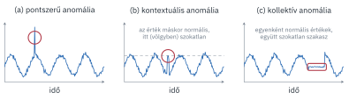
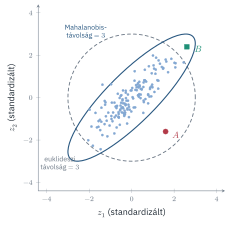
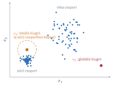
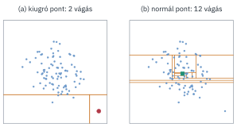

# Anomáliák és eltérések észlelése {#sec-anomalia}

```{python}
#| include: false
import numpy as np
import pandas as pd
import matplotlib.pyplot as plt
import adatbanyaszat as ab
ab.set_style()
pd.set_option("display.max_columns", 12)
pd.set_option("display.width", 110)
import warnings
warnings.filterwarnings("ignore", category=UserWarning)
```

::: {.roadmap}
Az anomália-észlelés a szokatlan, a többségtől eltérő objektumok és események
felismerése: csalásgyanús rendelések, meghibásodó berendezések, hibás mérések. A
felügyelt osztályozással szemben itt rendszerint nincsenek – vagy alig vannak – címkézett
példák, és az anomáliák ritkák, sokfélék, gyakran előre nem ismertek. A fejezet az
anomáliák típusaival kezdődik, majd a statisztikai módszereket (robusztus $z$-érték,
Mahalanobis-távolság), a statisztikai folyamatszabályozás egy- és többváltozós
eszközeit (Shewhart-, EWMA- és CUSUM-kártya, Hotelling-féle $T^2$, PCA-alapú $T^2$ és $Q$
statisztika), a távolság- és sűrűségalapú módszereket (LOF), az izolációs erdőt és az
egyosztályos SVM-et tárgyalja. Külön foglalkozunk a küszöbválasztással és az értékelés
buktatóival. A gyakorlatban a webáruház csalásgyanús rendeléseit és az üzem hibáit
keressük.

**A fejezet végére az olvasó** képes lesz megkülönböztetni a pontszerű, a kontextuális
és a kollektív anomáliákat; kiszámítani és értelmezni a Mahalanobis-távolságot, a $T^2$ és
a $Q$ statisztikát és ezek ellenőrzési határait; alkalmazni és összehasonlítani a LOF-ot, az
izolációs erdőt és az egyosztályos SVM-et; és az anomália-észlelőket a feladathoz illő
mértékekkel (átlagos pontosság, találati arány a lista elején, téves riasztási arány,
észlelési késés) értékelni.
:::

## Mi az anomália? {#sec-anomalia-fogalom}

Hawkins klasszikus meghatározása szerint az anomália (kiugró érték, outlier) olyan
megfigyelés, amely annyira eltér a többitől, hogy felmerül a gyanú: más mechanizmus hozta
létre [@hawkins1980]. A definíció kulcsa a *más mechanizmus*: az anomália-észlelés célja
nem egyszerűen a ritka értékek megtalálása, hanem azoké, amelyek mögött hiba, csalás vagy
új jelenség áll. Ugyanaz a technika a [-@sec-elokeszites]. fejezetben az adattisztítás
eszköze volt (ott a kiugró értékek zavaró zajt jelentettek); itt maguk az anomáliák az
elemzés célpontjai.

@chandola2009 három típust különböztet meg ([-@fig-anomalia-tipusok]. ábra). A
**pontszerű** anomália egyetlen, a többitől eltérő megfigyelés. A **kontextuális**
anomália értéke önmagában nem szokatlan, csak az adott környezetben (időpontban, helyen,
működési állapotban): 25 °C-os hűtővíz nyáron normális, télen hibára utal. A **kollektív**
anomália egymás utáni megfigyelések csoportja, amelyek egyenként normálisak, együtt
azonban szokatlan mintázatot alkotnak – például egy szenzor „befagyott”, állandó jele.

{#fig-anomalia-tipusok width=100%}

A rendelkezésre álló címkék szerint három feladattípust különböztetünk meg. **Felügyelt**
esetben mindkét osztályra vannak címkék – ez a [-@sec-osztalyozas]. fejezet erősen
kiegyensúlyozatlan osztályozási feladata. **Félig felügyelt** esetben csak a normál
működésre vannak (megbízható) példák, és az ettől való eltérést keressük; ez a tipikus
ipari helyzet, ahol a hibamentes üzem adatai bőven rendelkezésre állnak. **Felügyelet
nélküli** esetben semmilyen címke nincs, és azt feltételezzük, hogy az anomáliák ritkák és
eltérnek a többségtől. Az alábbi módszerek többsége mindkét utóbbi helyzetben
használható; a különbség az, hogy a modellt a tiszta normál adatokon vagy a teljes,
szennyezett adathalmazon illesztjük [@aggarwal2017; @ruff2021].

## Statisztikai módszerek {#sec-anomalia-statisztikai}

### Egyváltozós eset

A legegyszerűbb eljárás a standardizált érték: a $|z_i| = |x_i - \bar x|/s$ értéket
egy küszöbbel (például 3-mal) vetjük össze. Az átlag és a szórás azonban maguk is
érzékenyek a kiugró értékekre: néhány nagy kiugró érték megnöveli a szórást, és így
elrejti saját magát (**maszkolás**). Ezért robusztus változatot érdemes használni
[@leys2013]:

$$
z_i^{\text{rob}} = \frac{x_i - \operatorname{med}(\mathbf{x})}{1{,}4826\cdot\operatorname{MAD}(\mathbf{x})},
\qquad
\operatorname{MAD}(\mathbf{x}) = \operatorname{med}_i\bigl|x_i - \operatorname{med}(\mathbf{x})\bigr| ,
$$ {#eq-robusztus-z}

ahol az 1,4826-os szorzó normális eloszlásnál a MAD-ot a szórás torzítatlan becslőjévé
teszi. A [-@sec-elokeszites]. fejezet Hampel-szűrője ennek mozgóablakos változata.

### A Mahalanobis-távolság

Több változó esetén az egyes változók külön-külön normális értékei együtt is lehetnek
szokatlanok: a [-@fig-mahalanobis]. ábra $A$ pontja mindkét koordinátája szerint a
szokásos tartományban van, de ellentmond a két változó közötti erős pozitív
korrelációnak. A korrelációt a **Mahalanobis-távolság** [@mahalanobis1936] veszi
figyelembe:

$$
d_M(\mathbf{x}) = \sqrt{(\mathbf{x} - \boldsymbol\mu)^\top\boldsymbol\Sigma^{-1}(\mathbf{x} - \boldsymbol\mu)} .
$$ {#eq-mahalanobis}

A $\boldsymbol\Sigma = \mathbf{V}\boldsymbol\Lambda\mathbf{V}^\top$ sajátérték-felbontással
(B. függelék) $d_M^2 = \sum_j (\mathbf{v}_j^\top(\mathbf{x} - \boldsymbol\mu))^2/\lambda_j$: a
távolságot a főkomponensek irányában mérjük, és mindegyik irányban az ottani szórással
skálázzuk. Ezért a kis varianciájú irányokban – amelyeket a változók közötti
összefüggések jelölnek ki – már kis eltérés is nagy távolságot ad. Ha az adatok
$n$-dimenziós normális eloszlásúak, $d_M^2$ $\chi^2_n$ eloszlású, így a küszöb a
$\chi^2_n$ eloszlás egy felső kvantilise lehet.

{#fig-mahalanobis width=62%}

A $\boldsymbol\mu$ és $\boldsymbol\Sigma$ becslése a kiugró értékek miatt itt is torzulhat.
A **legkisebb kovariancia-determináns** (minimum covariance determinant, MCD) becslő az
adatok azon $h$ elemű részhalmazát keresi, amelynek kovarianciamátrixa a legkisebb
determinánsú, és ebből becsüli a helyzetet és a szóródást; erre @rousseeuw1999 hatékony
algoritmust adott (`sklearn.covariance.MinCovDet`).

## Statisztikai folyamatszabályozás {#sec-spc}

A **statisztikai folyamatszabályozás** (statistical process control, SPC) a gyártási
folyamatok ellenőrzésének klasszikus eszköztára [@montgomery2019]. Alapgondolata, hogy a
folyamat ingadozása két forrásból ered: a mindig jelen lévő, véletlenszerű „közös
okokból” és a beavatkozást igénylő „különleges okokból”. Az ellenőrzőkártyák a
folyamatjellemzőt a normál működésből becsült ellenőrzési határokkal vetik össze, és
riasztanak, ha a folyamat „kikerül a szabályozott állapotból”.

### Egyváltozós ellenőrzőkártyák

A **Shewhart-kártya** [@shewhart1931] minden új megfigyelést külön értékel, és jelez, ha az a
$\mu \pm 3\sigma$ tartományon kívül esik. Nagy, hirtelen eltolódásokat gyorsan észlel, a
kicsiket – egy-másfél szórásnyit – azonban csak lassan, mert nem „emlékszik” a korábbi
megfigyelésekre. Az **EWMA-kártya** [@roberts1959] az exponenciálisan súlyozott mozgóátlagot
figyeli:

$$
z_t = \lambda x_t + (1 - \lambda)z_{t-1},\qquad
\text{határ: } \mu \pm L\sigma\sqrt{\frac{\lambda}{2-\lambda}\bigl[1 - (1-\lambda)^{2t}\bigr]} ,
$$ {#eq-ewma}

a **CUSUM-kártya** [@page1954] pedig a célértéktől való eltérések kumulált összegét:

$$
S_t^{+} = \max\bigl(0,\; S_{t-1}^{+} + x_t - \mu_0 - k\bigr),\qquad
S_t^{-} = \max\bigl(0,\; S_{t-1}^{-} - x_t + \mu_0 - k\bigr),
$$ {#eq-cusum}

és jelez, ha $S_t^{+}$ vagy $S_t^{-}$ meghaladja a $h$ döntési határt. A $k$ referenciaérték
tipikusan az észlelni kívánt eltolódás fele (szórásegységben 0,5), $h$ pedig 4–5. A két
utóbbi kártya a kis, tartós eltolódásokat sokkal gyorsabban észleli, mint a Shewhart-kártya
([-@fig-ellenorzokartyak]. ábra).

```{python}
#| label: fig-ellenorzokartyak
#| fig-cap: "Egyváltozós ellenőrzőkártyák egy 0,75 szórásnyi tartós eltolódás (a 100. mintától, szaggatott vonal) észlelésére független, normális eloszlású adatokon. A függőleges pontozott vonalak az első riasztást jelölik."
#| fig-width: 7.2
#| fig-height: 4.6
rng = np.random.default_rng(6)
x = rng.normal(0, 1, 200)
x[100:] += 0.75                                    # tartós eltolódás
lam, L = 0.1, 2.7
z = np.zeros_like(x); S = np.zeros_like(x)
for t in range(len(x)):
    z[t] = lam * x[t] + (1 - lam) * (z[t - 1] if t else 0.0)
    S[t] = max(0.0, (S[t - 1] if t else 0.0) + x[t] - 0.5)
hatar = L * np.sqrt(lam / (2 - lam) * (1 - (1 - lam) ** (2 * np.arange(1, 201))))
def elso(riaszt, t0=100):                          # első riasztás a váltás után
    utana = np.flatnonzero(riaszt[t0:])
    return t0 + int(utana[0]) if len(utana) else None
jelzes = {"Shewhart": np.abs(x) > 3, "EWMA": np.abs(z) > hatar, "CUSUM": S > 5}
riasztasok = {nev: elso(r) for nev, r in jelzes.items()}
fig, ax = plt.subplots(3, 1, sharex=True)
ax[0].plot(x, color=ab.PALETTE[0], lw=0.9); ax[0].axhline(3, color=ab.PALETTE[4], lw=1); ax[0].axhline(-3, color=ab.PALETTE[4], lw=1)
ax[1].plot(z, color=ab.PALETTE[0], lw=1.1); ax[1].plot(hatar, color=ab.PALETTE[4], lw=1); ax[1].plot(-hatar, color=ab.PALETTE[4], lw=1)
ax[2].plot(S, color=ab.PALETTE[0], lw=1.1); ax[2].axhline(5, color=ab.PALETTE[4], lw=1)
for a, (nev, t) in zip(ax, riasztasok.items()):
    a.axvline(100, color="#6B7785", ls="--", lw=0.8)
    if t is not None:
        a.axvline(t, color=ab.PALETTE[1], ls=":", lw=1.3)
    a.set_ylabel(nev)
ax[2].set_xlabel("minta sorszáma")
fig.tight_layout()
print("észlelési késés [minta]:", {nev: (None if t is None else t - 100) for nev, t in riasztasok.items()},
      "| téves riasztás a váltás előtt:", {nev: int(r[:100].sum()) for nev, r in jelzes.items()})
```

Mindhárom kártya független megfigyeléseket feltételez. A 10 perces vagy órás
folyamatadatok azonban erősen autokorreláltak, és ilyenkor az EWMA és különösen a CUSUM
az elméleti határokkal sok téves riasztást ad, mert a pozitívan autokorrelált zaj
hosszú, egy irányba tartó kilengései eltolódásnak látszanak. Ilyenkor vagy egy
idősormodell (például AR-modell, [-@sec-idosor]. fejezet) maradékára alkalmazzuk a
kártyát, vagy a határokat a normál üzem adataiból, empirikusan határozzuk meg.

### Többváltozós folyamatfelügyelet: $T^2$ és $Q$

Sok, egymással korreláló változó esetén a változónkénti kártyák egyrészt túl sok
riasztást adnak (húsz független kártyánál a téves riasztás valószínűsége hússzoros),
másrészt nem veszik észre a korrelációs szerkezet megsérülését (a [-@fig-mahalanobis]. ábra
$A$ pontja). A **Hotelling-féle $T^2$ statisztika** [@hotelling1947] a Mahalanobis-távolság
négyzete a normál üzemből becsült $\bar{\mathbf{x}}$ átlaggal és $\mathbf{S}$ kovarianciával;
egy új megfigyelésre vonatkozó ellenőrzési határa $p$ változó és $N$ tanítómegfigyelés
esetén

$$
T^2_\alpha = \frac{p(N-1)(N+1)}{N(N-p)}\,F_\alpha(p,\, N-p) .
$$ {#eq-t2-hatar}

Ha a változók erősen korrelálnak, $\mathbf{S}$ rosszul kondicionált, és $T^2$ a kis
sajátértékű irányok zajára is érzékeny. A **PCA-alapú folyamatfelügyelet**
[@jackson1979; @macgregor1995; @qin2012] ezért a standardizált adatok terét két részre
bontja ([-@fig-mspc]. ábra): az első $q$ főkomponens kifeszítette **modelltérre**, amely a
normál működés szisztematikus változásait írja le, és a **maradéktérre**. A modelltérben a
$T^2$, a maradéktérben a $Q$ statisztika (más néven SPE, négyzetes előrejelzési hiba) méri az
eltérést:

$$
T^2 = \sum_{a=1}^{q}\frac{t_a^2}{\lambda_a},\qquad
Q = \lVert\mathbf{x} - \hat{\mathbf{x}}\rVert^2 = \bigl\lVert(\mathbf{I} - \mathbf{P}\mathbf{P}^\top)\mathbf{x}\bigr\rVert^2 ,
$$ {#eq-t2-q}

ahol $\mathbf{P}$ a főkomponens-irányok $n\times q$-s mátrixa, $t_a = \mathbf{p}_a^\top\mathbf{x}$
a főkomponens-értékek, $\lambda_a$ a sajátértékek. A $T^2$ statisztika azt jelzi, ha a
folyamat a szokásos összefüggések *mentén* szokatlanul messzire kerül (például szokatlanul
nagy terhelés), a $Q$ azt, ha a változók közötti *összefüggések* sérülnek (például egy
szenzor hibája vagy egy új zavar). A $Q$ ellenőrzési határát @jackson1979 adta meg:

$$
Q_\alpha = \theta_1\Biggl[\frac{c_\alpha\sqrt{2\theta_2h_0^2}}{\theta_1} + 1 + \frac{\theta_2h_0(h_0 - 1)}{\theta_1^2}\Biggr]^{1/h_0},
\qquad
\theta_i = \sum_{j=q+1}^{n}\lambda_j^i,\quad h_0 = 1 - \frac{2\theta_1\theta_3}{3\theta_2^2},
$$ {#eq-q-hatar}

ahol $c_\alpha$ a standard normális eloszlás $1-\alpha$ kvantilise. Riasztás után a
**hozzájárulási ábra** segít a hiba helyének megtalálásában: a $Q$ statisztika
változónkénti tagjai, $r_j^2 = (x_j - \hat x_j)^2$, megmutatják, mely változók sértik leginkább
a megszokott összefüggéseket. A hozzájárulás azonban nem diagnózis: a hiba gyakran olyan
változókban „látszik”, amelyek csak következményként térnek el.

{#fig-mspc width=85%}

::: {.callout-important}
## Az algoritmus összefoglalása: PCA-alapú folyamatfelügyelet
1. Gyűjtsünk adatokat a normál (hibamentes) üzemből; standardizáljuk a változókat.
2. Illesszünk PCA-modellt; válasszuk meg a megtartott komponensek $q$ számát (például a
   magyarázott variancia vagy keresztvalidáció alapján).
3. Számítsuk ki a $T^2$ és $Q$ ellenőrzési határait az ([-@eq-t2-hatar])–([-@eq-q-hatar])
   képletekkel vagy a normál adatok empirikus kvantiliseiből.
4. Minden új megfigyelésre számítsuk ki $T^2$-et és $Q$-t; riasszunk, ha valamelyik
   (adott számú egymást követő mintán át) meghaladja a határát.
5. Riasztás esetén a hozzájárulási ábrával keressük meg az érintett változókat.
:::

## Távolság- és sűrűségalapú módszerek {#sec-lof}

A távolságalapú módszerek egy objektumot annál inkább anomáliának tekintenek, minél
távolabb vannak tőle a legközelebbi szomszédai; a legegyszerűbb pontszám a $k$-adik
legközelebbi szomszéd távolsága. Ez azonban globális mérce: eltérő sűrűségű csoportok
esetén a ritka csoport normál pontjai is nagy pontszámot kapnak, egy sűrű csoport közvetlen
szomszédságában lévő, de ahhoz képest szokatlanul távoli pont viszont kicsit
([-@fig-lof]. ábra, $o_2$ pont).

{#fig-lof width=70%}

A **lokális kiugrási tényező** (local outlier factor, LOF) [@breunig2000] egy pont lokális
sűrűségét a szomszédaiéhoz viszonyítja. Jelölje $N_k(p)$ a $p$ pont $k$ legközelebbi
szomszédjának halmazát, $d_k(o)$ az $o$ pont $k$-adik szomszédjának távolságát! Az
**elérhetőségi távolság** $\operatorname{reach}_k(p, o) = \max\{d_k(o),\, d(p, o)\}$ – ez a
nagyon közeli pontok távolságát kisimítja –, a **lokális elérhetőségi sűrűség** és a LOF pedig

$$
\operatorname{lrd}_k(p) = \Biggl(\frac{1}{|N_k(p)|}\sum_{o\in N_k(p)}\operatorname{reach}_k(p, o)\Biggr)^{-1},
\qquad
\operatorname{LOF}_k(p) = \frac{1}{|N_k(p)|}\sum_{o\in N_k(p)}\frac{\operatorname{lrd}_k(o)}{\operatorname{lrd}_k(p)} .
$$ {#eq-lof}

A LOF értéke 1 körüli, ha a pont sűrűsége a szomszédaiéhoz hasonló, és jóval 1 feletti, ha a
pont ritkább környezetben van, mint a szomszédai. A módszer a $k$ megválasztására érzékeny
(tipikusan 10–50), és nagy adathalmazon a szomszédkeresés költséges.

## Izolációs erdő {#sec-iforest}

Az **izolációs erdő** (isolation forest) [@liu2008] nem távolságot vagy sűrűséget becsül,
hanem azt használja ki, hogy az anomáliák *könnyen elszigetelhetők*. Egy izolációs fa
az adatokat véletlenszerűen választott változó mentén, véletlenszerűen választott
küszöbbel vágja ketté, rekurzívan, amíg minden pont külön levélbe nem kerül. A ritka, a
többitől távoli pontokat már néhány vágás elszigeteli, a sűrű tartományok belsejében lévő
pontokhoz sok vágás kell ([-@fig-iforest]. ábra). Az anomáliapontszám a sok fán átlagolt
$E[h(\mathbf{x})]$ úthosszból számolható:

$$
s(\mathbf{x}, \psi) = 2^{-E[h(\mathbf{x})]/c(\psi)},\qquad
c(\psi) = 2H(\psi - 1) - \frac{2(\psi - 1)}{\psi},\quad H(i)\approx\ln i + 0{,}5772 ,
$$ {#eq-iforest}

ahol $\psi$ a fák építéséhez használt részminta mérete, $c(\psi)$ pedig a sikertelen
keresés átlagos úthossza egy $\psi$ elemű bináris keresőfában (normalizáló tényező). Az
1-hez közeli pontszám anomáliát, a 0,5 alatti normál pontot jelez. Az izolációs erdő
gyors (a fák kis, például 256 elemű részmintákon épülnek), jól skálázódik nagy
dimenzióra és sok adatra, és kevés hangolást igényel, ezért a gyakorlatban az egyik
legnépszerűbb felügyelet nélküli módszer; összehasonlító vizsgálatokban rendszerint az
élmezőnyben van [@goldstein2016; @han2022adbench]. Gyengesége, hogy a tengelyekkel
párhuzamos vágások miatt a változók közötti korrelációs szerkezet megsérülését
(a [-@fig-mahalanobis]. ábra $A$ pontját) kevésbé érzékeli.

{#fig-iforest width=85%}

## Egyosztályos SVM és rekonstrukciós módszerek {#sec-ocsvm}

Az **egyosztályos SVM** [@scholkopf2001] a normál adatokat egy kernel által meghatározott
jellemzőtérben a lehető legnagyobb margóval választja el az origótól:

$$
\min_{\mathbf{w},\,\boldsymbol\xi,\,\rho}\;\frac12\lVert\mathbf{w}\rVert^2 + \frac{1}{\nu N}\sum_{k=1}^{N}\xi_k - \rho
\quad\text{feltéve, hogy}\quad
\mathbf{w}^\top\phi(\mathbf{x}_k)\ge\rho - \xi_k,\;\; \xi_k\ge 0 .
$$ {#eq-ocsvm}

A $\nu\in(0, 1]$ paraméter felső korlát a tanítóadatok kiugrónak minősített hányadára és
alsó korlát a támaszvektorok hányadára. Radiális kernellel a döntési határ a normál adatok
köré simuló, tetszőleges alakú tartomány. A módszer érzékeny a $\gamma$ kernelparaméterre és a
változók skálázására, és nagy adathalmazon lassú.

A **rekonstrukciós módszerek** – a PCA $Q$ statisztikája és a [-@sec-neuralis]. fejezet
autoenkódere – egy tömörítő modellt tanítanak a normál adatokon, és a rekonstrukciós hibát
használják pontszámként. Ezek különösen akkor hasznosak, ha az anomália a változók közötti
összefüggések megsérülésében nyilvánul meg.

## Küszöbválasztás és értékelés {#sec-anomalia-ertekeles}

Az anomália-észlelők pontszámot adnak; a döntéshez küszöb kell. A küszöb meghatározható
statisztikai eloszlásból (a $\chi^2$, $F$ vagy a ([-@eq-q-hatar]) határok), a normál
adatok empirikus kvantiliséből, vagy az anomáliák várható arányából (a `scikit-learn`
`contamination` paramétere). A küszöb a téves riasztások és a kihagyott anomáliák közötti
kompromisszumot rögzíti, ezért a végső választás – akárcsak a [-@sec-ertekeles].
fejezet költségalapú küszöbénél – üzleti vagy üzemeltetési döntés: mennyi téves riasztást
képes a csalásfelderítő csoport vagy a műszakvezető naponta kivizsgálni?

Az értékelés több buktatót rejt [@campos2016]:

- **Rendkívül kiegyensúlyozatlan osztályok.** Ha a megfigyelések 0,1%-a anomália, az
  ROC-görbe alatti terület félrevezetően magas lehet: a negatívok óriási száma miatt kis
  téves pozitív *arány* is sok téves riasztást jelent. Az **átlagos pontosság** (AP, a
  PR-görbe alatti terület) és a **találati arány a lista elején** (precision@$k$: a $k$
  legnagyobb pontszámú objektum hányad része valódi anomália) a gyakorlati használathoz
  közelebb álló mérce, hiszen az elemzők a lista elejét vizsgálják ki.
- **Események és pontok.** Idősoroknál egy hibaesemény sok egymást követő megfigyelésből
  áll; az üzemeltető szempontjából az számít, hogy az eseményt észleltük-e, és mekkora
  **késéssel**, valamint hogy naponta hány téves riasztás érkezik.
- **A címkék hiánya és torzítottsága.** A „valódi” anomáliák listája ritkán teljes: a
  korábban fel nem ismert csalások a negatívok között vannak. Az értékelés ezért
  rendszerint alsó becslést ad.
- **Ritka nem azonos az érdekessel.** Egy felügyelet nélküli módszer a statisztikailag
  ritka objektumokat találja meg, amelyek nem feltétlenül a keresettek – a jellemzők
  megválasztása dönti el, milyen eltéréseket „lát” a módszer.

## Gyakorlat: csalásgyanús rendelések és üzemzavarok {#sec-anomalia-gyakorlat}

### Csalásgyanús rendelések a webáruházban

::: {.eset-uzleti}
A PannonShop adatai között 25 olyan rendelés rejtőzik, amely mögött – a szimulációban –
csalás áll; az elemző ezt nem tudja, csak azt, hogy a csalásfelderítő csoport naponta néhány
rendelést tud kézzel ellenőrizni. Készítsünk rendelésszintű jellemzőket, és rangsoroljuk a
rendeléseket felügyelet nélküli módszerekkel! Két jellemzőkészletet hasonlítunk össze: a
csak a kosár *tartalmát* leíró jellemzőket (érték, tételszám, mennyiség, átlagár), illetve
ezeket kiegészítve a rendelés *körülményeivel* (napszak, a vevő első rendelése-e, a
szállítási régiók száma a rendelésen belül).
:::

```{python}
from sklearn.preprocessing import StandardScaler
from sklearn.covariance import EmpiricalCovariance
from sklearn.neighbors import LocalOutlierFactor
from sklearn.ensemble import IsolationForest
from sklearn.svm import OneClassSVM
from sklearn.metrics import average_precision_score, roc_auc_score

tx = ab.shop_clean()
tx["ora"] = tx.InvoiceDate.dt.hour
rend = (tx.groupby("Invoice")
          .agg(ertek=("Ertek", "sum"), tetel=("StockCode", "nunique"), menny=("Quantity", "sum"),
               atl_ar=("Price", "mean"), ora=("ora", "first"), vevo=("CustomerID", "first"),
               regiok=("Regio", "nunique"), datum=("InvoiceDate", "first"))
          .sort_values("datum"))
rend["vevo_sorszam"] = rend.groupby("vevo").cumcount() + 1
rend.loc[rend.vevo.isna(), "vevo_sorszam"] = 1                     # vendégvásárló
jellemzok = pd.DataFrame({
    "log_ertek": np.log1p(rend.ertek), "tetel": rend.tetel, "log_menny": np.log1p(rend.menny),
    "log_atl_ar": np.log(rend.atl_ar),
    "ora_sin": np.sin(2 * np.pi * rend.ora / 24), "ora_cos": np.cos(2 * np.pi * rend.ora / 24),
    "elso_rendeles": (rend.vevo_sorszam == 1).astype(int), "regiok": rend.regiok})
csalas = rend.index.isin(ab.load_shop().truth["fraud_invoices"]).astype(int)   # csak az értékeléshez!
print(f"{len(rend)} rendelés, ebből {csalas.sum()} csalás ({csalas.mean():.2%})")

def ertekel(pontszam, k=25):
    elso_k = np.argsort(-pontszam)[:k]
    return {"AP": average_precision_score(csalas, pontszam), "AUC": roc_auc_score(csalas, pontszam),
            f"P@{k}": csalas[elso_k].mean()}

keszletek = {"tartalom": ["log_ertek", "tetel", "log_menny", "log_atl_ar"],
             "tartalom + körülmények": list(jellemzok.columns)}
eredm = {}
for knev, oszl in keszletek.items():
    Z = StandardScaler().fit_transform(jellemzok[oszl])
    pontok = {
        "max |z|": np.abs(Z).max(axis=1),
        "Mahalanobis": EmpiricalCovariance().fit(Z).mahalanobis(Z),
        "LOF (k = 35)": -LocalOutlierFactor(n_neighbors=35).fit(Z).negative_outlier_factor_,
        "izolációs erdő": -IsolationForest(n_estimators=500, random_state=0).fit(Z).score_samples(Z),
        "egyosztályos SVM": -OneClassSVM(nu=0.01, gamma="scale").fit(Z).decision_function(Z),
    }
    for mnev, s in pontok.items():
        eredm[(knev, mnev)] = ertekel(s)
pd.DataFrame(eredm).T.round(3)
```

Az eredmény két fontos tanulsággal szolgál. Egyrészt a ROC-görbe alatti terület szinte
minden esetben 0,9 fölött van, mégis a csak a kosár tartalmát leíró jellemzőkkel az első 25
rendelés között alig van csalás: az AP és a precision@25 sokkal hívebben tükrözi, mennyire
használható a rangsor. Másrészt a jellemzők megválasztása sokkal fontosabb, mint a módszeré.
A kosár tartalma alapján a legszokatlanabb rendelések nem a csalások, hanem a
viszonteladók nagy tételei – ezek valóban ritkák, de teljesen legitimek:

```{python}
Z = StandardScaler().fit_transform(jellemzok[keszletek["tartalom"]])
s_tart = -IsolationForest(n_estimators=500, random_state=0).fit(Z).score_samples(Z)
szegmens = rend.vevo.map(ab.load_shop().truth["segment"]).fillna("vendég / új vevő")
szegmens[csalas == 1] = "CSALÁS"
pd.crosstab(szegmens.iloc[np.argsort(-s_tart)[:50]], "db").rename_axis(None).rename(columns={"db": "az első 50 között"})
```

::: {.eset-uzleti}
A körülményeket leíró jellemzőkkel – éjszakai időpont, új vevő, egy rendelésen belül
eltérő szállítási régiók – a Mahalanobis-távolság és a LOF átlagos pontossága 0,95 fölötti,
és az első 25 rendelés közel 90%-a csalás; az egyosztályos SVM itt is a leggyengébb, mert
érzékeny a kernelparaméterre. A valóságban persze a csalók alkalmazkodnak, és a mintázat
változik; ezért a gyakorlatban a felügyelet nélküli rangsort az elemzők visszajelzései
alapján fokozatosan felügyelt modellé fejlesztik, a szabályalapú szűrőkkel és a hálózati
(közös címek, kártyák, eszközök) elemzéssel kombinálva [@bolton2002]. Fontos az is, hogy a
rangsor ne automatikusan utasítson el rendeléseket: a kiszűrt esetek emberi felülvizsgálata
az adatvédelmi és a fogyasztóvédelmi elvárásoknak is megfelel ([-@sec-bevezetes]. fejezet).
:::

### Az üzem többváltozós felügyelete

::: {.eset-mernoki}
Építsünk PCA-alapú felügyeleti rendszert a reaktorra! A modellt az első félév normál
üzemének 10 perces adatain illesztjük; a pillanatnyi mért értékek mellé a
[-@sec-neuralis]. fejezet tanulsága alapján a hűtővízáram egyórás szórását is felvesszük,
hogy a szelepakadás oszcillációja is látható legyen. A második félévben értékeljük a
riasztásokat.
:::

```{python}
from scipy import stats
from sklearn.decomposition import PCA

P = ab.load_plant()
m = ab.plant_clean()
m = m[~m.leallas].copy()
m["hiba"] = P.truth["fault"].reindex(m.ido).to_numpy()
mi = m.set_index("ido")
jelek = ["T_reaktor", "T_alapjel", "F_hutoviz", "T_hutoviz", "P_reaktor", "F_betap", "c_betap",
         "T_betap", "P_kevero", "E_fogyasztas", "T_kornyezet"]
X = mi[jelek].copy()
X["F_hut_szoras_1h"] = mi.F_hutoviz.rolling("60min").std()
X = X.dropna()
allapot = mi.loc[X.index, "hiba"].to_numpy()
tanito = X.index < "2025-07-01"
normal_tanito = tanito & (allapot == "normál")

sk = StandardScaler().fit(X[normal_tanito])
Z = sk.transform(X)
pca = PCA().fit(Z[normal_tanito])
print("kumulált magyarázott variancia:", np.round(np.cumsum(pca.explained_variance_ratio_)[:7], 3))
```

Öt főkomponenst tartunk meg, amelyek a normál üzem varianciájának mintegy 97%-át
magyarázzák. Számítsuk ki a statisztikákat és az elméleti ellenőrzési határokat 99%-os
szinten, és nézzük meg, hány riasztást adnak a *tanítóadatokon*!

```{python}
q, alfa = 5, 0.99
pca = PCA(n_components=q).fit(Z[normal_tanito])
Tq = pca.transform(Z)
T2 = (Tq ** 2 / pca.explained_variance_).sum(axis=1)
R = Z - pca.inverse_transform(Tq)
Q = (R ** 2).sum(axis=1)

N, p = normal_tanito.sum(), Z.shape[1]
T2_hatar = q * (N - 1) * (N + 1) / (N * (N - q)) * stats.f.ppf(alfa, q, N - q)
lam = np.linalg.eigvalsh(np.cov(Z[normal_tanito].T))[::-1]
th1, th2, th3 = [(lam[q:] ** i).sum() for i in (1, 2, 3)]
h0 = 1 - 2 * th1 * th3 / (3 * th2 ** 2)
Q_hatar = th1 * (stats.norm.ppf(alfa) * np.sqrt(2 * th2 * h0 ** 2) / th1 + 1
                 + th2 * h0 * (h0 - 1) / th1 ** 2) ** (1 / h0)
pd.DataFrame({"elméleti határ": [T2_hatar, Q_hatar],
              "a normál tanítóadatok 99%-os kvantilise": [np.quantile(T2[normal_tanito], 0.99), np.quantile(Q[normal_tanito], 0.99)],
              "riasztási arány a tanítóadatokon": [(T2[normal_tanito] > T2_hatar).mean(), (Q[normal_tanito] > Q_hatar).mean()]},
             index=["T²", "Q"]).round(3)
```

::: {.eset-mernoki}
A $Q$ elméleti határa jól egyezik a tapasztalati kvantilissel, a $T^2$ határa viszont
jóval alacsonyabb annál, és a normál üzemben is a vártnál többször riaszt. Ennek oka, hogy a
$T^2$ eloszlása a három termék eltérő alapjelei és betáplálási koncentrációi miatt nem
normális, hanem többmóduszú. A két lehetséges megoldás: állapotfüggő (termékenkénti)
modellek – ezekre a [-@sec-folyamat]. fejezetben visszatérünk – vagy empirikus határok.
Itt az utóbbit választjuk (a normál tanítóadatok 99,5%-os kvantilise), és a téves
riasztások további csökkentésére csak akkor riasztunk, ha három egymást követő minta
(30 perc) a határ felett van.
:::

```{python}
T2_emp, Q_emp = np.quantile(T2[normal_tanito], 0.995), np.quantile(Q[normal_tanito], 0.995)
nyers = pd.Series((T2 > T2_emp) | (Q > Q_emp), index=X.index)
riaszt = nyers.rolling(3).sum().eq(3)
teszt = ~tanito
sor = {}
for nev, r in [("egyedi minták", nyers), ("3 egymást követő minta", riaszt)]:
    sor[nev] = {"téves riasztási arány (normál)": r[teszt & (allapot == "normál")].mean()}
    for f in ["szenzor_drift", "betap_zavar", "szelep_akadas", "hutoviz_kieses"]:
        sor[nev][f] = r[teszt & (allapot == f)].mean()
pd.DataFrame(sor).T.round(3).rename_axis("2. félév")
```

```{python}
#| label: tbl-eszleles-keses
#| tbl-cap: "A második félév hibaeseményeinek észlelési késése a perzisztenciaszabállyal (az első riasztás a hiba kezdete után)."
esemenyek = P.truth["faults"]
esemenyek = esemenyek[esemenyek.kezdet >= "2025-07-01"].copy()
def keses(e):
    szakasz = riaszt[e.kezdet:e.veg]
    return (szakasz[szakasz].index.min() - e.kezdet).total_seconds() / 3600 if szakasz.any() else np.nan
esemenyek["késés [óra]"] = esemenyek.apply(keses, axis=1).round(1)
esemenyek["időtartam [óra]"] = ((esemenyek.veg - esemenyek.kezdet).dt.total_seconds() / 3600 + 1 / 6).round(0)
esemenyek[["hiba", "kezdet", "időtartam [óra]", "késés [óra]"]].reset_index(drop=True)
```

```{python}
#| label: fig-mspc-kartya
#| fig-cap: "A $T^2$ és a $Q$ statisztika (logaritmikus skálán) a második félév egy szakaszán az empirikus ellenőrzési határokkal. A színes sávok a valódi hibaeseményeket jelölik."
#| fig-width: 7.2
#| fig-height: 4
szakasz = (X.index >= "2025-07-01") & (X.index < "2025-09-30")
ido = X.index[szakasz]
fig, ax = plt.subplots(2, 1, sharex=True)
for a, stat, hatar, nev in [(ax[0], T2, T2_emp, "$T^2$"), (ax[1], Q, Q_emp, "$Q$")]:
    a.plot(ido, stat[szakasz], color=ab.PALETTE[0], lw=0.5)
    a.axhline(hatar, color=ab.PALETTE[4], lw=1.2)
    a.set_yscale("log"); a.set_ylabel(nev)
    for _, e in esemenyek[esemenyek.kezdet < "2025-09-30"].iterrows():
        szin = {"szenzor_drift": ab.PALETTE[2], "betap_zavar": ab.PALETTE[3],
                "szelep_akadas": ab.PALETTE[1], "hutoviz_kieses": ab.PALETTE[4]}[e.hiba]
        a.axvspan(e.kezdet, e.veg, color=szin, alpha=0.25, lw=0)
from matplotlib.patches import Patch
ax[0].legend(handles=[Patch(color=c, alpha=0.4, label=l) for l, c in
                      [("szenzor-drift", ab.PALETTE[2]), ("betáplálási zavar", ab.PALETTE[3]),
                       ("szelepakadás", ab.PALETTE[1]), ("hűtővíz-kiesés", ab.PALETTE[4])]],
             ncol=4, fontsize=7, loc="upper left")
fig.autofmt_xdate()
fig.tight_layout()
```

A hirtelen fellépő hibákat (hűtővíz-kiesés, betáplálási zavar, szelepakadás) a rendszer
egy órán belül jelzi – a 20 perces késés a perzisztenciaszabály miatti minimum –, a lassan kialakuló
szenzor-driftet viszont csak órák, illetve napok múlva, amikor a mérési hiba már
számottevő. A hozzájárulási ábra megmutatja, mely változók sértik a megszokott
összefüggéseket:

```{python}
#| label: fig-hozzajarulas
#| fig-cap: "A $Q$ statisztika változónkénti hozzájárulása (átlagos $r_j^2$) két esemény idején: a hűtővíz-kiesésnél a hűtővíz hőmérséklete, a szenzor-drift késői szakaszában a nyomás és a hűtővízáram sérti a megszokott összefüggéseket."
#| fig-width: 7.2
#| fig-height: 3
oszlopok = list(X.columns)
fig, ax = plt.subplots(1, 2, sharey=True)
for a, (cim, t0, t1) in zip(ax, [("hűtővíz-kiesés (aug. 5.)", "2025-08-05 07:00", "2025-08-05 11:00"),
                                 ("szenzor-drift (nov. 1.)", "2025-10-31 00:00", "2025-11-02 03:00")]):
    sel = (X.index >= t0) & (X.index <= t1)
    hj = pd.Series((R[sel] ** 2).mean(axis=0), index=oszlopok)
    a.barh(oszlopok, hj.values, color=ab.PALETTE[0])
    a.set_title(cim, fontsize=9); a.set_xlabel("átlagos hozzájárulás")
ax[0].tick_params(axis="y", labelsize=7)
fig.tight_layout()
```

::: {.eset-mernoki}
A hűtővíz-kiesésnél a hozzájárulás egyértelműen a hűtővíz hőmérsékletére mutat (a
környezeti hőmérséklet azért jelenik meg, mert a normál üzemben a kettő együtt mozog, és
ez az összefüggés sérül). A szenzor-driftnél a hőmérséklet-mérés maga alig tér el –
hiszen a szabályozó a mért értéket tartja az alapjelen –, a hiba a nyomás és a
hűtővízáram „ellentmondásában” látszik: a valódi hőmérséklet alacsonyabb, ezért a nyomás
és a hűtési igény kisebb a mért hőmérséklethez tartozónál. Ez jól mutatja a hozzájárulási
ábra korlátját: a hibás szenzor nem feltétlenül a legnagyobb hozzájárulású változó.
:::

Végül vessük össze a statisztikák és az izolációs erdő pontszámainak eseménytípusonkénti
elválasztóképességét (AUC) a második félévben:

```{python}
iso = IsolationForest(n_estimators=300, random_state=0).fit(Z[normal_tanito])
pontszamok = {"T²": T2, "Q": Q, "T²/határ + Q/határ": T2 / T2_emp + Q / Q_emp,
              "izolációs erdő": -iso.score_samples(Z)}
tabla = {}
for nev, s in pontszamok.items():
    tabla[nev] = {}
    for f in ["szenzor_drift", "betap_zavar", "szelep_akadas", "hutoviz_kieses"]:
        sel = teszt & np.isin(allapot, ["normál", f])
        tabla[nev][f] = roc_auc_score(allapot[sel] == f, s[sel])
pd.DataFrame(tabla).T.round(3).rename_axis("AUC (2. félév)")
```

A $T^2$ és a $Q$ kiegészíti egymást: a szelepakadás (amely a hűtővízáram szórását, és így a
modelltérben is szokatlan állapotot okoz) a $T^2$-ben, a betáplálási zavar és a szenzor-drift
(sérült összefüggések) a $Q$-ban látszik jobban. Az izolációs erdő mindegyik hibatípusnál
gyengébb a PCA-alapú statisztikáknál: a hibák itt elsősorban a változók közötti lineáris
összefüggések megsérülésében nyilvánulnak meg, amire a tengelyekkel párhuzamos vágások
kevésbé érzékenyek.





## Összefoglalás {#sec-anomalia-osszefoglalas}

- Az anomália más mechanizmus által létrehozott megfigyelés; lehet pontszerű,
  kontextuális vagy kollektív.
- A robusztus $z$-érték és a robusztus (MCD) kovarianciabecslés elkerüli, hogy a kiugró
  értékek elrejtsék magukat; a Mahalanobis-távolság a korrelációs szerkezetet is figyelembe
  veszi.
- Az EWMA- és a CUSUM-kártya a kis, tartós eltolódásokat gyorsabban észleli, mint a
  Shewhart-kártya, de autokorrelált adatokon a határokat korrigálni kell.
- A PCA-alapú folyamatfelügyelet $T^2$ statisztikája a modelltérben, $Q$ statisztikája a
  maradéktérben méri az eltérést; a hozzájárulási ábra a hiba helyére utal, de nem
  diagnosztizál.
- A LOF a lokális sűrűséget, az izolációs erdő az elszigetelhetőséget, az egyosztályos SVM
  a normál tartomány határát modellezi.
- Az értékeléshez a kiegyensúlyozatlanság miatt az átlagos pontosság, a precision@$k$, a
  téves riasztási arány és az észlelési késés alkalmasabb, mint az AUC.
- A jellemzők megválasztása legalább annyira fontos, mint a módszeré: a módszer csak azt az
  eltérést láthatja, amelyet a jellemzők leírnak.

## Ellenőrző kérdések {.unnumbered}

1. Miben különbözik a kontextuális és a kollektív anomália? Adjon példát mindkettőre a
   futó esetekből!
2. Mi a maszkolás, és hogyan védenek ellene a robusztus becslők?
3. Miért lehet egy pont kiugró a Mahalanobis-távolság szerint, ha minden koordinátája a
   szokásos tartományban van?
4. Mit jelez a nagy $T^2$, és mit a nagy $Q$ érték a PCA-alapú folyamatfelügyeletben?
5. Miért kell kevesebb vágás egy kiugró pont elszigeteléséhez az izolációs fában?
6. Miért lehet félrevezető az AUC a csalásfelderítésben?
7. Miért ad az EWMA- és a CUSUM-kártya autokorrelált adatokon sok téves riasztást?

## Feladatok {.unnumbered}

1. **Robusztus kovariancia.** Ismételje meg a csalásfelderítést a Mahalanobis-távolság
   MCD-alapú változatával (`MinCovDet`), csak a folytonos jellemzőkkel! Mi okoz gondot a
   diszkrét jellemzőknél?
2. **A LOF paramétere.** Vizsgálja meg a LOF átlagos pontosságát a $k = 5, 10, 20, 35, 50,
   100$ értékekre! Mennyire érzékeny a módszer?
3. **Komponensszám.** Hogyan változik a PCA-alapú felügyelet téves riasztási aránya és a
   hibák észlelési aránya a megtartott komponensek számával ($q = 2,\dots,8$)?
4. **Termékenkénti modellek.** Illesszen külön PCA-modellt mindhárom termékre, és vesse
   össze a téves riasztások számát az egyetlen modellel kapott értékkel!
5. **Autokorreláció.** Számítsa ki a [-@sec-osztalyozas]. fejezet nyomásmaradékának órás
   átlagán az autokorrelációt, és alkalmazzon EWMA-kártyát az eredeti adatokra, illetve egy
   AR(1)-modell maradékára! Hasonlítsa össze a téves riasztások számát és a szenzor-drift
   észlelési késését!

## További olvasmányok {.unnumbered}

Az anomália-észlelés átfogó áttekintése @chandola2009 cikke és @aggarwal2017 könyve; a
klasszikus és a mélytanulási módszereket egységes keretben @ruff2021 tárgyalja. A
statisztikai folyamatszabályozásról @montgomery2019, a többváltozós és PCA-alapú
folyamatfelügyeletről @macgregor1995 és @qin2012 ajánlott. A módszerek empirikus
összehasonlítását @goldstein2016, @campos2016 és @han2022adbench végezte el; a
csalásfelderítés statisztikai módszereiről @bolton2002 ad áttekintést.
