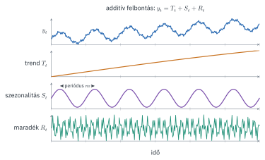
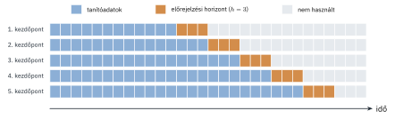
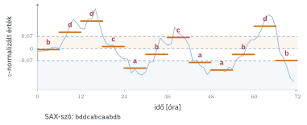

# Idősorok elemzése {#sec-idosor}

```{python}
#| include: false
import numpy as np
import pandas as pd
import matplotlib.pyplot as plt
import adatbanyaszat as ab
ab.set_style()
pd.set_option("display.max_columns", 12)
pd.set_option("display.width", 110)
import warnings
warnings.filterwarnings("ignore")
```

::: {.roadmap}
Az idősorok – időrendben rögzített megfigyelések – a futó esetek mindegyikében központi
szerepet játszanak: a webáruház forgalma, az üzem mérései, a riasztási napló mind
idősor. Az időbeli rendezettség új lehetőségeket és új veszélyeket hoz: a megfigyelések
nem függetlenek, a jövő a múltból jelezhető előre, de a véletlen keresztvalidáció
félrevezet. A fejezet az idősorok felbontásával és az autokorrelációval kezdődik, majd az
előrejelzés klasszikus módszereit (exponenciális simítás, ARIMA-modellek, dinamikus
regresszió) és értékelésük helyes módját tárgyalja. Ezután az idősorok hasonlóságát
(dinamikus idővetemítés) és tömör reprezentációit (Fourier- és hullámtranszformáció, PAA,
SAX) mutatjuk be, végül az idősorok osztályozását és szegmentálását.

**A fejezet végére az olvasó** képes lesz egy idősort trendre, szezonalitásra és
maradékra bontani; az autokorrelációs függvényt értelmezni; exponenciális simító és
(S)ARIMA-modellt illeszteni és gördülő kezdőpontú értékeléssel összehasonlítani egyszerű
viszonyítási módszerekkel; a DTW-távolságot kézzel és programmal kiszámítani; és a
legfontosabb idősor-reprezentációkat alkalmazni.
:::

## Az idősorok szerkezete {#sec-idosor-szerkezet}

### Felbontás

Egy $y_1, y_2, \dots, y_T$ idősor változását rendszerint három komponensre bontjuk
([-@fig-komponensek]. ábra): a hosszú távú **trendre** ($T_t$), a rögzített periódussal
ismétlődő **szezonalitásra** ($S_t$, periódusa $m$: órás adatoknál a napi ciklusra $m = 24$,
heti adatoknál az éves ciklusra $m \approx 52$), és a **maradékra** ($R_t$). Additív
felbontásban $y_t = T_t + S_t + R_t$; ha a szezonális ingadozás a szinttel arányos,
multiplikatív felbontás ($y_t = T_t\cdot S_t\cdot R_t$) vagy a logaritmált sor additív
felbontása a megfelelő. A klasszikus felbontás a trendet $m$ hosszú centrált mozgóátlaggal
becsüli, a szezonális komponenst pedig a trendtől megtisztított értékek periódusonkénti
átlagaként. Az **STL** (seasonal-trend decomposition using LOESS) [@cleveland1990] lokális
regresszióval, iteratívan becsli a komponenseket; a szezonális mintázat lassan változhat,
és robusztus változata a kiugró értékekre sem érzékeny [@hyndman2021].

{#fig-komponensek width=90%}

### Stacionaritás és autokorreláció

Egy idősor (gyengén) **stacionárius**, ha várható értéke és szórása időben állandó, és a
két időpont közötti kovariancia csak a késleltetéstől függ. A stacionaritás az
előrejelző modellek többségének alapfeltevése; a trend és a szezonalitás megsérti, ezért
ezeket differenciálással ($\nabla y_t = y_t - y_{t-1}$, illetve szezonálisan
$\nabla_m y_t = y_t - y_{t-m}$) vagy felbontással távolítjuk el. A stacionaritás
formálisan is vizsgálható, például a kiterjesztett Dickey–Fuller-próbával [@dickey1979].

Az idősor belső függőségi szerkezetét az **autokorrelációs függvény** (ACF) írja le:

$$
r_k = \frac{\sum_{t=k+1}^{T}(y_t - \bar y)(y_{t-k} - \bar y)}{\sum_{t=1}^{T}(y_t - \bar y)^2},\qquad k = 1, 2, \dots
$$ {#eq-acf}

A **parciális autokorrelációs függvény** (PACF) a $k$ késleltetésű korrelációt a
közbülső késleltetések hatásának kiszűrése után méri. A két függvény mintázata az
ARIMA-modellek rendjének megválasztását segíti, a modell maradékainak ACF-je pedig a
modell megfelelőségét mutatja: jó modell maradéka fehér zaj, amit a Ljung–Box-próba
[@ljung1978] egyszerre több késleltetésre ellenőriz. Az autokorreláció a
[-@sec-anomalia]. fejezet ellenőrzőkártyáinál is gondot okozott, és ez az oka annak is,
hogy idősoroknál a véletlen keresztvalidáció túl optimista képet ad
([-@sec-ertekeles]. fejezet).

## Előrejelzés {#sec-elorejelzes}

### Viszonyítási módszerek

Minden előrejelző modellt egyszerű viszonyítási (benchmark) módszerekkel kell
összevetni [@hyndman2021]. A **naiv** előrejelzés az utolsó megfigyelést ismétli,
$\hat y_{T+h} = y_T$; a **szezonális naiv** az egy periódussal korábbi értéket,
$\hat y_{T+h} = y_{T+h-m}$; a **sodródásos** változat a naiv előrejelzést az eddigi átlagos
változással tolja el. A nagy nemzetközi előrejelzési versenyek egyik visszatérő tanulsága,
hogy ezeket a módszereket meglepően nehéz legyőzni, és hogy a bonyolult módszerek csak
akkor jobbak, ha az adatok szerkezete ezt indokolja [@makridakis2018].

### Exponenciális simítás

Az **egyszerű exponenciális simítás** az előrejelzést a múltbeli értékek exponenciálisan
csökkenő súlyú átlagaként képzi: $\ell_t = \alpha y_t + (1 - \alpha)\ell_{t-1}$, és
$\hat y_{T+h} = \ell_T$. Holt [@holt2004] kiterjesztése egy trendkomponenssel, Winters
[@winters1960] pedig egy szezonális komponenssel egészítette ki; az additív
**Holt–Winters-módszer** egyenletei

$$
\begin{aligned}
\ell_t &= \alpha(y_t - s_{t-m}) + (1 - \alpha)(\ell_{t-1} + b_{t-1}), &
b_t &= \beta(\ell_t - \ell_{t-1}) + (1 - \beta)b_{t-1},\\
s_t &= \gamma(y_t - \ell_{t-1} - b_{t-1}) + (1 - \gamma)s_{t-m}, &
\hat y_{T+h} &= \ell_T + h\,b_T + s_{T+h-m(k+1)},
\end{aligned}
$$ {#eq-holt-winters}

ahol $\ell_t$ a szint, $b_t$ a trend, $s_t$ a szezonális komponens, $k$ pedig a $(h-1)/m$
egészrésze. A hosszú távú előrejelzések túlzott meredekségét a **csillapított trend**
mérsékli, amely a trendet minden lépésben egy $\phi < 1$ tényezővel szorozza. A
simítási paramétereket a maximum-likelihood vagy a legkisebb négyzetek elve szerint
becsüljük; a módszercsalád állapottér-modellként (ETS: error–trend–seasonal)
is felírható, ami előrejelzési intervallumokat és információs kritériumokon alapuló
modellválasztást tesz lehetővé [@hyndman2021].

### ARIMA-modellek

Az **autoregresszív** AR($p$) modell az idősort saját késleltetett értékeinek lineáris
függvényeként, a **mozgóátlag** MA($q$) modell a korábbi véletlen sokkok lineáris
kombinációjaként írja le. A kettő kombinációja a differenciált sorra az **ARIMA($p,d,q$)**
modell [@box2015]:

$$
\Bigl(1 - \sum_{i=1}^{p}\phi_iB^i\Bigr)(1 - B)^d y_t = c + \Bigl(1 + \sum_{j=1}^{q}\theta_jB^j\Bigr)\varepsilon_t ,
$$ {#eq-arima}

ahol $B$ a késleltető operátor ($By_t = y_{t-1}$), $\varepsilon_t$ fehér zaj. A
szezonális **SARIMA($p,d,q$)($P,D,Q$)$_m$** modell ugyanezt a szerkezetet a szezonális
késleltetésekre ($B^m$) is alkalmazza. A Box–Jenkins-módszertan lépései: a sor
stacionáriussá tétele (differenciálás, transzformáció), a rend azonosítása az ACF és a
PACF alapján (vagy információs kritériummal, például AIC), a paraméterek becslése, és a
maradékok diagnosztikája. Ha a jövőbeli értékeket befolyásoló, ismert vagy előre jelezhető
külső változók (termelési terv, időjárás-előrejelzés, akciók) vannak, a **dinamikus
regresszió** – lineáris regresszió ARIMA-hibataggal (ARIMAX, SARIMAX) – ezeket is
felhasználja.

### Az előrejelzések értékelése

Az előrejelzést mindig olyan adatokon kell értékelni, amelyek a modell illesztésekor
még nem voltak ismertek. Egyetlen tanító–teszt felosztás helyett a **gördülő
kezdőpontú értékelés** (rolling origin, idősoros keresztvalidáció) több kezdőpontból
készít előrejelzést, mindig csak a kezdőpont előtti adatokat felhasználva
([-@fig-gordulo]. ábra) [@bergmeir2012; @hyndman2021].

{#fig-gordulo width=90%}

A hibamértékek közül a MAE és az RMSE az eredeti mértékegységben értelmezhető, de
sorok között nem hasonlítható össze. A MAPE (átlagos abszolút százalékos hiba)
nullához közeli értékeknél instabil, és aszimmetrikusan bünteti a túl- és az
alulbecslést. @hyndman2006 ezért a **skálázott abszolút hibát** (MASE) javasolta, amely a
MAE-t a tanítóadatokon számolt naiv (vagy szezonális naiv) egylépéses előrejelzés MAE-jével
osztja: az 1-nél kisebb érték azt jelenti, hogy a módszer jobb a naiv viszonyításnál.

## Hasonlóság és reprezentáció {#sec-idosor-hasonlosag}

### Dinamikus idővetemítés

Két idősor euklideszi távolsága az azonos időpontú értékeket veti össze, ezért már egy
kis időbeli eltolódás vagy eltérő sebesség is nagy távolságot ad. A **dinamikus
idővetemítés** (dynamic time warping, DTW) [@sakoe1978; @berndt1994] az időtengelyt
rugalmasan „vetemíti”: azt a monoton illesztést keresi a két sor pontjai között, amely
mentén az összesített eltérés a legkisebb ([-@fig-dtw]. ábra). Az $\mathbf{a}$ és
$\mathbf{b}$ sorok kumulált költségmátrixát dinamikus programozással töltjük ki:

$$
D(i, j) = (a_i - b_j)^2 + \min\bigl\{D(i-1, j),\; D(i, j-1),\; D(i-1, j-1)\bigr\},
\qquad D(0, 0) = 0 ,
$$ {#eq-dtw}

és $\operatorname{DTW}(\mathbf{a}, \mathbf{b}) = \sqrt{D(n, m)}$. Az optimális illesztés
(vetemítési út) a $D(n, m)$ cellából visszakövethető. A számítás költsége $O(nm)$; a
**Sakoe–Chiba-sáv** az utat a főátló $w$ szélességű környezetére korlátozza, ami
gyorsít, és megakadályozza a fizikailag értelmetlen, túlzott vetemítést. Nagy
adatbázisokban a DTW-t olcsó alsó korlátokkal (például az LB_Keogh-korláttal
[@keogh2005]) kombinálják, így a legtöbb jelöltet a teljes számítás nélkül ki lehet
zárni [@rakthanmanon2012].

{#fig-dtw width=100%}

### Kézi példa

A segédcsomag két rövid jelalakja ugyanaz a „hegy”, egy lépéssel eltolva. Az
euklideszi távolság a ([-@eq-dtw]) rekurzió nélkül, a pontonkénti eltérésekből számolható:

```{python}
a, b = ab.mini.idosor_mini()
print("a =", a, "\nb =", b)
print(f"euklideszi távolság: {np.sqrt(((a - b) ** 2).sum()):.3f}")

def dtw(a, b, w=None):
    """Kumulált költségmátrix a (-@eq-dtw) rekurzióval, opcionális Sakoe–Chiba-sávval."""
    n, m = len(a), len(b)
    D = np.full((n + 1, m + 1), np.inf)
    D[0, 0] = 0.0
    for i in range(1, n + 1):
        jlo, jhi = (1, m) if w is None else (max(1, i - w), min(m, i + w))
        for j in range(jlo, jhi + 1):
            D[i, j] = (a[i - 1] - b[j - 1]) ** 2 + min(D[i - 1, j], D[i, j - 1], D[i - 1, j - 1])
    return D

D = dtw(a, b)
print(f"DTW-távolság: {np.sqrt(D[-1, -1]):.3f}")
pd.DataFrame(D[1:, 1:].astype(int), index=[f"a{i+1}={v:g}" for i, v in enumerate(a)],
             columns=[f"b{j+1}={v:g}" for j, v in enumerate(b)])
```

A DTW-távolság nulla: a vetemítési út az $a_1$ értéket $b_1$-hez és $b_2$-höz is
hozzárendeli, a hegyet egy lépéssel eltolva tökéletesen illeszti, végül $a_8$-at is
$b_8$-hoz rendeli. Az euklideszi távolság ezzel szemben 3,46, pedig a két jelalak
szemmel láthatóan ugyanaz.

### Tömör reprezentációk

Hosszú idősorok hasonlóságkereséséhez, csoportosításához és indexeléséhez az idősort
kevés együtthatóval leíró, tömör **reprezentációra** van szükség, amelyben a távolság jól
közelíti (lehetőleg alulról becsüli) az eredeti távolságot [@faloutsos1994]. A
legfontosabbak:

- A **diszkrét Fourier-transzformáció** (DFT) az idősort különböző frekvenciájú
  szinuszok összegeként írja le, $X_k = \sum_{t=0}^{T-1}y_te^{-2\pi ikt/T}$; az első néhány
  együttható a lassú változásokat őrzi meg [@agrawal1993ts]. A **periodogram**
  ($|X_k|^2$ a frekvencia függvényében) a rejtett periodicitások felderítésének eszköze.
- A **diszkrét hullámtranszformáció** (DWT) [@daubechies1992] időben és frekvenciában
  egyaránt lokalizált bázisfüggvényeket használ; a legegyszerűbb Haar-hullámnál az
  együtthatók szomszédos szakaszok átlagai és különbségei [@chan1999]. Hirtelen változásokat
  és tranzienseket jobban leír, mint a DFT.
- A **darabonként konstans közelítés** (piecewise aggregate approximation, PAA)
  [@keogh2001] az idősort $w$ egyenlő hosszú szakaszra bontja, és mindegyiket az átlagával
  helyettesíti.
- A **SAX** (symbolic aggregate approximation) [@lin2007] a $z$-normalizált sor
  PAA-értékeit a standard normális eloszlás kvantilisei által meghatározott sávok szerint
  betűkké alakítja ([-@fig-sax]. ábra). Az így kapott szövegszerű reprezentációra a
  szövegbányászat és a sorozatminta-keresés eszközei (például a [-@sec-asszociacio].
  fejezet módszerei) is alkalmazhatók.

{#fig-sax width=95%}

## Idősorok osztályozása és szegmentálása {#sec-idosor-osztalyozas}

Az idősor-osztályozás feladata egy teljes idősor (vagy idősorszakasz) osztályba
sorolása: egy gépindítás jó vagy rossz lefutású volt-e, milyen hibatípus jellemző egy
jelablakra. Kiterjedt összehasonlító vizsgálatok szerint az 1-legközelebbi szomszéd
osztályozó DTW-távolsággal évtizedekig nehezen legyőzhető viszonyítási alap volt
[@bagnall2017]; az újabb módszerek – az idősorok jellemzőit véletlen konvolúciós
szűrőkkel kinyerő ROCKET [@dempster2020] és a [-@sec-neuralis]. fejezet konvolúciós
hálózatai [@ismail2019] – a pontosságot és a sebességet tekintve egyaránt
előrelépést hoztak. A módszerek értékelésének közös alapja a nyilvános UCR-idősorarchívum
[@dau2019].

A **szegmentálás** az idősort belsőleg homogén szakaszokra bontja: működési állapotokra,
termékváltásokra, hibaepizódokra. A klasszikus algoritmusok (csúszóablakos, felülről
lefelé és alulról felfelé haladó módszerek) a szakaszokat egyszerű – például lineáris –
modellekkel közelítik, és a közelítési hiba alapján vágnak [@keogh2004seg]; a
**változáspont-észlelés** a szakaszok számát és határait egy büntetett költségfüggvény
optimumaként határozza meg, amire a PELT-algoritmus lineáris időben ad egzakt megoldást
[@killick2012]. Többváltozós folyamatadatoknál a szakaszok homogenitása a változók
közötti összefüggések (például lokális PCA-modellek) alapján is mérhető; ilyen a
fuzzy klaszterezésen alapuló szegmentálás, amely a szakaszhatárok bizonytalanságát is
kezeli [@abonyi2005seg].

## Gyakorlat: forgalom-előrejelzés, hűtési igény és jelalakok {#sec-idosor-gyakorlat}

### A heti rendelésszám előrejelzése

::: {.eset-uzleti}
A PannonShop logisztikája a következő négy hét rendelésszámát szeretné előre látni a
raktári létszám tervezéséhez. A heti rendelésszám két év adatából áll; erős éves
szezonalitás (az év végi csúcs), két akciós időszak és növekedés jellemzi.
:::

```{python}
#| label: fig-heti-rendelesek
#| fig-cap: "A PannonShop heti rendelésszáma. Az év végi csúcs és az akciós hetek (pontok) határozzák meg a sor szerkezetét; a második évben a forgalom nagyobb."
#| fig-width: 7.2
#| fig-height: 2.6
tx = ab.shop_clean()
heti = tx.set_index("InvoiceDate").groupby(pd.Grouper(freq="W-SUN")).Invoice.nunique()
heti = heti[(heti.index > "2024-01-01") & (heti.index <= "2025-12-28")]
het_sorszam = heti.index.isocalendar().week.to_numpy().astype(int)
akcio = np.isin(het_sorszam, ab.load_shop().truth["promo_weeks"][2025]).astype(float)
fig, ax = plt.subplots()
ax.plot(heti.index, heti.values, color=ab.PALETTE[0], lw=1.3)
ax.scatter(heti.index[akcio == 1], heti.values[akcio == 1], color=ab.PALETTE[1], s=18, zorder=3, label="akciós hét")
ax.set_ylabel("rendelések / hét"); ax.legend()
fig.tight_layout()
print(heti.groupby(heti.index.year).sum().rename("rendelések száma"))
```

Négy módszert hasonlítunk össze gördülő kezdőpontú értékeléssel (a 65. héttől négyhetente,
négyhetes horizonttal): a naiv és a szezonális naiv előrejelzést, a szezonális naiv
előrejelzés növekedéssel korrigált változatát (az elmúlt nyolc hét és az egy évvel korábbi
nyolc hét log-szintjének különbségével), valamint egy dinamikus harmonikus regressziót,
amely a logaritmált rendelésszámot Fourier-tagokkal (az éves szezonalitás), trenddel,
valamint az akciós és az ünnepi hetek indikátoraival magyarázza, AR(1) hibataggal. Az
éves periódusú Holt–Winters- és SARIMA-modellekhez két év kevés: a szezonális
komponens becsléséhez legalább két teljes periódus kellene már a legelső kezdőpontban is.

```{python}
from statsmodels.tsa.statespace.sarimax import SARIMAX

y = np.log(heti.to_numpy())
t = np.arange(len(y))
unnepi = np.isin(het_sorszam, [49, 50, 51, 52]).astype(float)
def fourier(t, K, P=52.18):
    return np.column_stack([f(2 * np.pi * k * t / P) for k in range(1, K + 1) for f in (np.sin, np.cos)])
Xdhr = np.column_stack([fourier(t, 3), t / 52, akcio, unnepi])
H = 4
kezdopontok = range(64, len(y) - H + 1, 4)

def naiv(o):            return np.repeat(y[o - 1], H)
def szez_naiv(o):       return y[o - 52:o - 52 + H]
def szez_naiv_nov(o):   return y[o - 52:o - 52 + H] + (y[o - 8:o].mean() - y[o - 60:o - 52].mean())
def dhr(o):
    illesztett = SARIMAX(y[:o], exog=Xdhr[:o], order=(1, 0, 0), trend="c").fit(disp=False, maxiter=200)
    return illesztett.forecast(H, exog=Xdhr[o:o + H])

skala = np.mean(np.abs(np.diff(heti.to_numpy()[:64])))     # naiv egylépéses MAE a tanítóadatokon
eredm = {}
for nev, f in [("naiv", naiv), ("szezonális naiv", szez_naiv),
               ("szezonális naiv + növekedés", szez_naiv_nov), ("dinamikus harmonikus regresszió", dhr)]:
    hibak = np.concatenate([np.abs(np.exp(f(o)) - heti.to_numpy()[o:o + H]) for o in kezdopontok])
    eredm[nev] = {"MAE [rendelés/hét]": hibak.mean(), "MASE": hibak.mean() / skala}
pd.DataFrame(eredm).T.round(2)
```

::: {.eset-uzleti}
A legjobb eredményt a legegyszerűbb, a szakterületi tudást (az éves ismétlődést és a
növekedést) közvetlenül felhasználó módszer adja: a növekedéssel korrigált szezonális
naiv előrejelzés MASE-értéke jóval 1 alatt van. A dinamikus harmonikus regresszió
ugyan jobb a szezonális naiv módszernél, de két év adatából a Fourier-tagok és a
indikátorváltozók együtthatói bizonytalanok, és a hirtelen év végi felfutást csak
elmosódottan írják le. A tanulság általános: rövid, erősen szezonális soroknál a jól
megválasztott viszonyítási módszer gyakran a legjobb választás, és egy bonyolultabb
modell bevezetését mindig ehhez kell mérni.
:::

### Óránkénti hűtési igény előrejelzése

::: {.eset-mernoki}
A hűtővízrendszer üzemeltetője 24 órával előre szeretné látni a hűtővízigényt. Az órás
adatok bőségesek, a sor napi periodicitású (a környezeti hőmérséklet napi járása miatt),
és szintje a gyártott terméktől és a hűtőköpeny állapotától függ. Bontsuk fel a sort STL-lel,
és vizsgáljuk meg az autokorrelációját!
:::

```{python}
#| label: fig-stl
#| fig-cap: "A hűtővízáram órás idősorának STL-felbontása (24 órás periódus, robusztus változat) négy hétre. A trend az október 12-i leállás – a hűtőköpeny tisztítása – után jelentősen csökken, mert a tiszta hőátadó felület kevesebb hűtővizet igényel; a napi szezonalitás amplitúdója a környezeti hőmérséklet napi ingadozását követi."
#| fig-width: 7.2
#| fig-height: 4.6
from statsmodels.tsa.seasonal import STL
ora = ab.load_plant().hourly.set_index("ido")
s = ora.F_hutoviz["2025-08-26":"2025-12-05"]
stl = STL(s["2025-10-01":"2025-10-28"], period=24, robust=True).fit()
fig, ax = plt.subplots(4, 1, sharex=True)
for a, (sor, nev) in zip(ax, [(stl.observed, "mért"), (stl.trend, "trend"), (stl.seasonal, "napi szezonalitás"), (stl.resid, "maradék")]):
    a.plot(sor.index, sor.values, color=ab.PALETTE[0], lw=0.8); a.set_ylabel(nev, fontsize=8)
fig.autofmt_xdate()
fig.tight_layout()
```

```{python}
#| label: fig-acf
#| fig-cap: "A hűtővízáram órás sorának autokorrelációs (balra) és parciális autokorrelációs függvénye (jobbra) az első két hétre. A 24 óránként ismétlődő csúcsok a napi szezonalitást jelzik."
#| fig-width: 7.2
#| fig-height: 2.6
from statsmodels.graphics.tsaplots import plot_acf, plot_pacf
fig, ax = plt.subplots(1, 2)
plot_acf(s["2025-09-01":"2025-09-14"], lags=72, ax=ax[0], color=ab.PALETTE[0], vlines_kwargs={"colors": ab.PALETTE[0]})
plot_pacf(s["2025-09-01":"2025-09-14"], lags=72, ax=ax[1], color=ab.PALETTE[0], vlines_kwargs={"colors": ab.PALETTE[0]}, method="ywm")
for a, cim in zip(ax, ["ACF", "PACF"]):
    a.set_title(cim, fontsize=9); a.set_xlabel("késleltetés [óra]")
fig.tight_layout()
```

Öt módszert hasonlítunk össze tizenöt kezdőponttal (október közepétől háromnaponta), 24
órás horizonttal, mindig az előző három hét adataira illesztve: a szezonális naiv előrejelzést
(a tegnapi azonos óra), a csillapított trendű Holt–Winters-módszert, egy
SARIMA$(1,0,1)(0,1,1)_{24}$ modellt, valamint két dinamikus regressziót. Ez utóbbiak a
termelési tervből ismert alapjelet, betáplálási áramot és koncentrációt, valamint a
környezeti hőmérsékletet is felhasználják; a jövőbeli környezeti hőmérsékletet itt a mért
értékkel helyettesítjük, ami az időjárás-előrejelzés hibáját figyelmen kívül hagyja,
tehát a valóságnál kissé optimista.

```{python}
from statsmodels.tsa.holtwinters import ExponentialSmoothing
from statsmodels.stats.diagnostic import acorr_ljungbox

kulso = ora.loc["2025-08-26":"2025-12-05", ["T_alapjel", "F_betap", "c_betap", "T_kornyezet"]]
H = 24
kezdo = pd.date_range("2025-10-15", "2025-11-28", freq="3D")
modszerek = {
    "szezonális naiv": lambda tr, Xtr, Xte: tr.to_numpy()[-24:],
    "Holt–Winters (csillapított)": lambda tr, Xtr, Xte: ExponentialSmoothing(
        tr.to_numpy(), trend="add", damped_trend=True, seasonal="add", seasonal_periods=24).fit().forecast(H),
    "SARIMA(1,0,1)(0,1,1)₂₄": lambda tr, Xtr, Xte: SARIMAX(
        tr.to_numpy(), order=(1, 0, 1), seasonal_order=(0, 1, 1, 24)).fit(disp=False).forecast(H),
    "regresszió + AR(1) hiba": lambda tr, Xtr, Xte: SARIMAX(
        tr.to_numpy(), exog=Xtr, order=(1, 0, 0), trend="c").fit(disp=False).forecast(H, exog=Xte),
    "SARIMAX": lambda tr, Xtr, Xte: SARIMAX(
        tr.to_numpy(), exog=Xtr, order=(1, 0, 1), seasonal_order=(0, 1, 1, 24)).fit(disp=False).forecast(H, exog=Xte),
}
eredm = {}
for nev, f in modszerek.items():
    mae, mase = [], []
    for o in kezdo:
        tr_idx = slice(o - pd.Timedelta(days=21), o - pd.Timedelta(hours=1))
        te_idx = slice(o, o + pd.Timedelta(hours=H - 1))
        elorejelzes = f(s[tr_idx], kulso[tr_idx].to_numpy(), kulso[te_idx].to_numpy())
        hiba = np.mean(np.abs(elorejelzes - s[te_idx].to_numpy()))
        skala = np.mean(np.abs(s[tr_idx].diff(24).dropna()))         # szezonális naiv MAE a tanítóablakon
        mae.append(hiba); mase.append(hiba / skala)
    eredm[nev] = {"MAE [m³/h]": np.mean(mae), "MASE (szezonális)": np.mean(mase),
                  "a kezdőpontok hányadában jobb a szez. naivnál": None}
    eredm[nev]["_mae"] = mae
alap = np.array(eredm["szezonális naiv"]["_mae"])
for nev in eredm:
    eredm[nev]["a kezdőpontok hányadában jobb a szez. naivnál"] = np.mean(np.array(eredm[nev].pop("_mae")) < alap)
pd.DataFrame(eredm).T.astype(float).round(3)
```

```{python}
utolso = SARIMAX(s["2025-11-05":"2025-11-25"].to_numpy(), order=(1, 0, 1), seasonal_order=(0, 1, 1, 24)).fit(disp=False)
lb = acorr_ljungbox(utolso.resid[25:], lags=[24, 48])
print("Ljung–Box-próba a SARIMA maradékain (p-érték):", lb["lb_pvalue"].round(4).to_dict())
```

::: {.eset-mernoki}
A tisztán idősoros modellek (Holt–Winters, SARIMA) legfeljebb kevéssel jobbak a
szezonális naiv előrejelzésnél – a kezdőpontok megválasztásától függően akár rosszabbak
is –, igazán nagy javulást a külső változók hoznak: a termelési terv és a környezeti hőmérséklet ismeretében
a hűtési igény szintjének változásai – amelyeket a tisztán idősoros modellek csak utólag
követnek – előre láthatók. A szezonális tagot is tartalmazó SARIMAX a legjobb. A
SARIMA-modell maradékaiban a Ljung–Box-próba szerint rövid távon (24 óráig) szignifikáns
autokorreláció marad: a termékváltások okozta szintugrásokat a tisztán idősoros modell
nem tudja leírni – ez is a külső változók felhasználása mellett szól. A táblázat utolsó
oszlopa arra is figyelmeztet, hogy az átlagos hiba mögött nagy kezdőpontonkénti
ingadozás áll: kevés kezdőpont esetén a módszerek sorrendje véletlenszerűen is
megfordulhat, ezért érdemes sok kezdőpontot használni, és a hibák eloszlását is megnézni. Ez ugyanaz a tanulság, mint a [-@sec-neuralis]. fejezet hűtési
igény modelljénél: a folyamat fizikájából ismert bemenetek felhasználása többet ér, mint a
modell bonyolultsága.
:::

### Jelalakok osztályozása dinamikus idővetemítéssel

A DTW előnye ott mutatkozik meg, ahol az azonos osztályba tartozó jelalakok időben
eltolódnak vagy eltérő sebességgel zajlanak le. Ennek klasszikus mintapéldája a
„henger–harang–tölcsér” (Cylinder–Bell–Funnel, CBF) feladat [@saito1994], amely az
UCR-archívum egyik referenciaadatsora is [@dau2019]: három jelalak (állandó szintű
szakasz, felfutó és lefutó rámpa), véletlen kezdettel, hosszal és amplitúdóval, zajjal
terhelve. A DTW-t sok sorpárra egyszerre, a párok mentén vektorizálva számítjuk.

```{python}
def cbf(n_osztalyonkent, rng, L=128):
    """A Cylinder–Bell–Funnel mintaadatsor generátora (Saito, 1994)."""
    t = np.arange(L)
    X, y = [], []
    for c in range(3):
        for _ in range(n_osztalyonkent):
            a = rng.integers(16, 33); b = min(a + rng.integers(32, 97), L - 1)
            chi = ((t >= a) & (t <= b)).astype(float)
            alak = [chi, chi * (t - a) / (b - a), chi * (b - t) / (b - a)][c]
            X.append((6 + rng.normal()) * alak + rng.normal(0, 1, L)); y.append(c)
    return np.array(X), np.array(y)

def dtw_parok(A, B, w=None):
    """DTW-távolság az A[k] és B[k] sorpárokra, a párok mentén vektorizálva."""
    n, L = A.shape
    elozo = np.full((n, L + 1), np.inf); elozo[:, 0] = 0.0
    for i in range(1, L + 1):
        akt = np.full((n, L + 1), np.inf)
        jlo, jhi = (1, L) if w is None else (max(1, i - w), min(L, i + w))
        for j in range(jlo, jhi + 1):
            c = (A[:, i - 1] - B[:, j - 1]) ** 2
            akt[:, j] = c + np.minimum(np.minimum(elozo[:, j], akt[:, j - 1]), elozo[:, j - 1])
        elozo = akt
    return np.sqrt(elozo[:, L])

rng = np.random.default_rng(0)
Xtr, ytr = cbf(10, rng); Xte, yte = cbf(100, rng)
znorm = lambda X: (X - X.mean(axis=1, keepdims=True)) / X.std(axis=1, keepdims=True)
Xtr, Xte = znorm(Xtr), znorm(Xte)
ii, jj = np.meshgrid(np.arange(len(Xte)), np.arange(len(Xtr)), indexing="ij")
tav = {"euklideszi": np.sqrt(((Xte[ii.ravel()] - Xtr[jj.ravel()]) ** 2).sum(axis=1))}
for w in [4, 12, None]:
    tav[f"DTW, w = {w if w else 'nincs korlát'}"] = dtw_parok(Xte[ii.ravel()], Xtr[jj.ravel()], w=w)
pd.Series({nev: (ytr[d.reshape(len(Xte), len(Xtr)).argmin(axis=1)] != yte).mean() for nev, d in tav.items()},
          name="1-NN tévesztési arány").round(3).to_frame()
```

```{python}
#| label: fig-cbf
#| fig-cap: "A Cylinder–Bell–Funnel feladat osztályonként három-három mintája. Az osztályon belüli eltérés főként időbeli (kezdet, hossz), amit az euklideszi távolság nagy különbségként érzékel, a DTW viszont kiegyenlít."
#| fig-width: 7.2
#| fig-height: 2.4
fig, ax = plt.subplots(1, 3, sharey=True)
for c, nev in enumerate(["henger", "harang", "tölcsér"]):
    for k in range(3):
        ax[c].plot(Xtr[ytr == c][k], color=ab.PALETTE[c], lw=0.9, alpha=0.9)
    ax[c].set_title(nev, fontsize=9); ax[c].set_xlabel("idő")
fig.tight_layout()
```

Osztályonként mindössze tíz tanítómintával az euklideszi 1-NN osztályozó a tesztminták
mintegy hatodát téveszti el, a DTW-vel a tévesztés néhány százalékra, korlátozás nélküli
vetemítéssel szinte nullára csökken – összhangban az UCR-archívumban közölt
eredményekkel. A Sakoe–Chiba-sáv szélessége itt kompromisszum: a keskeny sáv gyorsabb,
de túl kevés vetemítést enged. A futó üzemi esetben a DTW nem hozna ilyen javulást: ott
a hibák nem eltolt jelalakokban, hanem szintekben és ingadozásokban különböznek – a
távolságmértéket mindig a feladat jellegéhez kell választani.

### Periodicitás és tömörítés

Végül nézzük meg, mit árul el a periodogram a környezeti hőmérsékletről, és mennyire jól
őrzik meg a különböző reprezentációk a hűtővízáram egy hetes sorát azonos számú (24)
együtthatóval!

```{python}
#| label: fig-periodogram
#| fig-cap: "A környezeti hőmérséklet órás sorának periodogramja (logaritmikus skálán) a periódusidő függvényében, a heti mozgóátlag levonása után. A legerősebb csúcs a 24 órás napi ciklus."
#| fig-width: 7.2
#| fig-height: 2.6
sor = ora.T_kornyezet["2025-04-01":"2025-09-30"]
x = (sor - sor.rolling(168, center=True, min_periods=1).mean()).to_numpy()   # a heti mozgóátlag (lassú változás) levonása
X = np.fft.rfft(x)
freq = np.fft.rfftfreq(len(x), d=1.0)                  # ciklus / óra
P = np.abs(X[1:]) ** 2 / len(x)
fig, ax = plt.subplots()
ax.semilogy(1 / freq[1:], P, color=ab.PALETTE[0], lw=0.8)
ax.set_xscale("log"); ax.set_xlim(4, 1000)
ax.set_xticks([6, 12, 24, 48, 168, 720], ["6", "12", "24", "48", "168", "720"])
ax.set_xlabel("periódus [óra]"); ax.set_ylabel("teljesítmény")
fig.tight_layout()
print(f"a legerősebb periódus: {1 / freq[1:][np.argmax(P)]:.1f} óra")
```

```{python}
import pywt
het = ora.F_hutoviz["2025-10-20":"2025-10-26"].to_numpy()           # 168 óra
k = 24
z = (het - het.mean()) / het.std()
paa = np.repeat(z.reshape(k, -1).mean(axis=1), len(z) // k)         # 24 szakasz, egyenként 7 óra
# DFT: a 12 legkisebb frekvenciájú komplex együttható = 24 valós szám
F = np.fft.rfft(z); F[12:] = 0; dft = np.fft.irfft(F, n=len(z))
# Haar-DWT: a 24 legnagyobb abszolút értékű együttható
egyutt = pywt.wavedec(z, "haar")
lapos, szerk = pywt.coeffs_to_array(egyutt)
kuszob = np.sort(np.abs(lapos))[-k]
dwt = pywt.waverec(pywt.array_to_coeffs(np.where(np.abs(lapos) >= kuszob, lapos, 0), szerk, output_format="wavedec"), "haar")[:len(z)]
rmse = lambda r: float(np.sqrt(np.mean((z - r) ** 2)))
pd.Series({"PAA (24 szakasz)": rmse(paa), "DFT (12 komplex = 24 valós együttható)": rmse(dft),
           "Haar-DWT (24 legnagyobb együttható)": rmse(dwt)}, name="RMSE (z-normalizált)").round(3).to_frame()
```

Ezen a heti soron a DFT a legpontosabb, mert a jelet a sima napi ciklus uralja, amelyet
néhány alacsony frekvenciás szinusz jól leír. A Haar-hullámtranszformáció a legnagyobb
együtthatók megtartásával a lokális változásokhoz alkalmazkodik, ezért hirtelen
szintugrásokat és tranzienseket tartalmazó soroknál kerül előnybe; az egyenletes
felbontású PAA a legkevésbé pontos. A PAA és a SAX előnye az egyszerűség és az, hogy a távolságuk alsó korlátja
az eredeti sorok euklideszi távolságának, ami gyors indexelést tesz lehetővé
[@keogh2001; @lin2007].





## Összefoglalás {#sec-idosor-osszefoglalas}

- Az idősorok trendre, szezonalitásra és maradékra bonthatók; az STL robusztus, rugalmas
  felbontást ad.
- Az autokorreláció az idősorok alapvető jellemzője: az előrejelzés erre épül, a független
  mintavételt feltételező módszereket (véletlen keresztvalidáció, ellenőrzőkártyák) viszont
  félrevezeti.
- Az exponenciális simítás és az (S)ARIMA-modellek a klasszikus előrejelzési eszközök; a
  külső változókat a dinamikus regresszió (SARIMAX) használja fel.
- Az előrejelzéseket gördülő kezdőpontú értékeléssel, skálázott hibamértékkel (MASE) és
  egyszerű viszonyítási módszerekhez mérten kell értékelni.
- A dinamikus idővetemítés az időbeli eltolódásokat és sebességkülönbségeket kiegyenlítő
  távolságmérték; a Sakoe–Chiba-sáv és az alsó korlátok gyorsítják.
- A DFT, a DWT, a PAA és a SAX tömör reprezentációk; a SAX szimbolikus sorozattá alakítja az
  idősort.
- Az idősor-osztályozás erős viszonyítási alapja az 1-NN DTW; a szegmentálás homogén
  szakaszokra bontja a sort.

## Ellenőrző kérdések {.unnumbered}

1. Mikor alkalmazunk multiplikatív felbontást, és hogyan vezethető vissza additívra?
2. Mit jelez, ha az ACF 24, 48, 72 óra késleltetésnél csúcsokat mutat?
3. Miért nem alkalmas a véletlen keresztvalidáció idősoros előrejelzők értékelésére?
4. Mit jelent, ha egy módszer MASE-értéke 1-nél nagyobb?
5. Mi a különbség a Holt–Winters-módszer additív és multiplikatív változata között?
6. Miért lehet a DTW-távolság nulla két különböző hosszú sor között?
7. Hogyan függ a SAX-reprezentáció az ábécé méretétől és a szakaszok számától?

## Feladatok {.unnumbered}

1. **Kézi DTW.** Számítsa ki kézzel az $\mathbf{a} = (1, 2, 3)$ és a
   $\mathbf{b} = (1, 1, 2, 3)$ sorok DTW-távolságát és a vetemítési utat! Ellenőrizze a
   `dtw()` függvénnyel!
2. **Heti előrejelzés.** Bővítse a heti rendelésszám előrejelzését egy olyan változattal,
   amely a szezonális naiv előrejelzést az akciós hetekre külön korrigálja! Javul-e a MASE?
3. **SARIMA-rendválasztás.** Válassza meg a hűtési igény SARIMA-modelljének rendjét AIC
   alapján egy kis rácson ($p, q \in \{0, 1, 2\}$, $Q \in \{0, 1\}$), és vizsgálja meg a
   maradékok ACF-jét!
4. **Előrejelzési intervallum.** Ábrázolja a SARIMAX-modell 24 órás előrejelzését 95%-os
   előrejelzési intervallummal (`get_forecast().conf_int()`) egy kiválasztott napra!
   Hány mért érték esik az intervallumon kívül a hét kezdőpont során?
5. **Szegmentálás.** Bontsa szakaszokra a reaktorhőmérséklet alapjelének és a hűtővízáram
   órás sorának együttesét egy egyszerű alulról felfelé haladó algoritmussal (szakaszonként
   konstans közelítés)! Mennyire esnek egybe a szakaszhatárok a termékváltásokkal?

## További olvasmányok {.unnumbered}

Az előrejelzés módszereinek kiváló, ingyenesen elérhető tankönyve @hyndman2021; az
ARIMA-modellek klasszikus műve @box2015. Az idősor-osztályozás módszereit @bagnall2017,
a mélytanulási megközelítéseket @ismail2019 tekinti át. A DTW gyors számításáról
@keogh2005 és @rakthanmanon2012, az idősor-reprezentációkról @lin2007 cikke ajánlott; a
szegmentálás módszereit @keogh2004seg foglalja össze.
