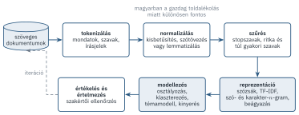
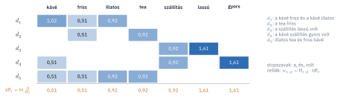
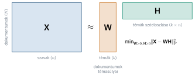
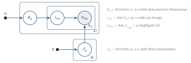

# Szövegbányászat {#sec-szoveg}

```{python}
#| include: false
import re
import numpy as np
import pandas as pd
import matplotlib.pyplot as plt
import adatbanyaszat as ab
ab.set_style()
pd.set_option("display.max_columns", 12)
pd.set_option("display.width", 110)
pd.set_option("display.max_colwidth", 90)
import warnings
warnings.filterwarnings("ignore")
```

::: {.roadmap}
A szervezetek adatainak jelentős része szöveg: vásárlói vélemények, panaszlevelek,
műszaknaplók, karbantartási jegyek, jelentések. A szövegbányászat ezekből nyer ki
strukturált, elemezhető információt. A fejezet a szöveg előfeldolgozásával kezdődik –
különös tekintettel a magyar nyelv sajátosságaira –, majd a vektortér-modellt és a
TF-IDF súlyozást, a szövegosztályozást, a szövegklaszterezést és a témamodelleket (LSA,
NMF, LDA), a disztribúciós szóbeágyazásokat, végül a kulcsszó- és mondatkinyerést
tárgyalja. A nagy nyelvi modellek a könyv keretein kívül esnek; az itt bemutatott
módszerek azonban ma is a gyors, átlátható és olcsó szövegelemzés alapjai, és a
nyelvi modellek értékelésének viszonyítási pontjai.

**A fejezet végére az olvasó** képes lesz egy magyar nyelvű szövegkorpuszt előfeldolgozni;
a dokumentum–szó mátrixot és a TF-IDF súlyokat kézzel és programmal kiszámítani;
szövegosztályozót építeni és értékelni; témamodellt illeszteni és értelmezni; és
megítélni, mikor érdemes szó-, illetve karakterszintű reprezentációt használni.
:::

## A szöveg mint adat {#sec-szoveg-adat}

A szövegbányászatban a vizsgált egység a **dokumentum** (egy vélemény, egy naplóbejegyzés,
egy e-mail), a dokumentumok összessége a **korpusz**. A dokumentumokat elemi egységekre,
**tokenekre** bontjuk – rendszerint szavakra, néha szórészletekre vagy karakterekre –, és a
modellek ezek előfordulásaiból dolgoznak ([-@fig-szoveg-folyamat]. ábra) [@manning2008].

{#fig-szoveg-folyamat width=100%}

Az előfeldolgozás tipikus lépései:

- **Tokenizálás**: a szöveg mondatokra és szavakra bontása; az írásjelek, számok,
  rövidítések kezelése.
- **Normalizálás**: kisbetűsítés, a szóalakok közös alakra hozása. A **szótövezés**
  (stemming) szabályokkal levágja a toldalékokat (az angol nyelvre a Porter-algoritmus
  [@porter1980] a klasszikus); a **lemmatizálás** morfológiai elemzéssel a szótári alakot
  állítja elő.
- **Szűrés**: a tartalmilag üres, nagyon gyakori **stopszavak** (névelők, kötőszavak) és a
  nagyon ritka szavak elhagyása. A feladattól függ, mi számít stopszónak: hangulatelemzésben
  a „nem” tagadószó például kulcsfontosságú.

A **magyar nyelv** agglutináló: a szavakhoz sok toldalék kapcsolódhat (*kávéfőzőnkkel*,
*szállításról*, *megérkezett*), és a szóösszetétel is gyakori. Ugyanannak a szónak ezért
sok alakja fordul elő, ami a szóalapú reprezentációkat ritkábbá és zajosabbá teszi, mint
angol nyelvű szövegeknél. A magyar nyelvre a HuSpaCy [@orosz2022; @orosz2023] ad korszerű,
nyílt forrású tokenizáló, lemmatizáló és szófaji címkéző eszközláncot. Egyszerű, nyelvfüggetlen
alternatíva a **karakter-$n$-gramok** használata: a szavakat átfedő, például 3–5 karakteres
részletekre bontjuk (*szállítás* → *szá, zál, áll, llí, lít, ítá, tás, …*), így a közös
tövű szóalakok sok közös jellemzőn osztoznak, és az elírások, ékezethiányok,
rövidítések sem okoznak teljes egyezéshiányt [@cavnar1994].

A szavak gyakoriságeloszlása rendkívül ferde: a **Zipf-törvény** [@zipf1949] szerint a
$r$-edik leggyakoribb szó gyakorisága közelítőleg $1/r$-rel arányos. Néhány szó
nagyon gyakori, a szókincs túlnyomó része viszont csak egyszer-kétszer fordul elő – ez a
szöveges adatok ritka (sparse) szerkezetének oka.

## A vektortér-modell {#sec-vektorter}

### Szózsák és TF-IDF

A legtöbb klasszikus módszer a **szózsák** (bag of words) modellre épül: a dokumentumot a
szavai előfordulási számának vektorával írjuk le, a szavak sorrendjét figyelmen kívül
hagyva. $N$ dokumentum és $n$ szavas szókincs esetén ez az $N\times n$-es
**dokumentum–szó mátrix**, amelynek elemei a $\mathrm{tf}_{t,d}$ gyakoriságok. A
mátrix rendkívül ritka: egy rövid vélemény a több ezer szavas szókincsből csak néhány
szót tartalmaz, ezért ritka mátrixként tároljuk.

A nyers gyakoriság a mindenütt előforduló szavakat túlsúlyozza. A **TF-IDF** súlyozás
[@sparckjones1972; @salton1988] a szó dokumentumon belüli gyakoriságát azzal szorozza,
mennyire ritka a szó a korpuszban:

$$
w_{t,d} = \mathrm{tf}_{t,d}\cdot\mathrm{idf}_t,\qquad
\mathrm{idf}_t = \ln\frac{N}{\mathrm{df}_t} ,
$$ {#eq-tfidf}

ahol $\mathrm{df}_t$ azon dokumentumok száma, amelyekben a $t$ szó előfordul. A minden
dokumentumban szereplő szó súlya nulla, a csak egy-két dokumentumban előfordulóé nagy. A
gyakorlatban számos változat létezik: logaritmikus tf ($1 + \ln\mathrm{tf}$), simított idf
(a `scikit-learn` alapértelmezése $\ln\frac{1+N}{1+\mathrm{df}_t} + 1$), és a dokumentumvektorok
egységnyi hosszra normálása.

### Koszinusz-hasonlóság

Két dokumentum hasonlóságát a vektoraik által bezárt szög koszinuszával mérjük:

$$
\cos(\mathbf{d}_i, \mathbf{d}_j) = \frac{\mathbf{d}_i^\top\mathbf{d}_j}{\lVert\mathbf{d}_i\rVert\,\lVert\mathbf{d}_j\rVert} .
$$ {#eq-koszinusz}

A koszinusz-hasonlóság független a dokumentumok hosszától (egy kétszer olyan hosszú,
ugyanolyan arányú szavakat tartalmazó dokumentum vektora azonos irányú), és nemnegatív
súlyoknál 0 és 1 közé esik. Egységnyi hosszra normált vektoroknál a koszinusz-hasonlóság a
skaláris szorzat, az euklideszi távolság négyzete pedig $2(1 - \cos)$, így a $k$-közép és
más euklideszi módszerek is alkalmazhatók.

### Kézi példa

A segédcsomag öt rövid dokumentumának dokumentum–szó mátrixa a stopszavak (*a, és, volt*)
elhagyása után a [-@fig-dtm]. ábrán látható. A *kávé* szó három dokumentumban fordul elő,
így $\mathrm{idf} = \ln(5/3) \approx 0{,}51$; az első dokumentumban kétszer szerepel, súlya
$2\cdot 0{,}51 = 1{,}02$. A csak egyszer előforduló *lassú* és *gyors* idf-je
$\ln 5 \approx 1{,}61$ – ezek a szavak jellemzik leginkább a saját dokumentumukat.

{#fig-dtm width=100%}

```{python}
docs = ab.mini.szoveg_mini()
stop = {"a", "és", "volt"}
tokenek = [[w for w in d.split() if w not in stop] for d in docs]
szokincs = ["kávé", "friss", "illatos", "tea", "szállítás", "lassú", "gyors"]
tf = np.array([[t.count(w) for w in szokincs] for t in tokenek], dtype=float)
idf = np.log(len(docs) / (tf > 0).sum(axis=0))
W = tf * idf
normalt = W / np.linalg.norm(W, axis=1, keepdims=True)
cos = normalt @ normalt.T
pd.DataFrame(cos, index=[f"d{i+1}" for i in range(5)], columns=[f"d{i+1}" for i in range(5)]).round(3)
```

A legnagyobb hasonlóság az első és az ötödik dokumentum között van (mindkettő friss,
illatos kávéról szól), a harmadik és a negyedik dokumentumot a *szállítás* szó köti
össze, a második és a harmadik dokumentumnak pedig nincs közös szava.

## Szövegosztályozás {#sec-szovegosztalyozas}

A szövegosztályozás – hangulatelemzés, levélszemét-szűrés, panaszok irányítása,
naplóbejegyzések hibatípus szerinti besorolása – a szöveges adatok egyik leggyakoribb
felhasználása. A TF-IDF vektorok nagy dimenziósak és ritkák, a dokumentumok száma ehhez
képest kicsi; ilyen helyzetben a lineáris modellek jól teljesítenek, és gyorsan
taníthatók [@joachims1998; @manning2008].

A **multinomiális naiv Bayes** [@mccallum1998] a dokumentumot a szavak független
húzásainak sorozataként modellezi. A [-@sec-bayes]. alfejezet osztályozójának ez a
szövegekre szabott változata:

$$
\hat c = \arg\max_c\;\Bigl[\ln P(c) + \sum_{t}\mathrm{tf}_{t,d}\ln P(t\mid c)\Bigr],\qquad
P(t\mid c) = \frac{N_{t,c} + 1}{\sum_{t'}N_{t',c} + n} ,
$$ {#eq-multinomialis-nb}

ahol $N_{t,c}$ a $t$ szó előfordulásainak száma a $c$ osztály tanítódokumentumaiban, és a
nevezőben a Laplace-simítás jelenik meg. A logisztikus regresszió
([-@sec-logreg]. alfejezet) és a lineáris SVM ([-@sec-svm]. alfejezet) a TF-IDF
jellemzőkön rendszerint pontosabb, és az együtthatóik közvetlenül megmutatják, mely szavak
szólnak egy-egy osztály mellett vagy ellen.

## Szövegklaszterezés és témamodellek {#sec-temamodellek}

A címkék nélküli korpuszok szerkezetének feltárására két megközelítés terjedt el. A
**szövegklaszterezés** minden dokumentumot egyetlen csoportba sorol, például a normált
TF-IDF vektorok $k$-közép klaszterezésével. A **témamodellek** ezzel szemben minden
dokumentumot több téma keverékeként írnak le, ahol a téma a szavak egy eloszlása – ez a
vegyes tartalmú szövegeknél (egy vélemény a termékről *és* a szállításról is szólhat)
természetesebb.

A **látens szemantikus elemzés** (LSA) [@deerwester1990] a TF-IDF mátrix csonkolt
szinguláris érték szerinti felbontása (B. függelék): $\mathbf{X}\approx\mathbf{U}_k
\boldsymbol\Sigma_k\mathbf{V}_k^\top$. A $k$ dimenziós látens térben az együtt előforduló
szavak – és az ilyen szavakat tartalmazó dokumentumok – közel kerülnek egymáshoz, ami a
szinonímia hatását is enyhíti. A látens dimenziók azonban negatív súlyokat is
tartalmaznak, ezért nehezen értelmezhetők.

A **nemnegatív mátrixfaktorizáció** (NMF) [@lee1999] a nemnegatív $\mathbf{X}$ mátrixot két
nemnegatív mátrix szorzatára bontja ([-@fig-nmf]. ábra):

$$
\min_{\mathbf{W}\ge 0,\;\mathbf{H}\ge 0}\;\lVert\mathbf{X} - \mathbf{W}\mathbf{H}\rVert_F^2 .
$$ {#eq-nmf}

A nemnegativitás miatt a dokumentumok a témák *additív* keverékei, és a $\mathbf{H}$
sorai – a témák szósúlyai – közvetlenül értelmezhetők: egy téma a legnagyobb súlyú
szavaival jellemezhető.

{#fig-nmf width=85%}

A **látens Dirichlet-allokáció** (LDA) [@blei2003] generatív valószínűségi modell
([-@fig-lda]. ábra). Feltételezi, hogy minden téma egy $\boldsymbol\beta_k$ szóeloszlás,
minden dokumentum egy $\boldsymbol\theta_d$ témaeloszlás, és a dokumentum minden szavát úgy
„írjuk le”, hogy előbb a $\boldsymbol\theta_d$ szerint témát, majd a téma szóeloszlása
szerint szót húzunk. A megfigyelt szavakból a rejtett téma- és szóeloszlásokat variációs
Bayes-módszerrel vagy Gibbs-mintavétellel becsüljük. A témák számát ($k$) mindhárom
módszernél nekünk kell megadnunk; a választást a témák értelmezhetősége, a
visszatartott dokumentumokon mért illeszkedés és a felhasználási cél együtt határozza meg.

{#fig-lda width=100%}

## Szóbeágyazások {#sec-beagyazas}

A szózsákmodellben minden szó külön dimenzió: a *drága* és a *túlárazott* ugyanolyan
távol van egymástól, mint a *drága* és a *futár*. A **disztribúciós hipotézis**
[@harris1954] szerint a hasonló jelentésű szavak hasonló környezetben fordulnak elő; erre
épülnek a **szóbeágyazások**, amelyek minden szót egy sűrű, néhány száz dimenziós
vektorral írnak le úgy, hogy a hasonló környezetű szavak vektorai közel legyenek.

Klasszikus változatuk a szó–környezet együttelőfordulási mátrixból indul. A
**pozitív pontonkénti kölcsönös információ** (PPMI) azt méri, mennyivel gyakrabban fordul
elő együtt két szó, mint függetlenség esetén:

$$
\mathrm{PPMI}(w, c) = \max\Bigl(0,\; \ln\frac{P(w, c)}{P(w)\,P(c)}\Bigr) ,
$$ {#eq-ppmi}

és a PPMI-mátrix csonkolt SVD-je adja a beágyazást. A **word2vec** [@mikolov2013] egy
sekély neurális hálózattal, a szavak környezetének előrejelzésével tanulja a vektorokat;
@levy2014 megmutatta, hogy negatív mintavétellel ez lényegében egy eltolt PMI-mátrix
implicit faktorizációja – a két megközelítés tehát közeli rokon. A szóbeágyazások
nagy korpuszt igényelnek; előre tanított magyar vektorok nyilvánosan elérhetők, és a
HuSpaCy modelljei is tartalmaznak ilyeneket. A szövegkörnyezettől függő
(kontextuális) reprezentációk – a transzformer alapú nyelvi modellek – már túlmutatnak a
könyv keretein.

## Kulcsszavak és összefoglalás {#sec-kinyeres}

A **kulcsszó-kinyerés** legegyszerűbb módja a dokumentum (vagy dokumentumcsoport)
legnagyobb TF-IDF súlyú szavainak kiválasztása. A **TextRank** [@mihalcea2004] gráfalapú
módszer: a szavakat (kulcsszó-kinyeréshez) vagy a mondatokat (kivonatoló
összefoglaláshoz) egy gráf csúcsaiként, a hasonlóságukat élsúlyként kezeli, és a
csúcsok fontosságát a PageRank-algoritmushoz hasonlóan, iteratívan számolja:

$$
S(v_i) = (1 - d) + d\sum_{v_j\in\mathrm{Be}(v_i)}\frac{w_{ji}}{\sum_{v_k\in\mathrm{Ki}(v_j)}w_{jk}}\,S(v_j),
\qquad d = 0{,}85 .
$$ {#eq-textrank}

Egy mondat annál fontosabb, minél több más fontos mondathoz hasonlít; a legmagasabb
pontszámú mondatok együtt a szöveg(csoport) „legjellemzőbb” kivonatát adják. A
kivonatoló összefoglalás mindig a forrás mondatait adja vissza, ezért nem „talál ki”
új állításokat – ez a megbízhatóság szempontjából előny.

## Gyakorlat: vásárlói vélemények és műszaknapló {#sec-szoveg-gyakorlat}

### A vélemények előfeldolgozása és szókincse

::: {.eset-uzleti}
A PannonShop 3000 vásárlói véleményt gyűjtött; mindegyikhez csillagos értékelés is
tartozik, amelyből hangulatcímkét képzünk (4–5 csillag: pozitív, 3: semleges, 1–2:
negatív). A cél kettős: egyrészt egy osztályozó, amely a csillag nélküli szöveges
visszajelzéseket (e-maileket, közösségi bejegyzéseket) is hangulat szerint tudja
besorolni, másrészt annak feltárása, miről szólnak a vélemények.
:::

```{python}
r = ab.load_shop().reviews
print(r.Hangulat.value_counts().to_dict())
r[["Csillag", "Szoveg"]].sample(5, random_state=3)
```

```{python}
STOP = set("a az és is de hogy volt vagyok mint egy meg már csak még ez azt ami amit".split())

def tokenizal(szoveg):
    """Kisbetűsítés, szavakra bontás és stopszószűrés (a "nem" tagadószót megtartjuk)."""
    return [w for w in re.findall(r"[a-záéíóöőúüű]+", szoveg.lower()) if w not in STOP and len(w) > 1]

from collections import Counter
gyak = Counter(w for t in r.Szoveg for w in tokenizal(t))
print(f"{sum(gyak.values())} szóelőfordulás, {len(gyak)} különböző szó (a szimulált korpusz sablonos, ezért szűk a szókincse); "
      f"a 10 leggyakoribb: {', '.join(w for w, _ in gyak.most_common(10))}")
```

```{python}
#| label: fig-zipf
#| fig-cap: "A vélemények szógyakoriságai a rangszám függvényében, log–log skálán. A szaggatott vonal az $1/r$-rel arányos Zipf-törvény. A sablonos, kis szókincsű korpuszban az eloszlás vége gyorsabban esik, mint a természetes szövegekben."
#| fig-width: 5
#| fig-height: 3
f = np.array(sorted(gyak.values(), reverse=True))
rang = np.arange(1, len(f) + 1)
fig, ax = plt.subplots()
ax.loglog(rang, f, color=ab.PALETTE[0], lw=1.5, label="megfigyelt")
ax.loglog(rang, f[0] / rang, color=ab.PALETTE[1], ls="--", lw=1.2, label="$\\propto 1/r$")
ax.set_xlabel("rangszám $r$"); ax.set_ylabel("gyakoriság"); ax.legend()
fig.tight_layout()
```

### Hangulatosztályozás

Három reprezentációt (szó-unigramok, szó-uni- és bigramok, karakter-3–5-gramok) és három
osztályozót (multinomiális naiv Bayes, logisztikus regresszió, lineáris SVM) hasonlítunk
össze rétegzett ötszörös keresztvalidációval. Mivel a három osztály aránya eltérő, a
makró-F1 értéket (az osztályonkénti F1 értékek átlagát) használjuk.

```{python}
from sklearn.feature_extraction.text import TfidfVectorizer, CountVectorizer
from sklearn.naive_bayes import MultinomialNB
from sklearn.linear_model import LogisticRegression
from sklearn.svm import LinearSVC
from sklearn.pipeline import make_pipeline
from sklearn.model_selection import StratifiedKFold, cross_val_score

X, y = r.Szoveg, r.Hangulat
cv = StratifiedKFold(n_splits=5, shuffle=True, random_state=0)
reprezentaciok = {
    "szó (1)": lambda: TfidfVectorizer(tokenizer=tokenizal, token_pattern=None, min_df=2),
    "szó (1–2)": lambda: TfidfVectorizer(tokenizer=tokenizal, token_pattern=None, ngram_range=(1, 2), min_df=2),
    "karakter (3–5)": lambda: TfidfVectorizer(analyzer="char_wb", ngram_range=(3, 5), min_df=2),
}
osztalyozok = {"naiv Bayes": lambda: MultinomialNB(),
               "logisztikus regresszió": lambda: LogisticRegression(max_iter=3000, C=5),
               "lineáris SVM": lambda: LinearSVC(C=0.5)}
pd.DataFrame({onev: {rnev: cross_val_score(make_pipeline(rep(), osz()), X, y, cv=cv, scoring="f1_macro").mean()
                     for rnev, rep in reprezentaciok.items()} for onev, osz in osztalyozok.items()}).round(3)
```

A lineáris modellek a naiv Bayesnél pontosabbak, a három reprezentáció között viszont
nincs érdemi különbség: ebben a gondosan megfogalmazott, helyesen írt korpuszban a
szóalapú reprezentáció is jól működik. Melyik osztályt tévesztik leginkább, és mely szavak
alapján dönt a modell?

```{python}
from sklearn.model_selection import train_test_split
from sklearn.metrics import classification_report
Xtr, Xte, ytr, yte = train_test_split(X, y, test_size=0.3, stratify=y, random_state=0)
vec = TfidfVectorizer(tokenizer=tokenizal, token_pattern=None, min_df=2)
lr = LogisticRegression(max_iter=3000, C=5).fit(vec.fit_transform(Xtr), ytr)
print(classification_report(yte, lr.predict(vec.transform(Xte)), digits=3))
szavak = np.array(vec.get_feature_names_out())
pd.DataFrame({c: szavak[np.argsort(-lr.coef_[i])[:8]] for i, c in enumerate(lr.classes_)})
```

::: {.eset-uzleti}
A semleges osztály a legnehezebb: a háromcsillagos vélemények vegyes tartalmúak – dicsérik
az árat, de panaszkodnak a szállításra –, és a csillagszám maga is zajos címke. A
legfontosabb szavak jól értelmezhetők: a pozitív osztály mellett a lelkes zárómondatok és a
minőséget dicsérő szavak, a negatív mellett a csalódást, a meghibásodást és a
„nem ajánlom” típusú kifejezéseket jelző szavak szólnak. Az együtthatók vizsgálata
egyben ellenőrzés is – és itt rögtön talál is valamit: a semleges osztály mellett
terméknevek (*turmixgép*, *vágódeszka*, *kenyérpirító*) is nagy súlyt kapnak. Ezeknek a
termékeknek a minősége közepes, ezért a véleményeik gyakrabban semlegesek; a modell tehát
részben a termékre, nem a szöveg hangulatára tanult rá. Egy új termékcsaládra ez a
tudás nem általánosítható, ezért a terméknevek kiszűrése vagy helyettesítése (például egy
közös *TERMÉK* jelölővel) indokolt lehet.
:::

### Miről szólnak a vélemények? Témák mondatszinten

Egy vélemény jellemzően több szempontot érint (a termék minőségét, a szállítást, az árat,
az ügyfélszolgálatot), ezért a témákat mondatszinten keressük, NMF-fel.

```{python}
from sklearn.decomposition import NMF
mondatok = [m.strip() for t in r.Szoveg for m in re.split(r"(?<=[.!?])\s+", t) if m.strip()]
STOP_T = STOP - {"nem"}
tok_t = lambda s: [w for w in re.findall(r"[a-záéíóöőúüű]+", s.lower()) if w not in STOP_T and len(w) > 1]
vec_t = TfidfVectorizer(tokenizer=tok_t, token_pattern=None, min_df=5, max_df=0.3)
M = vec_t.fit_transform(mondatok)
nmf = NMF(n_components=8, init="nndsvda", random_state=0, max_iter=800).fit(M)
voc = np.array(vec_t.get_feature_names_out())
print(f"{len(mondatok)} mondat, {M.shape[1]} szó")
pd.DataFrame({f"{k + 1}. téma": voc[np.argsort(-c)[:7]] for k, c in enumerate(nmf.components_)}).T \
  .apply(lambda s: ", ".join(s), axis=1).rename("legnagyobb súlyú szavak").to_frame()
```

::: {.eset-uzleti}
A témák többsége egyértelműen azonosítható szemponthoz köthető: a szállítás gyorsasága
és késése, a futár, a csomagolás és a sérült doboz, az ár („drága”, „olcsó”, „megéri”),
a tartósság, illetve az ajánló vagy elutasító zárómondatok. Néhány téma keveredik – az NMF
a gyakran együtt előforduló mondatrészleteket is egy témába vonhatja –, ezért a témák
elnevezése és szükség esetén összevonása szakértői feladat. A témasúlyok
($\mathbf{W}$ mátrix) alapján ezután például az is követhető, hogyan változik a
szállítási panaszok aránya hónapról hónapra.
:::

### Szóbeágyazás PPMI-mátrixból

```{python}
from sklearn.preprocessing import normalize
cv1 = CountVectorizer(tokenizer=tok_t, token_pattern=None, min_df=5, binary=True)
B = cv1.fit_transform(mondatok)                    # mondat–szó előfordulás (a környezet: a mondat)
v = np.array(cv1.get_feature_names_out())
C = (B.T @ B).toarray().astype(float)
np.fill_diagonal(C, 0)
osszes = C.sum()
p_w = C.sum(axis=1) / osszes
with np.errstate(divide="ignore"):
    pmi = np.log((C / osszes) / np.outer(p_w, p_w))
ppmi = np.where(np.isfinite(pmi) & (pmi > 0), pmi, 0.0)
U, S, _ = np.linalg.svd(ppmi)
E = normalize(U[:, :30] * np.sqrt(S[:30]))         # 30 dimenziós beágyazás
def szomszedok(szo, k=5):
    i = int(np.flatnonzero(v == szo)[0])
    h = E @ E[i]
    legkozelebbi = [j for j in np.argsort(-h) if j != i][:k]
    return ", ".join(f"{v[j]} ({h[j]:.2f})" for j in legkozelebbi)
pd.Series({w: szomszedok(w) for w in ["szállítás", "drága", "kávéfőző", "futár"]},
          name="legközelebbi szavak (koszinusz)").to_frame()
```

A beágyazás jól mutatja a disztribúciós reprezentációk két arcát. A *drága* legközelebbi
szomszédai között az *olcsó* is ott van – az ellentétes jelentésű szavak hasonló
környezetben fordulnak elő, ezért a disztribúciós hasonlóság nem azonos a
szinonímiával –, a *kávéfőző* szomszédai pedig más terméknevek, vagyis a beágyazás a
szavak „szerepét” is megtanulta. Másrészt ebben a kis, sablonos korpuszban az ugyanabban a
mondatfordulatban szereplő szavak szinte azonos vektort kapnak: valódi jelentésbeli
hasonlóságok tanulásához sokkal nagyobb és változatosabb korpusz kell.

### A panaszok kivonatoló összefoglalása

```{python}
import networkx as nx
negativ = [m for t in r.loc[r.Hangulat == "negatív", "Szoveg"] for m in re.split(r"(?<=[.!?])\s+", t) if m.strip()]
egyedi = pd.Series(negativ).value_counts()
mondat_lista = egyedi.index.tolist()
V = TfidfVectorizer(analyzer="char_wb", ngram_range=(3, 5)).fit_transform(mondat_lista)
S_hasonl = (V @ V.T).toarray()
np.fill_diagonal(S_hasonl, 0)
G = nx.from_numpy_array(S_hasonl * egyedi.to_numpy()[None, :])   # a gyakori mondatok súlyosabbak
pr = nx.pagerank(G, alpha=0.85, weight="weight")
legjobb = sorted(pr, key=pr.get, reverse=True)[:5]
pd.DataFrame({"mondat": [mondat_lista[i] for i in legjobb], "előfordulás": [egyedi.iloc[i] for i in legjobb],
              "TextRank-pontszám": [round(pr[i], 4) for i in legjobb]})
```

::: {.eset-uzleti}
A legmagasabb pontszámot az elutasító zárómondatok kapják – ezek a negatív vélemények
közös, leggyakoribb elemei –, utánuk semleges szállítási és árral kapcsolatos mondatok,
majd egy minőségi kifogás következik. A TextRank a legközpontibb, a többihez leginkább
hasonló mondatokat emeli ki, amelyek nem feltétlenül a leginformatívabbak. A gyakorlatban
ezért a kivonatot szűrik (például a zárómondatokat vagy a semleges hangulatú mondatokat
kizárva), vagy témánként – a fenti NMF-témák szerint csoportosítva – készítik el. Mivel a
módszer a forrás mondatait idézi, a kivonat minden állítása visszakereshető.
:::

### Szakmai szöveg: a műszaknapló

::: {.eset-mernoki}
A Pannon üzem kezelői minden műszakban rövid, szabad szöveges bejegyzéseket írnak a
műszaknaplóba. A bejegyzések stílusa tipikus: rövidítések (HV = hűtővíz, betáp, konc.),
elírások, hiányzó ékezetek. A szakmai szövegek (karbantartási jegyek, műszaknaplók)
elemzése külön kihívás, mert a nyelvi eszközláncokat általános szövegekre fejlesztették;
erre a problémára a szakirodalom a *technikai nyelvfeldolgozás* (technical language
processing) elnevezést használja [@brundage2021].
:::

```{python}
naplo = ab.load_shift_log()
print(f"{len(naplo)} bejegyzés; esemény szerinti megoszlás (csak az értékeléshez): {naplo.esemeny.value_counts().to_dict()}")
naplo[["ido", "muszak", "szoveg"]].sample(6, random_state=5)
```

Első feladatként keressük meg a szelep akadozására utaló bejegyzéseket egy rövid
keresőkifejezés alapján! Az egyik változat szavakra, a másik karakter-$n$-gramokra épül.

```{python}
kerdes = "szelep akad"
eredm = {}
for nev, vec in [("szó", TfidfVectorizer()), ("karakter (2–4)", TfidfVectorizer(analyzer="char_wb", ngram_range=(2, 4)))]:
    Xn = vec.fit_transform(naplo.szoveg)
    h = (Xn @ vec.transform([kerdes]).T).toarray().ravel()
    talalat = np.argsort(-h)[:10]
    eredm[nev] = {"találatok (első 10)": ", ".join(naplo.esemeny.iloc[talalat].str.replace("szelep_akadas", "SZELEP")),
                  "pontosság@10": (naplo.esemeny.iloc[talalat] == "szelep_akadas").mean()}
pd.DataFrame(eredm).T
```

Második feladatként az első félév bejegyzéseit – amelyeket utólag, a hibajegyek alapján
eseménytípus szerint felcímkéztek – tanítóhalmaznak használjuk, és a második félév
bejegyzéseit soroljuk be automatikusan.

```{python}
from sklearn.metrics import f1_score
tanit = (naplo.ido < "2025-07-01").to_numpy()
sor = {}
for nev, vec in [("szó", TfidfVectorizer()), ("karakter (2–4)", TfidfVectorizer(analyzer="char_wb", ngram_range=(2, 4)))]:
    Xn = vec.fit_transform(naplo.szoveg)
    pred = LinearSVC(C=1.0, class_weight="balanced").fit(Xn[tanit], naplo.esemeny[tanit]).predict(Xn[~tanit])
    valos = naplo.esemeny[~tanit].to_numpy()
    sor[nev] = {"makró-F1": f1_score(valos, pred, average="macro")}
    sor[nev].update({c: np.mean(pred[valos == c] == c) for c in ["hutoviz_kieses", "szelep_akadas", "betap_zavar", "szenzor_drift", "tisztitas"]})
pd.DataFrame(sor).T.round(2).rename_axis("2. félév (felidézés)")
```

Végül vizsgáljuk meg, felismerhetők-e címkék nélkül az eseménytípusok: a rutinbejegyzések
kiszűrése után klaszterezzük a rendkívüli bejegyzéseket!

```{python}
from sklearn.cluster import KMeans
from sklearn.metrics import adjusted_rand_score
rendkivuli = naplo[naplo.esemeny != "rutin"].reset_index(drop=True)
sor = {}
for nev, vec in [("szó", TfidfVectorizer()), ("karakter (3–5)", TfidfVectorizer(analyzer="char_wb", ngram_range=(3, 5)))]:
    Xr = vec.fit_transform(rendkivuli.szoveg)
    cimke = KMeans(n_clusters=5, n_init=50, random_state=0).fit_predict(Xr)
    sor[nev] = adjusted_rand_score(rendkivuli.esemeny, cimke)
pd.Series(sor, name="korrigált Rand-index").round(3).to_frame()
```

::: {.eset-mernoki}
A szakmai, „zajos” szövegeken a karakter-$n$-gramok előnye egyértelmű: a keresés és az
osztályozás is jobb velük, mert az ékezet nélküli és a rövidített alakok (*hutoviz* –
*hűtővíz*, *betap* – *betáplálás*) is sok közös jellemzőn osztoznak. A címke nélküli
klaszterezés ezzel szemben a karakter-$n$-gramokkal is csak részben adja vissza az
eseménytípusokat: a rövid bejegyzések kevés szót tartalmaznak, és ugyanazt a jelenséget a
kezelők sokféleképpen írják le. A gyakorlatban ezért a két megközelítést kombinálják: a
klaszterezés a szakértői címkézést segíti, a felcímkézett adatokon tanított osztályozó
pedig a további bejegyzéseket sorolja be. A naplóbejegyzések és a [-@sec-anomalia]. fejezet
riasztásai együtt adnak teljes képet egy üzemzavarról – ezt a [-@sec-folyamat]. fejezetben
hasznosítjuk.
:::





## Összefoglalás {#sec-szoveg-osszefoglalas}

- A szövegbányászat a szöveget tokenekre bontja, normalizálja és szűri; a magyar nyelv gazdag
  toldalékolása miatt a lemmatizálás vagy a karakter-$n$-gramok használata különösen fontos.
- A vektortér-modellben a dokumentumokat TF-IDF súlyozású, ritka vektorok írják le;
  hasonlóságukat a koszinusz méri.
- A szövegosztályozásban a lineáris modellek (logisztikus regresszió, lineáris SVM) erős,
  értelmezhető alapmódszerek; a multinomiális naiv Bayes gyors viszonyítási alap.
- A témamodellek (LSA, NMF, LDA) a dokumentumokat témák keverékeként írják le; a témák
  értelmezése és elnevezése szakértői feladat.
- A szóbeágyazások a disztribúciós hipotézisre épülnek; a PPMI-mátrix SVD-je és a word2vec
  közeli rokonok.
- A TextRank gráfalapú kivonatoló összefoglalást ad, amely a forrás mondatait idézi.
- A szakmai, zajos szövegeken (naplók, karbantartási jegyek) a karakterszintű
  reprezentációk robusztusabbak.

## Ellenőrző kérdések {.unnumbered}

1. Miért nulla a minden dokumentumban előforduló szavak TF-IDF súlya?
2. Miért független a koszinusz-hasonlóság a dokumentumok hosszától?
3. Mi a különbség a szótövezés és a lemmatizálás között, és miért fontos ez a magyar
   nyelvben?
4. Miért lehet hasznos megtartani a „nem” szót a stopszavak szűrésekor?
5. Miben különbözik a szövegklaszterezés és a témamodellezés kimenete?
6. Miért kerülhetnek közel egymáshoz az ellentétes jelentésű szavak egy disztribúciós
   beágyazásban?
7. Milyen előnye van a kivonatoló összefoglalásnak a megfogalmazó (absztraktív)
   összefoglalással szemben?

## Feladatok {.unnumbered}

1. **Kézi TF-IDF.** Számítsa ki kézzel a kézi példa második és ötödik dokumentumának
   koszinusz-hasonlóságát! Hogyan változik az eredmény, ha a `scikit-learn` simított idf-jét
   használjuk?
2. **Tagadás.** Készítsen olyan reprezentációt, amely a „nem” szót a következő szóval
   összevonja (*nem_ajánlom*)! Javul-e a negatív osztály felismerése?
3. **Témaszám.** Illesszen NMF-et és LDA-t $k = 4, 6, 8, 10, 12$ témával a mondatokra, és
   értékelje a témák értelmezhetőségét! Melyik $k$ mellett különül el legjobban a szállítás,
   az ár és az ügyfélszolgálat?
4. **Termékszintű elemzés.** Számítsa ki termékenként a negatív vélemények arányát és a
   minőségi panaszok témasúlyát! Összhangban van-e a két mérőszám?
5. **Napló és riasztások.** Kapcsolja össze a műszaknapló bejegyzéseit a [-@sec-anomalia].
   fejezet riasztásaival (a bejegyzés előtti 2 órában fellépő riasztások)! Mely
   riasztástípusok járnak együtt az egyes bejegyzéstípusokkal?

## További olvasmányok {.unnumbered}

A szöveges információkeresés és -osztályozás klasszikus tankönyve @manning2008. A
témamodellek alapcikkei @deerwester1990, @lee1999 és @blei2003; a szóbeágyazásokról
@mikolov2013 és @levy2014 ajánlott. A magyar nyelvű szövegfeldolgozás eszközeit
@orosz2023 mutatja be; a szakmai szövegek elemzésének sajátosságairól @brundage2021 ad
áttekintést.
