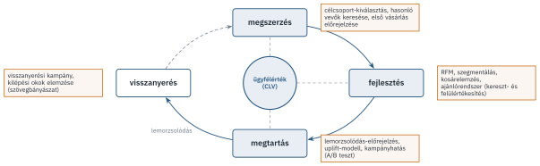
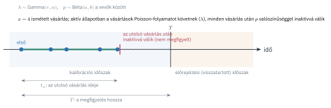
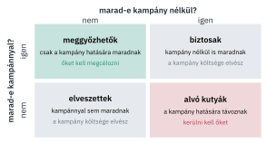

# Ügyfélkapcsolat-menedzsment és ügyfélanalitika {#sec-ugyfel}

```{python}
#| include: false
import numpy as np
import pandas as pd
import matplotlib.pyplot as plt
import adatbanyaszat as ab
ab.set_style()
pd.set_option("display.max_columns", 12)
pd.set_option("display.width", 110)
import warnings
warnings.filterwarnings("ignore")
```

::: {.roadmap}
Az ügyfélkapcsolat-menedzsment (customer relationship management, CRM) az
adatbányászat egyik legrégebbi és legnagyobb alkalmazási területe. Ez a fejezet az
eddigi módszereket – szegmentálás, asszociációs szabályok, osztályozás, értékelés –
egy egységes üzleti keretbe illeszti: a vevői életciklus szakaszaihoz rendeli őket, és
olyan új eszközökkel egészíti ki, amelyek kifejezetten az ügyfélanalitika kérdéseire
válaszolnak. Ezek az RFM-elemzés, az ügyfélérték (CLV) valószínűségi modellezése, az
ajánlórendszerek, valamint a kampányok valódi, oksági hatását mérő A/B tesztek és
uplift-modellek. A fejezet végén az ügyféladatok elemzésének jogi és etikai kereteit
foglaljuk össze.

**A fejezet végére az olvasó** képes lesz RFM-pontszámokat és -szegmenseket képezni; a
BG/NBD és a gamma–gamma modellt illeszteni és az ügyfélértéket előre jelezni; egyszerű
kollaboratív szűrést megvalósítani és népszerűségi viszonyítási alappal összevetni; egy
randomizált kampánykísérletet kiértékelni; és megérteni, miért a kampány hatására
reagáló, nem pedig a legnagyobb kockázatú vevőket kell megcélozni.
:::

## A vevői életciklus és az analitika {#sec-crm-eletciklus}

A CRM stratégiai keretrendszere [@payne2005; @kumar2018] a vevőkapcsolatot
életciklusként írja le ([-@fig-eletciklus]. ábra): a vevőt meg kell szerezni, a kapcsolatot
fejleszteni (több és értékesebb vásárlás), a vevőt megtartani, és ha mégis távozik,
esetleg visszanyerni. Minden szakaszhoz jellegzetes elemzési feladatok tartoznak
[@ngai2009], és mindegyik döntés közös mércéje az **ügyfélérték**: az a jövőbeli
nyereség, amelyet a vevő a kapcsolat során várhatóan termel.

{#fig-eletciklus width=100%}

Az ügyfélanalitika adatai jellemzően tranzakciós adatok (a [-@sec-adattarhaz]. fejezet
értékesítési ténytáblája), kiegészítve a vevők jellemzőivel, az interakciós adatokkal
(webes viselkedés, kampányreakciók, ügyfélszolgálati megkeresések) és a szöveges
visszajelzésekkel ([-@sec-szoveg]. fejezet). Az ilyen adatok személyes adatok, ezért
kezelésüket a GDPR szabályozza ([-@sec-ugyfel-etika]. alfejezet).

## RFM-elemzés és szegmentálás {#sec-rfm}

Az **RFM-elemzés** [@hughes1994] a vevők vásárlási viselkedését három mutatóval írja le:
mennyi ideje vásárolt utoljára (*recency*), milyen gyakran vásárol (*frequency*) és mennyit
költ (*monetary*). A három mutató egyszerű, könnyen kommunikálható, és sok vizsgálat
szerint a jövőbeli viselkedés legerősebb előrejelzői közé tartozik – ezt láttuk a
[-@sec-osztalyozas]. fejezet lemorzsolódási modelljeiben is. A klasszikus eljárás minden
mutatót kvintilisekre bont (1–5 pont, ahol 5 a legjobb: a legutóbbi, leggyakoribb,
legnagyobb értékű vásárlás), és a pontkombinációk alapján nevesített szegmenseket képez,
például „bajnokok” (magas R és F), „veszélyeztetettek” (korábban gyakori, de régóta nem
vásárló vevők) vagy „alvók” (alacsony R és F). Rugalmasabb a [-@sec-csoportositas]. fejezet
klaszterezési módszereivel, az RFM- és egyéb viselkedési jellemzők alapján képzett
szegmentálás – ezt a PannonShop vevőin ott már elvégeztük.

Az RFM korlátja, hogy pillanatfelvétel: nem mondja meg, mennyi a vevő *jövőbeli*
értéke, és nem veszi figyelembe, hogy egy ritkán vásárló vevőnél egy hosszabb szünet
teljesen normális lehet, egy gyakorinál viszont a távozás jele. Erre adnak választ a
következő alfejezet valószínűségi modelljei.

## Az ügyfélérték modellezése {#sec-clv}

### Az ügyfélérték fogalma

Az **ügyfélérték** (customer lifetime value, CLV) a vevőtől várható jövőbeli
nyereségáramok jelenértéke [@gupta2006]:

$$
\mathrm{CLV} = \sum_{t=1}^{H}\frac{m_t\,s_t}{(1 + d)^t} ,
$$ {#eq-clv}

ahol $m_t$ a $t$-edik időszakban várható fedezet (nyereség), $s_t$ annak valószínűsége,
hogy a vevő a $t$-edik időszakban még aktív, $d$ a diszkontráta, $H$ a horizont. Állandó
$m$ fedezet és $r$ megtartási ráta mellett végtelen horizonton $s_t = r^t$, és a képlet a
$\mathrm{CLV} = m\,r/(1 + d - r)$ zárt alakra egyszerűsödik. Ez a „szerződéses” helyzetben
(előfizetések, ahol a lemorzsolódás megfigyelhető) jó közelítés. A webáruházak vevői
azonban **nem szerződéses** kapcsolatban állnak a céggel: a távozás nem figyelhető meg
közvetlenül, csak az, hogy a vevő egy ideje nem vásárolt. Ilyenkor a „még vásárol-e”
kérdést valószínűségi modellel kell megválaszolni.

### A BG/NBD modell

A „buy till you die” (BTYD) modellcsalád [@schmittlein1987; @fader2005] azt feltételezi,
hogy a vevő egy ideig aktív, ezalatt véletlenszerűen vásárol, majd egy nem megfigyelhető
időpontban végleg inaktívvá válik ([-@fig-btyd]. ábra). A **BG/NBD** modell
[@fader2005] feltevései:

1. Aktív állapotban a vevő vásárlásai $\lambda$ intenzitású Poisson-folyamatot követnek.
2. A $\lambda$ a vevők között $\mathrm{Gamma}(r, \alpha)$ eloszlású (heterogenitás a
   vásárlási gyakoriságban).
3. Minden vásárlás után a vevő $p$ valószínűséggel inaktívvá válik.
4. A $p$ a vevők között $\mathrm{Béta}(a, b)$ eloszlású (heterogenitás a hűségben).
5. A $\lambda$ és a $p$ egymástól független.

{#fig-btyd width=100%}

A modell figyelemre méltó tulajdonsága, hogy egy vevő teljes vásárlási története helyett
elegendő három szám: az ismételt vásárlások száma ($x$), az utolsó vásárlás ideje az első
óta ($t_x$) és a megfigyelés hossza ($T$) – lényegében az RFM-mutatók. A vevő
likelihoodja

$$
L(r, \alpha, a, b\mid x, t_x, T) = \frac{B(a, b + x)}{B(a, b)}\,\frac{\Gamma(r + x)\,\alpha^r}{\Gamma(r)\,(\alpha + T)^{r + x}}
+ \delta_{x>0}\,\frac{B(a + 1, b + x - 1)}{B(a, b)}\,\frac{\Gamma(r + x)\,\alpha^r}{\Gamma(r)\,(\alpha + t_x)^{r + x}} ,
$$ {#eq-bgnbd}

ahol $B$ a béta-, $\Gamma$ a gammafüggvény, $\delta_{x>0}$ pedig 1, ha volt ismételt
vásárlás. Az első tag annak felel meg, hogy a vevő a megfigyelés végén még aktív, a
második annak, hogy az utolsó vásárlása után inaktívvá vált. A négy paramétert a vevők
log-likelihoodjainak összegét maximalizálva becsüljük, és a modellből zárt alakban
számolható annak valószínűsége, hogy a vevő még aktív,

$$
P(\text{aktív}\mid x, t_x, T) = \Biggl[1 + \delta_{x>0}\,\frac{a}{b + x - 1}\Bigl(\frac{\alpha + T}{\alpha + t_x}\Bigr)^{r + x}\Biggr]^{-1} ,
$$ {#eq-p-aktiv}

valamint a következő $t$ időegységben várható vásárlások száma (lásd a gyakorlatot). Az
([-@eq-p-aktiv]) képlet formalizálja az RFM intuícióját: a $T - t_x$ inaktív idő annál
inkább a távozás jele, minél gyakrabban vásárolt korábban a vevő (nagy $x$).

A vásárlások *értékét* a **gamma–gamma modell** [@fader2005jmr] írja le: a vevő
tranzakcióinak értéke a vevőre jellemző átlag körül gamma-eloszlású, és ez az átlag a vevők
között szintén gamma-eloszlású. A modellből a vevő várható átlagos vásárlási értéke a
populációs átlag és a vevő saját megfigyelt átlaga ($\bar z$) közötti súlyozott átlag:

$$
E[Z\mid\bar z, n] = \frac{q - 1}{pn + q - 1}\cdot\frac{\gamma p}{q - 1} + \frac{pn}{pn + q - 1}\,\bar z ,
$$ {#eq-gamma-gamma}

ahol $n$ a vevő tranzakcióinak száma, $p, q, \gamma$ a modell paraméterei. Kevés
tranzakció esetén a becslés a populációs átlag felé húzódik (zsugorítás), sok tranzakció
esetén a vevő saját átlaga dominál. A modell feltételezi, hogy a vásárlások értéke
független a gyakoriságuktól – ezt az adatokon ellenőrizni kell.

::: {.eset-mernoki}
A BTYD-modellek logikája – egy rejtett „aktív/inaktív” állapot, amelyről csak a
megfigyelt események alapján következtethetünk – a mérnöki megbízhatóság-elmélet
modelljeire emlékeztet, ahol egy berendezés rejtett állapotára a meghibásodásokból és a
karbantartási eseményekből következtetünk. A [-@sec-folyamat]. fejezetben a berendezések
állapotfüggő karbantartásánál hasonló gondolatmenettel találkozunk.
:::

## Ajánlórendszerek {#sec-ajanlo}

A kapcsolat fejlesztésének fő eszköze a **kereszt- és felülértékesítés**: olyan termékek
ajánlása, amelyek a vevőt valószínűleg érdeklik. A [-@sec-asszociacio]. fejezet
asszociációs szabályai („aki kávéfőzőt vesz, az kávébabot is”) az ajánlás legegyszerűbb
formái; az **ajánlórendszerek** ennél általánosabbak, és minden vevőnek személyre szabott
listát adnak [@aggarwal2016rec].

A **kollaboratív szűrés** a vevők közös vásárlási mintázataiból tanul. A *felhasználóalapú*
változat a vevőhöz leginkább hasonló vevőket (szomszédokat) keresi meg, és azokat a
termékeket ajánlja, amelyeket a szomszédok vettek, ő még nem. A *tételalapú* változat
[@sarwar2001; @linden2003] a termékek hasonlóságát számolja ki a közös vásárlók alapján,
és a vevő korábbi vásárlásaihoz hasonló termékeket ajánl; nagy vevőszámnál ez
hatékonyabb, mert a termék–termék hasonlósági mátrix kisebb és stabilabb. A vevő–termék
mátrix bináris (vásárolt-e) vagy értékelési adatokat tartalmaz; a hasonlóság rendszerint
koszinusz-hasonlóság ([-@eq-koszinusz]). A **mátrixfaktorizációs** módszerek [@koren2009]
a vevőket és a termékeket egy közös, alacsony dimenziós látens térbe képezik – ez a
[-@sec-szoveg]. fejezet NMF- és LSA-módszereinek közeli rokona.

Az ajánlórendszerek értékelése a jövőbeli vásárlások visszatartásával történik: a
modellt egy korábbi időszakon tanítjuk, és azt mérjük, hogy a későbbi időszakban
ténylegesen megvásárolt termékek közül hány szerepel az ajánlólista első $K$ helyén
(találati arány, precision@$K$, recall@$K$) [@herlocker2004]. Mindig érdemes egy
egyszerű népszerűségi ajánlóval (mindenkinek a legnépszerűbb, még meg nem vásárolt
termékeket ajánlja) összevetni: kis termékválaszték mellett ezt meglepően nehéz legyőzni.

## A kampányhatás mérése: A/B teszt és uplift-modellezés {#sec-uplift}

### Korreláció helyett oksági hatás

A [-@sec-osztalyozas]. fejezet lemorzsolódási modellje megmondja, kik a legnagyobb
kockázatú vevők. Egy megtartási kampány célzásához azonban nem ez a kérdés, hanem az, hogy
*kinél változtat a kampány* a kimeneten. A vevők négy csoportba sorolhatók aszerint, hogyan
viselkednének kampánnyal és kampány nélkül ([-@fig-uplift-negyed]. ábra): a
**meggyőzhetők** csak a kampány hatására maradnak, a **biztosak** enélkül is maradnának, az
**elveszettek** kampánnyal sem maradnak, az **alvó kutyák** pedig éppen a kampány hatására
távoznak (például mert egy kéretlen megkeresés emlékezteti őket arra, hogy lemondják a
szolgáltatást). A kockázatalapú célzás az elveszetteket és az alvó kutyákat is
megcélozza, a biztosakra pedig fölöslegesen költ – a kampány haszna ezért kisebb lehet a
vártnál, vagy akár negatív is.

{#fig-uplift-negyed width=75%}

### A randomizált kísérlet

Egy vevőnél soha nem figyelhetjük meg egyszerre, mi történik kampánnyal és kampány nélkül
– ez az oksági következtetés alapproblémája. A **randomizált kontrollált kísérlet** (az
online világban A/B teszt) [@kohavi2020] ezt úgy oldja fel, hogy a vevőket véletlenszerűen
osztja kezelt ($T = 1$) és kontroll ($T = 0$) csoportra; így a két csoport minden más
szempontból azonos eloszlású, és a kimenetek különbsége a kampány átlagos oksági hatását
(average treatment effect, ATE) becsli:

$$
\hat\tau = \bar y_{T=1} - \bar y_{T=0},\qquad
\mathrm{SE}(\hat\tau) = \sqrt{\frac{\hat p_1(1 - \hat p_1)}{n_1} + \frac{\hat p_0(1 - \hat p_0)}{n_0}} ,
$$ {#eq-ate}

ahol bináris kimenetnél $\hat p_1$ és $\hat p_0$ a két csoport kimeneti aránya, $n_1$ és $n_0$
a csoportok mérete.

### Uplift-modellek

Az **uplift-modell** az egyéni (feltételes) hatást becsli a vevők jellemzői alapján
[@gutierrez2017; @devriendt2018]:

$$
\tau(\mathbf{x}) = P(Y = 1\mid\mathbf{x}, T = 0) - P(Y = 1\mid\mathbf{x}, T = 1) ,
$$ {#eq-uplift}

ahol $Y = 1$ a lemorzsolódást jelöli, így a pozitív $\tau(\mathbf{x})$ a kampány által
megelőzött lemorzsolódás valószínűsége. A legegyszerűbb a **kétmodelles megközelítés**
(T-learner) [@kunzel2019]: külön osztályozót tanítunk a kezelt és a kontroll csoport
adatain, és a becsült valószínűségek különbsége az uplift. Az uplift-modellt nem lehet a
szokásos módon, egyedi előrejelzésenként értékelni, hiszen az egyéni hatás nem figyelhető
meg. Ehelyett a vevőket a becsült uplift szerint rendezzük, és a lista elejére számoljuk
a kezelt és a kontroll csoport kimenetének különbségét; a **Qini-görbe** ezt a
kumulált többlethatást mutatja a megcélzott hányad függvényében.

## Jogi és etikai keretek {#sec-ugyfel-etika}

Az ügyfélanalitika személyes adatokkal dolgozik, ezért a GDPR [@gdpr2016] elvei
közvetlenül érintik ([-@sec-bevezetes]. fejezet). A **célhoz kötöttség** és az
**adattakarékosság** elve szerint csak a kitűzött célhoz szükséges adatokat szabad
gyűjteni és felhasználni. A vevők RFM-, CLV- vagy lemorzsolódási pontszám szerinti
besorolása **profilalkotás**, amelyről a vevőt tájékoztatni kell, és a kizárólag
automatizált, a vevőre jelentős hatással járó döntésekkel szemben (22. cikk) a vevőnek
joga van emberi beavatkozást kérni. Az ügyfélérték szerinti megkülönböztetés – például
eltérő árak vagy kiszolgálási színvonal – etikai kérdéseket is felvet: a modell a múltbeli
egyenlőtlenségeket újratermelheti, és a védett tulajdonságokkal korreláló jellemzők
(lakóhely, eszköztípus) közvetett diszkriminációhoz vezethetnek [@barocas2023]. A
gyakorlatban ezért a modellek fejlesztését dokumentálni, a döntések hatását
csoportonként monitorozni, és a vevők felé átláthatóan kommunikálni kell.

## Gyakorlat: a PannonShop vevőinek értéke és megtartása {#sec-ugyfel-gyakorlat}

### RFM-pontszámok

::: {.eset-uzleti}
A PannonShop marketingcsapata egyszerű, kommunikálható szegmenseket kér a vevőkről a
2025. július 1-jei állapot szerint. Képezzük az RFM-pontokat kvintilisek alapján!
:::

```{python}
#| label: fig-rfm-hokep
#| fig-cap: "A vevők átlagos vásárlási értéke (ezer Ft) az R- és az F-pontszám szerint (5 = legutóbbi, illetve leggyakoribb vásárlás). A cellák felirata a vevők száma."
#| fig-width: 5.4
#| fig-height: 3.8
vevok = ab.customer_table(ref_date="2025-07-01")
rfm = pd.DataFrame(index=vevok.index)
rfm["R"] = pd.qcut(vevok.R_nap.rank(method="first"), 5, labels=[5, 4, 3, 2, 1]).astype(int)
rfm["F"] = pd.qcut(vevok.F_szamla.rank(method="first"), 5, labels=[1, 2, 3, 4, 5]).astype(int)
rfm["M"] = pd.qcut(vevok.M_ertek.rank(method="first"), 5, labels=[1, 2, 3, 4, 5]).astype(int)
racs = vevok.M_ertek.groupby([rfm.R, rfm.F]).mean().unstack() / 1000
db = rfm.groupby(["R", "F"]).size().unstack()
fig, ax = plt.subplots()
im = ax.imshow(racs.loc[::-1].to_numpy(), cmap="Blues", aspect="auto")
ax.set_xticks(range(5), racs.columns); ax.set_yticks(range(5), racs.index[::-1])
ax.set_xlabel("F-pontszám"); ax.set_ylabel("R-pontszám"); ax.grid(False)
for i, r_ in enumerate(racs.index[::-1]):
    for j, f_ in enumerate(racs.columns):
        n = db.loc[r_, f_] if f_ in db.columns and r_ in db.index else 0
        ax.text(j, i, f"{0 if pd.isna(n) else int(n)}", ha="center", va="center", fontsize=8,
                color="white" if racs.loc[r_, f_] > racs.to_numpy()[~np.isnan(racs.to_numpy())].mean() * 1.6 else "#1F2933")
fig.colorbar(im, ax=ax, shrink=0.8, label="átlagos érték [ezer Ft]")
fig.tight_layout()
```

```{python}
def rfm_szegmens(s):
    if s.R >= 4 and s.F >= 4: return "bajnok"
    if s.R >= 3 and s.F >= 3: return "hűséges"
    if s.R <= 2 and s.F >= 4: return "veszélyeztetett"
    if s.R >= 4 and s.F <= 2: return "új vagy alkalmi"
    if s.R <= 2 and s.F <= 2: return "alvó"
    return "átlagos"
rfm["szegmens"] = rfm.apply(rfm_szegmens, axis=1)
valodi = rfm.index.map(ab.load_shop().truth["segment"])
pd.crosstab(rfm.szegmens, valodi, margins=True, margins_name="összesen")
```

::: {.eset-uzleti}
Az RFM-szegmensek jól tükrözik a szimulált „valódi” vevőtípusokat: a bajnokok között a
törzsvásárlók, a hűségesek között az akcióvadászok és a törzsvásárlók, az alvók között az
alkalmi és a lemorzsolódó vevők vannak túlsúlyban. A „veszélyeztetett” szegmens –
korábban gyakran, de régóta nem vásárló vevők, köztük sok akcióvadász – a megtartási
kampány kézenfekvő célcsoportja lehetne; hogy valóban az-e, azt a fejezet végén, az
uplift-modellel vizsgáljuk meg.
:::

### Ügyfélérték a BG/NBD és a gamma–gamma modellel

A modellt a 2024. január 1. és 2025. június 30. közötti kalibrációs időszakon illesztjük, és
a második félévben ellenőrizzük. Az egy napon belüli vásárlásokat egy tranzakcióvá vonjuk
össze, az időt hetekben mérjük.

```{python}
from scipy.special import gammaln, betaln, hyp2f1
from scipy.optimize import minimize

tx = ab.shop_clean()
tx = tx[tx.CustomerID.notna()]
napi = (tx.assign(nap=tx.InvoiceDate.dt.normalize())
          .groupby(["CustomerID", "nap"]).Ertek.sum().reset_index())
kal_vege, ell_vege = pd.Timestamp("2025-07-01"), pd.Timestamp("2026-01-01")
kal = napi[napi.nap < kal_vege]
ell = napi[(napi.nap >= kal_vege) & (napi.nap < ell_vege)]
g = kal.groupby("CustomerID")
d = pd.DataFrame({"x": g.size() - 1, "elso": g.nap.min(), "utolso": g.nap.max(), "z_atl": g.Ertek.mean()})
d["t_x"] = (d.utolso - d.elso).dt.days / 7
d["T"] = (kal_vege - d.elso).dt.days / 7
d["y_ell"] = ell.groupby("CustomerID").size().reindex(d.index).fillna(0)
x, t_x, T = d.x.to_numpy(), d.t_x.to_numpy(), d["T"].to_numpy()

def bgnbd_negloglik(log_par):
    r, alfa, a, b = np.exp(log_par)                     # logaritmikus paraméterezés: pozitivitás
    A1 = gammaln(r + x) - gammaln(r) + r * np.log(alfa)
    A2 = betaln(a, b + x) - betaln(a, b)
    A3 = -(r + x) * np.log(alfa + T)
    A4 = np.where(x > 0, np.log(a) - np.log(np.maximum(b + x - 1, 1e-12)) - (r + x) * np.log(alfa + t_x), -np.inf)
    return -np.sum(A1 + A2 + np.logaddexp(A3, A4))      # a (-@eq-bgnbd) log-likelihood

illesztes = minimize(bgnbd_negloglik, np.zeros(4), method="Nelder-Mead",
                     options={"maxiter": 5000, "xatol": 1e-6, "fatol": 1e-6})
r, alfa, a, b = np.exp(illesztes.x)
print(f"r = {r:.3f}, α = {alfa:.2f}, a = {a:.3f}, b = {b:.2f}  (konvergált: {illesztes.success})")
print(f"átlagos heti vásárlási intenzitás aktív vevőnél: r/α = {r / alfa:.3f}; "
      f"várható lemorzsolódási valószínűség vásárlásonként: a/(a+b) = {a / (a + b):.3f}")
```

```{python}
def p_aktiv(x, t_x, T):
    return 1 / (1 + (x > 0) * a / (b + x - 1 + (x == 0)) * ((alfa + T) / (alfa + t_x)) ** (r + x))

def varhato_vasarlas(t, x, t_x, T):
    """A következő t hétben várható vásárlások száma (Fader, Hardie és Lee, 2005)."""
    hyp = hyp2f1(r + x, b + x, a + b + x - 1, t / (alfa + T + t))
    szamlalo = (a + b + x - 1) / (a - 1) * (1 - ((alfa + T) / (alfa + T + t)) ** (r + x) * hyp)
    return szamlalo / (1 + (x > 0) * a / (b + x - 1 + (x == 0)) * ((alfa + T) / (alfa + t_x)) ** (r + x))

H = (ell_vege - kal_vege).days / 7
d["p_aktiv"] = p_aktiv(x, t_x, T)
d["y_becsult"] = varhato_vasarlas(H, x, t_x, T)
d["y_naiv"] = (d.x + 1) / d["T"] * H                    # a múltbeli átlagos gyakoriság kivetítése
print(f"a második félév vásárlásai: tény {d.y_ell.sum():.0f}, BG/NBD {d.y_becsult.sum():.0f}, naiv {d.y_naiv.sum():.0f}")
print(f"átlagos abszolút hiba vevőnként: BG/NBD {np.mean(np.abs(d.y_ell - d.y_becsult)):.2f}, "
      f"naiv {np.mean(np.abs(d.y_ell - d.y_naiv)):.2f}")
```

```{python}
#| label: fig-bgnbd
#| fig-cap: "A BG/NBD modell ellenőrzése: a második félévben átlagosan várható és ténylegesen megfigyelt vásárlások száma a kalibrációs időszak ismételt vásárlásainak száma szerint csoportosítva."
#| fig-width: 5.4
#| fig-height: 3
cs = d.groupby(d.x.clip(upper=8)).agg(teny=("y_ell", "mean"), becsult=("y_becsult", "mean"))
fig, ax = plt.subplots()
ax.plot(cs.index, cs.teny, "o-", color=ab.PALETTE[0], label="tény")
ax.plot(cs.index, cs.becsult, "s--", color=ab.PALETTE[1], label="BG/NBD")
ax.set_xticks(cs.index, [str(i) for i in cs.index[:-1]] + ["8+"])
ax.set_xlabel("ismételt vásárlások a kalibrációs időszakban ($x$)")
ax.set_ylabel("vásárlások a 2. félévben"); ax.legend()
fig.tight_layout()
```

::: {.eset-uzleti}
A modell a vevők sorrendjét jól eltalálja, és vevőnként jóval pontosabb, mint a múltbeli
gyakoriság egyszerű kivetítése, összességében azonban alulbecsli a második félév
vásárlásait. Ennek oka a modell egyik alapfeltevésében keresendő: a BG/NBD időben
állandó vásárlási intenzitást feltételez, a második félév viszont a teljes év végi
szezonális csúcsot tartalmazza, a kalibrációs időszak pedig másfél évre átlagolja azt – és
a forgalom közben nőtt is. A szezonalitás és a növekedés kezelésére a modellt idővel
változó intenzitással vagy kovariánsokkal lehet bővíteni; az egyszerű változat ereje a
vevők *rangsorolásában* van.
:::

Végül a gamma–gamma modellel a vásárlási értéket, majd a kettő szorzataként az egyéves
ügyfélértéket becsüljük (30%-os fedezettel, diszkontálás nélkül):

```{python}
n_tr, z = (d.x + 1).to_numpy(), d.z_atl.to_numpy()
print(f"a gyakoriság és az átlagos érték korrelációja: {np.corrcoef(n_tr, z)[0, 1]:.3f}")

def gg_negloglik(log_par):
    p, q, gamma = np.exp(log_par)
    ll = (gammaln(p * n_tr + q) - gammaln(p * n_tr) - gammaln(q) + q * np.log(gamma)
          + (p * n_tr - 1) * np.log(z) + p * n_tr * np.log(n_tr) - (p * n_tr + q) * np.log(gamma + n_tr * z))
    return -ll.sum()

gg = minimize(gg_negloglik, np.log([1.0, 2.0, 1e4]), method="Nelder-Mead", options={"maxiter": 5000})
p_, q_, gamma_ = np.exp(gg.x)
d["z_varhato"] = (gamma_ + n_tr * z) * p_ / (p_ * n_tr + q_ - 1)        # (-@eq-gamma-gamma)
d["CLV_12ho"] = varhato_vasarlas(52, x, t_x, T) * d.z_varhato * 0.30
d["tipus"] = d.index.map(ab.load_shop().truth["segment"])
(d.groupby("tipus")
   .agg(vevok=("x", "size"), p_aktiv=("p_aktiv", "mean"), CLV_median=("CLV_12ho", "median"),
        CLV_osszes=("CLV_12ho", "sum"))
   .assign(CLV_reszesedes=lambda t: t.CLV_osszes / t.CLV_osszes.sum())
   .drop(columns="CLV_osszes").round({"p_aktiv": 2, "CLV_median": 0, "CLV_reszesedes": 3}))
```

::: {.eset-uzleti}
A gyakoriság és az átlagos vásárlási érték gyakorlatilag független, így a gamma–gamma modell
feltevése teljesül. Az ügyfélérték nagyon egyenlőtlenül oszlik meg: a viszonteladók a
vevők kis hányadát teszik ki, mégis a várható érték jelentős részét adják, a törzsvásárlók
és az akcióvadászok mediánértéke pedig többszöröse az alkalmi és a lemorzsolódó vevőkének.
Ez a megoszlás határozza meg, mennyit érdemes egy-egy vevőcsoport megtartására költeni.
:::

### Ajánlások a második félévre

::: {.eset-uzleti}
Melyik, a vevő által még meg nem vásárolt termékeket ajánljuk? A kalibrációs időszak
vásárlásaiból tanulunk, és azt mérjük, hogy a második félévben a vevők által először
megvásárolt termékek közül legalább egy szerepel-e az ötelemű ajánlólistán (top-5
találati arány). Három módszert vetünk össze: a népszerűségi ajánlót, a tételalapú és a
felhasználóalapú (50 szomszédos) kollaboratív szűrést.
:::

```{python}
from scipy import sparse
from sklearn.preprocessing import normalize

kal_tx, ell_tx = tx[tx.InvoiceDate < kal_vege], tx[(tx.InvoiceDate >= kal_vege) & (tx.InvoiceDate < ell_vege)]
vevo_idx = {c: i for i, c in enumerate(sorted(kal_tx.CustomerID.unique()))}
termekek = sorted(tx.StockCode.unique()); termek_idx = {p: j for j, p in enumerate(termekek)}
R = sparse.csr_matrix((np.ones(len(kal_tx)), (kal_tx.CustomerID.map(vevo_idx), kal_tx.StockCode.map(termek_idx))),
                      shape=(len(vevo_idx), len(termekek)))
R = (R > 0).astype(float)
Rs = R.toarray()
nepszeruseg = Rs.sum(axis=0)
Rn = normalize(R, axis=0)
S_tetel = (Rn.T @ Rn).toarray(); np.fill_diagonal(S_tetel, 0)       # termék–termék koszinusz
Un = normalize(Rs)                                                   # vevővektorok egységnyi hosszra

def felhasznaloalapu(u, k=50):
    hasonl = Un @ (u / np.linalg.norm(u))
    szomszed = np.argsort(-hasonl)[1:k + 1]
    return hasonl[szomszed] @ Rs[szomszed]

modszerek = {"népszerűség": lambda u: nepszeruseg,
             "tételalapú CF": lambda u: S_tetel @ u,
             "felhasználóalapú CF (k = 50)": felhasznaloalapu}
kesobbi = ell_tx.groupby("CustomerID").StockCode.apply(set)
talalat = {nev: [] for nev in modszerek}
for c in sorted(set(vevo_idx) & set(kesobbi.index)):
    u = Rs[vevo_idx[c]]
    uj = {termek_idx[p] for p in kesobbi[c]} - set(np.flatnonzero(u))
    if not uj:
        continue
    for nev, f in modszerek.items():
        pont = f(u).astype(float)
        pont[u > 0] = -np.inf                                        # csak új termékeket ajánlunk
        talalat[nev].append(len(set(np.argsort(-pont)[:5]) & uj) > 0)
pd.Series({nev: np.mean(v) for nev, v in talalat.items()}, name=f"top-5 találati arány ({len(talalat['népszerűség'])} vevő)").round(3).to_frame()
```

::: {.eset-uzleti}
A népszerűségi ajánló erős viszonyítási alap: hatvan termék közül a legnépszerűbbek
sok vevőnél eltalálják a következő vásárlást. Az egyszerű, összegző tételalapú szűrés ezt
nem is éri el – a sok terméket vásárló vevőknél a gyakori termékek hasonlóságai
összeadódnak, és a lista a népszerű termékek felé torzul. A felhasználóalapú szűrés viszont
jobb a népszerűségi ajánlónál: a hasonló vásárlási mintázatú vevők a szimulációban azonos
vevőtípusba tartoznak, és jellemző termékkategóriáik a következő vásárlást is előre jelzik.
A tanulság általános: az ajánlórendszer pontosságát mindig népszerűségi viszonyításhoz kell
mérni, és a pontozási szabály részletei (normalizálás, szomszédszám) érdemben befolyásolják
az eredményt.
:::

### Megtartási kampány: kísérlet és uplift-modell

::: {.eset-uzleti}
A PannonShop 2025. július 1-jén megtartási kampányt indít (személyre szóló kupon), és – a
helyes gyakorlatnak megfelelően – előbb randomizált kísérletben teszteli: a vevők fele
véletlenszerűen kapja meg a kupont. A kísérletet itt szimuláljuk. A kampány hatását
vevőtípusonként rögzítjük: az akcióvadászok lemorzsolódását 20, a lemorzsolódókét 10, az
alkalmi vevőkét 5 százalékponttal csökkenti, a törzsvásárlókra nincs hatással, a
viszonteladók egy részét viszont – akik a kéretlen kuponos megkeresést kéretlen
reklámnak tekintik – 6 százalékponttal nagyobb valószínűséggel elriasztja. Az elemző a
vevőtípusokat természetesen nem ismeri, csak a jellemzőket és a kísérlet kimenetelét.
:::

```{python}
churn = ab.churn_table(cutoff="2025-07-01", horizon_days=183)
tipus = np.asarray(churn.index.map(ab.load_shop().truth["segment"]).fillna("egyéb"))
hatas = {"akcióvadász": -0.20, "lemorzsolódó": -0.10, "alkalmi": -0.05,
         "törzsvásárló": 0.0, "viszonteladó": 0.06, "egyéb": 0.0}
rng = np.random.default_rng(0)
kezelt = rng.random(len(churn)) < 0.5                 # véletlen besorolás
Y0 = churn.lemorzsolodik.to_numpy().astype(int)        # kimenet kampány nélkül
alap = pd.Series(Y0).groupby(tipus).mean()
tau = np.array([hatas[t] for t in tipus]); p_t = np.array([alap[t] for t in tipus])
u = rng.random(len(churn))
Y1 = Y0.copy()                                         # kimenet kampánnyal
Y1[(tau < 0) & (Y0 == 1) & (u < -tau / np.maximum(p_t, 1e-9))] = 0
Y1[(tau > 0) & (Y0 == 0) & (u < tau / np.maximum(1 - p_t, 1e-9))] = 1
Y = np.where(kezelt, Y1, Y0)                           # csak ez figyelhető meg
p1, p0 = Y[kezelt].mean(), Y[~kezelt].mean()
se = np.sqrt(p1 * (1 - p1) / kezelt.sum() + p0 * (1 - p0) / (~kezelt).sum())
print(f"lemorzsolódás: kezelt {p1:.3f}, kontroll {p0:.3f}; becsült hatás {p1 - p0:+.3f} "
      f"(95% CI: {p1 - p0 - 1.96 * se:+.3f} … {p1 - p0 + 1.96 * se:+.3f}); valódi átlagos hatás {np.mean(Y1 - Y0):+.3f}")
```

A kísérlet szerint a kampány átlagosan mintegy hét százalékponttal csökkenti a
lemorzsolódást. De kiket érdemes megcélozni, ha a költségkeret csak a vevők egy részére
elég? Tanítsunk kétmodelles uplift-modellt a kísérlet adatainak 60%-án, és értékeljük a
maradék 40%-on, összevetve a lemorzsolódási kockázat szerinti célzással!

```{python}
from sklearn.pipeline import make_pipeline
from sklearn.preprocessing import FunctionTransformer, StandardScaler
from sklearn.impute import SimpleImputer
from sklearn.linear_model import LogisticRegression

jell = [c for c in churn.columns if c not in ("lemorzsolodik", "atl_koztes_nap")]
X = churn[jell].astype(float).to_numpy()
teszt = np.random.default_rng(1).random(len(X)) < 0.4
modell = lambda C=0.5: make_pipeline(SimpleImputer(strategy="median"), FunctionTransformer(np.log1p),
                                     StandardScaler(), LogisticRegression(max_iter=2000, C=C))
m_kontroll = modell().fit(X[~teszt & ~kezelt], Y[~teszt & ~kezelt])
m_kezelt = modell().fit(X[~teszt & kezelt], Y[~teszt & kezelt])
uplift = m_kontroll.predict_proba(X)[:, 1] - m_kezelt.predict_proba(X)[:, 1]     # (-@eq-uplift)
kockazat = m_kontroll.predict_proba(X)[:, 1]                                       # kampány nélküli kockázat

# A szimulációban mindkét lehetséges kimenetel ismert, így a célzás valódi haszna – a megcélzott
# vevők közül a kampány hatására megtartottak száma – közvetlenül kiszámítható.
tobblet = (Y0 - Y1)[teszt]
def valodi_haszon(pont):
    sorrend = np.argsort(-pont[teszt])
    return np.cumsum(tobblet[sorrend])

n_teszt = teszt.sum()
gorbek = {"uplift-modell": valodi_haszon(uplift),
          "kockázat szerinti célzás": valodi_haszon(kockazat),
          "véletlen célzás": valodi_haszon(np.random.default_rng(5).random(len(X)))}
pd.DataFrame({nev: {f"felső {int(f * 100)}%": g[int(f * n_teszt) - 1] for f in (0.1, 0.3, 0.5, 1.0)}
              for nev, g in gorbek.items()}).T.astype(int).rename_axis("megtartott többletvevő (tesztcsoport)")
```

```{python}
#| label: fig-qini
#| fig-cap: "A célzási stratégiák valódi haszna a tesztcsoporton (a szimulációban ismert lehetséges kimenetelek alapján): a kampány hatására megtartott vevők kumulált száma a megcélzott hányad függvényében. Az uplift-modell a kampány hatásának nagy részét a vevők kisebb hányadával éri el."
#| fig-width: 5.6
#| fig-height: 3.4
fig, ax = plt.subplots()
for (nev, gorbe), szin, vonal in zip(gorbek.items(), [ab.PALETTE[0], ab.PALETTE[1], "#6B7785"], ["-", "-", "--"]):
    ax.plot(np.arange(1, n_teszt + 1) / n_teszt, gorbe, color=szin, ls=vonal, lw=1.6, label=nev)
ax.set_xlabel("megcélzott hányad"); ax.set_ylabel("megtartott többletvevő"); ax.legend(fontsize=8)
fig.tight_layout()
```

```{python}
#| label: tbl-uplift-tipus
#| tbl-cap: "A becsült uplift és a lemorzsolódási kockázat vevőtípusonként, a szimulációban rögzített valódi hatással összevetve."
pd.DataFrame({"vevők": pd.Series(tipus).value_counts(),
              "valódi hatás [százalékpont]": pd.Series({t: -100 * h + 0.0 for t, h in hatas.items()}),
              "becsült uplift [százalékpont]": pd.Series(100 * uplift).groupby(tipus).mean(),
              "kockázat kampány nélkül": pd.Series(kockazat).groupby(tipus).mean()}).drop(index="egyéb").round(2)
```

::: {.eset-uzleti}
A kockázat szerinti célzás a legnagyobb lemorzsolódási valószínűségű vevőket – főként az
alkalmi és a lemorzsolódó vevőket – célozza meg, akiknél a kupon csak kis hatású; az
uplift-modell ezzel szemben elsősorban az akcióvadászokat sorolja előre, akiknél a kampány
valóban változtat. A vevők 30%-ának megcélzásával az uplift-modell a teljes kampányhatás
mintegy felét éri el, a kockázatalapú célzás jóval kevesebbet, bár többet, mint a
véletlenszerű célzás; ha viszont a vevők felét vagy többet célzunk meg, a különbség
eltűnik – a kis költségkeretű kampányoknál számít igazán a jó célzás. (A
gyakorlatban a lehetséges kimenetelek nem ismertek; ott a célzás hasznát a kísérlet
kezelt és kontroll csoportjának összevetésével, a Qini-görbével kell becsülni, ami
ilyen mintaméretnél jelentős véletlen ingadozással jár – lásd a feladatokat.) A becsült egyéni hatások
zajosak – a törzsvásárlóknál például a modell pozitív hatást becsül, holott a
szimulációban nincs –, ami a kétmodelles megközelítés ismert gyengesége: a két modell
hibái összeadódnak. Ezért a gyakorlatban az uplift-modellt mindig egy új, randomizált
kísérletben kell ellenőrizni, mielőtt a teljes vevőkörre alkalmaznák.
:::





## Összefoglalás {#sec-ugyfel-osszefoglalas}

- Az ügyfélanalitika feladatai a vevői életciklus szakaszaihoz kapcsolódnak; közös mércéjük
  az ügyfélérték.
- Az RFM-elemzés egyszerű, kommunikálható szegmentálást ad, de pillanatfelvétel.
- Nem szerződéses kapcsolatban a BG/NBD modell becsli, mekkora valószínűséggel aktív még
  egy vevő, és hányszor fog vásárolni; a gamma–gamma modell a vásárlások értékét. A kettő
  együtt adja az ügyfélérték előrejelzését.
- Az ajánlórendszerek a vevők közös vásárlási mintázataiból tanulnak; a népszerűségi
  ajánló erős viszonyítási alap.
- A kampányok oksági hatását randomizált kísérlettel kell mérni; a célzáshoz a
  lemorzsolódási kockázat helyett a kampány egyéni hatását (uplift) kell becsülni.
- Az ügyfélanalitika profilalkotás: a GDPR elvei és az etikai szempontok (átláthatóság,
  méltányosság) a módszertan részei.

## Ellenőrző kérdések {.unnumbered}

1. Miben különbözik a szerződéses és a nem szerződéses vevőkapcsolat, és miért kell az
   utóbbiban valószínűségi modell az ügyfélérték becsléséhez?
2. Mit jelentenek a BG/NBD modell paraméterei, és milyen heterogenitást írnak le?
3. Miért nő egy vevő inaktivitásának valószínűsége az ([-@eq-p-aktiv]) szerint gyorsabban,
   ha korábban gyakran vásárolt?
4. Mit jelent a gamma–gamma modellben a zsugorítás, és mikor erős?
5. Miért nem a legnagyobb lemorzsolódási kockázatú vevőket kell egy megtartási kampányban
   megcélozni?
6. Miért nem értékelhető egy uplift-modell egyedi előrejelzésenként, és mit mutat a
   Qini-görbe?
7. Milyen GDPR-kötelezettségek kapcsolódnak a vevők pontozásához?

## Feladatok {.unnumbered}

1. **Megtartási ráta.** Egy előfizetéses szolgáltatás havi fedezete vevőnként 3000 Ft, a
   havi megtartási ráta 0,9, a havi diszkontráta 1%. Mekkora a végtelen horizontú
   ügyfélérték? Hogyan változik, ha a megtartási ráta 0,92-re nő?
2. **Aktív valószínűség.** Ábrázolja a BG/NBD modell $P(\text{aktív})$ valószínűségét a
   $T - t_x$ inaktív idő függvényében $x = 1, 5, 15$ ismételt vásárlás mellett! Értelmezze az
   eredményt!
3. **Szezonalitás.** Illessze a BG/NBD modellt úgy, hogy a kalibrációs időszak 2024.
   december 31-én érjen véget, és a következő félévre ellenőrizze! Mennyit változik az
   összesített előrejelzés hibája?
4. **Ajánló.** Vizsgálja meg a felhasználóalapú szűrés találati arányát a szomszédszám
   ($k = 10, 25, 50, 100, 200$) függvényében! Készítsen hibrid ajánlót, amely a népszerűségi és a
   felhasználóalapú pontszámot súlyozza!
5. **Qini-görbe.** Számítsa ki a tesztcsoporton a Qini-görbét – a lista elejére a kontroll és a
   kezelt csoport lemorzsolódási arányának különbsége szorozva a kezeltek számával –, és vesse
   össze a valódi haszon görbéjével! Mekkora a véletlen ingadozás? (Segítség: ismételje meg a
   kísérlet véletlen besorolását több véletlenmaggal.)
6. **Kampányprofit.** Tegyük fel, hogy egy megtartott vevő 20 000 Ft fedezetet hoz, a kupon
   költsége 1500 Ft. Ábrázolja a kampány nyereségét a megcélzott hányad függvényében az
   uplift-modell és a kockázatalapú célzás esetén! Mekkora az optimális hányad?

## További olvasmányok {.unnumbered}

A CRM stratégiai kereteiről @payne2005 és @kumar2018, az adatbányászati módszerek CRM-beli
alkalmazásairól @ngai2009 áttekintése ajánlott. Az ügyfélérték modellezésének
áttekintése @gupta2006; a BTYD-modellek alapcikkei @schmittlein1987, @fader2005 és
@fader2005jmr. Az ajánlórendszerekről @aggarwal2016rec tankönyve, az online kísérletekről
@kohavi2020 könyve, az uplift-modellezésről @gutierrez2017 és @devriendt2018 áttekintése
ajánlott.
