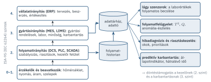
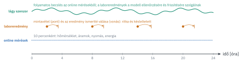
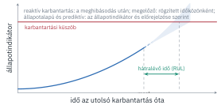

# Ipari folyamatanalitika {#sec-folyamat}

```{python}
#| include: false
import numpy as np
import pandas as pd
import matplotlib.pyplot as plt
import adatbanyaszat as ab
ab.set_style()
pd.set_option("display.max_columns", 12)
pd.set_option("display.width", 110)
import warnings
warnings.filterwarnings("ignore")
```

::: {.roadmap}
Az ipari folyamatok – vegyipari reaktorok, erőművek, gyártósorok – a legadatgazdagabb
rendszerek közé tartoznak: több ezer érzékelő méri őket másodperces vagy perces
felbontásban, évtizedekre visszamenőleg. A [-@sec-ugyfel]. fejezet üzleti alkalmazásai
után ez a fejezet a mérnöki szálat zárja le: a korábbi fejezetekben a Pannon üzem
adatain kipróbált módszereket – regresszió, osztályozás, anomália-észlelés, idősorok,
szövegbányászat – egy ipari folyamatanalitikai rendszer építőköveiként rendezi egységbe.
Sorra vesszük az ipari adatok sajátosságait, a lágy szenzorokat, a több működési állapotú
folyamatok felügyeletét, a hibadiagnózist, a riasztáskezelést és a prediktív
karbantartást, végül a modellek üzemeltetésének kérdéseit.

**A fejezet végére az olvasó** képes lesz lágy szenzort tervezni és értékelni, és a
maradékát diagnosztikai célra felhasználni; megítélni, mikor érdemes működési
állapotonként külön felügyeleti modellt építeni; a riasztási rendszert a szabványos
mutatókkal értékelni; adatalapú állapotindikátort készíteni és a hátralévő időt
becsülni; és átlátni, milyen feltételek kellenek az adatalapú modellek tartós ipari
üzemeltetéséhez.
:::

## Az ipari adatok sajátosságai {#sec-ipari-adatok}

Az ipari adatok a vállalati információs rendszerek hierarchiájának különböző szintjein
keletkeznek ([-@fig-architektura]. ábra). Az ISA-95 (IEC 62264) modell [@iec62264] az
érzékelők és beavatkozók szintjétől a folyamatirányításon (DCS, PLC, SCADA) és a
gyártásirányításon (MES, laborinformációs rendszer) át a vállalatirányításig (ERP)
írja le a szinteket. Az adatelemzés számára a legfontosabb forrás a **folyamat-historian**,
amely a mért jeleket időbélyeggel, tömörítve tárolja, kiegészítve a laboreredményekkel, a
riasztási és eseménynaplókkal, a karbantartási jegyekkel és a termelési tervvel.

{#fig-architektura width=100%}

Az ipari adatokat néhány jellegzetesség különbözteti meg az üzleti adatoktól
[@qin2014; @ge2013]:

- **Dinamika és autokorreláció**: a jelek folytonos fizikai folyamatokat követnek,
  holtidőkkel és tehetetlenséggel; a minták nem függetlenek ([-@sec-idosor]. fejezet).
- **Eltérő mintavételezés**: az online mérések percenként, a laboreredmények néhány
  óránként és késleltetve állnak rendelkezésre.
- **Visszacsatolt szabályozás**: a szabályozók elfedik a zavarokat – a szabályozott
  változó az alapjelen marad, a zavar a beavatkozó jelben vagy más változókban
  jelenik meg. Ezért láttuk a szenzor-drift esetén, hogy a hibás mérés maga alig tér el.
- **Több működési állapot**: termékváltások, terhelésváltozások, indítások és leállások
  más-más összefüggéseket hoznak létre.
- **Lassú változások**: a berendezések elhasználódása, a lerakódás, a katalizátor
  öregedése és az évszakok miatt a „normál” működés is változik.
- **Kevés címkézett hiba**: a hibák ritkák, sokfélék, és a hibamentes üzem adatai
  dominálnak ([-@sec-anomalia]. fejezet).

Ezek a sajátosságok magyarázzák, miért értékes az ipari elemzésben a folyamatismeret: a
fizikai összefüggésekre épülő jellemzők és szürkedobozos modellek a korábbi fejezetekben
rendre jobb eredményt adtak, mint a pusztán adatvezérelt megközelítések. A **digitális
iker** [@tao2019] fogalma ennek a gondolatnak a kiteljesedése: a fizikai rendszer
folyamatosan frissülő, adatokkal kalibrált modellje, amely felügyeletre, előrejelzésre és
optimalizálásra egyaránt használható.

## Lágy szenzorok {#sec-lagy-szenzor}

A **lágy szenzor** (soft sensor, inferenciális szenzor) olyan modell, amely egy nehezen,
drágán, ritkán vagy késleltetve mérhető változót – tipikusan egy laborban meghatározott
minőségi jellemzőt – a folyamatosan mért változókból becsül
[@fortuna2007; @kadlec2009]. Alkalmazásai: a laborértékek közötti időszakok kitöltése
(és így a gyorsabb minőségszabályozás), a fizikai műszer ellenőrzése vagy kiváltása, és a
„mi lenne, ha” elemzések ([-@fig-lagyszenzor]. ábra).

{#fig-lagyszenzor width=100%}

A lágy szenzorok modellje lehet első elvekre épülő (fizikai), adatvezérelt vagy a
kettőt ötvöző szürkedobozos modell ([-@sec-regresszio]. fejezet). Az adatvezérelt modellek
közül a vegyiparban a legelterjedtebb a **részleges legkisebb négyzetek** (partial least
squares, PLS) regresszió [@wold2001]. A PLS a PCA-hoz hasonlóan kevés látens változóval
írja le a sok, egymással erősen korreláló bemenetet, de a látens irányokat nem a bemenetek
varianciája, hanem a kimenettel vett kovariancia maximalizálásával választja:

$$
\mathbf{w}_1 = \arg\max_{\lVert\mathbf{w}\rVert = 1}\operatorname{cov}(\mathbf{X}\mathbf{w},\, \mathbf{y})^2 ,
$$ {#eq-pls}

majd a bemenetekből és a kimenetből eltávolítja az első látens változó által magyarázott
részt, és a további irányokat ugyanígy határozza meg. A látens változók számát
keresztvalidációval választjuk. A PLS kezeli a kollinearitást (mint a ridge-regresszió),
és látens változói a folyamatfelügyeletben is értelmezhetők.

A lágy szenzor fejlesztésénél a modell *karbantartása* legalább annyira fontos, mint a
kezdeti pontosság [@kadlec2009]. A folyamat lassú változásai (lerakódás, katalizátor-öregedés,
új alapanyag) miatt a modell pontossága romlik, ezért a modellt rendszeresen frissíteni
kell – mozgó ablakkal, rekurzív becsléssel vagy az új laboreredményekhez igazított
torzításkorrekcióval. A laboreredmény és a becslés közötti eltérés közben értékes
diagnosztikai jel: ha hirtelen megnő, az a modell érvényességének elvesztésére vagy egy
mérési hibára utal.

## Több működési állapotú folyamatok felügyelete {#sec-allapotfuggo}

A [-@sec-anomalia]. fejezet PCA-alapú felügyelete egyetlen, időben állandó „normál”
működést feltételez. A több termékkel, terhelési szinttel vagy évszakfüggő
körülményekkel működő folyamatoknál ez a feltevés sérül. A lehetséges stratégiák
[@ge2013]: (1) egyetlen globális modell, amely a működési állapotok közötti különbségeket is
„normálisnak” tekinti – ez egyszerű, de csökkenti az érzékenységet; (2) állapotonként
külön (lokális) modell, az állapotot a termelési tervből vagy klaszterezéssel (például a
[-@sec-csoportositas]. fejezet Gauss-keverék modelljével) azonosítva; (3) állapotonkénti
központosítás és skálázás egy közös modell előtt; (4) adaptív modellek, amelyek a lassú
változásokat rekurzív frissítéssel követik [@li2000]. A lokális modellek elvben
érzékenyebbek, de mindegyik állapothoz elegendő és reprezentatív normál adat kell – ha egy
állapotot csak egy évszakban figyeltünk meg, a modell a másik évszakban téves riasztásokat ad.

## Hibadiagnózis {#sec-hibadiagnozis}

Az anomália-észlelés azt mondja meg, *hogy* baj van; a **hibadiagnózis** azt, *mi* a baj
és *hol*. @venkatasubramanian2003 a módszereket három csoportba sorolja: kvantitatív
modellalapú (a mérések és egy fizikai modell közötti maradékok elemzése, analitikus
redundancia), kvalitatív modellalapú (ok-okozati gráfok, hibafák, szakértői rendszerek)
és folyamattörténeti (adatvezérelt) módszerek. A könyvben mindhárom típusra láttunk
példát: a nyomásmaradék a [-@sec-osztalyozas]. fejezetben analitikus redundancia volt, a
riasztási sorozatok a [-@sec-asszociacio]. fejezetben az ok-okozati láncok feltárását
segítették, a felügyelt osztályozó és a hozzájárulási ábra pedig adatvezérelt diagnózist
adott.

A gyakorlatban a diagnózis több információforrás összevetése: az adatalapú felügyelet
riasztása és hozzájárulási ábrája, a hagyományos riasztások sorrendje, a kezelők
naplóbejegyzései ([-@sec-szoveg]. fejezet) és a karbantartási előzmények együtt adnak
teljes képet. Az adatbányászat itt nem a szakértőt helyettesíti, hanem a figyelmét a
lényeges jelekre irányítja.

## Riasztáskezelés {#sec-riasztaskezeles}

A folyamatirányító rendszerek riasztásai a kezelő elsődleges információforrásai a
rendellenes helyzetekről. A rosszul tervezett riasztási rendszer azonban több kárt
okozhat, mint hasznot: a túl sok, fölösleges, ismétlődő riasztás elvonja a figyelmet, és
egy üzemzavar során a „riasztásáradat” a kezelőt cselekvésképtelenné teheti
[@wang2016]. A riasztáskezelés szabványai – az ANSI/ISA-18.2 [@isa2016] és az EEMUA 191
[@eemua2013] – a riasztási rendszer teljes életciklusát (filozófia, azonosítás,
racionalizálás, tervezés, bevezetés, üzemeltetés, monitorozás, felülvizsgálat)
szabályozzák, és mérhető teljesítménymutatókat adnak. Az EEMUA 191 szerint egy kezelőre
átlagosan legfeljebb néhány riasztás jusson óránként (10 percenként egy már nehezen
kezelhető), 10 perc alatt 10-nél több riasztás már áradatnak számít, és a riasztások nagy
részét néhány „rossz szereplő” okozza, amelyeket elsőként kell felülvizsgálni.

Az adatbányászat a riasztáskezelés több lépését támogatja: a gyakori sorozatminták és
asszociációs szabályok feltárják az együtt vagy egymás után jelentkező, redundáns
riasztásokat, amelyek csoportosíthatók vagy elnyomhatók [@dorgo2018]; a fecsegő
(chattering) riasztások – rövid időn belül sokszor ismétlődő be- és kikapcsolások –
egyszerű statisztikákkal azonosíthatók; és az adatalapú felügyelet összevethető a
hagyományos, határérték-alapú riasztásokkal.

## Prediktív karbantartás {#sec-prediktiv-karbantartas}

A karbantartási stratégiák fejlődése a **reaktív** (a meghibásodás utáni javítás) és a
**megelőző** (rögzített időközönkénti) karbantartástól az **állapotalapú** és a
**prediktív** karbantartás felé halad [@jardine2006]. Ez utóbbiak a berendezés tényleges
állapotát egy mérésekből számolt **állapotindikátorral** (health indicator) követik, és a
beavatkozást akkor ütemezik, amikor az indikátor – vagy az előrejelzése – egy küszöböt
elér ([-@fig-karbantartas]. ábra). A **hátralévő hasznos élettartam** (remaining useful
life, RUL) becslése a prognosztika központi feladata [@lei2018]; a becslés mindig
bizonytalan, ezért jó gyakorlat egy valószínűségi intervallumot is megadni.

{#fig-karbantartas width=80%}

Az állapotindikátor lehet közvetlen fizikai mennyiség (rezgésszint, hőmérséklet), egy
modell maradéka (a tényleges és a „hibátlan állapotra” jellemző viselkedés eltérése) vagy
egy többváltozós statisztika (például a $Q$). A Pannon üzemben a hűtőköpeny lerakódása
a tipikus elhasználódási folyamat: a tisztítás után a hőátadás romlik, a hűtési igény nő, és
nyáron a hűtés telítődése minőségi gondokat okoz. Az állapotindikátort a
[-@sec-neuralis]. fejezet hűtési igény modelljének mintájára építjük meg.

## Gyakorlat: a Pannon üzem folyamatanalitikai rendszere {#sec-folyamat-gyakorlat}

### Lágy szenzor a termékkoncentrációra

::: {.eset-mernoki}
A termék koncentrációját a labor négyóránként méri, az eredmény egy–két óra
múlva érkezik. Építsünk lágy szenzort, amely a koncentrációt a 10 perces online
mérésekből folyamatosan becsli! Négy modellt hasonlítunk össze: a keresztvalidációval
hangolt PLS-t, a ridge-regressziót, a véletlen erdőt és a [-@sec-regresszio]. fejezet
szürkedobozos modelljét, amely a betáplált koncentrációt az Arrhenius-kinetikából számolt
konverzióval szorozza.
:::

```{python}
from sklearn.cross_decomposition import PLSRegression
from sklearn.linear_model import RidgeCV
from sklearn.ensemble import RandomForestRegressor
from sklearn.pipeline import make_pipeline
from sklearn.preprocessing import StandardScaler
from sklearn.model_selection import GridSearchCV, TimeSeriesSplit
from sklearn.metrics import r2_score, mean_absolute_error
from adatbanyaszat.plant import conversion

P = ab.load_plant()
q = ab.quality_table()
q["allapot"] = P.truth["fault"].reindex(q.ido.dt.floor("10min")).to_numpy()
bemenet = ["T_kornyezet", "F_betap", "c_betap", "T_betap", "T_reaktor", "T_alapjel", "F_hutoviz",
           "T_hutoviz", "P_reaktor", "P_kevero", "E_fogyasztas"]
tanito = (q.ido < "2025-07-01").to_numpy()
y = q.c_termek.to_numpy()
modellek = {
    "PLS": GridSearchCV(make_pipeline(StandardScaler(), PLSRegression()),
                        {"plsregression__n_components": [1, 2, 3, 4, 5, 6, 8]}, cv=TimeSeriesSplit(5)),
    "ridge": make_pipeline(StandardScaler(), RidgeCV(alphas=np.logspace(-3, 3, 13))),
    "véletlen erdő": RandomForestRegressor(n_estimators=300, min_samples_leaf=3, n_jobs=-1, random_state=0),
}
becsles = {}
for nev, m in modellek.items():
    m.fit(q.loc[tanito, bemenet], y[tanito])
    becsles[nev] = np.ravel(m.predict(q[bemenet]))
becsles["szürkedobozos"] = (q.c_betap * conversion(q.T_reaktor, q.F_betap)).to_numpy()
print("a PLS látens változóinak száma:", modellek["PLS"].best_params_["plsregression__n_components"])
teszt = ~tanito
tabla = {}
for nev, p in becsles.items():
    hiba = np.abs(y - p)
    tabla[nev] = {"R² (2. félév)": r2_score(y[teszt], p[teszt]), "MAE (2. félév)": hiba[teszt].mean()}
    for allapot in ["normál", "szenzor_drift", "betap_zavar", "szelep_akadas", "hutoviz_kieses"]:
        tabla[nev][f"MAE: {allapot}"] = hiba[teszt & (q.allapot == allapot).to_numpy()].mean()
pd.DataFrame(tabla).T.round(4)
```

::: {.eset-mernoki}
Mind a négy modell pontos (R² ≈ 0,98), a fizikai ismeretre épülő szürkedobozos modell
tanítás nélkül is a legjobbak között van – ez az ismert kinetika értéke. A véletlen erdő a
legkevésbé pontos, főként a betáplálási zavar idején, amikor a betáplált koncentráció a
tanítóadatok tartományán kívülre esik. A legérdekesebb az utolsó oszlopok mintázata: a
szenzor-drift idején *minden* modell hibája többszörösére nő. A lágy szenzor a hibás
hőmérséklet-mérésből számol, ezért a becslése eltér a laboreredménytől – vagyis a lágy
szenzor maradéka a műszerhiba érzékeny jelzője.
:::

```{python}
#| label: fig-lagyszenzor-drift
#| fig-cap: "A PLS lágy szenzor folyamatos becslése és a laboreredmények a második szenzor-drift idején (szürke sáv). A drift előrehaladtával a becslés egyre jobban eltér a laboreredményektől."
#| fig-width: 7.2
#| fig-height: 2.8
m10 = ab.plant_clean()
m10 = m10[~m10.leallas].set_index("ido")
ablak = m10["2025-10-24":"2025-11-05"]
folyamatos = np.ravel(modellek["PLS"].predict(ablak[bemenet].rolling("60min").mean()))
lab = q[(q.ido >= "2025-10-24") & (q.ido < "2025-11-06")]
drift = P.truth["faults"].query("hiba == 'szenzor_drift' and kezdet > '2025-10-01'").iloc[0]
fig, ax = plt.subplots()
ax.axvspan(drift.kezdet, drift.veg, color="#6B7785", alpha=0.18, lw=0)
ax.plot(ablak.index, folyamatos, color=ab.PALETTE[0], lw=0.8, label="lágy szenzor (PLS)")
ax.scatter(lab.ido, lab.c_termek, color=ab.PALETTE[1], s=16, zorder=3, label="laboreredmény")
ax.set_ylabel("termékkoncentráció [mol/L]"); ax.legend(fontsize=8)
fig.autofmt_xdate()
fig.tight_layout()
```

### Globális vagy állapotonkénti felügyeleti modell?

::: {.eset-mernoki}
A Pannon üzem három terméket gyárt, eltérő alapjellel és betáplálással. Érdemes-e
termékenként külön PCA-modellt építeni? Hasonlítsuk össze a [-@sec-anomalia]. fejezet
globális modelljét (empirikus határokkal, háromminás perzisztenciával) a termékenkénti
modellekkel és a termékenként központosított, közös modellel!
:::

```{python}
from sklearn.decomposition import PCA

m = ab.plant_clean()
m = m[~m.leallas].copy()
m["hiba"] = P.truth["fault"].reindex(m.ido).to_numpy()
mi = m.set_index("ido")
jelek = ["T_reaktor", "F_hutoviz", "T_hutoviz", "P_reaktor", "F_betap", "c_betap", "T_betap",
         "P_kevero", "E_fogyasztas", "T_kornyezet"]
X = mi[jelek].copy()
X["F_hut_szoras_1h"] = mi.F_hutoviz.rolling("60min").std()
X = X.dropna()
allapot = mi.loc[X.index, "hiba"].to_numpy()
termek = mi.loc[X.index, "termek"].to_numpy()
tr = X.index < "2025-07-01"
nt = tr & (allapot == "normál")

def pca_riasztas(X_tanito, X_minden, q):
    """PCA-felügyelet empirikus (99,5%-os) T² és Q határokkal; logikai riasztásvektort ad."""
    sk = StandardScaler().fit(X_tanito)
    Zt, Z = sk.transform(X_tanito), sk.transform(X_minden)
    pca = PCA(n_components=q).fit(Zt)
    def stat(A):
        T = pca.transform(A)
        return (T ** 2 / pca.explained_variance_).sum(axis=1), ((A - pca.inverse_transform(T)) ** 2).sum(axis=1)
    T2t, Qt = stat(Zt); T2, Q = stat(Z)
    return (T2 > np.quantile(T2t, 0.995)) | (Q > np.quantile(Qt, 0.995))

valtozatok = {"globális modell": pca_riasztas(X[nt], X, 5)}
lokalis = np.zeros(len(X), bool)
kozpontositott = X.copy()
for t in ["A", "B", "C"]:
    s = termek == t
    lokalis[s] = pca_riasztas(X[nt & s], X[s], 4)
    kozpontositott[s] = (X[s] - X[nt & s].mean()) / X[nt & s].std()
valtozatok["termékenkénti modellek"] = lokalis
valtozatok["termékenként központosított közös modell"] = pca_riasztas(kozpontositott[nt], kozpontositott, 5)

eredm = {}
for nev, r in valtozatok.items():
    r3 = pd.Series(r, index=X.index).rolling(3).sum().eq(3).to_numpy()
    eredm[nev] = {"téves riasztás (2. félév)": r3[~tr & (allapot == "normál")].mean()}
    eredm[nev].update({f: r3[~tr & (allapot == f)].mean() for f in ["szenzor_drift", "betap_zavar", "szelep_akadas", "hutoviz_kieses"]})
pd.DataFrame(eredm).T.round(3)
```

```{python}
pd.crosstab(pd.Series(termek, name="termék"), pd.Series(np.where(tr, "1. félév", "2. félév"), name="időszak"))
```

::: {.eset-mernoki}
Az eredmény elsőre meglepő: a termékenkénti modellek több téves riasztást adnak, és a
betáplálási zavart és a hűtővíz-kiesést is rosszabbul ismerik fel, mint a globális modell.
A magyarázat a tanítóadatok lefedettségében rejlik. A termékek az év során eltérő
arányban és eltérő évszakokban futottak, így egy termékenkénti modell tanítóadatai csak az
év egy részének körülményeit (környezeti és hűtővíz-hőmérséklet, lerakódás) fedik le; a
második félév más körülményeit a modell rendellenesnek látja, a határai pedig a kevesebb
adat miatt bizonytalanabbak. A globális modell az összes termék összes körülményét látta,
és empirikus határai a termékek közötti különbségeket is magukba foglalják. A tanulság
nem az, hogy a lokális modellek rosszak, hanem az, hogy az állapotfüggő felügyelet csak
akkor javít, ha az állapotok összefüggési szerkezete valóban eltér, és mindegyikről
elegendő, reprezentatív normál adat áll rendelkezésre; különben a lassú változásokat
követő adaptív modellek vagy a globális modell a jobb választás.
:::

### A riasztási rendszer értékelése

```{python}
riaszt = P.alarms.copy()
tiz_perc = riaszt.groupby(riaszt.ido.dt.floor("10min")).size()
oras = riaszt.groupby(riaszt.ido.dt.floor("1h")).size()
riaszt = riaszt.sort_values("ido")
riaszt["elozo"] = riaszt.groupby("riasztas").ido.diff()
pd.Series({
    "riasztások száma (1 év)": len(riaszt),
    "átlagos riasztásszám / nap": round(len(riaszt) / 365, 2),
    "legtöbb riasztás 10 perc alatt": int(tiz_perc.max()),
    "áradatos 10 perces ablakok (≥ 10 riasztás)": int((tiz_perc >= 10).sum()),
    "legtöbb riasztás egy óra alatt": int(oras.max()),
    "30 percen belül ismétlődő riasztások aránya": round((riaszt.elozo < pd.Timedelta("30min")).mean(), 3),
}, name="érték").to_frame()
```

A riasztási terhelés messze az EEMUA 191 ajánlásai alatt marad – a szimulált üzem riasztási
rendszere „racionalizált”. Fontosabb kérdés, hogy a riasztások mennyire relevánsak: hányad
részük kapcsolódik valódi üzemzavarhoz, és melyik zavart jelzik?

```{python}
#| label: tbl-riasztas-relevancia
#| tbl-cap: "A riasztástípusok gyakorisága és hibaeseményekhez kötődő aránya (a riasztás egy hibaesemény alatt vagy azt követő két órán belül jelentkezett)."
esemenyek = P.truth["faults"]
def esemenyhez(t):
    talalt = esemenyek[(esemenyek.kezdet <= t) & (esemenyek.veg + pd.Timedelta("2h") >= t)]
    return talalt.hiba.iloc[0] if len(talalt) else "nincs (normál üzem)"
riaszt["esemeny"] = riaszt.ido.apply(esemenyhez)
osszesito = pd.crosstab(riaszt.riasztas, riaszt.esemeny)
osszesito.insert(0, "összesen", osszesito.sum(axis=1))
osszesito["eseményhez kötődő arány"] = (1 - osszesito["nincs (normál üzem)"] / osszesito["összesen"]).round(2)
osszesito.sort_values("összesen", ascending=False)
```

```{python}
def elso_riasztas(e):
    r = riaszt[(riaszt.ido >= e.kezdet) & (riaszt.ido <= e.veg)]
    return pd.Series({"első riasztás": r.riasztas.iloc[0] if len(r) else "—",
                      "késés [óra]": round((r.ido.iloc[0] - e.kezdet).total_seconds() / 3600, 1) if len(r) else np.nan})
esemenyek.join(esemenyek.apply(elso_riasztas, axis=1))[["hiba", "kezdet", "első riasztás", "késés [óra]"]] \
    .query("kezdet >= '2025-07-01'").reset_index(drop=True)
```

::: {.eset-mernoki}
A leggyakoribb riasztás, a minőségi eltérés (MINOSEG_ELTERES), nagyrészt normál üzemben
jelentkezik: ezek a hűtés nyári telítődéséből és a termék célértéke körüli ingadozásból
eredő, utólagos jelzések, amelyek a laboreredmény késése miatt órákkal az ok után
érkeznek. A hűtővíz felmelegedését, a betáplálási zavart és a szelepakadást a
határérték-alapú riasztások gyorsan és a hiba jellegének megfelelő üzenettel jelzik. A
szenzor-drift idején fellépő első riasztások (a hűtés telítődése, a hűtővízáram
ingadozása) viszont egyidejű, más jelenségekhez kötődnek, és a hiba okára egyáltalán nem
utalnak – a hibás hőmérséklet-mérés a határértékek szempontjából „normálisnak” látszik.
Az adatalapú felügyelet ([-@tbl-eszleles-keses]. táblázat) a hirtelen hibákat hasonlóan
gyorsan észlelte, a driftet pedig 10, illetve 50 óra után, a sérült összefüggések
alapján. A két rendszer tehát kiegészíti egymást: a határérték-alapú riasztások egyszerűek
és jól érthetők, az adatalapú felügyelet a változók közötti összefüggések sérülését is
észreveszi.
:::

### Állapotindikátor és hátralévő idő a hűtőköpeny lerakódására

::: {.eset-mernoki}
A hűtőköpenyt jelenleg nagyjából hét hetente tisztítják. Készítsünk állapotindikátort,
amely a lerakódás mértékét az üzemi adatokból becsli, és vizsgáljuk meg, mennyire
jelezhető előre, mikor éri el egy karbantartási küszöböt! Az indikátor a hűtési igény
relatív többlete a *tiszta* állapotra jellemző igényhez képest: a hűtési igény modelljét
(másodfokú polinomos ridge-regresszió) csak a tisztítások utáni első hét nap adatain
tanítjuk, így a modell a tiszta hűtőköpeny viselkedését írja le.
:::

```{python}
from sklearn.preprocessing import PolynomialFeatures
m = ab.plant_clean()
utolso = m.ido.where(m.leallas).ffill()
m["nap_tisztitas_ota"] = ((m.ido - utolso).dt.total_seconds() / 86400).fillna((m.ido - m.ido.iloc[0]).dt.total_seconds() / 86400)
m = m[~m.leallas].copy()
m["hiba"] = P.truth["fault"].reindex(m.ido).to_numpy()
be = ["T_reaktor", "T_alapjel", "T_hutoviz", "F_betap", "c_betap", "T_betap", "T_kornyezet"]
h = (m[m.hiba == "normál"].set_index("ido")[be + ["F_hutoviz", "nap_tisztitas_ota"]]
     .resample("1h").mean().dropna())
tiszta = h.nap_tisztitas_ota < 7
modell_tiszta = make_pipeline(StandardScaler(), PolynomialFeatures(2), StandardScaler(),
                              RidgeCV(alphas=np.logspace(-3, 3, 13))).fit(h.loc[tiszta, be], h.F_hutoviz[tiszta])
h["HI"] = h.F_hutoviz / modell_tiszta.predict(h[be]) - 1          # relatív többletigény
napi = h[["HI", "nap_tisztitas_ota"]].resample("1D").mean().dropna()
napi["lerakodas"] = P.truth["fouling"].resample("1D").mean().reindex(napi.index)   # csak az ellenőrzéshez
print(f"az állapotindikátor és a (szimulált, a valóságban nem mérhető) lerakódás korrelációja: "
      f"{napi.HI.corr(napi.lerakodas):.3f}")
```

```{python}
#| label: fig-allapotindikator
#| fig-cap: "A hűtőköpeny állapotindikátora (a hűtési igény relatív többlete a tiszta állapothoz képest, napi átlag) az év során. A függőleges vonalak a tisztítások, a szaggatott vízszintes vonal a 30%-os karbantartási küszöb."
#| fig-width: 7.2
#| fig-height: 2.8
fig, ax = plt.subplots()
ax.plot(napi.index, napi.HI, color=ab.PALETTE[0], lw=1.2)
for d in P.truth["cleanings"]:
    ax.axvline(d, color="#6B7785", lw=0.8, ls=":")
ax.axhline(0.30, color=ab.PALETTE[4], lw=1, ls="--")
ax.set_ylabel("állapotindikátor")
fig.tight_layout()
```

Az indikátor minden tisztítás után nulla közelébe esik, majd egyre gyorsulva nő – a
lerakódás rontja a hőátadást, és a szükséges hűtővízáram a hőátadási tényező csökkenésével
nemlineárisan nő. A hátralévő idő becsléséhez a korábbi ciklusokból egy közös
romlási görbét tanulunk ($\mathrm{HI}(t) \approx \beta_1t + \beta_2t^2$), és az aktuális
ciklus első húsz napjának adataiból egyetlen skálatényezővel igazítjuk az aktuális
ciklushoz; a becsült küszöbátlépés az igazított görbe és a küszöb metszéspontja.

```{python}
#| label: tbl-rul
#| tbl-cap: "A 30%-os küszöb átlépésének becsült és tényleges ideje ciklusonként (napokban a tisztítás óta), a ciklus 20. napján készített előrejelzés alapján."
kuszob, k = 0.30, 20
napi["ciklus"] = (napi.nap_tisztitas_ota.diff() < -1).cumsum()
ciklusok = [g.sort_values("nap_tisztitas_ota") for _, g in napi.groupby("ciklus") if len(g) >= 30]
sorok = []
for i in range(1, len(ciklusok)):
    elozmeny = pd.concat(ciklusok[:i])
    elozmeny = elozmeny[elozmeny.nap_tisztitas_ota <= 45]
    A = np.column_stack([elozmeny.nap_tisztitas_ota, elozmeny.nap_tisztitas_ota ** 2])
    beta, *_ = np.linalg.lstsq(A, elozmeny.HI.to_numpy(), rcond=None)
    g = ciklusok[i]
    tenyleges = g.nap_tisztitas_ota[g.HI.rolling(3, center=True).mean() >= kuszob].min()
    s = g[(g.nap_tisztitas_ota >= 2) & (g.nap_tisztitas_ota <= k)]
    alak = beta[0] * s.nap_tisztitas_ota + beta[1] * s.nap_tisztitas_ota ** 2
    skala = float(alak @ s.HI / (alak @ alak))
    t = np.linspace(0, 120, 4801)
    becsult = t[np.argmax(skala * (beta[0] * t + beta[1] * t ** 2) >= kuszob)]
    sorok.append({"ciklus kezdete": g.index[0].date(), "skálatényező": round(skala, 2),
                  "becsült átlépés [nap]": round(becsult, 1), "tényleges átlépés [nap]": round(tenyleges, 1),
                  "hiba [nap]": round(becsult - tenyleges, 1)})
rul = pd.DataFrame(sorok)
print(f"átlagos abszolút hiba: {rul['hiba [nap]'].abs().mean():.1f} nap")
rul
```

::: {.eset-mernoki}
Az állapotindikátor jól követi a lerakódást, a hátralévő idő becslése azonban átlagosan
mintegy öt napos, egy ciklusban közel két hetes hibával terhelt; a becslés többnyire
korai, vagyis konzervatív. A hibák fő forrása, hogy az
indikátor nemcsak a lerakódástól függ: a nyári ciklusokban a melegebb hűtővíz és a
nagyobb terhelés gyorsabb növekedést okoz (a skálatényező is nagyobb), és ezt a korábbi
ciklusokból tanult görbe nem tudja előre. A prediktív karbantartás gyakorlatában ezért a
becslést valószínűségi intervallummal adják meg, a modellt a körülmények (évszak, terhelés)
előrejelzésével bővítik, és a döntést nem egyetlen pontbecslésre, hanem a kockázat és a
karbantartási költség mérlegelésére alapozzák. Már a puszta indikátor is jelentős
előrelépés a rögzített időközönkénti tisztításhoz képest: megmutatja, mikor valóban
szükséges a beavatkozás, és mikor halasztható.
:::

## A modellek üzemeltetése {#sec-uzemeltetes}

Egy adatalapú modell értéke csak akkor realizálódik, ha tartósan, megbízhatóan működik az
üzemi környezetben. Ez szoftvermérnöki és szervezeti feladat is: a gépi tanulási
rendszerek „rejtett technikai adóssága” – az adatfüggőségek, a visszacsatolási hurkok, a
konfigurációs bonyolultság – sokszor nagyobb, mint maga a modell [@sculley2015]. A
CRISP-ML(Q) folyamatmodell [@studer2021] ezért a [-@sec-bevezetes]. fejezet CRISP-DM
modelljét a minőségbiztosítással és a modellek üzemeltetésével (monitorozás, karbantartás)
egészíti ki. Az ipari alkalmazások legfontosabb kérdései:

- **Adatminőség és -elérés**: a historian adatainak tömörítése, a hiányzó és hibás
  mérések kezelése valós időben ([-@sec-elokeszites]. fejezet).
- **A modell érvényességének felügyelete**: a bemenetek eloszlásának és a modell hibájának
  folyamatos követése, a koncepciósodródás (concept drift) észlelése [@gama2014], és a
  modell újratanításának szabályozott folyamata.
- **Az ember szerepe**: a kezelőnek értenie kell, miért riaszt vagy mit javasol a rendszer;
  az értelmezhető modellek és a hozzájárulási ábrák ezt szolgálják. A döntés felelőssége az
  emberé marad.
- **Biztonság és szabályozás**: a folyamatirányításba beavatkozó modellekre a
  funkcionális biztonsági követelmények, az MI-rendszerekre az európai MI-rendelet
  [@aiact2024] előírásai vonatkoznak.





## Összefoglalás {#sec-folyamat-osszefoglalas}

- Az ipari adatok dinamikusak, eltérő mintavételezésűek, szabályozott és több működési
  állapotú folyamatokból származnak; a folyamatismeret ezért az elemzés kulcsa.
- A lágy szenzor a ritkán mért minőségi jellemzőket becsli az online mérésekből; a
  laboreredmény és a becslés eltérése a modell érvényességét és a műszerhibákat is jelzi.
- A több működési állapotú folyamatok felügyeletében a lokális modellek csak elegendő és
  reprezentatív állapotonkénti adat mellett előnyösek.
- A hibadiagnózis modellalapú, tudásalapú és adatvezérelt eszközöket és több
  információforrást kombinál.
- A riasztási rendszert a szabványos mutatókkal (riasztásszám, áradatok, fecsegés,
  relevancia) kell értékelni; az adatbányászat a redundáns és fölösleges riasztások
  azonosítását segíti.
- A prediktív karbantartás állapotindikátorra és a hátralévő idő – bizonytalanságot is
  számszerűsítő – előrejelzésére épül.
- Az adatalapú modellek ipari értéke az üzemeltetésen múlik: adatminőség, monitorozás,
  újratanítás, átláthatóság és emberi felelősség.

## Ellenőrző kérdések {.unnumbered}

1. Miben különböznek az ipari folyamatadatok a webáruház tranzakciós adataitól?
2. Miért nehéz a szabályozott változó mérési hibáját közvetlenül észlelni?
3. Miben különbözik a PLS a főkomponens-regressziótól?
4. Miért lehet a lágy szenzor maradéka diagnosztikai jel?
5. Mikor érdemes működési állapotonként külön felügyeleti modellt építeni?
6. Milyen mutatókkal értékelhető egy riasztási rendszer az EEMUA 191 szerint?
7. Miért kell a hátralévő hasznos élettartamot intervallummal megadni?

## Feladatok {.unnumbered}

1. **Adaptív lágy szenzor.** Frissítse a PLS lágy szenzort mozgó ablakkal (az utolsó 60
   nap laboreredményeivel, hetente)! Javul-e a második félév pontossága? Hogyan hat a
   frissítés a szenzor-drift észlelhetőségére?
2. **Lágy szenzor mint detektor.** Készítsen EWMA-kártyát a lágy szenzor maradékára (a
   laboreredmény és a becslés különbségére)! Mennyi idő után jelez a szenzor-drift során?
3. **Állapotazonosítás klaszterezéssel.** Azonosítsa a működési állapotokat a termékazonosító
   nélkül, Gauss-keverék modellel ([-@sec-csoportositas]. fejezet), és építsen
   állapotonkénti felügyeleti modelleket! Hogyan viszonyul az eredmény a termékenkénti
   modellekhez?
4. **Riasztási sorozatok.** Keressen gyakori riasztási sorozatokat a hibaesemények körül
   ([-@sec-asszociacio]. fejezet), és javasoljon egy riasztáscsoportosítást, amely a
   redundáns riasztásokat egyetlen összefoglaló jelzéssé vonja össze!
5. **Valószínűségi RUL.** A korábbi ciklusok skálatényezőinek eloszlása alapján adjon 80%-os
   előrejelzési intervallumot a küszöbátlépés idejére! Hány ciklusban esik a tényleges érték
   az intervallumba?

## További olvasmányok {.unnumbered}

A lágy szenzorokról @fortuna2007 könyve és @kadlec2009 áttekintése, a PLS-ről @wold2001
ajánlott. Az adatalapú folyamatfelügyelet és -diagnosztika áttekintései @venkatasubramanian2003,
@qin2012 és @ge2013; a folyamatadatok elemzésének kihívásairól @qin2014 ír. A riasztáskezelésről
@wang2016 áttekintése, valamint az ANSI/ISA-18.2 [@isa2016] és az EEMUA 191 [@eemua2013]
szabvány, a prediktív karbantartásról @jardine2006 és @lei2018 ajánlott.
