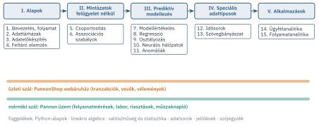

# Előszó {.unnumbered}

Az adatbányászat – az adatokban rejlő, korábban ismeretlen, hasznos és érthető
összefüggések feltárása – az elmúlt két évtizedben a vállalatirányítás, a mérnöki
gyakorlat és a tudományos kutatás mindennapi eszközévé vált. A könyv első kiadása 2006-ban
jelent meg [@abonyi2006], amikor a módszerek még elsősorban speciális szoftvercsomagokban
voltak elérhetők, és a „big data”, a mélytanulás vagy az ipar 4.0 fogalma még nem létezett.
Azóta a terület alapjaiban átalakult: a nyílt forrású Python-ökoszisztéma vált a közös
nyelvvé, megjelentek az együttes modellek és a mély neurális hálózatok, és az
adatvédelmi, etikai szempontok a módszertan részévé váltak. Ez a második kiadás ezért nem
egyszerű frissítés: a könyvet teljesen átírtam, a régi fejezeteket korszerűsítettem és
kibővítettem, és új fejezetekkel egészítettem ki – megőrizve az első kiadás gyakorlatias
szemléletét és két alkalmazási szálát, az üzleti és a mérnöki adatbányászatot.

## Kinek szól a könyv? {.unnumbered}

A könyv elsősorban mérnök-, gazdaságinformatikus- és adattudományi alapszakos (BSc)
hallgatóknak készült, de haszonnal forgathatják a mesterszakos hallgatók és a gyakorló
szakemberek is, akik az adatbányászat módszereit rendszerezett formában, a gyakorlati
alkalmazáshoz szükséges mélységben szeretnék megismerni. Előismeretként középiskolai
matematikát és az egyetemi analízis alapjait feltételezem; a szükséges lineáris algebrai,
valószínűségszámítási és programozási ismereteket a függelékek részletesen összefoglalják.

## A könyv felépítése {.unnumbered}

A tizenöt fejezet öt részre tagolódik ([-@fig-felepites]. ábra). Az **I. rész** az alapokat
teremti meg: az adatbányászati folyamatot, az adattárházakat, az adatok előkészítését és a
feltáró elemzést. A **II. rész** a felügyelet nélküli mintázatkeresés két nagy területét, a
csoportosítást és az asszociációs szabályokat tárgyalja. A **III. rész** a prediktív
modellezésé: a modellek értékelésétől a regresszión, az osztályozáson és a neurális
hálózatokon át az anomáliák észleléséig. A **IV. rész** két speciális adattípussal, az
idősorokkal és a szövegekkel foglalkozik, az **V. rész** pedig az ügyfélanalitika és az
ipari folyamatanalitika egységes keretébe illeszti a korábbi módszereket.

{#fig-felepites width=100%}

A fejezetek egymásra épülnek. A két **futó eset** – a PannonShop webáruház és a Pannon
üzem – adatai minden fejezetben visszatérnek, és a korábbi fejezetekben elvégzett
lépésekre (például az adattisztításra) építenek; így a módszerek nem elszigetelt
példákon, hanem egy-egy összefüggő elemzési történet részeként jelennek meg. A futó esetek
adatai szimuláltak, de valósághűek; előnyük, hogy a háttérigazság ismert, ezért minden
módszer eredménye pontosan ellenőrizhető (D. függelék).

## A fejezetek szerkezete {.unnumbered}

Minden fejezet egy rövid **útmutatóval** kezdődik, amely összefoglalja, mit és miért
tárgyalunk, és mit tud majd az olvasó a fejezet végére. Az elméleti részeket **kézi
számolási példák** kísérik, amelyekben egy kis adatsoron lépésről lépésre végigkövethetők
az algoritmusok, és a fontosabb algoritmusok végén **összefoglaló keret** áll. A
**gyakorlati részekben** a módszereket a futó esetekre alkalmazzuk; az üzleti és a
mérnöki esettanulmányokat színes keretek jelölik. A fejezeteket összefoglalás,
ellenőrző kérdések, önálló feladatok és további olvasmányok zárják.

A könyv minden ábrája, táblázata és számszerű eredménye a könyv fordításakor lefuttatott
kódból származik, így a szöveg és az eredmények összhangja automatikusan biztosított. Ahol
egy módszer egy adott feladaton nem teljesít jól, azt nem hallgatjuk el: ezek a „negatív”
eredmények legalább annyira tanulságosak, mint a sikeresek.

## Interaktív anyagok {.unnumbered}

A webes változatban a fejezetekhez **böngészőben futó alkalmazások** tartoznak, amelyekkel a
módszerek viselkedése paraméterek változtatásával közvetlenül kipróbálható (például a
$k$-közép algoritmus lépései, a PCA forgatása, egy döntési fa építése vagy egy ROC-görbe
küszöbe). Minden fejezet kódja **Google Colab-jegyzetfüzetként** is elérhető, telepítés
nélkül futtatható és módosítható. A könyv teljes forrása – a szöveg, a kód, az ábrák és az
adatgenerátorok – nyilvános GitHub-tárolóban érhető el; a hibák bejelentését és a
javítási javaslatokat ott várom.

## Konvenciók {.unnumbered}

A szövegben a magyar helyesírás szerinti tizedesvesszőt használom, a programkódban és a
kódkimenetekben a Python szabályai szerinti tizedespontot. A szakkifejezések angol
megfelelőjét első előfordulásukkor zárójelben megadom, a teljes szójegyzék az F.
függelékben található; a jelölések összefoglalása az E. függelékben. A kódrészletek a
klasszikus, széles körben használt Python-csomagokra – NumPy, pandas, Matplotlib, SciPy,
statsmodels, `scikit-learn` – épülnek; a mélytanulási példák a PyTorch keretrendszert
használják.

## A tankönyvsorozat {.unnumbered}

A könyv a Pannon Egyetem nyílt hozzáférésű tankönyvsorozatának része. A sorozat kötetei –
köztük a *Rendszermérnökség* és a *Biztonságkritikus rendszerek* – egységes szerkezetet,
arculatot és technikai megoldást követnek: a Quarto-alapú forrásból kereshető webkönyv,
PDF és EPUB készül, a kiadásokat a Zenodo archiválja és DOI-azonosítóval látja el.

## Licenc és hivatkozás {.unnumbered}

A könyv szövege és ábrái a [Creative Commons Nevezd meg! – Ne add el! 4.0
Nemzetközi](https://creativecommons.org/licenses/by-nc/4.0/deed.hu) (CC BY-NC 4.0) licenc
alatt nem kereskedelmi célra szabadon felhasználhatók; kereskedelmi célú felhasználásukhoz
a szerző előzetes engedélye szükséges. A programkód az MIT licenc alatt áll. Hivatkozás:

> Abonyi János (2026): *Adatbányászat – a hatékonyság eszköze. Elmélet és gyakorlat
> Pythonban.* 2., teljesen átdolgozott kiadás. Pannon Egyetem, Veszprém.

A pontos, kiadásonkénti DOI-azonosító a könyv weboldalán és a tároló `CITATION.cff`
fájljában található.

## Köszönetnyilvánítás {.unnumbered}

Az első kiadás a Veszprémi Egyetem Folyamatmérnöki Tanszékén, az IKTA 00142/2002 számú
projekt és több OTKA-pályázat támogatásával készült. Köszönettel tartozom mindazoknak, akik
az első kiadás megírásában és lektorálásában részt vettek, különösen Árva Péternek, Németh
Sándornak, Vassányi Istvánnak, Feil Balázsnak, Balaskó Balázsnak, Pach Ferenc Péternek és
Madár Jánosnak, valamint az esettanulmányokat és a lektori munkát vállaló gyakorló
szakembereknek: Körmendi Györgynek, Cseh Zoltánnak, Halász Istvánnak, Robotka Zsoltnak,
Rovnyai Jánosnak és Fekete Zoltánnak. Gondolataik és tapasztalataik ebben a kötetben is
tovább élnek. A második kiadás kutatási hátterét a Nemzeti Kutatási, Fejlesztési és
Innovációs Hivatal OTKA 143482 számú projektje támogatta.

Veszprém, 2026

*Abonyi János*
